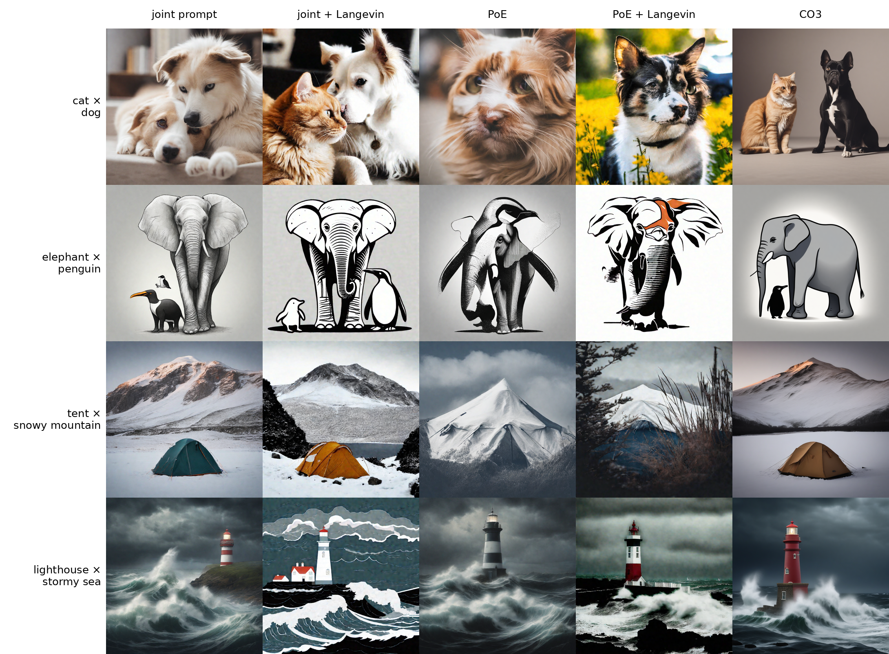

# Does a Langevin corrector fix the product?

The Langevin corrector beside the joint prompt, PoE and CO3 on Figure 5's four pairs, for reviewer PrzE's request for an MCMC corrector baseline. Its PoE + Langevin and CO3 tiles feed Figure 5 (slot R2). The plan is [PRZE-2](../../../plans/prove-the-langevin-corrector-for-the-six-column-figure.md), and the slot it feeds is R2 in [the layout sheet](../../../report/paper-review/layout-sheet.md).

## five_columns.png

**What it shows.** Rows are cat × dog, elephant × penguin, tent × snowy mountain and lighthouse × stormy sea at seed 10; columns are the joint prompt, joint + Langevin, PoE, PoE + Langevin (c = 3, k = 20 over all 50 levels) and CO3 at its published default. On the first three rows PoE fuses the two things, PoE + Langevin keeps one of them (one dog, one elephant, a mountain with no tent), and joint + Langevin and CO3 show both. The lighthouse row shows both things in every column. One seed, called by eye. `seen`

**How it was made.** `1-lora-correction/scripts/review_r6_renders.sbatch` on mscluster107 card 0 (RTX 8000), 2026-11-11 08:56 to 09:58 SAST, from commit `379695a6`: 16 tiles by `1-lora-correction/scripts/review_r6_renders.py --render`, 4 CO3 tiles by `1-lora-correction/scripts/review_baseline_cell.py --method co3 --group r6`, then `--sheet`. Every column starts from `latents/seed10.pt` (latent hash `7c8f7483d9ecc6b6`, matched on every row); CO3's later resampling noise comes from the seed number. Tiles and their sidecars are under `/datasets/mmolefe/poe_repair_min/outputs/paper_review/r6_correctors/` and `co3_default/r6/`. The sidecar beside the sheet, `five_columns.json`, lists every tile's path, the seed, the noise and the setting.
