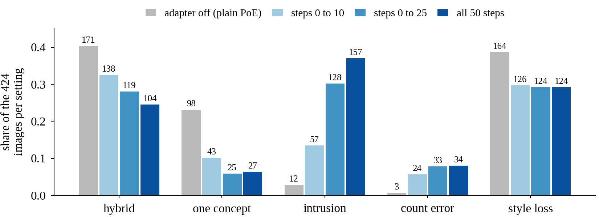
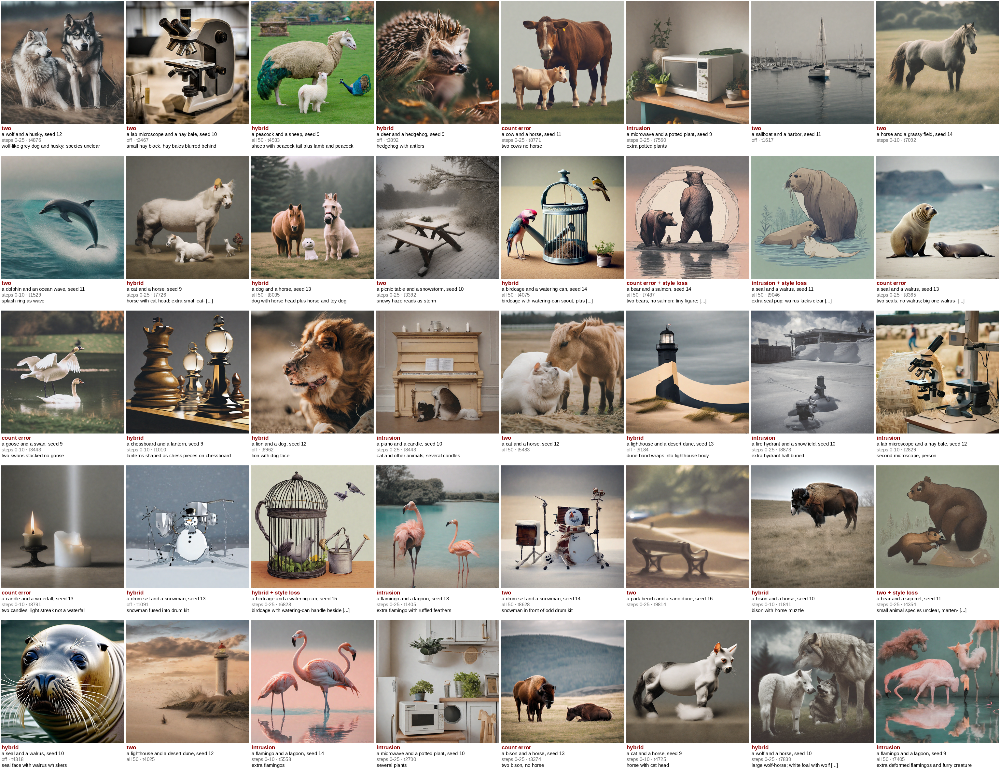

# Does restricting the adapter to early steps change the failures?

The renders behind slots R9 and R10, from wave 1's early-steps job (1-lora-correction/report/paper-review/prze-10-compute.md, job 2): the adapter of record, v58-03-self at step 30,000, switched on for the first 10 or the first 25 of 50 steps and off after, on the 53 held-out pairs at seeds 9 to 16, 848 pictures in `/datasets/mmolefe/poe_repair_min/outputs/paper_review/early_steps/`. The all-50-steps column is R3's renders in `paper_review/r3_ours/`.

## early-steps-seed10-sheet.png

**What it shows.** Two pairs from each held-out group at seed 10. By eye, the 25-step window separated the two things more often than the 10-step window (seal and walrus, cat and horse, bathtub and streetlamp), and on cow and horse every window drew two cows and no horse. One seed; R9's failure counts over 8 seeds decide. `seen`

**How it was made.** Drawn on mscluster84 on 2026-11-11 from the tiles named above, joint and PoE from step 4's census. Two cells read "rendering" because the session node's view of `/datasets` lagged the launch node; the tiles exist.

## cow-horse-seeds-9-12-first-look.png

**What it shows.** The hard pair cow and horse at seeds 9 to 12: PoE draws one animal on every seed, the 10-step adapter draws two on all four, and none of the four shows a clear horse. `seen`

**How it was made.** The first 10-step tiles of the early-steps job beside step 4's census joint and PoE, drawn on mscluster84 on 2026-11-11.

## early_steps_grid.pdf (slot R10)

**What it shows.** The early-steps renders on R4's rows (rule 5: per held-out group, ours' highest- and lowest-BLIP-VQA cell). Columns are the LoRA off (plain PoE), v58-03-self at step 30,000 on steps 0 to 10, on steps 0 to 25 and on all 50 steps; the fifth, a LoRA trained on all steps, is grey because gated training job 12 has not run. By eye, steps 0 to 10 already carry most of the change from PoE to the all-steps picture, on the working rows and the failing rows alike. `seen`

**How it was made.** Window tiles from `/datasets/mmolefe/poe_repair_min/outputs/paper_review/early_steps/` (wave 1's job 2), PoE from `review_step4/census/`, all-steps from `paper_review/r3_ours/`; resized to 512 px into `tiles-rule5/` and drawn at 5.5 in by `1-lora-correction/scripts/paper_tile_figure.py` from `early_steps_grid-spec.json`, 2026-11-11. The PNG is a 110 dpi preview of the PDF.

## failure_counts.pdf (slot R9), failure_calls.csv and failure_calls_key.csv

**What it shows.** One bar group per failure type (hybrid, one concept, intrusion, count error, style loss), one bar per setting: the adapter off (plain PoE), v58-03-self at step 30,000 on steps 0 to 10, on steps 0 to 25 and on all 50. The y axis is the share of that setting's 424 images (53 held-out pairs × seeds 9 to 16), with the true count above each bar. As the window widens, one-concept and hybrid images fall and intrusion and count error rise; most of the drop in one-concept images is already there at steps 0 to 10. Style loss is a second flag on any image, so a style-loss image is also counted under its main label. Joint-prompt corruption and instability from the layout row are left out because these renders cannot show them, and the all-steps-trained adapter is left out because it was never trained. `seen`

**How it was made.** All 1,696 images exist (424 per setting): PoE from `review_step4/census/<pair>/seedNN/poe.png`, the windows from `paper_review/early_steps/`, all 50 from `paper_review/r3_ours/`. Each image got one label (two, hybrid, one, intrusion, count error, broken) and a style-loss yes or no, called by eye by Claude in six blind batches on 2026-11-11 from 106 contact sheets at 360 px a tile, with the full-resolution image opened for borderline tiles. An extra copy of a named concept beside both concepts (two polar bears and an iceberg) was called intrusion. `failure_calls.csv` holds one row per image (pair, seed, group, setting, label, style_loss, note, id); the CSV lists every column the figure reads.

**Blinding.** Each sheet row held the four settings of one pair and seed in shuffled order, labelled only by a random id (shuffle seed 20261111). The id-to-setting key, `failure_calls_key.csv`, was kept apart and joined only after every call was made. The calls lean on judgement where species are close (wolf and husky, seal and walrus without tusks, lion cub against cat) and where extra props count as intrusion; they have not yet been checked by a person.

## failure_calls_sample.png

**What it shows.** 40 calls drawn at random from `failure_calls.csv` (Python `random.Random(20261111).sample`), each tile at 384 px with its call, prompt, seed, setting, id and note printed beneath, for a person to check the calls against the pictures. `seen`

**How it was made.** Drawn from the full-resolution renders after the key was joined, 2026-11-11.

## window_scores.pdf (proposed replacement for slot R9) and window_scores.csv

**What it shows.** The same 424 images per setting (53 held-out pairs, seeds 9 to 16, one starting latent per seed) scored by the scorers of Tables 1 and 3, with the adapter off, on for steps 0 to 10, 0 to 25 and all 50. (a) BLIP-VQA per held-out group with 95% intervals from resampling pairs then seeds; (b) the share of the 160 animal-pair images per setting where GroundingDINO finds two or more animals; (c) CLIP score and (d) ImageReward over all 424. The off and all-50 cells equal Table 3's PoE and ours cells. `ran`

**How it was made.** The 848 window renders listed in `rows_windows.csv` (`1-lora-correction/scripts/review_window_rows.py`) were scored on mscluster on 2026-11-12 by the unchanged scorers: BLIP-VQA job 85541 (mscluster82, 9 min 29 s), CLIP score and ImageReward job 85539 (mscluster130, 16 min 26 s), Comp job 85540 (mscluster131, 19 min 5 s; 320 animal rows). Drawn by `python3 1-lora-correction/scripts/review_window_figure.py --scores artifacts/drips/present-revision-to-supervisor/scores --out 1-lora-correction/artifacts/results/does-restricting-the-adapter-to-early-steps-change-the-failures`. The reading was written in `1-lora-correction/plans/present-revision-to-supervisor.md` task 2.3 before any window score existed.
