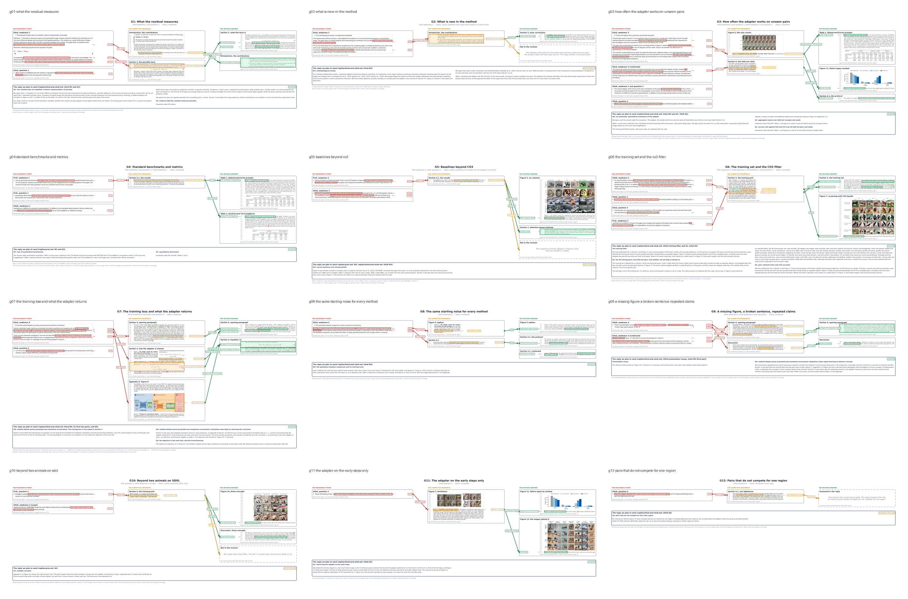
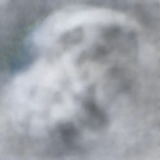

# Scenes: LoRA correction

<!-- index: written by scripts/regroup/artifacts_index.py; edit the items, not this file -->

| Scene | What it is | Picture | Last change |
|---|---|---|---|
| [The dose-response result, as a page you can drive](how-much-correction-is-needed/README.md) | under this README's own instructions below (stated, not independently re-verified this move). |  | 2026-11-13 |
| [ICLR 56173 review response, one page per claim group](iclr-review-response/README.md) | Each figure takes one group of reviewer claims and puts four things on one page. |  | 2026-11-13 |
| [Scene: the noise shell and its basins](noise-shell-and-basins/README.md) | dependencies. | — | 2026-11-13 |
| [The four cached-trajectory analyses, as a page you can drive](what-the-cached-runs-already-show/README.md) | Seven claims from | — | 2026-11-13 |
| [Where each condition lands, step by step](where-each-condition-lands/README.md) | An interactive page in the style of Diffusion Explorer: |  | 2026-11-13 |
