# ICLR 56173 review response, one page per claim group

Each figure takes one group of reviewer claims and puts four things on one page. On the left is the reviewer's words, then the submitted paper's weak passage, then the revised paper's answer, and below them the reply we plan to send. Red marks the reviewer's point, orange the submitted weakness and green the revised answer. Every excerpt is a crop of a page render, with its file and page printed under it. The claims and their groups come from [the claim table](../../../../artifacts/drips/present-revision-to-supervisor/claims.md).

**How these are made**

`draw_review_figures.py` renders each source page (paper/iclr-56173/Reviews.pdf at 300 dpi because it is vector shapes with no text layer, both papers at 200 dpi). It finds each passage by its words, using pdftotext word boxes for the papers and tesseract OCR for paper/iclr-56173/Reviews.pdf, and cuts the crop halfway between text lines. Boxes are drawn around the found words. `figure_specs.py` holds one spec per group: which passages to crop, which words to box, the arrows, and the reply sections. The reply panel copies the reply file's own paragraphs under the named headings and leaves out the reviewer quotations, which the left column already shows.

Redraw one group with `python3 1-lora-correction/artifacts/scenes/iclr-review-response/draw_review_figures.py G7`, or all of them by leaving out the group name. Raw crops are written to `artifacts/drips/present-revision-to-supervisor/crops/` as `<source>-p<page>-<claim>.png`.

## The figures

The [contact sheet](contact-sheet.png) shows all twelve at a glance. Each figure is saved as a PNG and a PDF under the same name.

**G1: What the residual measures**

<a href="g01-what-the-residual-measures.png">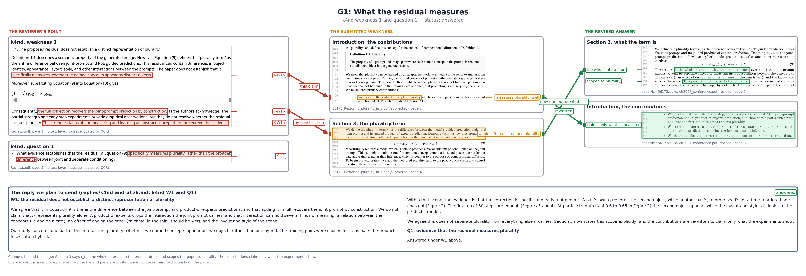</a> · [PDF](g01-what-the-residual-measures.pdf)

Claims K-Q1, K-W1a, K-W1b. The reviewer column shows k4nd, weakness 1 (paper/iclr-56173/Reviews.pdf page 4); k4nd, question 1 (paper/iclr-56173/Reviews.pdf page 5). The submitted column shows Introduction, the contributions (submitted page 2); Section 3, the plurality term (submitted page 4). The revised column shows Section 3, what the term is (revised page 5); Introduction, the contributions (revised page 3). The reply panel holds W1: the residual does not establish, Q1: evidence that the residual from `paper/iclr-56173/replies/k4nd-and-uhz6.md`. Status: answered.

**G2: What is new in the method**

<a href="g02-what-is-new-in-the-method.png">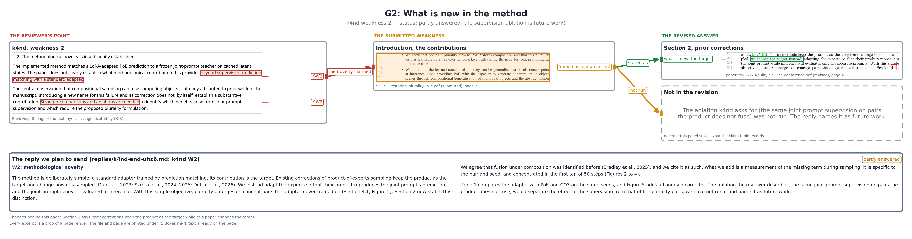</a> · [PDF](g02-what-is-new-in-the-method.pdf)

Claims K-W2. The reviewer column shows k4nd, weakness 2 (paper/iclr-56173/Reviews.pdf page 4). The submitted column shows Introduction, the contributions (submitted page 3). The revised column shows Section 2, prior corrections (revised page 5); a marked panel, "Not in the revision". The reply panel holds W2: methodological novelty from `paper/iclr-56173/replies/k4nd-and-uhz6.md`. Status: partly answered.

**G3: How often the adapter works on unseen pairs**

<a href="g03-how-often-the-adapter-works-on-unseen-pairs.png">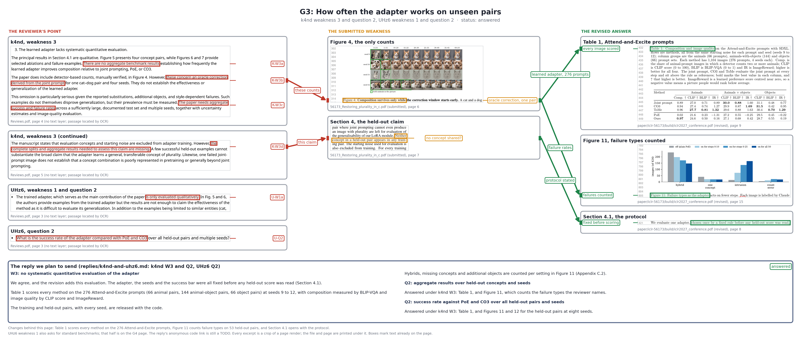</a> · [PDF](g03-how-often-the-adapter-works-on-unseen-pairs.pdf)

Claims K-W3a, K-W3b, K-W3c, K-W3d, U-Q2, U-W1a. The reviewer column shows k4nd, weakness 3 (paper/iclr-56173/Reviews.pdf page 4); k4nd, weakness 3 (continued) (paper/iclr-56173/Reviews.pdf page 5); UHz6, weakness 1 and question 2 (paper/iclr-56173/Reviews.pdf page 3); UHz6, question 2 (paper/iclr-56173/Reviews.pdf page 3). The submitted column shows Figure 4, the only counts (submitted page 6); Section 4, the held-out claim (submitted page 7). The revised column shows Table 3, 53 held-out pairs (revised page 16); Figure 10, failure types counted (revised page 17); Section 4.1, the protocol (revised page 8). The reply panel holds W3: no systematic quantitative, Q2: aggregate results, Q2: success rate against from `paper/iclr-56173/replies/k4nd-and-uhz6.md`. Status: answered.

**G4: Standard benchmarks and metrics**

<a href="g04-standard-benchmarks-and-metrics.png">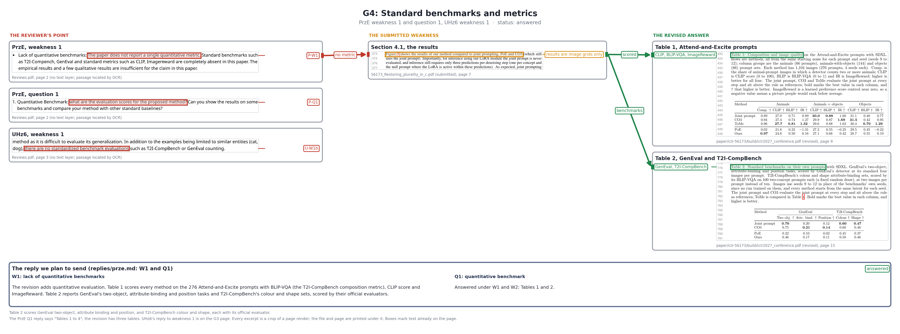</a> · [PDF](g04-standard-benchmarks-and-metrics.pdf)

Claims P-Q1, P-W1, U-W1b. The reviewer column shows PrzE, weakness 1 (paper/iclr-56173/Reviews.pdf page 2); PrzE, question 1 (paper/iclr-56173/Reviews.pdf page 2); UHz6, weakness 1 (paper/iclr-56173/Reviews.pdf page 3). The submitted column shows Section 4.1, the results (submitted page 7). The revised column shows Table 1, Attend-and-Excite prompts (revised page 9); Table 2, GenEval and T2I-CompBench (revised page 16). The reply panel holds W1: lack of quantitative benchmarks, Q1: quantitative benchmark from `paper/iclr-56173/replies/prze.md`. Status: pending: Table 2.

**G5: Baselines beyond CO3**

<a href="g05-baselines-beyond-co3.png">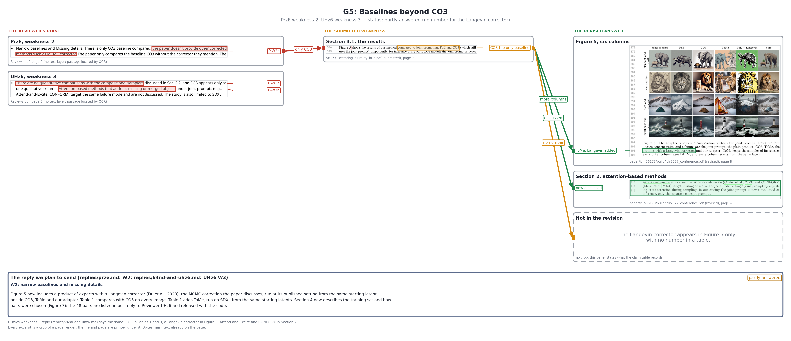</a> · [PDF](g05-baselines-beyond-co3.pdf)

Claims P-W2a, U-W3a, U-W3b. The reviewer column shows PrzE, weakness 2 (paper/iclr-56173/Reviews.pdf page 2); UHz6, weakness 3 (paper/iclr-56173/Reviews.pdf page 3). The submitted column shows Section 4.1, the results (submitted page 7). The revised column shows Figure 5, six columns (revised page 8); Section 2, attention-based methods (revised page 5); a marked panel, "Pending, and not in the revision". The reply panel holds W2: narrow baselines from `paper/iclr-56173/replies/prze.md`. Status: partly answered.

**G6: The training set and the CO3 filter**

<a href="g06-the-training-set-and-the-co3-filter.png">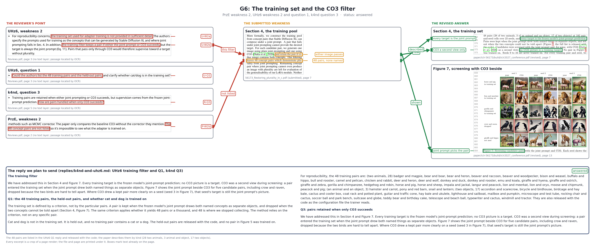</a> · [PDF](g06-the-training-set-and-the-co3-filter.pdf)

Claims K-Q3, P-W2b, U-Q1, U-W2a, U-W2b. The reviewer column shows UHz6, weakness 2 (paper/iclr-56173/Reviews.pdf page 3); UHz6, question 1 (paper/iclr-56173/Reviews.pdf page 3); k4nd, question 3 (paper/iclr-56173/Reviews.pdf page 5); PrzE, weakness 2 (paper/iclr-56173/Reviews.pdf page 2). The submitted column shows Section 4, the training pool (submitted page 7). The revised column shows Section 4, the training set (revised page 8); Figure 7, screening with CO3 beside (revised page 13). The reply panel holds The training filter, Q1: the 48 training pairs, Q3: pairs retained when only CO3 from `paper/iclr-56173/replies/k4nd-and-uhz6.md`. Status: answered.

**G7: The training loss and what the adapter returns**

<a href="g07-the-training-loss-and-what-the-adapter-returns.png">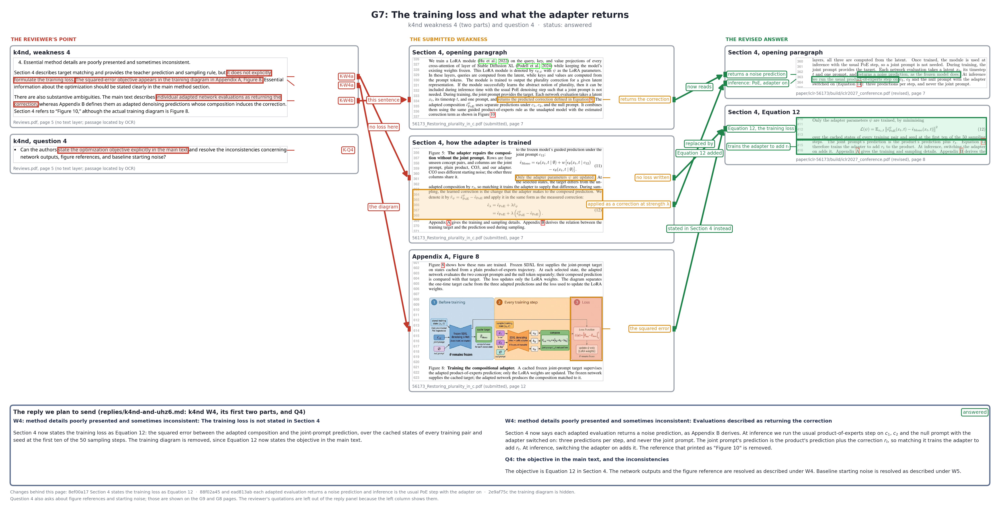</a> · [PDF](g07-the-training-loss-and-what-the-adapter-returns.pdf)

Claims K-Q4, K-W4a, K-W4b. The reviewer column shows k4nd, weakness 4 (paper/iclr-56173/Reviews.pdf page 5); k4nd, question 4 (paper/iclr-56173/Reviews.pdf page 5). The submitted column shows Section 4, opening paragraph (submitted page 7); Section 4, how the adapter is trained (submitted page 7); Appendix A, Figure 8 (submitted page 12). The revised column shows Section 4, opening paragraph (revised page 7); Section 4, Equation 12 (revised page 8). The reply panel holds W4: method details, The training loss is not stated in Section 4, W4: method details, Evaluations described as returning the correction, Q4: the objective in the main text from `paper/iclr-56173/replies/k4nd-and-uhz6.md`. Status: answered.

**G8: The same starting noise for every method**

<a href="g08-the-same-starting-noise-for-every-method.png">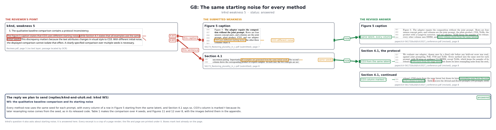</a> · [PDF](g08-the-same-starting-noise-for-every-method.pdf)

Claims K-W5. The reviewer column shows k4nd, weakness 5 (paper/iclr-56173/Reviews.pdf page 5). The submitted column shows Figure 5 caption (submitted page 7); Section 4.1 (submitted page 8). The revised column shows Figure 5 caption (revised page 8); Section 4.1, the protocol (revised page 8); Section 4.1, continued (revised page 9). The reply panel holds W5: the qualitative baseline comparison from `paper/iclr-56173/replies/k4nd-and-uhz6.md`. Status: answered.

**G9: A missing figure, a broken sentence, repeated claims**

<a href="g09-a-missing-figure-a-broken-sentence-repeated-claims.png">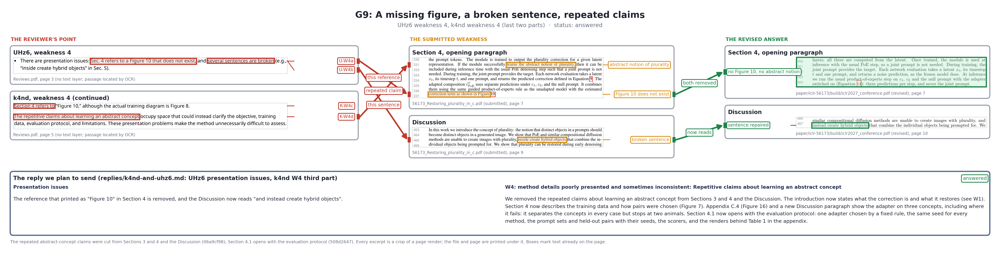</a> · [PDF](g09-a-missing-figure-a-broken-sentence-repeated-claims.pdf)

Claims K-W4c, K-W4d, U-W4a, U-W4b. The reviewer column shows UHz6, weakness 4 (paper/iclr-56173/Reviews.pdf page 3); k4nd, weakness 4 (continued) (paper/iclr-56173/Reviews.pdf page 5). The submitted column shows Section 4, opening paragraph (submitted page 7); Discussion (submitted page 9). The revised column shows Section 4, opening paragraph (revised page 7); Discussion (revised page 10). The reply panel holds Presentation issues, W4: method details, Repetitive claims about learning an abstract concept from `paper/iclr-56173/replies/k4nd-and-uhz6.md`. Status: answered.

**G10: Beyond two animals on SDXL**

<a href="g10-beyond-two-animals-on-sdxl.png">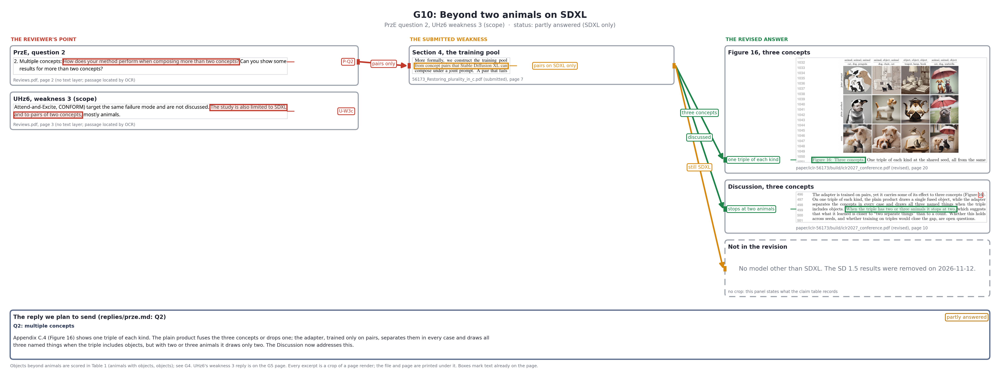</a> · [PDF](g10-beyond-two-animals-on-sdxl.pdf)

Claims P-Q2, U-W3c. The reviewer column shows PrzE, question 2 (paper/iclr-56173/Reviews.pdf page 2); UHz6, weakness 3 (scope) (paper/iclr-56173/Reviews.pdf page 3). The submitted column shows Section 4, the training pool (submitted page 7). The revised column shows Figure 13, three concepts (revised page 20); Discussion, three concepts (revised page 10); a marked panel, "Not in the revision". The reply panel holds Q2: multiple concepts from `paper/iclr-56173/replies/prze.md`. Status: partly answered.

**G11: The adapter on the early steps only**

<a href="g11-the-adapter-on-the-early-steps-only.png">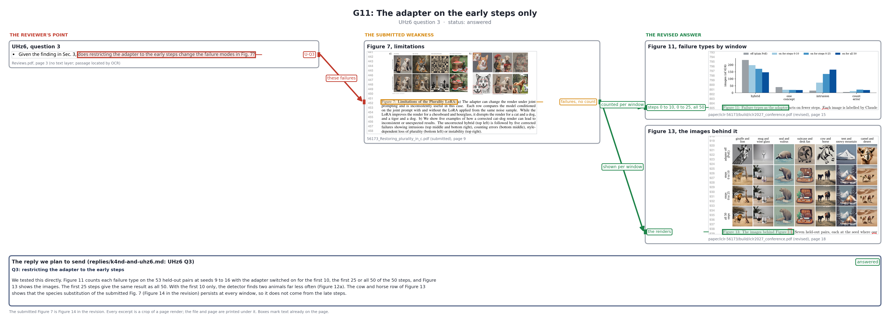</a> · [PDF](g11-the-adapter-on-the-early-steps-only.pdf)

Claims U-Q3. The reviewer column shows UHz6, question 3 (paper/iclr-56173/Reviews.pdf page 3). The submitted column shows Figure 7, limitations (submitted page 9). The revised column shows Figure 10, failure types by window (revised page 17); Figure 11, the images behind it (revised page 18). The reply panel holds Q3: restricting the adapter from `paper/iclr-56173/replies/k4nd-and-uhz6.md`. Status: answered.

**G12: Pairs that do not compete for one region**

<a href="g12-pairs-that-do-not-compete-for-one-region.png">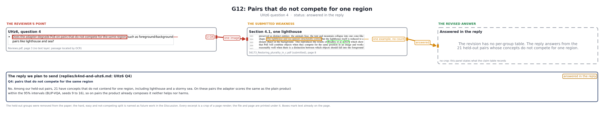</a> · [PDF](g12-pairs-that-do-not-compete-for-one-region.pdf)

Claims U-Q4. The reviewer column shows UHz6, question 4 (paper/iclr-56173/Reviews.pdf page 3). The submitted column shows Section 4.1, one lighthouse (submitted page 8). The revised column shows Table 3, the not-competing group (revised page 16); Appendix C.2, the held-out pairs (revised page 16). The reply panel holds Q4: pairs that do not compete from `paper/iclr-56173/replies/k4nd-and-uhz6.md`. Status: answered, reply TODO.
