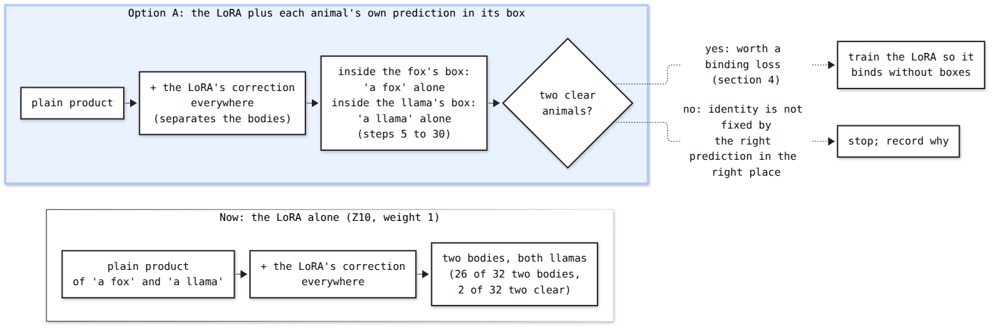

# Plan: does the LoRA's separation plus each animal's own prediction give two clear animals?

The diagram's source is [binding-plan.mmd](binding-plan.mmd). Nothing here has run; the run needs the owner's yes on a board question first.

## 1. The problem this plan starts from

On eight animal pairs it never trained on, the LoRA (`v58-03-self`, step 30,000) separates hybrids into two bodies as its weight rises, but the bodies are rarely the two animals asked for: from weight 0 to 1, hybrids fall from 29 to 4 of 32 pictures and two bodies rise from 1 to 26, while two clear animals rise only from 0 to 2 ([Z10's review](../artifacts/notes/progress/leakage/10-co-occurrence-dial/review.md)). On a training pair, badger × magpie, weight 1 also gave two bodies and no two clear animals on 4 seeds.

**Why the LoRA learns separation and not identity.** It is trained to reproduce the whole correction, the joint prompt's prediction minus the plain product's, on pictures of pairs. In those pictures most of that correction is "two things instead of one"; which body is which animal is a small part of it, and nothing in the loss singles it out. So the LoRA learns the strong signal and barely the weak one. Separating the bodies and naming them are two jobs, and the training rewards mostly the first.

**The other half already exists, with boxes.** On CO3, putting each animal's own prediction inside its hand-drawn box at steps 5 to 30 turned the mallard-headed goose into a Canada goose (duck × goose 0 to 5 of 8; 14 of 48 two clear against CO3's 8, p = 0.073; [Z7's review](../artifacts/notes/progress/leakage/07-own-prediction/review.md)).

## 2. Option A, the test

**Question.** With the LoRA separating the bodies, does each animal's own prediction inside its box make them the two animals asked for?

| Row | What is sampled | Why it is there |
|---|---|---|
| 1. LoRA alone | plain product plus the LoRA's correction at weight 1, all 50 steps | the separation half alone (Z10's weight-1 row, drawn again on the same card type) |
| 2. Own prediction alone | plain product, and inside each animal's box that animal's own prediction at steps 5 to 30 | the identity half alone |
| 3. Both | the LoRA's correction everywhere, and inside each animal's box that animal's own prediction at steps 5 to 30 | the combination |
| 4. Plain product | no correction | the floor |

**Pairs and seeds.** Z10's eight new animal pairs at seeds 6001 to 6004, 32 pictures per row: the set where the LoRA already gives two bodies and wrong animals, and none of the frozen held-out set (`report/paper-review/held-out-set.md`) is spent.

**Boxes.** Drawn by eye on row 1's finished pictures, one box per body, each labelled with the animal it should be (the body nearer that animal in shape, or left to right when neither is), before any row 3 picture exists. Boxes from finished pictures are an upper bound on any reader of regions.

**How it is sampled.** "Off" from an untouched U-Net and "on" from a copy carrying the LoRA, because the LoRA's off switch leaks on this checkpoint (a mean of 10.8 grey levels with it attached and switched off; Z10's review). Inside each animal's box the cell takes that animal's own prediction alone, Z7's rule; outside the boxes, and where they overlap, it takes the LoRA-corrected product.

**Counted** blind on the ladder one subject, hybrid, two bodies, two clear, two reviewers and a third on splits, as in Z10.

**Bar, written before the run.** Row 3 has at least 5 more two-clear pictures than row 1 and at least 5 more than row 2, each with an exact one-sided McNemar p < 0.05 on the 32 matched pictures, and no more broken pictures than row 1 plus 3. A pass says the two halves together give identity; a fail says identity is not fixed even by the right prediction in the right place, and the loss in section 4 should not be built.

**Cost.** About 128 renders at about 50 seconds with two U-Nets, about 1.8 GPU-hours on an RTX 3090, plus the boxes (32 pictures, by eye). No training.

## 3. What a result would mean

| Result | For the LoRA paper | Next |
|---|---|---|
| Pass | the LoRA's separation plus per-animal identity gives two clear animals on new pairs | build the binding loss below so the LoRA does it without boxes |
| Row 2 alone passes, row 3 does not beat it | identity comes from the box rule; the LoRA adds nothing on these pairs | the box rule is the method; the LoRA is not needed for identity |
| Fail | the right prediction in the right place does not give the right animal | stop; record why |

## 4. If A passes: a loss that teaches binding

The LoRA's present loss rewards the whole correction, so binding has to be made a term of its own. Four ways, from closest to the evidence to furthest:

| Way | What the loss asks | What it needs | Main risk |
|---|---|---|---|
| a. Per-region identity target | inside each animal's region of a training picture, the corrected prediction matches that animal's own single-prompt prediction; outside, the present correction | a region per animal per training picture | it teaches only what option A already does with boxes, so A's result predicts it |
| b. A swap penalty | inside A's region, the corrected prediction must sit nearer A's own prediction than B's by a margin, and the same for B | the same regions | a margin is easier to satisfy than a match and may learn less |
| c. Cross-attention alignment | each animal word's cross-attention map, inside the LoRA-adapted layers, falls inside that animal's region and outside the other's | the same regions | the LoRA adapts exactly these layers (`attn2`), so this acts where binding is read; whether attention alignment gives two clear animals on SDXL is not measured here. TokenCompose (Wang et al., 2023) trains a similar token-to-region term on Stable Diffusion; not re-read for this plan |
| d. Hard negatives from the failures | the borrowing pictures (the mallard-headed goose, the two llamas) as negatives for the pair asked | labelled failure pictures | teaches what not to draw, not what to draw |

**Training set.** The existing v58 training set: 48 pairs, 182 pair-and-seed cells, 50 steps each, from the cached trajectories the LoRA already trains on (`pair_pool_v58.yaml`). Every target picture there is a joint-prompt picture admitted by eye, so each holds two animals. What is new is one region per animal per target picture, about 364 regions, marked by eye or by a detector's boxes named by eye (the detector counts animals but cannot tell which is which).

**Recommendation.** Ways a and c together, a on the prediction and c on attention, with the present correction loss kept, since separation is what the LoRA already does well. Each gets a twin trained without it on the same cells, so the change is the new term alone, and the test is option A's set with no boxes at sampling time.

## 5. Where this sits

This plan belongs to the LoRA project (`1-lora-correction/`). It follows Loop 12's steps Z7 (the box rule) and Z10 (the LoRA on new pairs), whose reviews are under `artifacts/notes/progress/leakage/`.
