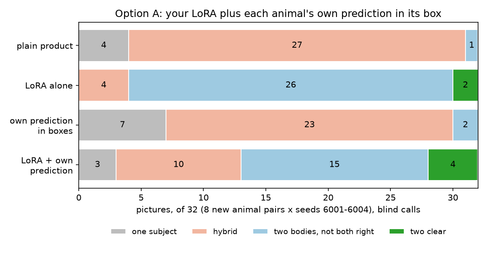

# Review: does the LoRA's separation plus each animal's own prediction in its box give two clear animals? (option A)

**Fail, by the bar written before the run.** On Z10's eight new animal pairs at seeds 6001 to 6004, the LoRA (`v58-03-self`, step 30,000, weight 1) with each animal's own prediction inside its box at sampler steps 5 to 30 drew 4 of 32 pictures with two clear animals, against 2 for the LoRA alone and 0 for the box rule alone. The bar asked for a lead of at least 5 over each half with an exact one-sided McNemar p < 0.05; the leads are 2 (4 won, 2 lost, p = 0.34) and 4 (4 won, 0 lost, p = 0.0625). The plan is [the binding plan](../binding-plan.md), section 2.

## What the pictures show

| Row | One subject | Hybrid | Two bodies, not both right | Two clear | Broken |
|---|---|---|---|---|---|
| Plain product | 4 | 27 | 1 | 0 | 7 |
| LoRA alone | 0 | 4 | 26 | 2 | 24 |
| Own prediction in each box | 7 | 23 | 2 | 0 | 10 |
| **LoRA + own prediction** | 3 | 10 | 15 | **4** | 14 |

**The two halves do not add up to identity.** The box rule alone keeps the plain product's hybrid: the same body takes both animals' predictions in neighbouring cells and stays fused. With the LoRA separating the bodies first, the box rule moves some second bodies toward the right animal, but the blind reviewers called most of them still carrying the other animal's parts: on fox × llama at seed 6001, a large fox with a llama's muzzle beside a small llama; on goat × rhinoceros at seed 6002, a goat beside a rhinoceros whose head carries goat-like horn pieces (two clear on the third call). Hybrids also rise from 4 with the LoRA alone to 10 with the box rule added. The two-clear pictures sit in three pairs: ladybug × octopus (2), goat × rhinoceros (1), lobster × whale (1).

The grids, four rows by four seeds per pair, are in [the grids folder](grids/), for example [fox × llama](grids/fox-llama.png) and [goat × rhinoceros](grids/goat-rhinoceros.png).

## What this means for the binding loss

The plan wrote before the run that a fail means identity is not fixed even by the right prediction in the right place, and that the loss in its section 4 should not be built. Way a of that section asks the LoRA to learn exactly what this row did with boxes, so it is not built. Way c (aligning each animal word's attention with its region) acts on a different mechanism, attention rather than the noise prediction, and this result neither supports nor rules it out; it would need its own test.

**The boxes were a best case.** They were drawn by eye by a Claude agent on the LoRA's own finished pictures, before any boxed render ([the boxes file](boxes.json), [the check sheets](box-sheets/)), so they placed each prediction where the body already was. Boxes from a detector could only place it worse, so no detector rerun is owed.

## How it was counted

All 128 pictures (four rows of 32) in one shuffled batch under neutral ids, the key held apart (`1-lora-correction/scripts/binding/option_a_blind.py`, committed as `d97e2967` before any call). Two blind Claude reviewers called every picture, one from the first row of the sheet and one from the last; they agreed on the rung for 119 of 128 (93%) and on rung and broken together for 99, and a third settled the 29 splits ([the blind records](blind/)). The LoRA-alone row, called again here beside the other rows, gave the same counts Z10's reviewers gave it (4 hybrid, 26 two bodies, 2 two clear). The third reviewer marked 28 of the 29 splits broken, which raises every row's broken count; broken decides nothing in this bar.

## Runs

| Job | What | Time | W&B |
|---|---|---|---|
| 95479 | rows 2 and 3 (64 pictures), after the checks | 15:18 UTC end; median 36.8 s a picture | `nnwceagz` |

On a `bigbatch` RTX 3090 (mscluster54), whole node. Rows 1 and 4 are Z10's pictures: the job first redrew Z10's LoRA-alone picture for fox × llama at seed 6001 and matched it byte for byte (`checks.json`), and with empty boxes the new code gave the LoRA-alone picture and the plain product byte for byte. About 0.7 GPU-hours against 0.9 approved (board question 113). Pictures under `/datasets/mmolefe/poe_repair_min/lora-binding/option-a/`.

## What this cannot say

Eight pairs, four seeds, one checkpoint, one window (steps 5 to 30), and one way of applying identity (replacing the prediction inside the box). The calls are by Claude reviewers at full size on Loop 6's rubric, which counts a body carrying the other animal's part as not clear.
