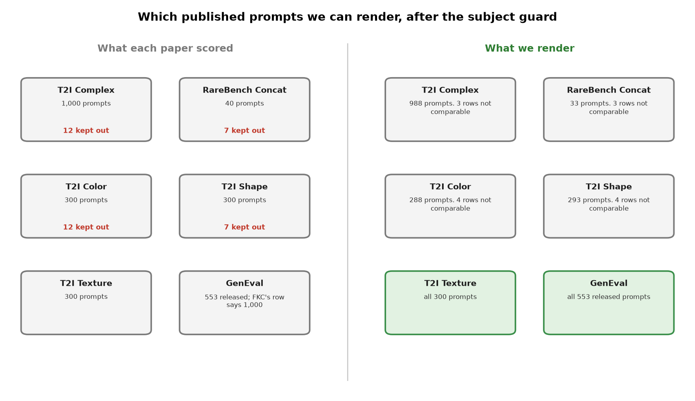
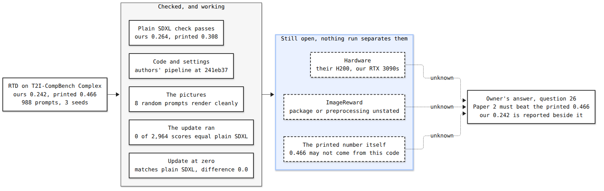
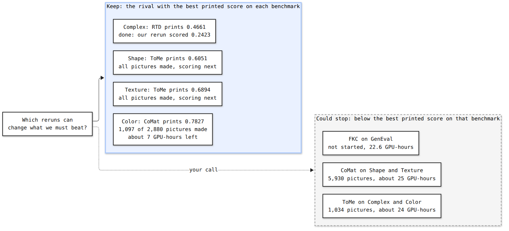

# Do the rival methods reproduce the scores their papers print?   ❌ RTD not reproduced on Complex · ✅ RTD reproduced on Concat, a weak test · FKC not tested · read 2026-11-24

**The claim**

Rectify Then Diffuse (RTD), run from its authors' own code at their printed settings, scores an ImageReward of 0.2423 on
the 988 T2I-CompBench Complex prompts the subject guard allows, against the 0.4661 its paper prints, so it does not reproduce.
It passes on RareBench Concat, where 33 prompts make the test weak. Feynman-Kac Correctors (FKC) was not rerun, by the owner's
choice, so its printed 0.78 stays as context. Plain SDXL on FKC's [GenEval two-object](../measuring-composition/what-each-scorer-says-about-two-objects.md#geneval-two-object) prompts does reproduce its printed score,
and that is the number a Paper 2 win on GenEval must beat.

The numbers come from [the RTD review](../../../artifacts/notes/progress/reproductions/RTD/review.md) and
[the FKC review](../../../artifacts/notes/progress/reproductions/FKC/review.md).

## Table of contents

- [What would have counted](#what-would-have-counted)
- [1. RTD on T2I-CompBench Complex and RareBench Concat](#1-rtd-on-t2i-compbench-complex-and-rarebench-concat)
- [2. FKC's plain SDXL baseline on GenEval](#2-fkcs-plain-sdxl-baseline-on-geneval)
- [Where the sources disagree](#where-the-sources-disagree)
- [What this cannot tell you](#what-this-cannot-tell-you)
- [Concepts this uses](#concepts-this-uses)
- [Where this came from](#where-this-came-from)
- [Still open](#still-open)

## What would have counted

Navigation: 📋 [TOC](#table-of-contents) | [Next](#1-rtd-on-t2i-compbench-complex-and-rarebench-concat) ➡️

**A row counts as `reproduced` when the printed score lies inside a pass band around our rerun, and `not reproduced`
otherwise.** The rule is |ours − published| ≤ 1.96 × √(SE_ours² + SE_published²), where SE is a bootstrap standard error over
prompts. Neither paper prints a standard error, so the published one is taken as equal to ours, and the band becomes ours
± 1.96 × √2 × SE_ours. The rule was pinned before the first run in [the RTD design's test](../../../artifacts/notes/progress/reproductions/RTD/design.md#the-test-fixed-before-the-first-run)
and in [the FKC design's run settings](../../../artifacts/notes/progress/reproductions/FKC/design.md#the-run), and its
constants sit in `scripts/reproductions/verdict.py` in the replications hub.

The RTD design adds one more rule: plain SDXL takes the same test against its printed score. A pass there shows our prompts
and scorer match the paper's, so an RTD miss cannot be blamed on the setup alone.

**Every row is judged on the prompts the subject guard allows, with the count beside it.** That is the owner's answer to board
question 14 in [the progress board](../../../artifacts/notes/progress/board.json). A published score averages all its prompts,
so a score on fewer of them is a weaker test.

| The prompts each paper scored and the prompts this rerun renders |
|---|
|  Left, the prompt count each paper scored. Right, the count left after the subject guard. T2I-CompBench Complex goes from 1,000 to 988 (12 kept out) and RareBench Concat from 40 to 33 (7 kept out) `verified` (read on the picture; matches the RTD design). The GenEval box reads "all 553 released prompts". The FKC baseline below renders only the 99 two-object prompts among them `stated` (FKC review). |

## 1. RTD on T2I-CompBench Complex and RareBench Concat

Navigation: ⬅️ [Previous](#what-would-have-counted) | 📋 [TOC](#table-of-contents) | [Next](#2-fkcs-plain-sdxl-baseline-on-geneval) ➡️

**RTD's printed Complex score of 0.4661 sits above the top of the pass band around our rerun, which ends at 0.3095.** Plain SDXL passes its own check on both benchmarks, which shows our prompts and scorer give the paper's plain SDXL
scores back.

| Why the Complex score misses | Plain SDXL beside RTD on eight random Complex prompts |
|---|---|
|  Left box, the result: ours 0.242 against printed 0.466 on 988 prompts at 3 seeds. Middle, five checks that pass: plain SDXL 0.264 against printed 0.308, the authors' pipeline at commit `241eb37`, eight random prompts render cleanly, 0 of 2,964 scores equal plain SDXL's, and a zero-size update matches plain SDXL with difference 0.0. Right, three causes nothing run here separates: their H200 against our RTX 3090s, an unstated ImageReward package or preprocessing, and the printed number itself `verified` (read on the picture; matches the review, which gives the same numbers to four places). |  Eight Complex prompts drawn at random (generator seed 0, picture seed 0), plain SDXL left and RTD right in each pair, with each picture's ImageReward printed above `stated` (RTD review). Both methods draw clean pictures. On the cube, rectangle and sphere prompt RTD drops the cube and scores 0.03 against plain SDXL's 1.45. On the lemon and lime prompt RTD draws separate lemons and limes as a flat pattern and scores -0.90, against -0.02 for a plain SDXL picture of limes with lemon-coloured flesh `verified` (seen on the picture). Eight prompts are too few to say how often the scorer misses the composition like this. |

**The number.** ImageReward is the mean over 3 seeds per prompt (seeds 0, 1 and 2); higher is better. The pass band is the
range a printed score must fall in to count as reproduced. All rows `stated` from the review's results table, and the two RTD
rows match [the RTD rows file](../../../artifacts/notes/progress/reproductions/RTD/rows.json).

| Method | Benchmark | Prompts | Ours | Pass band | Printed | Verdict | W&B run |
|---|---|---|---|---|---|---|---|
| RTD | T2I-CompBench Complex | 988 of 1,000 | 0.2423 | 0.1751 to 0.3095 | 0.4661 | not reproduced | `5i9dt7by` |
| RTD | RareBench Concat | 33 of 40 | 0.4166 | -0.0268 to 0.8600 | 0.4464 | reproduced | `tc75fx0i` |
| plain SDXL | T2I-CompBench Complex | 988 of 1,000 | 0.2637 | 0.2019 to 0.3256 | 0.3083 | reproduced | `8802binw` |
| plain SDXL | RareBench Concat | 33 of 40 | 0.3035 | -0.1269 to 0.7338 | 0.1018 | reproduced | `1gh0vhil` |

The Concat band runs from below zero to 0.8600, so almost any printed score near RTD's would pass it. That is why the review
calls the Concat test weak.

**RTD does not beat plain SDXL on the same prompts and seeds.** Matched picture by picture, RTD minus plain SDXL is -0.0214 on
Complex (standard error 0.0153 over prompts), where the two printed scores differ by +0.1578. On Concat it is +0.1131 (standard
error 0.0983). The review marks this 🟡 not shown on either benchmark `stated`.

> [!IMPORTANT]
> By the owner's answer to board question 26, the printed 0.466 stays the bar Paper 2 must beat on Complex, and this rerun of
> 0.242 is reported beside it ([the RTD review](../../../artifacts/notes/progress/reproductions/RTD/review.md), line 5).

## 2. FKC's plain SDXL baseline on GenEval

Navigation: ⬅️ [Previous](#1-rtd-on-t2i-compbench-complex-and-rarebench-concat) | 📋 [TOC](#table-of-contents) | [Next](#where-the-sources-disagree) ➡️

**FKC itself was not rerun, and the plain SDXL check on its prompts reproduces.** FKC's printed 0.78 sits below plain SDXL's
printed 0.80 on the same prompts, and a Paper 2 win must beat plain SDXL anyway, so the review records that an FKC rerun cannot
raise the bar on this row `stated`.

| Which rival reruns can change the bar | What a scored plain SDXL GenEval image looks like |
|---|---|
|  Left group, the rival with the best printed score on each benchmark, which is kept. It includes Complex, where RTD prints 0.4661 and our rerun scored 0.2423. Right group, reruns that could stop because the rival sits below the best printed score. It includes FKC on GenEval, not started, measured at 22.6 GPU-hours `verified` (read on the picture; matches both reviews). The ToMe and CoMat boxes show their state when the picture was drawn, and their own reviews hold the current state. | 🖼️ **Figure wanted**: four plain SDXL images on GenEval two-object prompts, two the detector judged correct and two it judged wrong, each with its prompt. The renders are on the cluster under `/datasets/mmolefe/poe_repair_min/loop-5/renders/FKC/full/sdxl/`. Check each against the subject guard, render the sheet into `1-lora-correction/artifacts/results/against-other-methods/`, write its card entry, then embed here. |

**The number.** GenEval's two-object score is the share of images in which a detector finds both named objects. Plain SDXL
scores 0.7399 of 396 images correct (99 two-object prompts at 4 images each), against the 0.80 printed in FKC Table A4, p39.
The pass band is 0.6468 to 0.8330, so the row is `reproduced`. Rendered by Slurm job 93251 and scored by job 93311 at commit
pair `ac85826a-47e659d`, W&B run `qcdz35cj` `stated` (FKC review).

**What one FKC image would cost.** One batch of 8 particles takes 205.6 seconds on an RTX 3090, against 12.8 seconds for a
plain render, so 16.1 times as long. The 396 images at 8 particles would be 22.6 GPU-hours. On the one prompt timed, all 8
particles at the last step descend from one ancestor, as the paper's note on weight degeneracy (p7) describes `stated` (FKC
review).

## Where the sources disagree

Navigation: ⬅️ [Previous](#2-fkcs-plain-sdxl-baseline-on-geneval) | 📋 [TOC](#table-of-contents) | [Next](#what-this-cannot-tell-you) ➡️

**Four places where two records say different things. This page reports both and resolves none.**

| What | One source | The other source |
|---|---|---|
| FKC's verdict word | [the FKC review](../../../artifacts/notes/progress/reproductions/FKC/review.md), line 30: "Not tested, by the owner's choice" | [the FKC rows file](../../../artifacts/notes/progress/reproductions/FKC/rows.json), line 9: `"verdict": "not comparable"` |
| whether FKC will run | [the FKC design](../../../artifacts/notes/progress/reproductions/FKC/design.md), line 11: "The row is waiting on its run", and FKC "does not run until the owner has seen the measured cost" | [the FKC review](../../../artifacts/notes/progress/reproductions/FKC/review.md), line 3: "FKC is not rerun, by the owner's answer to board question 41" |
| whether CoMat has a verdict | [the CoMat review](../../../artifacts/notes/progress/reproductions/CoMat/review.md), line 3: "CoMat has no verdict yet" | [the same review](../../../artifacts/notes/progress/reproductions/CoMat/review.md), line 32: "Does CoMat reproduce its published Color score? ✅ Yes. CoMat scores 0.7696 on the 288 allowed prompts at 10 seeds (2,880 pictures), with a pass band of 0.7331 to 0.8060, and the paper prints 0.7827" (scoring job 93588, W&B `dk8g2tpx`) |
| how many GenEval prompts are rendered | [the guard picture's data](../../../artifacts/notes/progress/reproductions/prompts-the-guard-keeps-out.json), line 111: "all 553 released prompts" under "What we render" | [the FKC review](../../../artifacts/notes/progress/reproductions/FKC/review.md), line 14: plain SDXL on "99 two-object prompts at 4 images" |

## What this cannot tell you

Navigation: ⬅️ [Previous](#where-the-sources-disagree) | 📋 [TOC](#table-of-contents) | [Next](#concepts-this-uses) ➡️

**Whether FKC reproduces.** FKC itself was never rerun, so its printed 0.78 is neither confirmed nor contradicted here. Only
plain SDXL on its prompts was checked.

**Why RTD misses on Complex.** The review lists three causes still open: the authors' NVIDIA H200 against our RTX 3090s, an
ImageReward package or preprocessing difference the paper does not state, and the printed number itself. Nothing run here
separates them, so "not reproduced" says the number did not come back on our setup and says nothing about which of the three
is responsible.

**Anything about the prompts the guard keeps out.** Every number here is on 988 of 1,000 Complex prompts and 33 of 40 Concat
prompts. The printed scores average all of them, so the comparison is between two slightly different prompt sets.

**The other rivals.** CO3 and ToMe have no verdict yet. CoMat's review both says it has none and answers its reproduction question yes; the two readings are under [Where the sources disagree](#where-the-sources-disagree). All three are listed under [Still open](#still-open).

## Concepts this uses

Navigation: ⬅️ [Previous](#what-this-cannot-tell-you) | 📋 [TOC](#table-of-contents) | [Next](#where-this-came-from) ➡️

The toy numbers below are invented. GenEval's fraction correct is taught on
[the standard benchmarks page](how-does-the-adapter-score-on-the-standard-benchmarks.md#concepts-this-uses).

**ImageReward**

A coffee tasting: three people each taste one cup and give it a number, 0.5, -0.2 and 0.9, and the cup's score is the mean,
1.2 / 3 = 0.4. ImageReward does the same for a picture and its prompt, except the taster is a model trained on people's
preferences between pictures. "Image" because it scores the picture, "reward" because it is the number such a model is trained
to push up, so higher is better and a score can be negative. Here each prompt gets 3 pictures (seeds 0, 1 and 2), and on the
1% rung single pictures scored from -1.71 to 1.96 `stated` (RTD review). RTD's Complex score of 0.2423 is that mean over 988
prompts. Read more in [the ImageReward walk](../../../../../goal-setting/learning/deep-learning/diffusion-models/12-scoring-and-rival-methods/plans/02-imagereward-the-preference-number.md)
and [the ImageReward note](../../../../../Obsidian/deep-learning/12-scoring-and-rival-methods/tables/imagereward.md).

**The pass band**

Say our rerun scores 0.30 and the bootstrap gives a standard error of 0.05, meaning a fresh draw of prompts would typically move
the mean by about 0.05. The paper's own error is unknown, so take it as 0.05 too. Two equal errors combine to √2 × 0.05, and 1.96
of those covers 95% of a normal spread: 1.96 × 1.414 × 0.05 = 0.139. The band is 0.30 − 0.139 to 0.30 + 0.139, which is 0.161 to
0.439. "Pass" because a printed number inside it passes, so a printed 0.40 is reproduced. "Band" because it is a range around our
number, so a printed 0.47 sits above it and is not reproduced. Run back on RTD's Complex row, the band is 0.1751 to 0.3095
around our 0.2423, and the printed 0.4661 sits above its top. In the design's letters this is |ours − published| ≤ 1.96 ×
√(SE_ours² + SE_published²). Read more in [the bootstrap card](../../../../../Obsidian/Mathematics/Statistics/Bootstrap.md#standard-error)
and [the chapter on the bootstrap standard error](../../../../../goal-setting/learning/mathematics/statistics/sampling/textbook/08-the-percentile-bootstrap.md#84-why-with-replacement-and-the-bootstrap-standard-error).

**GenEval and T2I-CompBench**

Two public prompt sets with their own scorers. Read more in [the GenEval walk](../../../../../goal-setting/learning/deep-learning/diffusion-models/12-scoring-and-rival-methods/plans/05-geneval-a-detector-checks-the-objects.md)
and [the T2I-CompBench walk](../../../../../goal-setting/learning/deep-learning/diffusion-models/12-scoring-and-rival-methods/plans/04-t2i-compbench-a-fixed-prompt-set-per-category.md).
RareBench has no walk or note in the learning tree.

## Where this came from

Navigation: ⬅️ [Previous](#concepts-this-uses) | 📋 [TOC](#table-of-contents) | [Next](#still-open) ➡️

**Every number is copied from the two reviews; the score files they summarise are on the cluster and were not opened.**

| What | Source | Mark |
|---|---|---|
| RTD and plain SDXL scores, pass bands, verdicts, W&B runs | [the RTD review](../../../artifacts/notes/progress/reproductions/RTD/review.md), lines 52 to 61; RTD rows checked against [the RTD rows file](../../../artifacts/notes/progress/reproductions/RTD/rows.json) | stated |
| RTD runs | Slurm jobs 93064 (RTD) and 93068 (plain SDXL) scoring at commit pair `045e027f-94b2919`; scores in `full/rtd-scores.jsonl` and `full/sdxl-scores.jsonl` under `/datasets/mmolefe/poe_repair_min/loop-5/renders/RTD/` | stated |
| The printed scores and the protocol | [the RTD design](../../../artifacts/notes/progress/reproductions/RTD/design.md), RTD Table 2, p6 | stated |
| Plain SDXL on GenEval, FKC's cost | [the FKC review](../../../artifacts/notes/progress/reproductions/FKC/review.md), lines 3 to 4 and 19 to 31; jobs 93248, 93251 and 93311, W&B `qcdz35cj` | stated |
| The owner's answers to board questions 14, 26 and 41 | [the progress board](../../../artifacts/notes/progress/board.json), `questions` | stated |
| What each picture shows | the four pictures above, opened at full size on 2026-11-24 | verified |
| The plan that owned the reruns | step D2 of [the two-papers route](../../../plans/route-two-papers.md#the-steps), run by Session 5 | |
| Regenerate with | [launching and harvesting a run](../../../runbook/running-things-on-the-cluster/launching-and-harvesting-a-run.md) | |
| The cards the runs used | [the environment overview](../../../environment/overview.md) | |

## Still open

Navigation: ⬅️ [Previous](#where-this-came-from) | 📋 [TOC](#table-of-contents)

- [ ] Why RTD misses on Complex: hardware, the ImageReward package or preprocessing, or the printed number. Nothing run separates them.
- [ ] CO3: no verdict yet ([the CO3 review](../../../artifacts/notes/progress/reproductions/CO3/review.md)).
- [ ] CoMat: its review's opening line says no verdict yet, while its line 32 records the Color score reproduced (0.7696 against 0.7827 printed); this page takes neither until the review is settled. It runs on Color only, by the owner's answer to board question 43 ([the CoMat review](../../../artifacts/notes/progress/reproductions/CoMat/review.md)).
- [ ] ToMe: no verdict yet; it is scored on Shape and Texture only, by the owner's answer to board question 43 ([the ToMe review](../../../artifacts/notes/progress/reproductions/ToMe/review.md)).
- [ ] The plain SDXL GenEval exemplar sheet in section 2.
- [ ] The three disagreements under [Where the sources disagree](#where-the-sources-disagree).

## Cross-references

- The mention of **the reproduction finding** in [the context page on the BLIP-VQA score, from answers to a target, section "What the number can and cannot tell you"](../../../context/methods/08-the-blip-vqa-score/03-from-answers-to-a-target.md#what-the-number-can-and-cannot-tell-you).

<!-- built-to: PAGE_LOOK_FORMAT v1 -->
