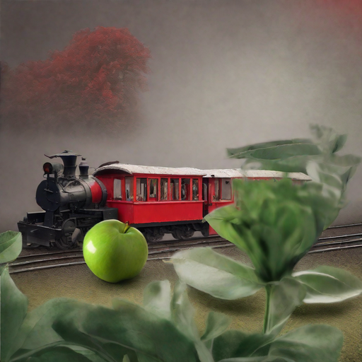

# 📒 Report: how the adapter scores on the GenEval and T2I-CompBench benchmarks

**No verdict was recorded for this table.** It scores four methods on two public benchmarks, using
each benchmark's own prompts and scorer. The adapter ("Ours") is above PoE in all five scored columns
and below the joint prompt in all five. CO3 is above the adapter in four columns. On T2I-CompBench
shape the adapter reads 0.4631 and CO3 0.4616, a gap of 0.0015 (0.4631 minus 0.4616).

## Table of contents

- [The scores by method and benchmark](#the-scores-by-method-and-benchmark)
- [Two prompts from the benchmarks](#two-prompts-from-the-benchmarks)
- [Where the sources disagree](#where-the-sources-disagree)
- [What this cannot tell you](#what-this-cannot-tell-you)
- [Concepts this uses](#concepts-this-uses)
- [Where this came from](#where-this-came-from)
- [Still open](#still-open)

## The scores by method and benchmark

Navigation: 📋 [TOC](#table-of-contents) | [Next](#two-prompts-from-the-benchmarks) ➡️

**The largest gap over PoE is on GenEval's two-object task, 0.4571 against 0.2247.** GenEval columns
are the fraction of images judged correct. T2I-CompBench columns are mean [BLIP-VQA](how-does-the-adapter-score-on-the-attend-and-excite-prompts.md#blip-vqa),
0 to 1. The heading gives the images per method `verified`
([the benchmark result file](../../artifacts/results/against-other-methods/the-head-to-head-tables/how-the-adapter-scores-against-other-methods/standard_benchmarks.csv)).

| Method | GenEval two objects, 396 | GenEval colour attribute, 400 | GenEval position, 400 | T2I-CompBench colour, 200 | T2I-CompBench shape, 200 |
|---|---|---|---|---|---|
| Joint prompt | 0.7626 | 0.2050 | 0.1175 | 0.6007 | 0.4683 |
| CO3 | 0.7500 | 0.2125 | 0.1425 | 0.5990 | 0.4616 |
| PoE | 0.2247 | 0.1025 | 0.0225 | 0.4511 | 0.3665 |
| Ours | 0.4571 | 0.1750 | 0.1075 | 0.5778 | 0.4631 |

GenEval used seeds 9 to 12 and T2I-CompBench seeds 9 and 10. The file's T2I-CompBench texture column
rests on 0 images, so it is left out here.

## Two prompts from the benchmarks

Navigation: ⬅️ [Previous](#the-scores-by-method-and-benchmark) | 📋 [TOC](#table-of-contents) | [Next](#where-the-sources-disagree) ➡️

**All three methods draw the car and the meter, and on the second prompt PoE loses the apple.** The
captions are eye reads `verified`. The record does not say how the rows of this sheet were chosen,
so they say nothing about rates.

| PoE | CO3 | Ours |
|---|---|---|
|  Black car and green meter, seed 11: both drawn |  Both drawn |  Both drawn |
|  Green apple and red train, seed 9: a red and green train, no apple |  Both drawn |  Both drawn, with added leaves |

> [!NOTE]
> The full sheets are `table2_images.pdf` and `table2_images_wide.pdf` in
> `1-lora-correction/artifacts/results/against-other-methods/the-head-to-head-tables/how-the-adapter-scores-against-other-methods/`.
> Each is not shown: holds a subject the pair ledger keeps off sheets. The word is a baseball bat, which the
> ledger allows for the review response only.

## Where the sources disagree

Navigation: ⬅️ [Previous](#two-prompts-from-the-benchmarks) | 📋 [TOC](#table-of-contents) | [Next](#what-this-cannot-tell-you) ➡️

**The planned columns and the scored columns differ, and this page shows the scored ones.**

| What | One source | The other source | What the code shows |
|---|---|---|---|
| which tasks the table holds | [the layout sheet](../paper-review/layout-sheet.md) lists GenEval two objects and counting, and T2I-CompBench spatial and complex | the result file holds GenEval two objects, colour attribute and position, and T2I-CompBench colour, shape and an empty texture column | the [benchmark table script](../../../scripts/review_bench_table.py) (line 25) and the [paper slot's schema](../../scripts/refresh_paper_slots.py) (lines 132 to 133) both use the result file's tasks |
| runs on counting and spatial prompts | [the pair ledger](../../../artifacts/_shared/cross_pair_pool_configs/pair_ledger.md) records [GenEval two-object](../measuring-composition/what-each-scorer-says-about-two-objects.md#geneval-two-object), counting and T2I-CompBench spatial as run complete (99, 80 and 300 prompts) | the result file has no counting or spatial column | the two-object count fits: 396 images is 99 prompts at 4 seeds. Where the counting and spatial scores went is not recorded |

## What this cannot tell you

Navigation: ⬅️ [Previous](#where-the-sources-disagree) | 📋 [TOC](#table-of-contents) | [Next](#concepts-this-uses) ➡️

**These numbers carry no intervals, so a small gap cannot be read as a real difference.** The file
holds one mean per cell, and the 0.0015 between Ours and CO3 on T2I-CompBench shape is one such gap.

**CO3 and the joint prompt read the sentence naming both concepts while drawing, and the adapter
does not.** PoE is the matched comparison, as on [the benchmark page](how-does-the-adapter-score-on-the-attend-and-excite-prompts.md#what-this-cannot-tell-you).
This page quotes no [compose rate](../../../context/world/compose-rate.md#what-a-compose-rate-is), so the `__cmp` strip fault does not apply to it.

## Concepts this uses

Navigation: ⬅️ [Previous](#what-this-cannot-tell-you) | 📋 [TOC](#table-of-contents) | [Next](#where-this-came-from) ➡️

The toy numbers are invented. BLIP-VQA and the intervals are taught on [the benchmark page](how-does-the-adapter-score-on-the-attend-and-excite-prompts.md#concepts-this-uses).

**GenEval's fraction correct**

Four pictures are each asked for "a cup and a plate". A detector finds both in the first, second and
fourth, so the score is 3 / 4 = 0.75. The name is short for generation evaluation, and its
two-object task passes an image when each named class is detected at least once, above 0.3
confidence ([the GenEval script](../../scripts/review_score_geneval.py)). Here that fraction is
0.4571 over Ours' 396 images. Read more in [the GenEval walk](../../../../../goal-setting/learning/deep-learning/diffusion-models/12-scoring-and-rival-methods/plans/05-geneval-a-detector-checks-the-objects.md)
and [the GenEval note](../../../../../Obsidian/deep-learning/12-scoring-and-rival-methods/tables/geneval.md).

**T2I-CompBench**

A fixed list of prompts per category, such as colour or shape, each scored with BLIP-VQA and averaged
per category. If three colour prompts score 0.9, 0.5 and 0.4, the category reads 1.8 / 3 = 0.6. Here
Ours reads 0.5778 on colour over 200 images. Read more in [the T2I-CompBench walk](../../../../../goal-setting/learning/deep-learning/diffusion-models/12-scoring-and-rival-methods/plans/04-t2i-compbench-a-fixed-prompt-set-per-category.md)
and [the T2I-CompBench note](../../../../../Obsidian/deep-learning/12-scoring-and-rival-methods/tables/t2i-compbench.md).

## Where this came from

Navigation: ⬅️ [Previous](#concepts-this-uses) | 📋 [TOC](#table-of-contents) | [Next](#still-open) ➡️

| File | What it holds | Written by |
|---|---|---|
| [standard_benchmarks.csv](../../artifacts/results/against-other-methods/the-head-to-head-tables/how-the-adapter-scores-against-other-methods/standard_benchmarks.csv) | one row per method and benchmark, with the images behind each score | [the benchmark table script](../../../scripts/review_bench_table.py) |
| `tiles-table2/` beside it | the renders behind the sheet | the sheet's spec, `table2_images-spec.json` beside it, lists them; the folder has no card entry |

## Still open

Navigation: ⬅️ [Previous](#where-this-came-from) | 📋 [TOC](#table-of-contents)

- [ ] Whether the table should carry the counting, spatial and complex tasks the layout sheet lists.
- [ ] A card entry saying how the rows of the benchmark sheet were chosen.
- [ ] Intervals on these means, if a gap this small is going to be argued from.

<!-- built-to: PAGE_LOOK_FORMAT v1 -->
