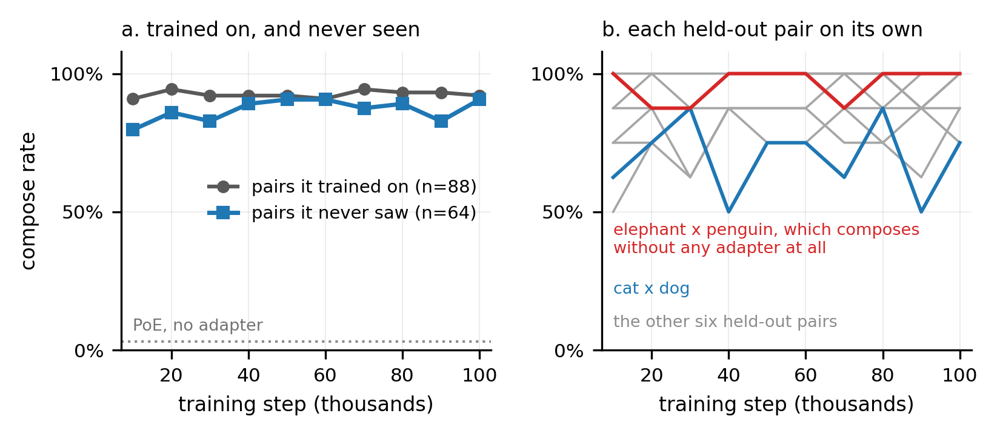

# 📒 Report: does one pooled adapter compose on pairs it never trained on?   ✅ support · recorded 2026-11-13

**At training step 60000, 58 of 64 pictures (0.906) of eight pairs the adapter never trained on hold two
animals, against 80 of 88 (0.909) on its eleven training pairs** `verified`
([scored rates](../../artifacts/results/does-it-reach-unseen-pairs/the-transfer/does-the-fix-reach-unseen-pairs/pooled_lora/phase1_r8_100k/compose_rate.json)).
The adapter is one small set of extra weights, a rank 8 [LoRA](../../../../../Obsidian/Artificial%20Intelligence/Large%20Language%20Models/LoRA.md#where-to-learn-this),
trained on all eleven pairs at once. The support verdict is the one recorded in
[the review of this run](../../plans/04-does-the-fix-reach-unseen-pairs/review/03-does-one-pooled-fix-transfer-at-all.md).

> [!WARNING]
> Two older rates for this run, 0.961 and 0.742, counted comparison strips as pictures. Both are kept
> below with what each one counted. The review's verdict rests on 0.906.

## Table of contents

- [What would have counted](#what-would-have-counted)
- [The compose rate while the adapter trained](#the-compose-rate-while-the-adapter-trained)
- [Three scorings of the same run](#three-scorings-of-the-same-run)
- [What the six-pair picture shows](#what-the-six-pair-picture-shows)
- [Where the sources disagree](#where-the-sources-disagree)
- [What this cannot tell you](#what-this-cannot-tell-you)
- [Concepts this uses](#concepts-this-uses)
- [Where this came from](#where-this-came-from)
- [Still open](#still-open)

## What would have counted

Navigation: 📋 [TOC](#table-of-contents) | [Next](#the-compose-rate-while-the-adapter-trained) ➡️

**The plan wrote a question and a stop rule, with no numeric bar.** The question was whether the
held-out compose rate beats the level plain product-of-experts reaches with no fix. The
[plan's stop rule](../../plans/04-does-the-fix-reach-unseen-pairs/plans/hypothesis/03-does-one-pooled-fix-transfer-at-all.md#engagement-instructions)
calls the run a no-transfer null if that rate is no better than plain product-of-experts and the
direction measure also comes out wrong. The direction measure was wired after this run, so only the first
half of the rule has been read `stated`.

## The compose rate while the adapter trained

Navigation: ⬅️ [Previous](#what-would-have-counted) | 📋 [TOC](#table-of-contents) | [Next](#three-scorings-of-the-same-run) ➡️

**The rate on unseen pairs stays between 0.83 and 0.91 from step 20000 to step 100000** `verified`. In both
panels the y-axis is the compose rate and the x-axis is the training step in thousands. On the left, one
point is one saved checkpoint scored over 88 training-pair pictures (grey) or 64 unseen-pair pictures
(blue). On the right, one line is one unseen pair at 8 pictures per point. The numbers are in
[the scored rates](../../artifacts/results/does-it-reach-unseen-pairs/the-transfer/does-the-fix-reach-unseen-pairs/pooled_lora/phase1_r8_100k/compose_rate.json),
drawn by [the figure script](../../scripts/adapter_transfers.py), line 67. The dotted line at 0.03 is
plain product-of-experts, measured in a separate sweep over 32 cells (same script, lines 46 to 49) `stated`.

## Three scorings of the same run

Navigation: ⬅️ [Previous](#the-compose-rate-while-the-adapter-trained) | 📋 [TOC](#table-of-contents) | [Next](#what-the-six-pair-picture-shows) ➡️

**One run has three recorded rates at step 60000, and only the third counts each picture once.** From step
20000 the trainer saves a three-panel comparison strip beside each picture: joint-prompt target, plain
product, adapter. Until commit `0811f029` (2026-11-13) [the scorer](../../../poe_repair/experiments/does_the_fix_reach_unseen_pairs/compose_rate.py)
counted those strips as pictures too ([known failure poe-score-003](../../../environment/known-failures.md#entry-id-poe-score-003)).

| What was scored | Unseen pairs | Training pairs | Result file | When scored | Strips scored |
|---|---|---|---|---|---|
| pictures and strips, no size filter | 0.961 (123 of 128) | 0.960 (169 of 176) | [first scoring](../../artifacts/results/does-it-reach-unseen-pairs/the-transfer/does-the-fix-reach-unseen-pairs/pooled_lora/phase1_r8_100k/compose_rate.to-step-60000.json) | by 2026-08-04, when commit `84972edd` quotes it; before the fix | yes |
| pictures and strips, 25% size filter | 0.742 (95 of 128) | 0.847 (149 of 176) | [second scoring](../../artifacts/results/does-it-reach-unseen-pairs/the-transfer/does-the-fix-reach-unseen-pairs/pooled_lora/phase1_r8_100k/compose_rate.with-cmp-strips.json) | 2026-11-13, jobs 86565 and 86587, commit `b9b166b2`; before the fix | yes |
| pictures alone, 25% size filter | 0.906 (58 of 64) | 0.909 (80 of 88) | [current scoring](../../artifacts/results/does-it-reach-unseen-pairs/the-transfer/does-the-fix-reach-unseen-pairs/pooled_lora/phase1_r8_100k/compose_rate.json) | 2026-11-13, job 86591, commit `5cb9329c`; after the fix | no |

The rates and sample sizes are read from each file `verified`, and each count is the rate times the file's
sample size. The sample size doubles at step 20000 in the first two files and stays single in the third,
which is the strips entering the count `verified`. All three files carry a disk date of 2026-11-13 from
being copied, so the dates above come from commits.

**From the first scoring to the current one no pair rose, and frog and toad fell most, by 0.1875.** The two
columns differ in both the strips and the size filter. Each pair has 8 pictures, so 16 images are scored in
the first column and 8 in the second `verified`:

| Unseen pair, step 60000 | Pictures and strips, no filter | Pictures alone, with filter |
|---|---|---|
| leopard and jaguar | 1.0 | 1.0 |
| goose and swan | 1.0 | 1.0 |
| cow and buffalo | 1.0 | 1.0 |
| elephant and penguin (composes with no adapter) | 1.0 | 1.0 |
| eagle and hawk | 0.9375 | 0.875 |
| seal and walrus | 0.9375 | 0.875 |
| frog and toad | 0.9375 | 0.75 |
| cat and dog | 0.875 | 0.75 |

## What the six-pair picture shows

Navigation: ⬅️ [Previous](#three-scorings-of-the-same-run) | 📋 [TOC](#table-of-contents) | [Next](#where-the-sources-disagree) ➡️

> [!IMPORTANT]
> The six-pair figure is described here and not embedded, because one row shows a frog and a toad. The
> [project's subject guard](../../../scripts/shared/disallowed_subjects.py) holds those subjects back unless
> a decision is recorded, and [the pair ledger](../../../artifacts/_shared/cross_pair_pool_configs/pair_ledger.md)
> records this pair as not rendered and held.

**In all six rows the adapter's picture holds two animals where the plain product draws one main animal**
`verified` (looked at in the figure, one seed per row, 320 pixels per picture). The rows are frog and toad,
eagle and hawk, seal and walrus, leopard and jaguar, then two training pairs, wolf and husky and lion and
tiger. [The note on hard and easy pairs](../../artifacts/results/does-it-reach-unseen-pairs/the-transfer/does-the-fix-reach-unseen-pairs/hard-vs-easy-transfer/QUERY.md)
reads the seal and walrus row as two seals, which the count of two animals cannot detect `stated`.

> 🖼️ **Figure wanted**: the same joint-prompt, plain product and adapter columns with the frog and toad row left out,
> drawn by the figure's `demo.py` after removing that row. It reads the step 60000 samples folder, which is
> not on this laptop.

## Where the sources disagree

Navigation: ⬅️ [Previous](#what-the-six-pair-picture-shows) | 📋 [TOC](#table-of-contents) | [Next](#what-this-cannot-tell-you) ➡️

**Four recorded statements conflict, and the code explains two of them.**

| What | One source | The other source | What the code shows |
|---|---|---|---|
| held-out rate at step 60000 | 0.961 in the note on hard and easy pairs, 0.96 in the plan's short version | 0.906 in the review and the current file | the strips and the size filter, as in the table above. [The scorer](../../../poe_repair/experiments/does_the_fix_reach_unseen_pairs/compose_rate.py), lines 79 to 85, now skips strips |
| whether the draft and figure still carry 0.96 | the review says they do | the figure's data and `writing/iclr/DRAFT_MAP.md` carry 0.906 and no 0.96 | commit `2a3da6f9` rebuilt the figure at 16:17 on 2026-11-13, after the review's last rewrite at 16:11. [The figure script](../../scripts/adapter_transfers.py), line 67, reads the current file |
| which pairs were hardest | the note names frog and toad, eagle and hawk, seal and walrus as lowest, at 0.9375 | the same file has cat and dog lower, at 0.875 | [the figure's script](../../artifacts/results/does-it-reach-unseen-pairs/the-transfer/does-the-fix-reach-unseen-pairs/hard-vs-easy-transfer/demo.py), lines 34 to 41, lists the pairs by hand with no sort. Nothing records why cat and dog was left out |
| the walrus's missing tusks | the note counts them against the adapter's picture | the joint-prompt picture in that row shows no tusks either, at 320 pixels `verified` | no code bears on this. A full-size look at both pictures would settle it |

## What this cannot tell you

Navigation: ⬅️ [Previous](#where-the-sources-disagree) | 📋 [TOC](#table-of-contents) | [Next](#concepts-this-uses) ➡️

**One run gives one transfer reading.** The rate over many held-out pairs is the job of
[the fifteen-run review](../../plans/04-does-the-fix-reach-unseen-pairs/review/04-transfer-as-a-rate-over-fifteen-pairs.md).

**The scorer counts animals and cannot name them.** Cat and dog scores 0.75, and the review's reading by eye
finds a clear cat beside a clear dog on 3 of its 8 seeds `stated`.

**The 58 of 64 includes the control pair.** Elephant and penguin composes with no adapter, and its 8 of 8
pictures are inside the count `verified`.

**The gap to plain product-of-experts is a mixed comparison.** The 0.03 comes from a different sweep over 32
cells, so the pairs differ as well as the presence of the adapter.

## Concepts this uses

Navigation: ⬅️ [Previous](#what-this-cannot-tell-you) | 📋 [TOC](#table-of-contents) | [Next](#where-this-came-from) ➡️

The toy numbers are invented. The project numbers are from the three result files.

**A compose rate**

Take 8 photos asked to show a cat and a dog. An [object detector](../../../../../Obsidian/Artificial%20Intelligence/Deep%20Learning/Object%20Detector.md#where-to-learn-this)
draws a box round each animal it finds, and 6 photos get two or more boxes. "Compose" is the photo holding
both things and "rate" is the share of photos that do: 6 / 8 = 0.75. Here it is 58 / 64 = 0.906. The full
definition is on the [compose rate page](../../../context/world/compose-rate.md#what-a-compose-rate-is).

**A strip counted as a picture**

Say 4 pictures hold 2 passes, and each has a strip that always passes. The honest rate is 2 / 4 = 0.5. Counting
strips gives (2 + 4) / 8 = 0.75. Here the first scoring's 123 of 128 fits 59 pictures plus all 64 strips. The
59 is the current 58 plus the one call the review says the filter changes, so this split is `inferred`.

**A size filter**

On a 1000 pixel photo a 25% filter drops any box whose longer side is under 250 pixels, so a 300 pixel dog
stays and a 120 pixel bird goes. The rule is the box's longer side divided by the image's longer side, at
least 0.25 ([the detection scorer](../../../poe_repair/experiments/compose_scorer_validation/detection_scorer.py),
lines 46, 68 and 84 to 87). A 992 by 384 strip needs a 248 pixel box inside panels 320 pixels wide, so small
animals drop out. That fits the second scoring's 95 of 128 as 58 pictures plus 37 strips `inferred`.

## Where this came from

Navigation: ⬅️ [Previous](#concepts-this-uses) | 📋 [TOC](#table-of-contents) | [Next](#still-open) ➡️

| What | Source | Mark |
|---|---|---|
| the three scorings | the three result files linked in the table above, read 2026-11-22 | `verified` |
| the fault and its fix | [the scorer](../../../poe_repair/experiments/does_the_fix_reach_unseen_pairs/compose_rate.py) and commit `0811f029`, read 2026-11-22 | `verified` |
| the verdict and go-ahead | [the review of this run](../../plans/04-does-the-fix-reach-unseen-pairs/review/03-does-one-pooled-fix-transfer-at-all.md), read 2026-11-22 | `stated` |
| the run's design | [the plan for one pooled adapter](../../plans/04-does-the-fix-reach-unseen-pairs/plans/hypothesis/03-does-one-pooled-fix-transfer-at-all.md), read 2026-11-22 | `stated` |
| the curve figure | [the figure script](../../scripts/adapter_transfers.py), commit `2a3da6f9` | `verified` |
| rescoring recipe | [the scoring job](../../scripts/animals_compose_transfer/score_compose_rate.sbatch) | `stated` |

## Still open

Navigation: ⬅️ [Previous](#where-this-came-from) | 📋 [TOC](#table-of-contents)

- [ ] Decide whether the frog and toad row may stay in the six-pair figure, or redraw it without that row.
- [ ] Update the review's line saying the draft and figure carry 0.96, and the plan's short version quoting 0.96.
- [ ] Close the review's three unticked checks: the realised split, the scorer's read scope and the environment.
- [ ] Wire the two direction measures and re-read the pairs near the plain-product level.

<!-- built-to: PAGE_LOOK_FORMAT v1 -->
