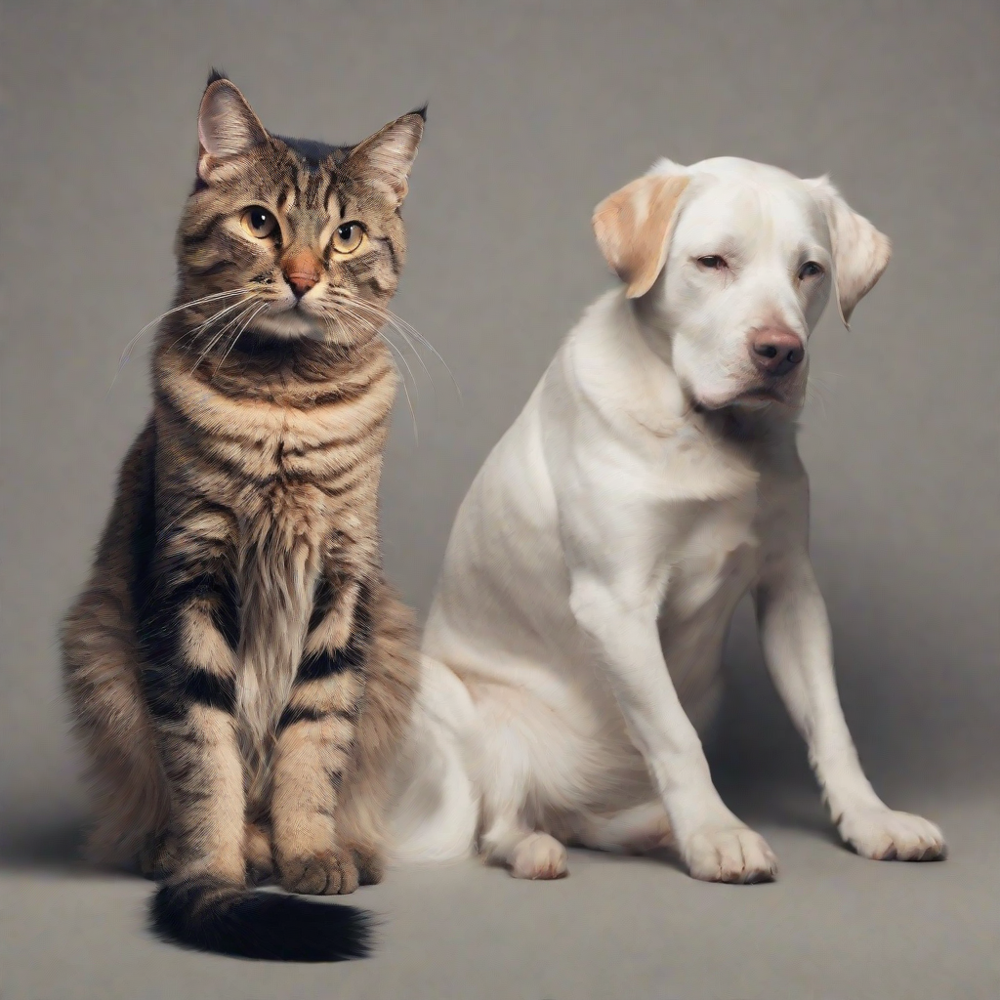
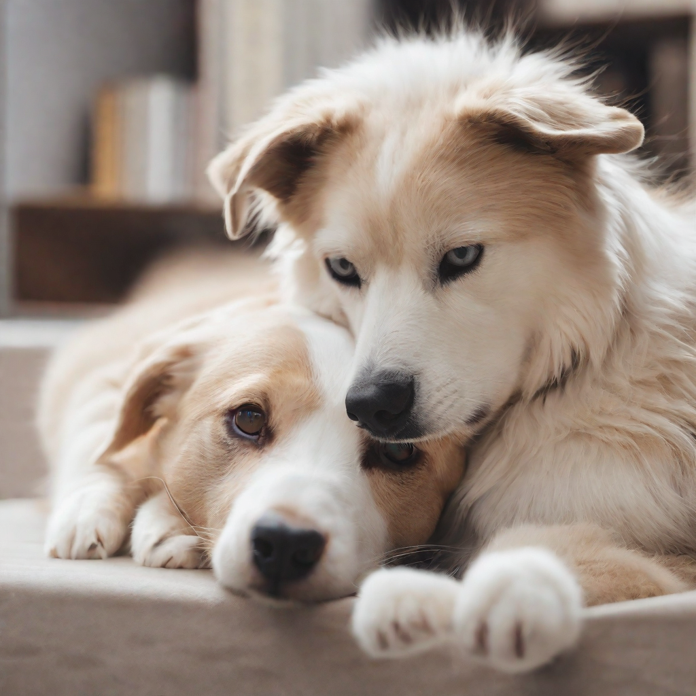
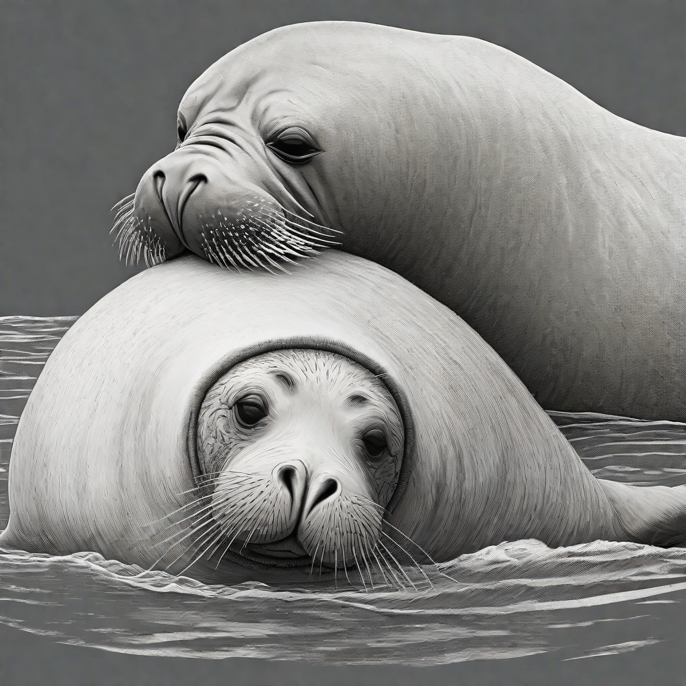
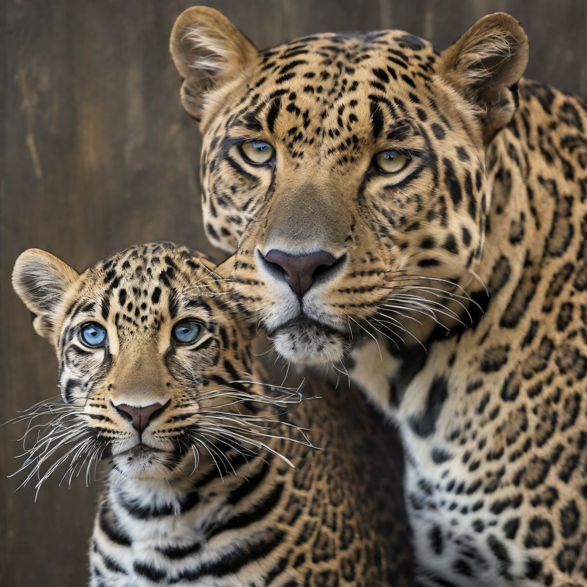
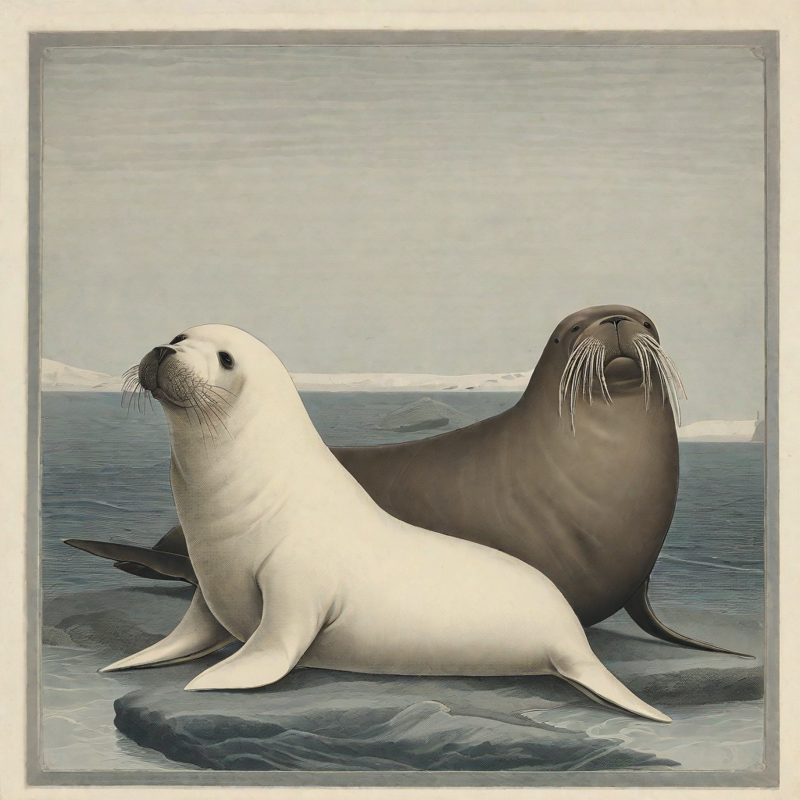
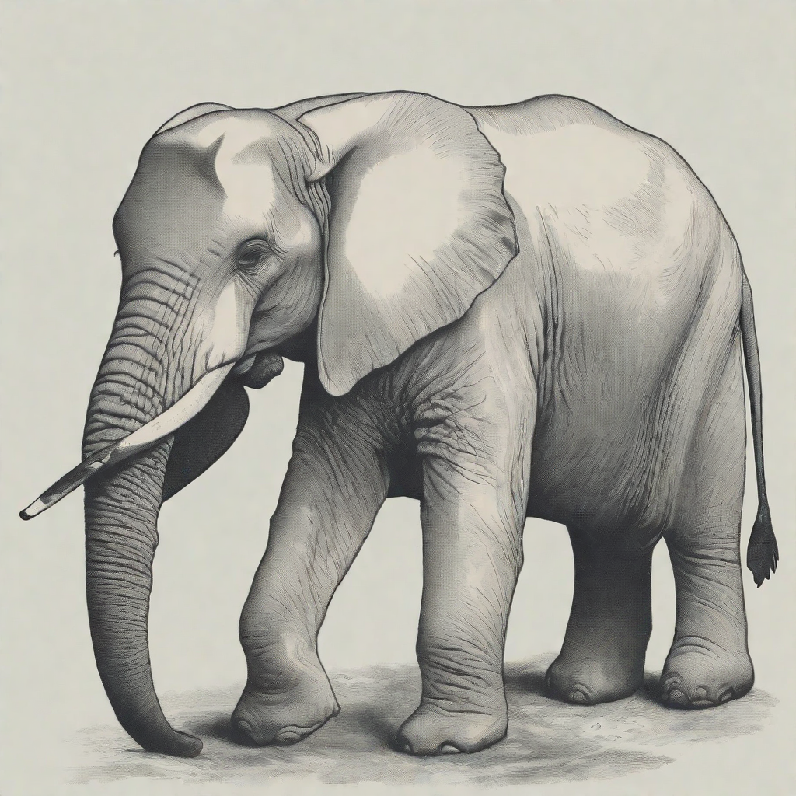

# 📒 Report: do the images scored as composed contain both animals?

**No verdict has been recorded for this question.** A [compose rate](../../../context/world/compose-rate.md#what-a-compose-rate-is)
is the share of images a detector scores as holding two or more animals. At full correction strength
it reads 94%, which is 30 of 32 images. A hand sort of those 32 finds 12 with both requested animals,
one with two of the same animal, and 17 that the sort could not settle by eye.

## Table of contents

- [What the detector scored on all 32 images](#what-the-detector-scored-on-all-32-images)
- [One image from each pile](#one-image-from-each-pile)
- [How far the rate could sit from 94 percent](#how-far-the-rate-could-sit-from-94-percent)
- [Where the sources disagree](#where-the-sources-disagree)
- [What this cannot tell you](#what-this-cannot-tell-you)
- [Concepts this uses](#concepts-this-uses)
- [Where this came from](#where-this-came-from)
- [Still open](#still-open)

## What the detector scored on all 32 images

Navigation: 📋 [TOC](#table-of-contents) | [Next](#one-image-from-each-pile) ➡️

> [!NOTE]
> The contact sheet of all 32 images is not shown here because its second row holds a frog and toad pair,
> which the [pair ledger](../../../artifacts/_shared/cross_pair_pool_configs/pair_ledger.md) holds back from every sheet. The file stays at
> `1-lora-correction/artifacts/results/measuring-composition/the-scorers/can-we-trust-the-compose-score/do-the-successful-cells-contain-both-animals/contact-sheet.png`.

**The detector scores 30 of the 32 images as composed, and the hand sort puts them in five piles.** The
contact sheet shows every image at full correction strength: 8 animal pairs at seeds 9 to 12, each tile titled
with its pair, seed and detector count `verified` (counted on the picture; all 32 counts and calls match
between [the hand-sort file](../../artifacts/results/measuring-composition/the-scorers/can-we-trust-the-compose-score/do-the-successful-cells-contain-both-animals/calls.json)
and `outputs/interaction_term/dose/dose_curves.json`).

| Pile on [the audit card](../../artifacts/results/measuring-composition/the-scorers/can-we-trust-the-compose-score/do-the-successful-cells-contain-both-animals/README.md) | Images | Detector's call |
|---|---|---|
| both requested animals present | 12 | composed |
| two of the same animal | 1 | composed |
| cannot decide | 5 | composed |
| the two animals look alike | 12 | composed |
| scored as a failure | 2 | not composed |

> [!NOTE]
> The 94% does not carry the comparison-strip fault. Before commit `0811f029`, `compose_rate.py` also
> scored each `__cmp` strip, whose target panel always shows two animals. The 94% comes from a different
> script: [the strength-sweep scorer](../../scripts/plot_dose_curves.py) reads only the file named after
> its run folder (line 94, present since the script's first commit on 2026-08-05) and writes
> `dose_curves.json` (line 220) `verified`.

## One image from each pile

Navigation: ⬅️ [Previous](#what-the-detector-scored-on-all-32-images) | 📋 [TOC](#table-of-contents) | [Next](#how-far-the-rate-could-sit-from-94-percent) ➡️

**A count of two can be a cat and a dog, two dogs, or two animals nobody can name.** The count under each
picture is the detector's. The description is what the picture shows at full size.

| Both animals | Two of the same | Cannot decide |
|---|---|---|
|  |  |  |
| cat and dog, seed 9, count 2: a tabby cat and a white dog `verified` | cat and dog, seed 10, count 2: two dogs and no cat, scored as composed `verified` | seal and walrus, seed 10, count 2: two pale animals and no visible tusks `verified` |

| The two look alike | Scored a failure, two animals visible | Scored a failure, one animal |
|---|---|---|
|  |  |  |
| leopard and jaguar, seed 10, count 2: two spotted big cats `verified`; the card says the image cannot settle which is which `stated` | seal and walrus, seed 9, count 1: a pale seal and a brown whiskered animal `verified` | elephant and penguin, seed 9, count 1: one elephant and no penguin `verified` |

## How far the rate could sit from 94 percent

Navigation: ⬅️ [Previous](#one-image-from-each-pile) | 📋 [TOC](#table-of-contents) | [Next](#where-the-sources-disagree) ➡️

**The rate depends on how the unsettled images are counted, and that choice is the owner's.** Each row
below starts from the detector's 30 and moves whole images. The rate is the images counted as composed
divided by 32, calculated for this page from the pile sizes above.

| How the images are counted | Composed, of 32 | Rate |
|---|---|---|
| as the detector scored them | 30 | 93.75%, the recorded 94% |
| take out the two-dog image | 29 | 90.6% |
| also take out the 5 cannot-decide images | 24 | 75.0%, the lower end [the plan](../../plans/02-can-we-trust-the-compose-rate/MASTER_PLAN.md) records |
| also take out the 12 look-alike images | 12 | 37.5% |
| as the detector scored them, plus the seal and walrus image at seed 9 | 31 | 96.9% |

The card and [the review of the strength sweep](../../artifacts/plans/completed/03-does-the-correction-cause-composition/review/03-more-correction-more-composition.md)
call 94% an upper bound. The last row shows that this holds only while the seal and walrus image at seed
9 stays a correct failure `inferred` (one reading of one picture).

## Where the sources disagree

Navigation: ⬅️ [Previous](#how-far-the-rate-could-sit-from-94-percent) | 📋 [TOC](#table-of-contents) | [Next](#what-this-cannot-tell-you) ➡️

**Four recorded statements conflict with another source or with the picture, and each is shown unresolved.**

| What | One source | The other source | What the files show |
|---|---|---|---|
| the lower end of the true rate | the audit card says about 87% to 94% | the plan says 75% to 94%, and that 87% "counts the 17 uncallable images as successes" | counting those 17 as successes gives 29 of 32, or 90.6%. 75% is 24 of 32. The card shows no arithmetic for 87%; the nearest whole-image rate is 28 of 32, or 87.5% |
| seal and walrus, seed 9 | the card says the failure call is correct | the picture shows a pale seal and a brown whiskered animal, two separate bodies | `dose_curves.json` records count 1 and stores no boxes, so the saved files do not show why the detector returned one |
| elephant and penguin, seed 9 | the card says "two elephants and no penguin", merged into one box | the picture shows one elephant, with one head and four legs | the recorded count of 1 agrees with the picture |
| elephant and penguin, seed 11 | the card files it under both animals present, "no argument" | [the picture](../../artifacts/results/measuring-composition/the-scorers/can-we-trust-the-compose-score/do-the-successful-cells-contain-both-animals/both-animals-there/an_elephant__x__a_penguin_seed11_n2.png) shows an elephant and a small grey beaked creature with flipper-like limbs | whether that creature counts as a penguin is a reading of the picture `inferred` |

## What this cannot tell you

Navigation: ⬅️ [Previous](#where-the-sources-disagree) | 📋 [TOC](#table-of-contents) | [Next](#concepts-this-uses) ➡️

**The detector's count is not a count of animals.** On leopard and jaguar at seed 9 it reports 3 for an
image [the scorer note](../../artifacts/results/measuring-composition/the-scorers/can-we-trust-the-compose-score/the-scorers-instance-count-is-not-a-count.md)
describes as two big cats. The third box is 162 by 473 pixels at confidence 0.309 `stated`. It clears the
confidence floor of 0.30 and the size floor, which tests a box's longer side against a quarter of the
image, 256 pixels here ([the scorer](../../../poe_repair/experiments/compose_scorer_validation/detection_scorer.py),
lines 46 to 87) `verified`. A rule of two or more is unaffected when two real boxes are present.

**The hand sort covers one strength.** It audits full correction only, so the rates at strengths 0.25,
0.5 and 0.75 have no matching hand sort.

**The sort is one person's reading of 8 animal pairs.** Three of those pairs were chosen because they
blend `stated` (the card), so their images are the hardest to call.

## Concepts this uses

Navigation: ⬅️ [Previous](#what-this-cannot-tell-you) | 📋 [TOC](#table-of-contents) | [Next](#where-this-came-from) ➡️

The toy numbers below are invented. The project numbers are from the files named on this page.

### Counting animals with a detector

An [object detector](../../../../../Obsidian/Artificial%20Intelligence/Deep%20Learning/Object%20Detector.md#where-to-learn-this)
draws a box round each thing it finds and gives each box a confidence. Ask one for "coin" on a photo of
two coins and say it returns four boxes.

| Box | Confidence | What happens to it |
|---|---|---|
| A | 0.90 | kept |
| B | 0.80 | kept |
| C | 0.85 | sits almost on top of A, so the more confident A wins and C goes |
| D | 0.20 | below the 0.30 floor, so it goes |

An instance is one box left standing, and the instance count is how many are left: here 2. The project
asks for "animal", keeps confidence 0.30 or more and a longer side of at least a quarter of the image,
drops a box overlapping a stronger one by 0.5 or more, and calls an image composed at a count of 2 or more.

### A compose rate

If 3 of 4 images are called composed, the compose rate is 3 / 4 = 75%. "Compose" is the call on one image,
and "rate" is the share of images with that call. Here it is 30 / 32 = 93.75%, printed as 94%.

### A false positive and a false negative

Put the scorer across the top and a careful reader down the side. Say 10 images fall like this.

| | Scorer says two | Scorer says one |
|---|---|---|
| reader sees both | 6 | 1 |
| reader does not | 1 | 2 |

The 1 at top right is a false negative: "false" because the scorer was wrong, "negative" because it said no.
The 1 at bottom left is a false positive: wrong again, and this time it said yes. The same table on the 32
images uses the card's piles, with the seal and walrus image at seed 9 moved by this page's reading.

| | Scorer says two | Scorer says one |
|---|---|---|
| both requested animals | 12 | 1 (seal and walrus, seed 9) |
| not both | 1 (two dogs) | 1 (elephant, seed 9) |
| the sort cannot say | 17 | 0 |

The bottom row is why one rate cannot be read off this table.

## Where this came from

Navigation: ⬅️ [Previous](#concepts-this-uses) | 📋 [TOC](#table-of-contents) | [Next](#still-open) ➡️

| What | Source | Mark |
|---|---|---|
| the 32 counts and calls | the hand-sort file and `outputs/interaction_term/dose/dose_curves.json`, compared cell by cell on 2026-11-22 | `verified` |
| the piles and their meaning | [the audit card](../../artifacts/results/measuring-composition/the-scorers/can-we-trust-the-compose-score/do-the-successful-cells-contain-both-animals/README.md) | `stated` |
| the third box | [the scorer note](../../artifacts/results/measuring-composition/the-scorers/can-we-trust-the-compose-score/the-scorers-instance-count-is-not-a-count.md), written 2026-08-05 | `stated` |
| how an image is scored | [the strength-sweep scorer](../../scripts/plot_dose_curves.py) and [the detector rule](../../../poe_repair/experiments/compose_scorer_validation/detection_scorer.py) | `verified` |
| the 75% band and its open task | [the plan](../../plans/02-can-we-trust-the-compose-rate/MASTER_PLAN.md) and [its review](../../plans/02-can-we-trust-the-compose-rate/review/04-the-three-state-labelled-set.md) | `stated` |
| 25 tiles held out of the drain | the rest of the 32 scored images, in this result's folder. Each is a tile of the contact sheet, and the folder includes the held-back pair, so it is not linked here | `stated` |

## Still open

Navigation: ⬅️ [Previous](#where-this-came-from) | 📋 [TOC](#table-of-contents)

- [ ] Choose how the 17 unsettled images count, which sets the band around 94%.
- [ ] Decide whether the seal and walrus image at seed 9 is a missed composition. If it is, 94% is no longer an upper bound.
- [ ] Re-read the elephant and penguin images at seeds 9 and 11 against what the card says about them.
- [ ] Run the labelling pass in [the three-state labelled set plan](../../plans/02-can-we-trust-the-compose-rate/plans/tools/04-the-three-state-labelled-set.md), which also owns correcting the card's band.
- [ ] Write the card for the compose-score folder, which its index row lists as "no card yet".
- [ ] Find `scorer_validated.json`. The strength-sweep scorer refuses to run without it, and its folder is absent from this laptop.

<!-- built-to: PAGE_LOOK_FORMAT v1 -->
