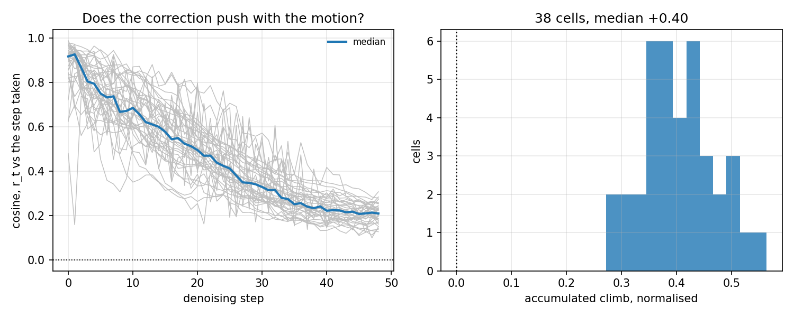
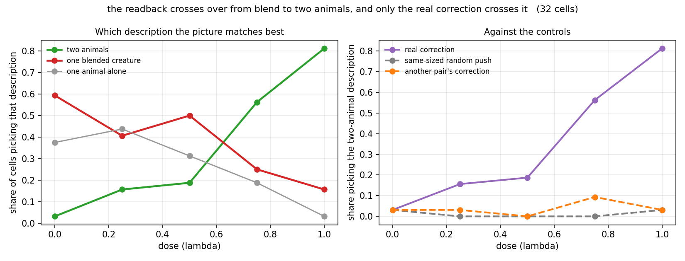
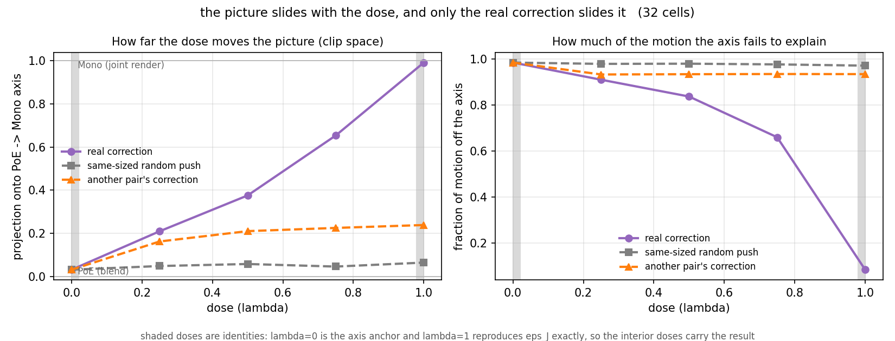
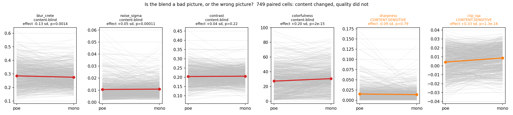
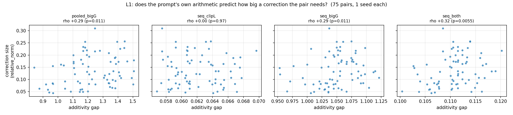
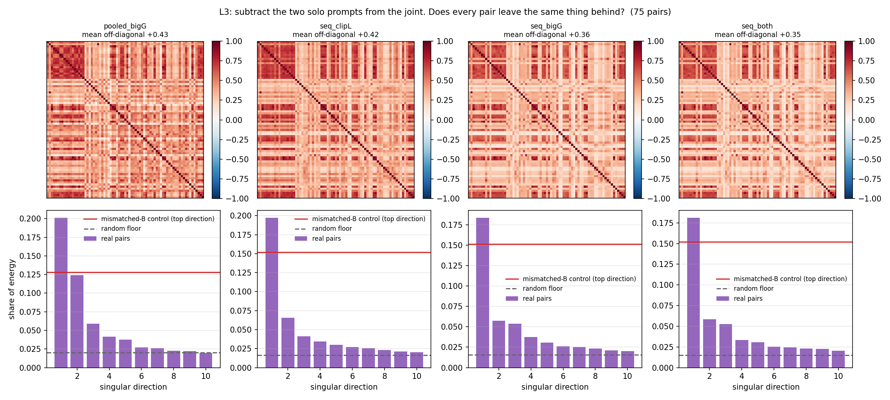
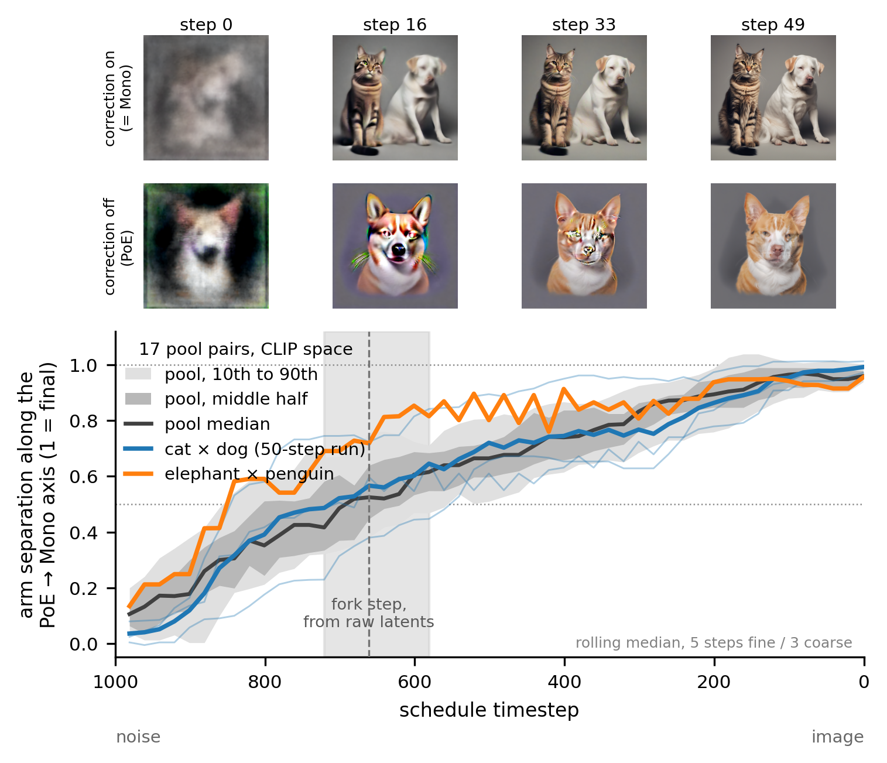
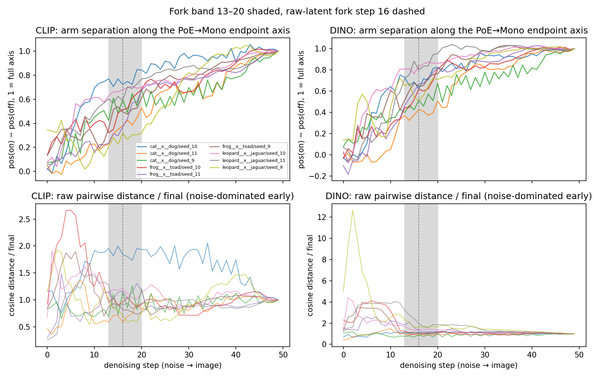
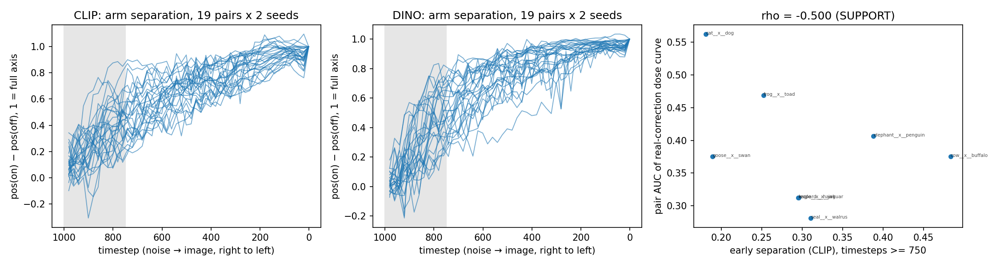

# 📒 Report: does the correction cause composition?

**This page adds no verdict: it gathers the three already recorded and shows the pictures behind them.**
The correction is the difference, at each denoising step, between the joint prompt's prediction and the
[product of experts](../../../../../Obsidian/Artificial%20Intelligence/Generative%20Modeling/Product%20Of%20Experts.md#where-to-learn-this)
prediction for the same noisy picture ([its definition](../../../context/world/interaction-term.md#what-the-interaction-term-is)).
The question is whether adding that difference back is what makes two separate animals appear.

| Question | Recorded answer | The number | Where the verdict lives |
|---|---|---|---|
| does more correction give more composition? | yes | [compose rate](../../../context/world/compose-rate.md#what-a-compose-rate-is), the share of images with two separate animals: 3% with none added, 94% at full strength; both control pushes stay at or below 6%; 32 runs per point `stated` | [the review of the strength sweep](../../artifacts/plans/completed/03-does-the-correction-cause-composition/review/03-more-correction-more-composition.md) |
| does it matter when the correction arrives? | yes, at the very start | on [the timing page](when-does-the-correction-have-to-act.md) | [the review of the timing grid](../../artifacts/plans/completed/03-does-the-correction-cause-composition/review/05-when-in-the-run-it-matters.md) |
| do five checks that avoid the compose scorer agree? | two yes, one yes with a caution, two no | [the table below](#five-checks-that-avoid-the-compose-scorer) | [the review of the five checks](../../plans/03-does-the-correction-cause-composition/review/06-the-same-story-from-three-sides.md) |

The grid shows one pair, cat and dog at seed 9, with a column per strength and a row per thing added. On the
curve beneath it, y is the compose rate, x is the strength, and one point is 32 runs, read from
`outputs/interaction_term/dose/dose_curves.json` `verified`. Its three controls are wrong pair, wrong seed and
wrong order, a different set from the two in the table above, and [the strength grid page](../measuring-composition/how-big-the-strength-grid-should-be.md#what-the-curve-under-the-grid-counts)
gives their counts.

## Table of contents

- [The correction opposes the product's own prediction](#the-correction-opposes-the-products-own-prediction)
- [Five checks that avoid the compose scorer](#five-checks-that-avoid-the-compose-scorer)
- [The corrected and plain runs part gradually](#the-corrected-and-plain-runs-part-gradually)
- [Where the sources disagree](#where-the-sources-disagree)
- [What this cannot tell you](#what-this-cannot-tell-you)
- [Concepts this uses](#concepts-this-uses)
- [Where this came from](#where-this-came-from)
- [Still open](#still-open)

## The correction opposes the product's own prediction

Navigation: 📋 [TOC](#table-of-contents) | [Next](#five-checks-that-avoid-the-compose-scorer) ➡️

**In all 38 cached runs the correction points against what the product asks for.** On the left, y is the
cosine between the correction and the step the sampler took, x is the denoising step, each grey line is
one run, and the blue median falls from 0.92 to 0.21 `verified` (picture and review agree). On the right,
one count is one run and x is that run's correction-times-step total divided by the product of their
sizes, an average cosine. The median is +0.40 and no run is below zero `verified`.

A sampler step moves along minus the prediction, so a positive value here means the correction sits
opposite the prediction ([the script's note](../../scripts/plausibility_climb.py)). The cosine between the
correction and the product's prediction is negative in 38 of 38 runs, median -0.14. A random direction
reads +0.000 and a correction taken from the wrong step reads +0.11 `stated`
([the review of the cached runs](../../plans/03-does-the-correction-cause-composition/review/04-what-the-cached-runs-already-show.md)).

## Five checks that avoid the compose scorer

Navigation: ⬅️ [Previous](#the-correction-opposes-the-products-own-prediction) | 📋 [TOC](#table-of-contents) | [Next](#the-corrected-and-plain-runs-part-gradually) ➡️

**The three checks on images came back positive and the two on the prompt's text came back null.** Each
bar was written before its run. Strength below means how much of the correction was added, from 0 (none)
to 1 (all of it).

| Which caption wins | Position between the plain and corrected picture | Image quality |
|---|---|---|
|  |  |  |
| y: share of 32 cat and dog runs whose picture best matches each caption; x: strength | y: position from the plain render (0) to the corrected render (1) in CLIP image space; x: strength | y: the measure's value; one grey line is one of 749 image pairs |

| The prompt's text alone | What is left after subtracting the solo prompts |
|---|---|
|  |  |
| y: correction size; x: how far the joint prompt's embedding sits from the two solo prompts added; one point is one of 75 pairs | top: similarity between pairs; bottom: share of energy per direction, with the mismatched-prompt control in red |

| Check | Bar | Measured | Recorded answer |
|---|---|---|---|
| two-animal caption at strength 0.75 | share at least 50%, gain at least 20 points, each control gaining under half the real gain | 56% from 3%; controls gain -3 and +6 points, which is -5.9% and +11.8% of the real gain `verified` | yes |
| position, mean over strengths 0.25, 0.5 and 0.75 | at least 0.30, each control under half the real travel | 0.413; a random push travels 5% of that and another pair's correction 44% `verified` | yes |
| four quality measures, effect in [standard deviations](#a-paired-effect-in-standard-deviations) | under 0.20, or p above 0.05 | blur -0.13, noise +0.05, contrast +0.04, colourfulness +0.1994, while compose rate goes 13.9% to 48.9% (323 images gained, 61 lost) `verified` | yes, with colourfulness on the bar |
| text gap against correction size, four views of the prompt | [rank correlation](#a-rank-correlation) at least 0.30 in size with p at most 0.05 | +0.29, +0.00, +0.29, +0.32 `verified` | no ([the rule has two readings](#where-the-sources-disagree)) |
| top leftover direction against the mismatched-prompt control | at least 2.0 times | 1.19 to 1.57 times `verified` | no |

## The corrected and plain runs part gradually

Navigation: ⬅️ [Previous](#five-checks-that-avoid-the-compose-scorer) | 📋 [TOC](#table-of-contents) | [Next](#where-the-sources-disagree) ➡️

**The two runs separate in meaning from about step 3, with no sharp fork** `stated` ([the card](../../artifacts/results/what-the-correction-is/does-it-cause-composition/how-far-the-corrected-run-separates-from-the-uncorrected-one/README.md)). Each run was decoded step by
step and placed on the axis from its own plain picture (0) to its own corrected picture (1).

| One run and the pool | Nine 50-step runs | All 19 pairs at 20 steps |
|---|---|---|
|  |  |  |
| y: separation; x: schedule timestep, noise on the left | y: separation (top), raw distance over its final value (bottom); x: step | left two: separation against timestep; right: one point is one pair, y its response to the correction, x its early separation |

The written check asked for the steepest rise inside steps 13 to 20. That held for 3 of 9 runs in CLIP and
1 of 9 in DINOv2 `verified` (counted from `rise_in_window` in the [run separation file](../../artifacts/results/what-the-correction-is/does-it-cause-composition/how-far-the-corrected-run-separates-from-the-uncorrected-one/divergence.json)).
At step 16 the runs have covered 0.32 to 0.72 of the axis in CLIP (median 0.51) and 0.43 to 0.83 in DINOv2
(median 0.62), read from `separation[16]` for the 9 runs `verified`.

Pairs that separate more early respond worse to the correction. Rank correlation between early separation
(timesteps 750 and above) and the area under each pair's compose-rate curve is -0.500 in CLIP, exactly on
the 0.5 bar, and -0.690 in DINOv2, over 8 pairs `verified` ([the 20-step separation file](../../artifacts/results/what-the-correction-is/does-it-cause-composition/how-far-the-corrected-run-separates-from-the-uncorrected-one/dose_divergence.json)).

## Where the sources disagree

Navigation: ⬅️ [Previous](#the-corrected-and-plain-runs-part-gradually) | 📋 [TOC](#table-of-contents) | [Next](#what-this-cannot-tell-you) ➡️

**Five recorded facts conflict, and each is shown here unresolved.**

| What | One source | The other source | What the code shows |
|---|---|---|---|
| sign of the noise effect | the [five checks card](../../artifacts/results/what-the-correction-is/does-it-cause-composition/does-the-interaction-term-cause-composition/five-checks-from-three-sides/README.md) and the review say -0.05 sd | the [quality file](../../artifacts/results/what-the-correction-is/does-it-cause-composition/does-the-interaction-term-cause-composition/five-checks-from-three-sides/quality_control_cache.json) records +0.0461 and the picture prints +0.05 | both come from `paired_read`, lines 228 to 238 of [the quality script](../../scripts/quality_control.py); the verdict holds at either sign |
| strength of the 56% caption share | the card says "56% at dose 1.0" | the [caption file](../../artifacts/results/what-the-correction-is/does-it-cause-composition/does-the-interaction-term-cause-composition/five-checks-from-three-sides/caption_readback.json), the picture and the review put 56% at 0.75 and 81% at 1.0 | the file's `scored_at_lambda` is 0.75 |
| seeds behind the 20-step curves | the picture's title says 19 pairs x 2 seeds | the file holds 27 curves: 8 pairs at 2 seeds and 11 at 1 | `max_seeds_per_pair` is a ceiling; the [card](../../artifacts/results/what-the-correction-is/does-it-cause-composition/how-far-the-corrected-run-separates-from-the-uncorrected-one/README.md) records that 11 pairs saved one seed |
| whether the text gap predicts difficulty | the review answers no | the [text file](../../artifacts/results/what-the-correction-is/does-it-cause-composition/does-the-interaction-term-cause-composition/five-checks-from-three-sides/language_probes.json) marks `predicts: true` for the view joining both encoders (+0.3175, p 0.0055) | [the script](../../../5-text-embedding-third-expert/scripts/language_probes.py), line 262, applies the bar per view and has no rule for combining views |
| why the sharpness measure was excluded | the card says two animals score higher on it | the file records -0.09 sd, p 0.79 | the number comes from `sharpness`, lines 115 to 119 of the quality script, a Laplacian variance, and is quoted as recorded while that measure is under review |

**The text gap's rule can be read two ways, and the choice is the owner's.**

| How the rule is read | Views that pass | That reading would give |
|---|---|---|
| any one of the four views clearing the bar counts | 1 of 4 | yes |
| the gap has to clear the bar across the views, as the review argues | 1 of 4 | no (the recorded answer) |

## What this cannot tell you

Navigation: ⬅️ [Previous](#where-the-sources-disagree) | 📋 [TOC](#table-of-contents) | [Next](#concepts-this-uses) ➡️

**The ends of the strength axis prove nothing.** At strength 1 the correction rebuilds the joint prompt's
prediction by arithmetic, so only strengths 0.25, 0.5 and 0.75 carry the position and caption results.

**A position on the axis is no compose score.** At those strengths 66% to 91% of the picture's motion falls
off the axis, and whole-image CLIP distance was already ruled out for telling a blend from two animals.

**The caption and position checks cover one pair.** Both use 32 cat and dog runs, and the caption bank is
hand-written.

**The opposition result reads the plain run only.** The cache holds the uncorrected path, so it measures the
push the correction would apply at states the product visits.

## Concepts this uses

Navigation: ⬅️ [Previous](#what-this-cannot-tell-you) | 📋 [TOC](#table-of-contents) | [Next](#where-this-came-from) ➡️

The toy numbers below are invented. The project numbers are from the result files named above. The
[appearance page](what-does-the-correction-look-like.md#concepts-this-uses) and the
[timing page](when-does-the-correction-have-to-act.md#concepts-this-uses) teach the rest.

### The correction and its strength

Say the product predicts (2, 6) and the joint prompt predicts (3, 4). The correction is joint minus
product, (1, -2). At strength 0.5 you add half of it: (2, 6) + 0.5 x (1, -2) = (2.5, 5). At strength 1 you
land exactly on the joint prediction. Here each prediction holds 4 x 128 x 128 numbers, and the strengths
tried are 0, 0.25, 0.5, 0.75 and 1.

### A position along an axis

Put the plain picture at (0, 0), the corrected picture at (4, 0), and a new picture at (1, 3). The position
is how far it got along the line: (1 x 4 + 3 x 0) / (4 x 4) = 0.25. The off-axis share is the part of its
move the line misses: 3 / 3.16 = 0.95. Here the real correction at strength 0.5 sits at position 0.376 with
an off-axis share of 0.84.

### A paired effect in standard deviations

Two images score (1, 3) before and (2, 4) after. Each rose by 1, so the mean change is 1. The spread of all
four values together is 1.12, so the effect is 1 / 1.12 = 0.89 standard deviations. That is mean change
divided by pooled spread, the calculation at lines 233 and 234 of the quality script. For colourfulness the
mean change is 3.28 and the effect is 0.1994, so the pooled spread is 3.28 / 0.1994 = 16.45. This is a
[paired difference](../../../../../Obsidian/Mathematics/Statistics/Paired%20Difference.md#where-to-learn-this) scaled by spread.

### A rank correlation

Four pairs rank 1, 2, 3, 4 on the text gap and 1, 3, 2, 4 on correction size. Two neighbours swapped, so the
squared rank differences are 0, 1, 1, 0 and sum to 2. Spearman's formula gives 1 - 6 x 2 / (4 x 15) = 0.8.
It is a [correlation](../../../../../Obsidian/Mathematics/Statistics/Correlation%20Coefficient.md#where-to-learn-this) of the
ranks, so it asks only whether the order agrees. Here the four views read +0.29, +0.00, +0.29 and +0.32 over
75 pairs.

## Where this came from

Navigation: ⬅️ [Previous](#concepts-this-uses) | 📋 [TOC](#table-of-contents) | [Next](#still-open) ➡️

| What | Source | Mark |
|---|---|---|
| the five checks | [their card](../../artifacts/results/what-the-correction-is/does-it-cause-composition/does-the-interaction-term-cause-composition/five-checks-from-three-sides/README.md) and the [caption](../../artifacts/results/what-the-correction-is/does-it-cause-composition/does-the-interaction-term-cause-composition/five-checks-from-three-sides/caption_readback.json), [position](../../artifacts/results/what-the-correction-is/does-it-cause-composition/does-the-interaction-term-cause-composition/five-checks-from-three-sides/manifold_slide_clip.json), [quality](../../artifacts/results/what-the-correction-is/does-it-cause-composition/does-the-interaction-term-cause-composition/five-checks-from-three-sides/quality_control_cache.json) and [text](../../artifacts/results/what-the-correction-is/does-it-cause-composition/does-the-interaction-term-cause-composition/five-checks-from-three-sides/language_probes.json) files, read 2026-11-22 | `verified` |
| run separation | [its card](../../artifacts/results/what-the-correction-is/does-it-cause-composition/how-far-the-corrected-run-separates-from-the-uncorrected-one/README.md), the [50-step](../../artifacts/results/what-the-correction-is/does-it-cause-composition/how-far-the-corrected-run-separates-from-the-uncorrected-one/divergence.json) and [20-step](../../artifacts/results/what-the-correction-is/does-it-cause-composition/how-far-the-corrected-run-separates-from-the-uncorrected-one/dose_divergence.json) files, read 2026-11-22 | `verified` |
| the recorded answers | the three reviews linked in the opening table | `stated` |
| how the grouping is filed | the [index of what the correction is](../../artifacts/results/what-the-correction-is/README.md) and the [card for this question](../../artifacts/results/what-the-correction-is/does-it-cause-composition/README.md) | `stated` |
| what the correction is made of | [the finding on its reachable part](../when-does-the-outcome-lock-in/what-is-the-correction-made-of.md) | `stated` |

## Still open

Navigation: ⬅️ [Previous](#where-this-came-from) | 📋 [TOC](#table-of-contents)

- [ ] Choose how the text gap's bar applies across the four views.
- [ ] Settle the sign of the noise effect on the card and the review.
- [ ] Write the cards for the five-check parent folder and for the correction-strength folder, which has none.
- [ ] Find out why text anchoring separates a blend from two animals when image-to-image distance does not, the question the review leaves open.
- [ ] Run more of the mis-aimed control, whose 44% is the weakest number in the five checks.

<!-- built-to: PAGE_LOOK_FORMAT v1 -->
