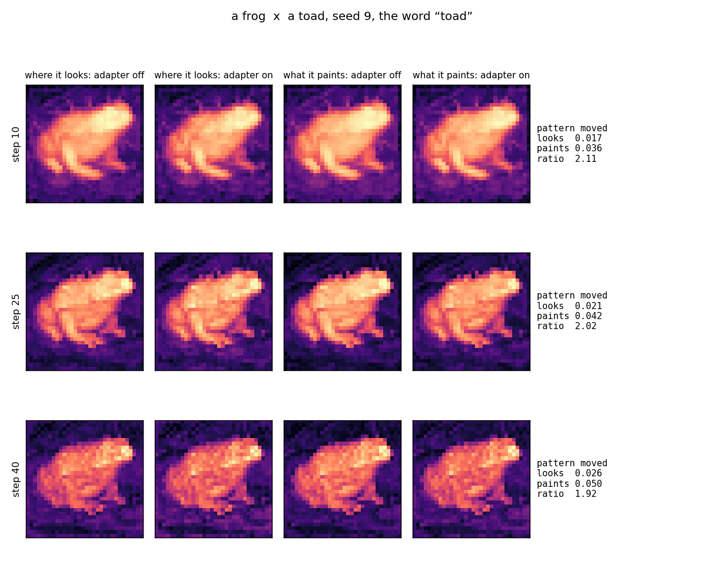
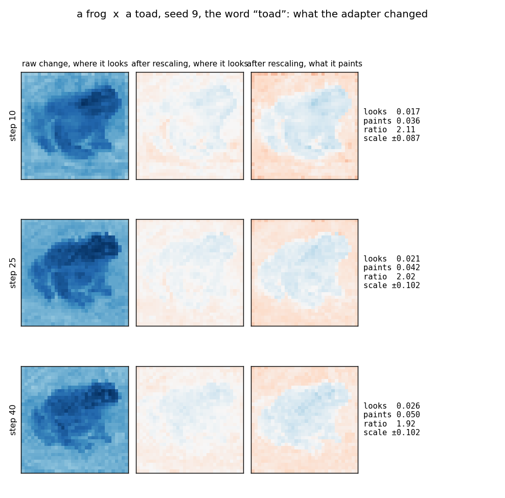
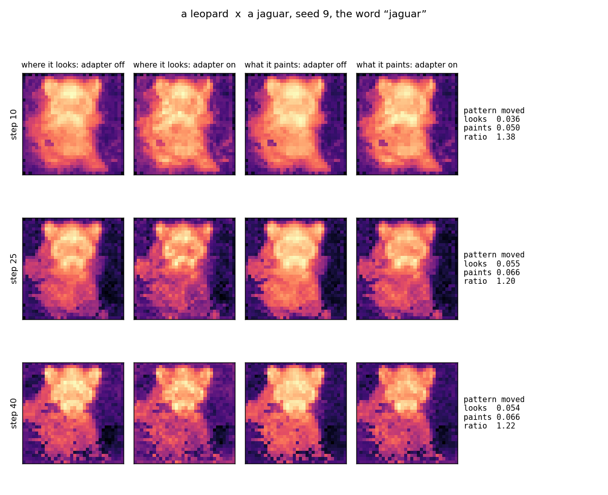
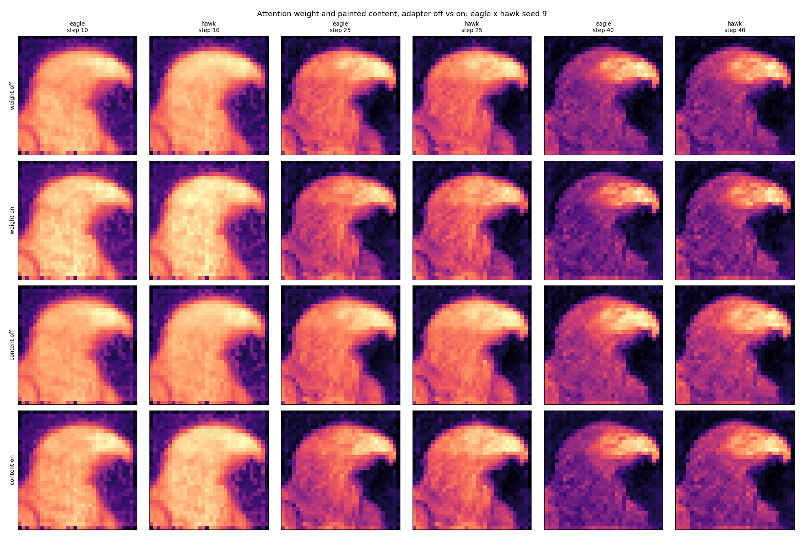
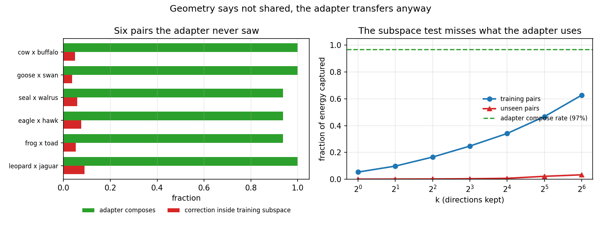

# 📒 Report: what does the correction look like?

**The correction has a clear place in the picture and no direction shared across pairs.** This page gathers
four reads of it in the order they were made. Two carry a recorded verdict, and the other two record none.
The correction is [defined on the causation page](does-the-correction-cause-composition.md#the-correction-and-its-strength),
and what it is made of relative to the two experts is in
[the finding on its reachable part](../when-does-the-outcome-lock-in/what-is-the-correction-made-of.md).

| Read | Recorded answer | The number |
|---|---|---|
| does the adapter change what a word paints more than where it looks? | yes, replicated, on any pair it touches | median ratio 1.52 against a bar of 1.2 `stated` |
| does a subspace fitted on training pairs carry to unseen pairs? | no at the level of vectors, which says nothing about transfer | 6.0% of unseen pairs' energy inside it `verified` |
| do corrections share a few directions? | no structure against a fair floor | 1.41 times the floor at 8 directions `verified` |
| where in the frame does it land? | no verdict recorded | a face on the 8-seed average, noise on the control `verified` |

## Table of contents

- [What a word paints and where it looks](#what-a-word-paints-and-where-it-looks)
- [A subspace test that misses the transfer](#a-subspace-test-that-misses-the-transfer)
- [No directions shared across runs](#no-directions-shared-across-runs)
- [Where the correction lands in the frame](#where-the-correction-lands-in-the-frame)
- [Where the sources disagree](#where-the-sources-disagree)
- [What this cannot tell you](#what-this-cannot-tell-you)
- [Concepts this uses](#concepts-this-uses)
- [Where this came from](#where-this-came-from)
- [Still open](#still-open)

## What a word paints and where it looks

Navigation: 📋 [TOC](#table-of-contents) | [Next](#a-subspace-test-that-misses-the-transfer) ➡️

**The adapter moves the pattern of what a word paints about 1.5 times as much as the pattern of where it
looks.** In [cross-attention](../../../../../Obsidian/Artificial%20Intelligence/Deep%20Learning/Cross-Attention.md#where-to-learn-this)
each word gets a weight map (where it looks) and a content map (what it paints). The maps below are captured
with the adapter off and on at the same noisy picture.

| Strongest pair: the word toad | What the adapter changed on it | Weakest pair: the word jaguar |
|---|---|---|
|  |  |  |
| content-to-weight pattern ratio 2.11, 2.02, 1.92 at steps 10, 25, 40 `verified` | left: raw change; right two: what is left after a [single rescale](#a-pattern-change-after-a-rescale) | ratio 1.38, 1.20, 1.22 at the same steps `verified` |

The first short run, on eagle and hawk at seed 9, shows why the choice of measure decides the answer. The
four rows look almost alike `verified`, because most of the change is a uniform dimming `stated`.

| Measure on that one run | Weight map | Content map | Reads as |
|---|---|---|---|
| plain relative change | 0.236 | 0.139 | where it looks moves 1.70 times more |
| pattern left after one rescale | 0.034 | 0.054 | what it paints moves 1.57 times more |

The first row is unfair because the adapter dims the weight map by 25% overall `stated`
([the note on the measure](../../artifacts/results/what-the-correction-is/what-it-looks-like/residual-dynamics/content-change-relative-to-attention-change/measure-fairness.md)). The bar, written before the sweep, was a median ratio
of at least 1.2 with at least 75% of rows above 1. Over 64 runs the median is 1.52 with 373 of 384 rows above
1, and all 8 pairs pass, from 1.16 to 2.15 `stated`
([the review](../../artifacts/plans/completed/03-does-the-correction-cause-composition/review/07-what-the-fix-changes-inside-the-model.md)).
The elephant and penguin pair, which composes with no adapter, also reads 1.45. So the supported sentence is
that the adapter does this to any pair it touches.

## A subspace test that misses the transfer

Navigation: ⬅️ [Previous](#what-a-word-paints-and-where-it-looks) | 📋 [TOC](#table-of-contents) | [Next](#no-directions-shared-across-runs) ➡️

**A subspace fitted on 11 training pairs holds 6.0% of the unseen pairs' correction, and the adapter still
composes on them.** Left: one row is one unseen pair, with the fraction composed (green) and the fraction of
its correction's energy inside the training subspace (red). Right: y is energy captured, x is directions kept,
one line per set of pairs.

> [!WARNING]
> This picture predates the corrected scoring. It prints 97% composed, and the current
> [result file](../../artifacts/results/what-the-correction-is/what-it-looks-like/which-way-the-correction-points/does-the-subspace-test-predict-transfer/result.json) gives 91.7%. Both are in
> [the disagreement table](#where-the-sources-disagree).

| Unseen pair | Composed, current file | Energy inside the subspace (64 directions) |
|---|---|---|
| leopard and jaguar | 100% | 9.0% |
| frog and toad | 75% | 5.2% |
| eagle and hawk | 87.5% | 7.5% |
| seal and walrus | 87.5% | 5.9% |
| goose and swan | 100% | 3.7% |
| cow and buffalo | 100% | 4.9% |

Each rate is over 8 images at training step 60,000 `verified`. The corrections are nearly at right angles to
each other, with [cosine](../../../../../Obsidian/Mathematics/Linear%20Algebra/Cosine%20Similarity.md#where-to-learn-this) about
0.00 between pairs even inside the training set `stated`
([the query note](../../artifacts/results/what-the-correction-is/what-it-looks-like/which-way-the-correction-points/does-the-subspace-test-predict-transfer/QUERY.md)). So no fitted subspace could
contain another pair's correction, whether or not the adapter transfers.

## No directions shared across runs

Navigation: ⬅️ [Previous](#a-subspace-test-that-misses-the-transfer) | 📋 [TOC](#table-of-contents) | [Next](#where-the-correction-lands-in-the-frame) ➡️

**Against a floor with the corrections' real sizes, the stacked corrections are close to random.** The
measure is the [share of energy in the top directions](#energy-in-the-top-directions-and-a-fair-floor). This
read has no picture in its folder. All values are from [its result file](../../artifacts/results/what-the-correction-is/what-it-looks-like/which-way-the-correction-points/what-the-spectrum-measures/result.json) `verified`.

| Stack | Directions kept | Ratio to the floor |
|---|---|---|
| all rows, against an equal-size random floor | 1, then 8 | 14.2, then 10.8 |
| all rows, against a floor with the real sizes | 1, then 8 | 1.55, then 1.41 |
| 50 steps of one run, each row scaled to size 1 (median of 6 runs) | 1, then 8 | 11.2, then 4.8 |
| one step from each of 50 different runs, scaled the same way | 1, then 8 | 1.35, then 1.15 |

The structure that survives lives inside a single run, whose correction turns smoothly from step to step. The
[query note](../../artifacts/results/what-the-correction-is/what-it-looks-like/which-way-the-correction-points/what-the-spectrum-measures/QUERY.md) draws the consequence: the figure's argument that a
shared low-dimensional structure makes the correction learnable does not stand, and the learnability claim
rests on the adapter's measured behaviour `stated`.

## Where the correction lands in the frame

Navigation: ⬅️ [Previous](#no-directions-shared-across-runs) | 📋 [TOC](#table-of-contents) | [Next](#where-the-sources-disagree) ➡️

| The correction against the product | The control for subject position |
|---|---|
|  |  |
| rows: correction averaged over 8 seeds, one seed (42), the product's prediction averaged | rows: the difference, the joint prompt's prediction, the product's prediction, each averaged over 8 seeds |

**Averaged over 8 seeds, the correction draws one centred animal face, on the eyes, muzzle and ears.** Each
panel is 128 by 128 cells of the latent, brighter meaning a larger size `verified`. The same averaging on either
prediction alone gives noise, so the face is more than the model centring its subject.

| Step | Unevenness of the correction ([coefficient of variation](#a-coefficient-of-variation)) | Same, for the product's prediction | Agreement between seeds' correction maps (Pearson r) |
|---|---|---|---|
| 0 | 0.358 | 0.362 | 0.074 |
| 5 | 0.718 | 0.363 | 0.116 |
| 10 | 1.012 | 0.363 | 0.241 |
| 20 | 1.341 | 0.363 | 0.290 |
| 30 | 1.564 | 0.367 | 0.271 |
| 49 | 0.528 | 0.414 | 0.017 |

These are `stated` by [the card](../../artifacts/results/what-the-correction-is/what-it-looks-like/where-the-correction-lives-in-the-frame/README.md). The tensors behind them are on the cluster.

## Where the sources disagree

Navigation: ⬅️ [Previous](#where-the-correction-lands-in-the-frame) | 📋 [TOC](#table-of-contents) | [Next](#what-this-cannot-tell-you) ➡️

**Four recorded facts conflict, and the code explains three of them.**

| What | One source | The other source | What the code shows |
|---|---|---|---|
| adapter compose rate on the 6 unseen pairs | 96.9% on the picture, the query note and the review of the cached runs | 91.7% in the current result file | the old count also scored each three-panel comparison strip, whose target panel always holds two animals. Commit `0811f029` fixed this ([line 79 of the scorer](../../../poe_repair/experiments/does_the_fix_reach_unseen_pairs/compose_rate.py)) and commit `134f7cce` reran the file. Counting 8 renders plus 8 strips as composed reproduces five of the six old rates; frog and toad is one image off, which the code does not explain `inferred` |
| unseen energy at 64 directions | 3.3% on the picture; 13.3% in the review | 6.0% in the current file | the picture drew the old file, which pooled 8 held-out pairs (408 vectors) where the current file has 6 (306 vectors). The review says its 13.3% uses denser sampling `stated` |
| rank correlation between subspace share and compose rate | -0.43 in the query note and commit message | -0.19 with tied rates given their average rank | [the demo](../../artifacts/results/what-the-correction-is/what-it-looks-like/which-way-the-correction-points/does-the-subspace-test-predict-transfer/demo.py), lines 208 and 209, breaks ties by list order. Five of the six rates are tied, and the possible orders give -0.49 to +0.14 (every order enumerated from the file's six rows) |
| rows in the pooled spectrum | 440 in the query note and the review | 445 in the result file | [the control script](../../artifacts/results/what-the-correction-is/what-it-looks-like/which-way-the-correction-points/what-the-spectrum-measures/control.py) takes every cached seed, so 89 runs x 5 kept steps. The extra run being wolf and husky's ninth seed is `inferred`. Its directions stop at 32, so the note's row at 64 is absent from this file |

## What this cannot tell you

Navigation: ⬅️ [Previous](#where-the-sources-disagree) | 📋 [TOC](#table-of-contents) | [Next](#concepts-this-uses) ➡️

**The face is measured on one pair.** Cat and dog at seeds 42 to 49 is the only pair whose tensors were saved,
so whether other pairs show a face is unmeasured.

**The paint-versus-look ratio does not show how the fix works.** It appears on a pair that needs no fixing, and
the pool holds no pair the adapter demonstrably fails to help.

**The subspace and spectrum reads use one split.** That is 11 training pairs and 6 unseen pairs with one rank-8
adapter.

## Concepts this uses

Navigation: ⬅️ [Previous](#what-this-cannot-tell-you) | 📋 [TOC](#table-of-contents) | [Next](#where-this-came-from) ➡️

The toy numbers below are invented. [The correction and its strength](does-the-correction-cause-composition.md#the-correction-and-its-strength)
and [rank correlation](does-the-correction-cause-composition.md#a-rank-correlation) are taught on the causation page.

### Energy in the top directions and a fair floor

Stack two rows, (10, 0) and (0, 1). A [singular value decomposition](../../../../../Obsidian/Mathematics/Linear%20Algebra/Singular%20Value%20Decomposition.md#where-to-learn-this)
finds the directions carrying the most energy, here 100 and 1, so the top direction holds 100 / 101 = 99%. The
two rows share nothing, and one is simply bigger. A fair floor therefore uses random directions with the real
row sizes. Here the top 8 directions hold 22.5% of the energy, against 2.09% for an equal-size floor and 16.0%
for a real-size floor: 22.5 / 16.0 = 1.41.

### A pattern change after a rescale

Take an off map (2, 4) and an on map (1.5, 3.5). The best single rescale of off onto on is
(1.5 x 2 + 3.5 x 4) / (2 x 2 + 4 x 4) = 0.85, so the gain change is 0.15. What the rescale cannot explain is
(1.5, 3.5) - 0.85 x (2, 4) = (-0.2, 0.1), of size 0.224. Divided by the on map's size, 3.81, the pattern change
is 0.059. On the eagle and hawk run the weight map's gain change is 0.235 and its pattern change 0.034.

### A coefficient of variation

A map of (1, 1, 1, 5) has mean 2 and standard deviation 1.73, so its coefficient of variation is
1.73 / 2 = 0.87. A flat map of (2, 2, 2, 2) scores 0. Higher means the size is concentrated in fewer places.
Here the correction reaches 1.341 at step 20, while the product's prediction stays at 0.363.

## Where this came from

Navigation: ⬅️ [Previous](#concepts-this-uses) | 📋 [TOC](#table-of-contents) | [Next](#still-open) ➡️

| What | Source | Mark |
|---|---|---|
| the paint and look measure | [the note on the measure](../../artifacts/results/what-the-correction-is/what-it-looks-like/residual-dynamics/content-change-relative-to-attention-change/measure-fairness.md), [the handoff for the 64-run sweep](../../artifacts/results/what-the-correction-is/what-it-looks-like/residual-dynamics/content-change-relative-to-attention-change/RUN_ON_THIS_NODE.md) and [the review](../../artifacts/plans/completed/03-does-the-correction-cause-composition/review/07-what-the-fix-changes-inside-the-model.md) | `stated` |
| the subspace read | [the result file](../../artifacts/results/what-the-correction-is/what-it-looks-like/which-way-the-correction-points/does-the-subspace-test-predict-transfer/result.json), read 2026-11-22 | `verified` |
| the spectrum | [the result file](../../artifacts/results/what-the-correction-is/what-it-looks-like/which-way-the-correction-points/what-the-spectrum-measures/result.json), read 2026-11-22 | `verified` |
| the frame maps | [their card](../../artifacts/results/what-the-correction-is/what-it-looks-like/where-the-correction-lives-in-the-frame/README.md), pictures opened 2026-11-22 | `verified` for the pictures, `stated` for the table |
| how the grouping is filed | the [card for this question](../../artifacts/results/what-the-correction-is/what-it-looks-like/README.md) | `stated` |
| 7 pictures held out of the drain | the rest of [the follow-along series](../../artifacts/results/what-the-correction-is/what-it-looks-like/residual-dynamics/content-change-relative-to-attention-change/follow-along). It has no summary sheet, so the strongest and weakest pairs stand for it above | `stated` |

## Still open

Navigation: ⬅️ [Previous](#where-this-came-from) | 📋 [TOC](#table-of-contents)

- [ ] Redraw the subspace picture from the current result file and correct the 96.9% in the query note and the review.
- [ ] Decide whether the -0.43 rank correlation stands, given that tied rates allow -0.49 to +0.14.
- [ ] Check every other number read from a compose-rate file scored before commit `0811f029`.
- [ ] Measure whether the face appears on a second pair, which needs a fresh collection run.
- [ ] Write the cards for the correction-direction and residual-dynamics folders, which have none.

<!-- built-to: PAGE_LOOK_FORMAT v1 -->
