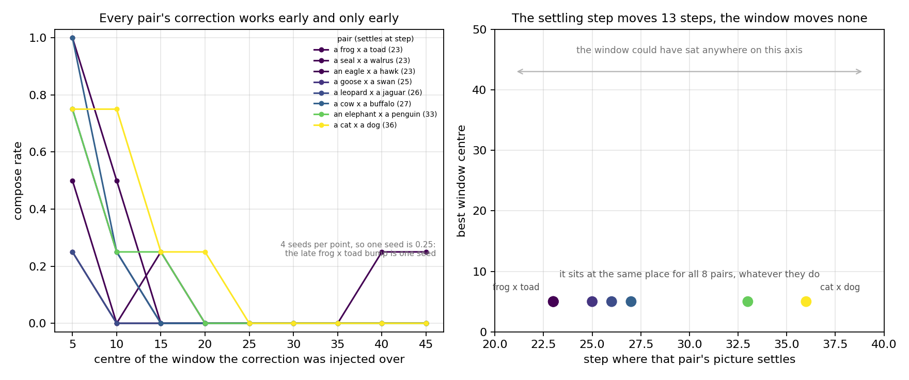
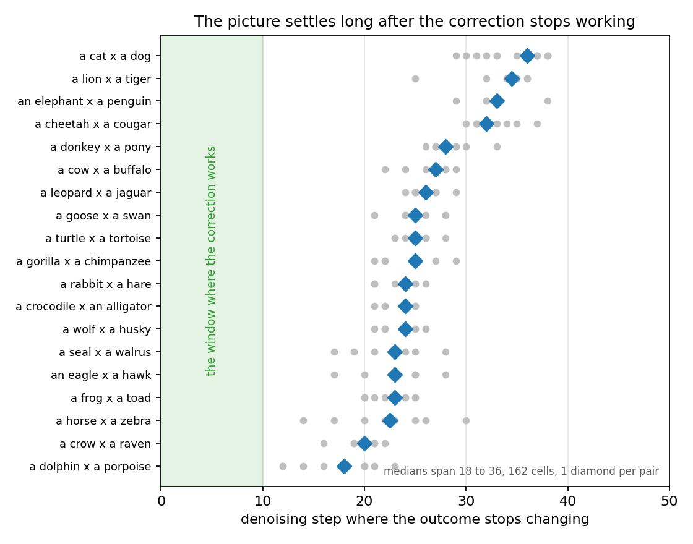
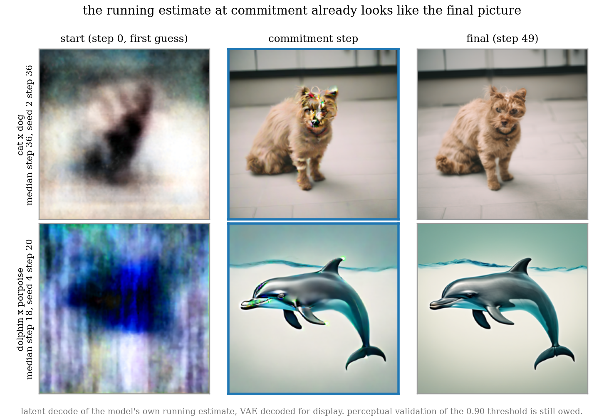
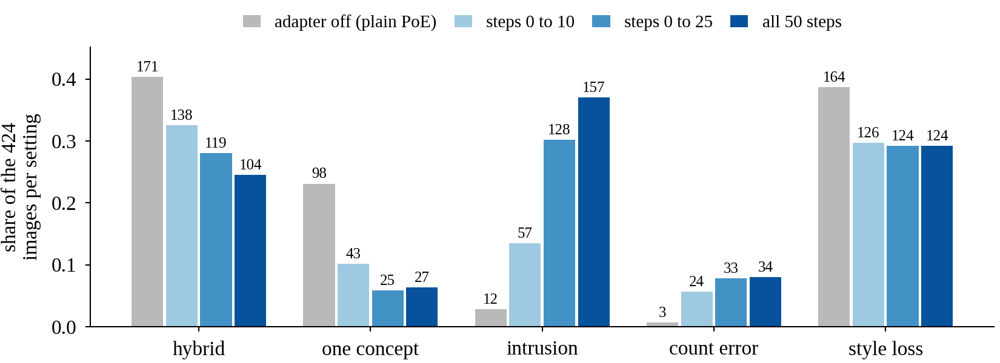
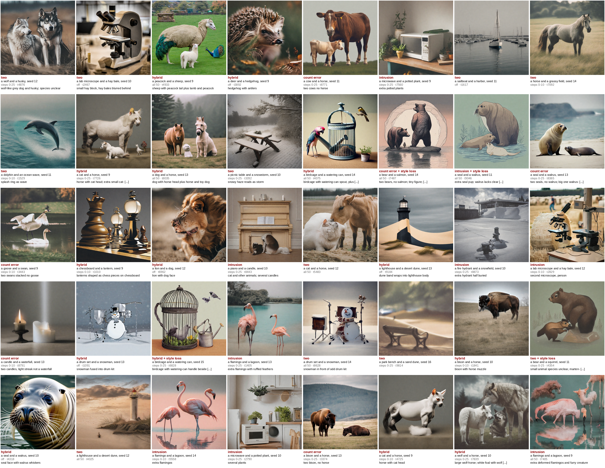

# 📒 Report: when does the correction have to act?

**The true correction works at the very start of the run, and the learned adapter needs longer.** Injected over
a sliding 10-step window, the true correction composes best at steps 0 to 10 for all 8 pairs tested. The learned
adapter, switched off after step 10, draws two animals in 47% of the animal-pair images, and after step 25 in 92%. The first
result has a recorded verdict. The second has a reading written in advance whose outcome nobody has recorded.

| Question | Recorded answer | The number |
|---|---|---|
| does the step where a run's picture settles vary by pair? | yes | medians run from step 18 to step 36 over 19 pairs, against a bar of 5 steps `verified` |
| does the window where the correction works move with the pair? | no | every pair's best window is steps 0 to 10, a span of 0 steps against a bar of 5 `verified` |
| does restricting the adapter to early steps change the failures? | no verdict recorded | [the counts and scores below](#the-learned-adapter-switched-off-early) |

## Table of contents

- [The window stays put while the settling step moves](#the-window-stays-put-while-the-settling-step-moves)
- [The learned adapter switched off early](#the-learned-adapter-switched-off-early)
- [Which failures change](#which-failures-change)
- [Where the sources disagree](#where-the-sources-disagree)
- [What this cannot tell you](#what-this-cannot-tell-you)
- [Concepts this uses](#concepts-this-uses)
- [Where this came from](#where-this-came-from)
- [Still open](#still-open)

## The window stays put while the settling step moves

Navigation: 📋 [TOC](#table-of-contents) | [Next](#the-learned-adapter-switched-off-early) ➡️

| Compose rate by window | Settling step by pair | What settling looks like |
|---|---|---|
|  |  |  |
| left: y compose rate, x window centre, one line per pair; right: y best window centre, x settling step, one point per pair | y: pair; x: settling step; one grey dot is one seed, the diamond is the pair's median | model's estimate of the finished picture, decoded at three moments |

**Every pair composes best with the correction at steps 0 to 10, whichever step its picture settles at.**
The settling step is the first step after which the model's estimate of the final picture keeps a
[cosine](../../../../../Obsidian/Mathematics/Linear%20Algebra/Cosine%20Similarity.md#where-to-learn-this) of at least 0.90 with its final value.
Across 162 runs its per-pair median spans 18 steps, and the spread between pairs is 1.90 times the spread across
seeds, against a bar of 1.5 `verified` ([settling result](../../artifacts/results/what-the-correction-is/when-it-acts/when-the-correction-must-arrive/commitment-step/result.json)). Those 8 tested pairs
settle between steps 23 and 36, and their best window does not move `verified` ([window result](../../artifacts/results/what-the-correction-is/when-it-acts/when-the-correction-must-arrive/window-vs-commitment/result.json)).

| Window of the run (10 steps wide) | 0 to 10 | 5 to 15 | 10 to 20 | 15 to 25 | 20 to 30 | 25 to 35 | 30 to 40 | 35 to 45 | 40 to 50 |
|---|---|---|---|---|---|---|---|---|---|
| runs composed, of 32 | 21 | 8 | 3 | 1 | 0 | 0 | 0 | 1 | 1 |
| compose rate | 0.656 | 0.250 | 0.094 | 0.031 | 0 | 0 | 0 | 0.031 | 0.031 |

The counts sum each window's per-pair rate times 4 seeds over the 8 pairs, from the window result `verified`. Timing
also beats amount: given the same total correction, the late window still fails on all four seeds tested
`stated` ([the review of the timing grid](../../artifacts/plans/completed/03-does-the-correction-cause-composition/review/05-when-in-the-run-it-matters.md)).
The [query note on settling](../../artifacts/results/what-the-correction-is/when-it-acts/when-the-correction-must-arrive/commitment-step/QUERY.md) and the [query note on the window](../../artifacts/results/what-the-correction-is/when-it-acts/when-the-correction-must-arrive/window-vs-commitment/QUERY.md) hold the argument.

## The learned adapter switched off early

Navigation: ⬅️ [Previous](#the-window-stays-put-while-the-settling-step-moves) | 📋 [TOC](#table-of-contents) | [Next](#which-failures-change) ➡️

| Renders by setting | All four scores | The figure as laid out for the paper |
|---|---|---|
|  |  |  |
| rows: held-out pairs; columns: how long the adapter stays on. [The current grid is the PDF](../../artifacts/results/what-the-correction-is/when-it-acts/does-restricting-the-adapter-to-early-steps-change-the-failures/early_steps_grid.pdf) | y: each score; x: setting; bars show the mean and a [95% interval](#an-interval-from-resampling) | same settings, with [each panel](#where-this-came-from) also saved alone |

**Two animals are found in 47% of the animal-pair images with the adapter on for 10 steps and 92% with it on for 25.** The adapter
is v58-03-self at training step 30,000, run on the 53 held-out pairs at seeds 9 to 16, 424 images per setting
`stated` ([the card](../../artifacts/results/what-the-correction-is/when-it-acts/does-restricting-the-adapter-to-early-steps-change-the-failures/README.md)). Values are from [the scores file](../../artifacts/results/what-the-correction-is/when-it-acts/does-restricting-the-adapter-to-early-steps-change-the-failures/window_scores.csv) `verified`.

| Score | Adapter off | Steps 0 to 10 | Steps 0 to 25 | All 50 |
|---|---|---|---|---|
| two or more animals found, of the 160 animal-pair images | 6 (3.75%) | 75 (46.88%) | 147 (91.87%) | 153 (95.63%) |
| BLIP-VQA (0 to 1), hard group, 3 pairs | 0.3301 | 0.4386 | 0.4529 | 0.4543 |
| BLIP-VQA, easy but unseen group, 29 pairs | 0.3783 | 0.4981 | 0.6082 | 0.5755 |
| BLIP-VQA, not competing group, 21 pairs | 0.7395 | 0.7614 | 0.7584 | 0.7319 |
| CLIP score, all 424 images | 25.3798 | 26.3118 | 26.4437 | 26.0530 |
| ImageReward, all 424 images | -0.1063 | 0.4383 | 0.5451 | 0.4908 |

> [!IMPORTANT]
> The plan wrote its reading before any score existed, and one branch can be read two ways. The choice is the
> owner's, and the plan's task is unticked. [The reading](../../plans/present-revision-to-supervisor.md) says that if
> steps 0 to 25 and all 50 overlap on BLIP-VQA in every group, the reply says 25 steps give the same result, and if
> steps 0 to 10 sit "below both in a group", the reply says ten steps are too short there.

Steps 0 to 25 and all 50 have overlapping 95% intervals in all three groups `verified`. The second branch depends on
what "below" means.

| How "below both" is read | Hard group | Easy group | Not competing | That reading would say |
|---|---|---|---|---|
| the mean of steps 0 to 10 is under both means | below | below | above | ten steps are too short in the hard and easy groups |
| the whole interval of steps 0 to 10 is under both intervals | overlaps | overlaps | overlaps | no group is below, so the result is reported as it landed |

| First look at seed 10 | Cow and horse, seeds 9 to 12 |
|---|---|
|  |  |
| drawn while the job ran; six grey cells read "rendering" `verified` | the product draws one animal on all four seeds and the 10-step adapter draws two `verified`; the card reads none of them as a clear horse `stated` |

## Which failures change

Navigation: ⬅️ [Previous](#the-learned-adapter-switched-off-early) | 📋 [TOC](#table-of-contents) | [Next](#where-the-sources-disagree) ➡️

| Calls made by eye | Calls by the fixed-prompt judge | A sample to check the eye calls |
|---|---|---|
|  |  |  |
| y: share of the 424 images per setting, with the count on each bar | y: images out of 424 | 40 calls drawn at random, for a person to check |

**As the adapter stays on longer, one-animal and hybrid images fall and images with an unrequested extra rise,
under both labellers.** Each image got one label. Counts of 424 images per setting, by eye from
[the eye calls](../../artifacts/results/what-the-correction-is/when-it-acts/does-restricting-the-adapter-to-early-steps-change-the-failures/failure_calls.csv) and by the judge from [the judge counts](../../artifacts/results/what-the-correction-is/when-it-acts/does-restricting-the-adapter-to-early-steps-change-the-failures/judge_shares.csv) `verified`:

| Label | Off: eye / judge | 0 to 10: eye / judge | 0 to 25: eye / judge | All 50: eye / judge |
|---|---|---|---|---|
| hybrid | 171 / 236 | 138 / 198 | 119 / 172 | 104 / 147 |
| one concept | 98 / 41 | 43 / 22 | 25 / 21 | 27 / 20 |
| intrusion (an unrequested extra) | 12 / 16 | 57 / 73 | 128 / 135 | 157 / 166 |
| count error | 3 / 6 | 24 / 13 | 33 / 23 | 34 / 20 |
| two, clean | 139 / 124 | 162 / 118 | 119 / 73 | 101 / 69 |
| broken | 1 / 1 | 0 / 0 | 0 / 0 | 1 / 2 |
| style loss (a second flag on any image) | 164 / 167 | 126 / 146 | 124 / 138 | 124 / 134 |

## Where the sources disagree

Navigation: ⬅️ [Previous](#which-failures-change) | 📋 [TOC](#table-of-contents) | [Next](#what-this-cannot-tell-you) ➡️

**Seven recorded facts conflict, and each is shown here unresolved.**

| What | One source | The other source | What the code or file shows |
|---|---|---|---|
| failure counts | by eye: 171 hybrid and 98 one-concept with the adapter off | judge: 236 and 41 on the same setting | two labellers with different rules. [The judge](../../../scripts/review_judge_failures.py) sees each image at 1024 px and checks hybrid first; the eye calls used 360 px contact sheets, opening the full image for borderline tiles. That this order explains the gap is `inferred`. Neither set has been checked by a person |
| latest window that still works, cow and buffalo | [the window note](../../artifacts/results/what-the-correction-is/when-it-acts/when-the-correction-must-arrive/window-vs-commitment/QUERY.md) table says centre 15 | the result file says 10, with rate 0 at 15 | `last_alive` at line 99 of [the window script](../../scripts/window_vs_commitment.py) takes the last nonzero rate. The note's own rank correlation of +0.26 matches 10; recomputed with tied ranks averaged, 15 would give +0.32 |
| whether late windows stay at zero | the timing review says the rate is 0 from steps 20 to 30 onward | the result file has 1 of 32 runs composing at each of the last two windows | both are frog and toad, one seed each, as the window note says |
| runs per pair in the settling read | the settling note says 19 pairs at 8 seeds each | the file holds 162 runs: 17 pairs at 8 seeds, wolf and husky at 9, cat and dog at 17 | `per_pair` in the settling result |
| the grid's rows | the [PNG](../../artifacts/results/what-the-correction-is/when-it-acts/does-restricting-the-adapter-to-early-steps-change-the-failures/early_steps_grid.png) shows six rows and five columns | the [PDF](../../artifacts/results/what-the-correction-is/when-it-acts/does-restricting-the-adapter-to-early-steps-change-the-failures/early_steps_grid.pdf) and its [spec](../../artifacts/results/what-the-correction-is/when-it-acts/does-restricting-the-adapter-to-early-steps-change-the-failures/early_steps_grid-spec.json) show seven rows and four columns | the PNG is dated 2026-11-11 and the spec and PDF 2026-11-12, so the card's "preview of the PDF" describes the earlier layout |
| grey cells on the seed 10 sheet | [the card](../../artifacts/results/what-the-correction-is/when-it-acts/does-restricting-the-adapter-to-early-steps-change-the-failures/README.md) says two cells read "rendering" | [the sheet](../../artifacts/results/what-the-correction-is/when-it-acts/does-restricting-the-adapter-to-early-steps-change-the-failures/early-steps-seed10-sheet.png) shows six, five of them in the all-50 column | the card gives the reason for its two (a lagging view of the disk); nothing records the other four |
| which checkpoint is the adapter | [the early-training note](../paper-review/prze-11-early-training.md) names step 50,000 as the adapter of record | these renders use step 30,000 | [the protocol](../paper-review/protocol.md) names step 30,000 for the revision's renders, so the windows above describe that checkpoint |

## What this cannot tell you

Navigation: ⬅️ [Previous](#where-the-sources-disagree) | 📋 [TOC](#table-of-contents) | [Next](#concepts-this-uses) ➡️

**The two timing experiments ask different things.** The window sweep injects the true correction for 10 steps at
any position. The adapter experiment runs a learned adapter from step 0 until a cut-off, so its need for 25 steps
does not contradict the true correction's early window.

**The best window is bounded, and its true position is unknown.** Steps 0 to 10 is the earliest window on the grid,
so the true best may be earlier or narrower.

**The settling step is a stand-in.** It is measured in latent space, and its check on decoded frames is still owed.

## Concepts this uses

Navigation: ⬅️ [Previous](#what-this-cannot-tell-you) | 📋 [TOC](#table-of-contents) | [Next](#where-this-came-from) ➡️

The toy numbers below are invented. [The correction and its strength](does-the-correction-cause-composition.md#the-correction-and-its-strength)
is taught on the causation page.

### A sliding window

Take a 10-step run and a 4-step window. Inject the correction only on steps 0 to 4 and score the image, then only on
steps 2 to 6, and so on. The window's centre names it: steps 0 to 4 has centre 2. Here the run has 50 steps, the window
is 10 wide, and centre 5 means steps 0 to 10, which composed 21 of 32 runs.

### A settling step

Say a run's estimate has cosine 0.50, 0.85, 0.92, 0.88, 0.93, 0.97, 1.00 with its final picture at steps 0 to 6. Step 2
crosses 0.90 and step 3 falls back, so the settling step is 4, the first step after which it stays at or above 0.90.
Here cat and dog settles at a median of step 36 and dolphin and porpoise at step 18.

### An interval from resampling

Three pairs score 0.2, 0.5 and 0.8. Draw three pairs at random with replacement, say 0.2, 0.2, 0.5, and take the mean,
0.3. Repeat many times and keep the middle 95% of those means. This is a [bootstrap](../../../../../Obsidian/Mathematics/Statistics/Bootstrap.md#where-to-learn-this).
Here the draw resamples pairs and then seeds within each pair ([the figure script](../../scripts/review_window_figure.py),
`two_level`). The easy group at steps 0 to 25 reads 0.6082 with interval 0.5189 to 0.6946. The hard group has only 3 pairs, so
its intervals run from about 0.01 to 0.85.

## Where this came from

Navigation: ⬅️ [Previous](#concepts-this-uses) | 📋 [TOC](#table-of-contents) | [Next](#still-open) ➡️

| What | Source | Mark |
|---|---|---|
| settling step | [result file](../../artifacts/results/what-the-correction-is/when-it-acts/when-the-correction-must-arrive/commitment-step/result.json) and [query note](../../artifacts/results/what-the-correction-is/when-it-acts/when-the-correction-must-arrive/commitment-step/QUERY.md), read 2026-11-22 | `verified` |
| window against settling | [result file](../../artifacts/results/what-the-correction-is/when-it-acts/when-the-correction-must-arrive/window-vs-commitment/result.json) and [query note](../../artifacts/results/what-the-correction-is/when-it-acts/when-the-correction-must-arrive/window-vs-commitment/QUERY.md), read 2026-11-22 | `verified` |
| adapter scores | [the scores file](../../artifacts/results/what-the-correction-is/when-it-acts/does-restricting-the-adapter-to-early-steps-change-the-failures/window_scores.csv), from [the figure script](../../scripts/review_window_figure.py) | `verified` |
| failure counts | [eye calls](../../artifacts/results/what-the-correction-is/when-it-acts/does-restricting-the-adapter-to-early-steps-change-the-failures/failure_calls.csv) and [judge counts](../../artifacts/results/what-the-correction-is/when-it-acts/does-restricting-the-adapter-to-early-steps-change-the-failures/judge_shares.csv), drawn by [the panel script](../../../_archive/scripts/review_window_panels.py) | `verified` |
| Figure 10's separate panels | [failure types](../../artifacts/results/what-the-correction-is/when-it-acts/does-restricting-the-adapter-to-early-steps-change-the-failures/panel_a_failure_types.png), [BLIP-VQA](../../artifacts/results/what-the-correction-is/when-it-acts/does-restricting-the-adapter-to-early-steps-change-the-failures/panel_b_blip.png), [two animals](../../artifacts/results/what-the-correction-is/when-it-acts/does-restricting-the-adapter-to-early-steps-change-the-failures/panel_c_two_animals.png), [ImageReward](../../artifacts/results/what-the-correction-is/when-it-acts/does-restricting-the-adapter-to-early-steps-change-the-failures/panel_d_imagereward.png), [legend](../../artifacts/results/what-the-correction-is/when-it-acts/does-restricting-the-adapter-to-early-steps-change-the-failures/panel_legend.png), [three-panel preview](../../artifacts/results/what-the-correction-is/when-it-acts/does-restricting-the-adapter-to-early-steps-change-the-failures/figure10_preview_1x3.png), [BLIP-VQA with all 53 pairs](../../artifacts/results/what-the-correction-is/when-it-acts/does-restricting-the-adapter-to-early-steps-change-the-failures/window_blip.png) | `verified` |
| how the grouping is filed | the [card for this question](../../artifacts/results/what-the-correction-is/when-it-acts/README.md) and the [card for the early-steps renders](../../artifacts/results/what-the-correction-is/when-it-acts/does-restricting-the-adapter-to-early-steps-change-the-failures/README.md) | `stated` |
| 62 pictures held out of the drain | 44 [tiles behind the early-steps grid](../../artifacts/results/what-the-correction-is/when-it-acts/does-restricting-the-adapter-to-early-steps-change-the-failures/tiles-rule5), 6 [frames behind the commitment-step picture](../../artifacts/results/what-the-correction-is/when-it-acts/when-the-correction-must-arrive/commitment-step/frames), and 12 [tiles at rank 10](../../artifacts/results/what-the-correction-is/when-it-acts/does-restricting-the-adapter-to-early-steps-change-the-failures/tiles-r10), which no card or script names and which have no summary sheet | `stated` |

## Still open

Navigation: ⬅️ [Previous](#where-this-came-from) | 📋 [TOC](#table-of-contents)

- [ ] Choose how "below both in a group" is read for the adapter's 10-step window, then record the outcome in the plan.
- [ ] Have a person check the failure calls against [the 40-image sample](../../artifacts/results/what-the-correction-is/when-it-acts/does-restricting-the-adapter-to-early-steps-change-the-failures/failure_calls_sample.png), and choose which labeller the paper's figure uses.
- [ ] Measure a finer grid inside the first ten steps, since the best window is the earliest one measured.
- [ ] Apply the settling step to decoded frames, its owed perceptual check.
- [ ] Trace [the mid-run separation picture](../../artifacts/results/what-the-correction-is/when-it-acts/when-the-correction-must-arrive/commitment-step/midrun_separation_example.png), which has no card, script or data file.
- [ ] Write a card for the folder on when the correction must arrive, and add the Figure 10 panels and the 10-step tiles to the early-steps card.

<!-- built-to: PAGE_LOOK_FORMAT v1 -->
