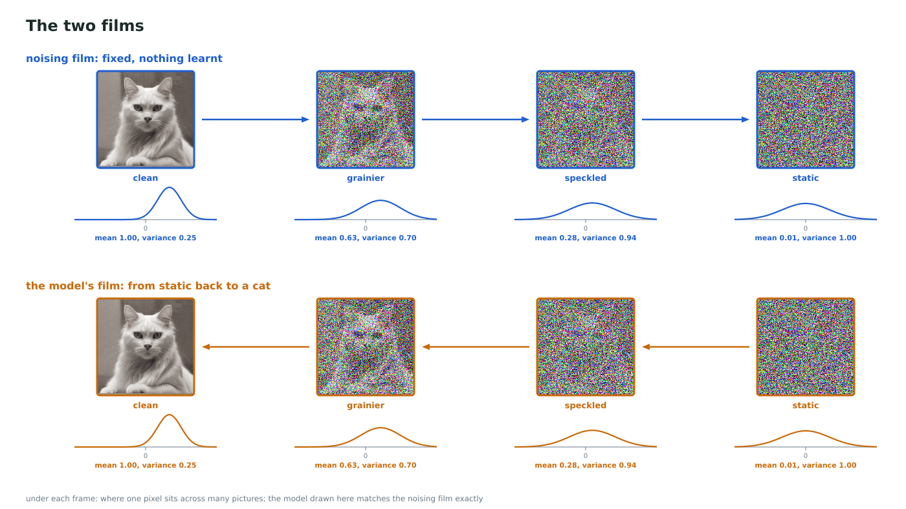
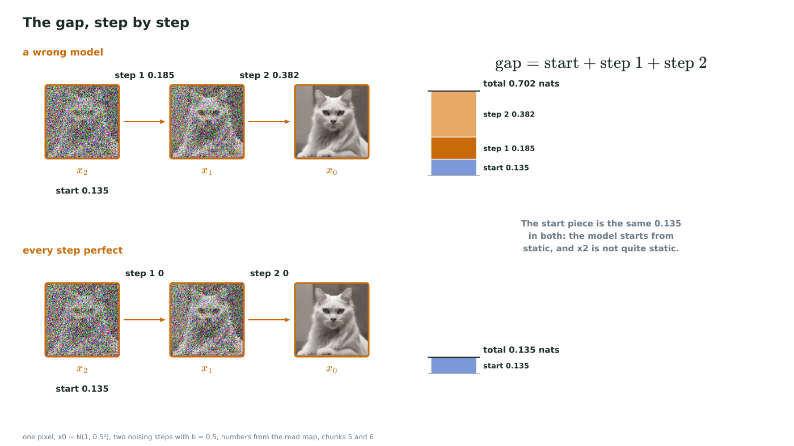
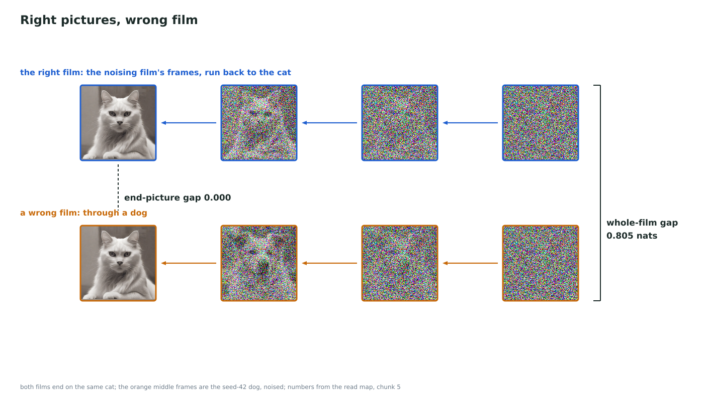
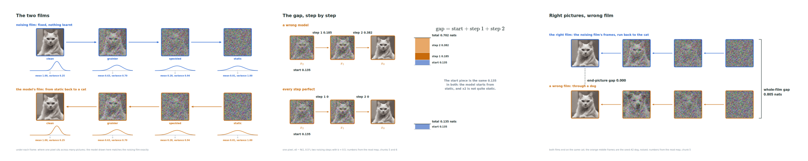

# The gap between two films: illustrated map

Pictures for section 2 of Kim et al. 2023, "Refining Generative Process with Discriminator
Guidance" (arXiv 2211.17091), in the plain words of [the read map](READ_MAP.md): the gap between
the noising film and the model's film (the paper's KL divergence, in nats), and how it splits into
one piece per step.

**4 prompts · 4 rendered · 0 waiting**

## Table of contents

- [Art direction](#art-direction)
- [Where the numbers come from](#where-the-numbers-come-from)
- [Subject lane](#subject-lane)

## Art direction

Navigation: 📋 [TOC](#table-of-contents) | [Where the numbers come from](#where-the-numbers-come-from) ➡️

Schematic, drawn by script (`figures/make_figures.py`): flat, white background, two colours only,
blue for the noising film and orange for the model's film, labels on the things, no legend, and one
equation only, "gap = start + step 1 + step 2", in picture 2. Every number printed exactly as given
below. The film frames are the project's seed-42 SDXL render of "a cat"
(`data/pilot/seed_42/a_cat__x__a_dog/solo_a.png`), noised by the forward process in the script; the
wrong film in picture 3 passes through the same run's "a dog" render (`solo_b.png`).

## Where the numbers come from

Navigation: ⬅️ [Art direction](#art-direction) | 📋 [TOC](#table-of-contents) | [Subject lane](#subject-lane) ➡️

The read map's chunks 5 and 6, section 2: one pixel, $x_0 \sim \mathcal N(1, 0.5^2)$, two noising
steps with $b = 0.5$, gaps in nats. Wrong model: start 0.135 + step 1 0.185 + step 2 0.382 = 0.702.
Exact backward steps from $\mathcal N(0, 1)$: start 0.135 + 0 + 0 = 0.135. Right pictures through a
wrong film: end-picture gap 0.000, whole-film gap 0.805. The start gap, 0.135, is recomputed in the
script (the noised pixel is $\mathcal N(0.5, 0.8125)$); the step pieces and 0.805 come from the
read's script, which was not kept, and are printed as given.

The bell curves in picture 1 follow the read's chunk 7 schedule (VP drift, beta 0.1 to 20) at
$t = 0, 0.3, 0.5, 1.0$, applied to the chunk 5 pixel $x_0 \sim \mathcal N(1, 0.5^2)$.

## Subject lane

Navigation: ⬅️ [Where the numbers come from](#where-the-numbers-come-from) | 📋 [TOC](#table-of-contents)

### Prompt 1. The two films

[observed] 🖼️ rendered 2026-11-17, `figures/01-the-two-films.svg`, drawn by `figures/make_figures.py`

Save as: `figures/01-the-two-films.svg`

<a href="figures/01-the-two-films.svg"></a>

**Visual thesis:** the noising film is fixed and only adds noise; the model's film runs the other way, and each frame carries a spread for where one pixel sits.

```
Two rows of four frames. Top row, left to right, blue frame borders: the clean cat, grainier,
a speckled shape, grey static, with arrows pointing right and the label "noising film: fixed,
nothing learnt". Bottom row, right to left, orange frame borders: grey static, a speckled shape,
grainier, the clean cat, with arrows pointing left and the label "the model's film". Under every
frame, a small bell curve for one pixel's value across many pictures: narrow around 1 at the
clean end, wide and centred at 0 at the static end, blue on top and orange below. Each curve
carries its mean and variance.
```

Faithfulness note: the blue curves must read mean 1.00 variance 0.25, mean 0.63 variance 0.70, mean 0.28 variance 0.94, mean 0.01 variance 1.00 from clean to static; the orange row runs right to left.

### Prompt 2. The gap, step by step

[observed] 🖼️ rendered 2026-11-17, `figures/02-the-gap-step-by-step.svg`, drawn by `figures/make_figures.py`

Save as: `figures/02-the-gap-step-by-step.svg`

<a href="figures/02-the-gap-step-by-step.svg"></a>

**Visual thesis:** the whole-film gap is a sum, one piece at the start and one per step, and a perfect model's steps contribute nothing.

```
Two examples stacked. Each is a strip of three frames, x2 (noisiest) on the right, x1, x0 (the
clean cat) on the left, with brackets: "start" over x2, "step 1" between x2 and x1, "step 2"
between x1 and x0. Top example, a wrong model: start 0.135, step 1 0.185, step 2 0.382,
total 0.702 nats. Bottom example, every step perfect: start 0.135, step 1 0, step 2 0, total
0.135 nats. Beside each, a stacked bar of the pieces reaching the total. The only equation,
once: gap = start + step 1 + step 2.
```

Faithfulness note: the bars' segments must be in proportion to the printed numbers and sum to 0.702 and 0.135; no other equation appears.

### Prompt 3. Right pictures, wrong film

[observed] 🖼️ rendered 2026-11-17, `figures/03-right-pictures-wrong-film.svg`, drawn by `figures/make_figures.py`

Save as: `figures/03-right-pictures-wrong-film.svg`

<a href="figures/03-right-pictures-wrong-film.svg"></a>

**Visual thesis:** two films can end on the same clean cat and still be far apart, so a zero gap between finished pictures does not mean a zero gap between films.

```
Two film strips ending on the same clean cat on the left. Blue: the noising film's frames. Orange:
a film whose middle frames pass through a dog before ending on the cat. Over the two end frames,
a tie mark reading "end-picture gap 0.000". A bracket over both whole strips reading "whole-film
gap 0.805 nats".
```

Faithfulness note: both strips must end on the identical cat frame; the two printed numbers are 0.000 and 0.805.

### Prompt 4. Capstone: the three side by side

[observed] 🖼️ rendered 2026-11-17, `figures/04-capstone.svg`, drawn by `figures/make_figures.py`

Save as: `figures/04-capstone.svg`

<a href="figures/04-capstone.svg"></a>

**Visual thesis:** the films, their gap split by step, and why the end picture alone cannot see the gap, on one page.

```
Pictures 1, 2 and 3 side by side on one white page, each at the same height, in that order,
with their own titles, nothing added.
```

Faithfulness note: no element that is not in pictures 1 to 3, and none of theirs missing.
