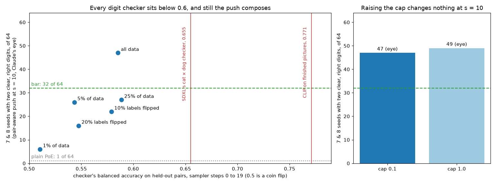

# Results: Classifier guidance

<!-- index: written by scripts/regroup/results_index.py; edit the cards, not this file -->

| Result | What it shows | Picture |
|---|---|---|
| [Can a classifier supply the term the product drops](can-a-classifier-supply-the-missing-term/README.md) | Evidence for the plan, |  |
| [🧪 Results: can two digits compose on MNIST](can-two-digits-compose-on-mnist/README.md) | The work asks one question in three stages. |  |
| [does-a-pair-aware-push-compose-our-photos](does-a-pair-aware-push-compose-our-photos/README.md) | Can a classifier trained on our own cat and dog images push the product of a cat model and a dog model into drawing two separate animals, on more seeds than a p |  |
| [Does a small pair-aware discriminator steer SDXL's cat × dog product?](does-a-small-discriminator-steer-cat-x-dog/README.md) | Rung 2 of the classifier-guided PoE ladder (A3q's page, |  |
| [does-classifier-guidance-draw-a-dog](does-classifier-guidance-draw-a-dog/README.md) | Does SDXL draw a dog from an empty prompt when a trained dog classifier's gradient pushes each sampling step? |  |
| [Does classifier guidance work on the released weights](does-classifier-guidance-work-on-the-released-weights/README.md) | Dhariwal and Nichol's classifier guidance (arXiv 2105.05233), run on their own released 256 px unconditional ImageNet model and 256 px noisy classifier. |  |
| [What each line of classifier guidance computes](what-each-line-of-classifier-guidance-computes/README.md) | Dhariwal and Nichol's classifier guidance (arXiv 2105.05233, Section 4, Algorithms 1 and 2 on page 7), walked line by line through the authors' code beside the  |  |
| [What each line of our guided sampler computes](what-each-line-of-our-guided-sampler-computes/README.md) | This project's classifier-guided SDXL sampler, `poe_repair/methods/_classifier_guided.py` at the current commit (last changed in `445cef9f`), walked line by lin |  |
| [What each line of Readout Guidance computes](what-each-line-of-readout-guidance-computes/README.md) | Two code walks for Readout Guidance (Luo et al., CVPR 2024, arXiv 2312.02150), level 3 of its zoom ladder, the way classifier guidance has the authors' walk and |  |
