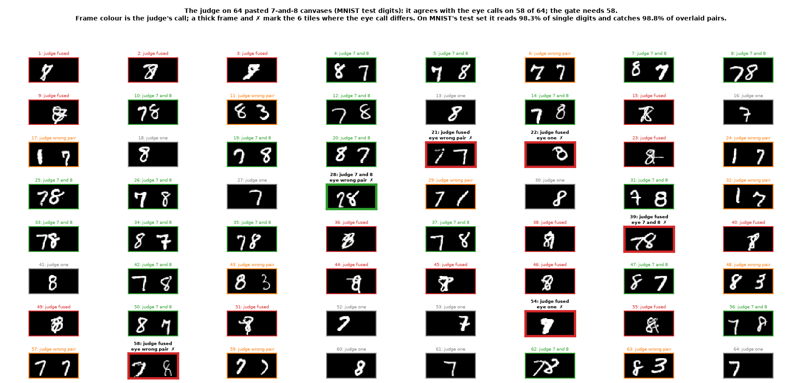
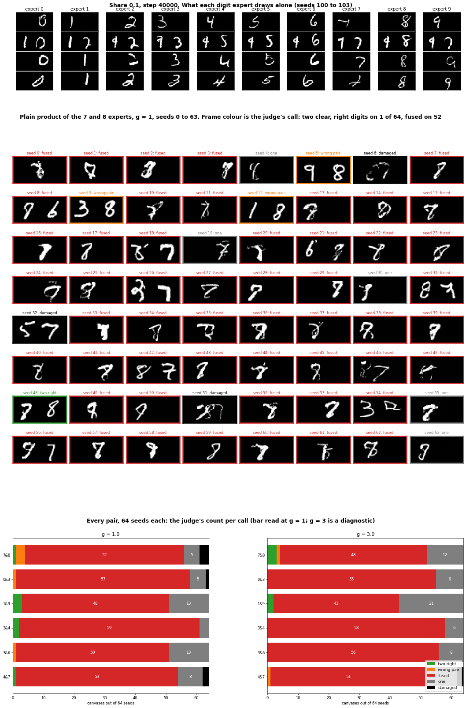
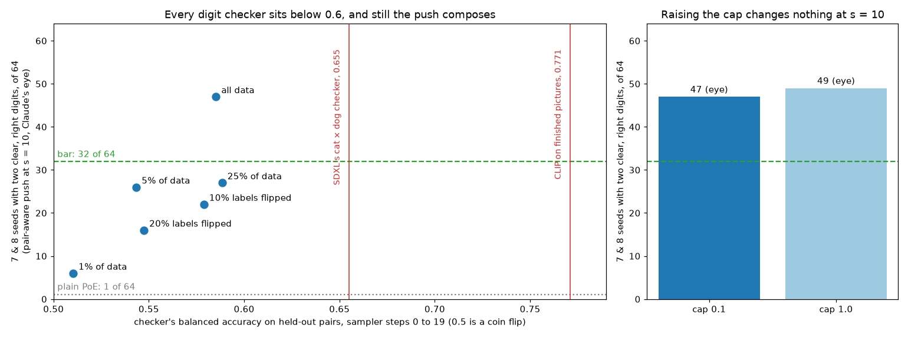

# How good must the checker be on MNIST

⬆️ [The whole story](../README.md) | [Stage 2: two models trained apart](../02-two-models-trained-apart/README.md) ➡️

Route step 7b, [plan 24](../../../../plans/24-mnist-digits-on-a-canvas.md), judged by
[the A2b review file](../../../../plans/review/a2b-mnist-digits-on-a-canvas.md). Each folder below holds one
piece of the step, in the order the work ran.

## judge-gate

<a href="judge-gate/judge-against-eye-calls.png"></a>

**What it shows.** The judge, a digit classifier that reads each separate blob of a finished canvas,
called 64 pasted canvases asked for 7 and 8, and agrees with the eye calls on 58 of 64; the gate in
the review file needs 58. `verified`

**How it was made.** `scripts/mnist/judge.py train` taught the judge on MNIST's 60,000 training
digits plus 30,000 overlays of two different training digits at a shift of up to 6 pixels, as an
eleventh class "two digits on one spot"; it never sees a canvas. On MNIST's test set it reads 98.3%
of single digits right, catches 98.8% of test-digit overlays, and calls 0.9% of single digits an
overlay (`judge_test.json`). `judge.py sheet` pasted 64 canvases from MNIST's test digits (16 a 7
beside an 8, 16 a 7 and an 8 on one spot, 8 touching, 12 one digit alone, 12 a wrong pair),
shuffled. Claude called each tile by eye from a blind numbered sheet at full size before reading
the judge's calls or how each tile was built (`eye_calls_claude.csv`), under the reader's delegation;
the reader can veto any call. The judge's calls are in `judge_calls.csv`.

**What to know.** Against how each tile was built, the judge gets 60 of 64 and the eye 61 of 64; on
tile 54, built as a 7 and an 8 on one spot, the judge was right and the eye was not. Most of the
judge's other misses are sloppy single digits read below confidence 0.9, which it calls fused, so
its count of two clear, right digits is strict and errs low in every column alike. The gate is
"validated against Claude's calls" until the reader checks them.

## plain-product

<a href="plain-product/plain-product-share-0.1.png"></a>

**What it shows.** Plain product of the 7 and 8 experts fuses at every share: two clear, right
digits on 0 of 64 at shares 0 and 0.01 and 1 at 0.1 by the judge (1 and 4 by eye). The share-0.1
model often draws a digit beside the wrong partner (10 of 64 by eye). `verified`

**How it was made.** `scripts/mnist/plain_product.py`, jobs 89917, 89918 and 89964, DDIM 50 steps at
g = 1, seeds 0 to 63; eye calls in `eye_calls_claude_78_g1.csv`.

## five-versions

`sheet-78.png` is on the cluster at `/datasets/mmolefe/poe_repair_min/artifacts-archive/2-classifier-guidance/artifacts/results/can-two-digits-compose-on-mnist/01-one-model-that-saw-a-few-pairs/five-versions/sheet-78.png`

**What it shows.** On 7 & 8 the pair-aware push gives a clear 8 beside a clear 7 on 47 of 64 seeds
at s = 10 (28 at s = 3); plain product 1, random push 1, best-of-2 1, best-of-16 16, separate-label
push 15 at its best. On the five held-out pairs, 84 of 320. Counts by Claude's eye (`eye_counts.json`),
since the judge's counts (`counts.json`) undercount thick drawn digits. `verified`

**How it was made.** `scripts/mnist/five_versions.py`, job 89968, the 4,000-step full checker, cap
0.1; cap sweep jobs 89984 and 89985; sweep 1 jobs 89982 and 89983.

## compose-against-checker-accuracy.png

<a href="compose-against-checker-accuracy.png"></a>

**What it shows.** Six checkers' held-out balanced accuracy over steps 0 to 19 against their push's
eye count on 7 & 8 at s = 10, with SDXL's 0.655 and CLIP's 0.771 marked; every checker sits below
0.6, so the curve never reaches either mark. Numbers in `compose-against-checker-accuracy.json`. `verified`

## network-view

The step's four networks drawn as networks, in zoom order, in journey 13's cheat-sheet style and
colour key (blue inputs, green hidden units, red outputs, orange pushes, grey frozen). Every size
comes from `network-view/network_view_numbers.json`, read off the code by
`make_network_view_numbers.py`; every picture is a real canvas from this step's runs. Drawn by
`make_network_view_figures.py`, which refuses to save a figure where a line crosses a box or label
it does not connect. `verified`

The figures moved to [the the sampler step page](../../../scenes/mnist-guidance-explained/1-the-sampler-step.md), which shows each with what it answers; the scripts and numbers files stay in this folder.

## grids

Real canvases in every cell (the same seeds 0, 1 and 2, top to bottom), with the third judge's count
of two clear, right digits out of 64 under each cell; the judge runs about 5% below a careful eye.
Drawn by `grids/make_grids.py` from jobs 90111 (the controls), 90154, 90155 and 90156. `verified`

The figures moved to [the the grids page](../../../scenes/mnist-guidance-explained/5-qualitative-grids.md), which shows each with what it answers; the scripts and numbers files stay in this folder.

## results-figures

The result and the networks behind it, in the zoom-ladder's cheat-sheet style and colour key. Drawn
by `results-figures/make_results_figures.py` from the controls run (job 90111) and the both-pushes run
(job 90154), seed 0 for every pair, not chosen; counts are the third judge's, about 5% below a careful
eye. Every figure passed the crossing check. `verified`

The figures moved to [the the sampler step page](../../../scenes/mnist-guidance-explained/1-the-sampler-step.md), which shows each with what it answers; the scripts and numbers files stay in this folder.

## architecture

One sheet per network, read left to right as input, process, output, in the zoom-ladder's U-Net
register: every feature map is a bar with its channel count above and its grid size beside, its
width growing with the channels and its height with the grid, and a coloured arrow names the
operation between two maps. Each sheet also carries the size, the training recipe and real outputs.
Every number comes from `architecture/arch_numbers.json`, which `make_arch_numbers.py` reads off the
code, the checkpoints (pulled to `data/mnist-canvas/24-mnist-one-model/arch/`) and the training log; the pictures are a
real noisy canvas, the U-Net's real noise prediction for it, and four pasted test canvases (MNIST
test digits) with both checkers' real answers at step 25 of 50. Drawn by `make_arch_figures.py`;
every sheet passed the crossing check. `verified`

The figures moved to [the the networks page](../../../scenes/mnist-guidance-explained/2-the-networks.md), which shows each with what it answers; the scripts and numbers files stay in this folder.

## gradient-flow

How each checker's gradient travels back to the canvas, in the architecture sheets' bar register.
Each bar is filled and labelled by the size of the gradient of the checker's answer that reaches it
(the L2 norm over the whole map; white small, orange large, grey exactly zero), measured with
`gradient-flow/make_grad_numbers.py` on the real checkpoints (`grad_numbers.json`). A decoder bar's
light, hatched part is its skip copy, shaded by the size at the left-arm map it was copied from.
The canvases are pasted from MNIST test digits and noised with one fixed noise, the same four as the
architecture sheets; they are not states from a sampler run. Drawn by `make_grad_figures.py`;
both flow figures passed the crossing check. `verified`

The figures moved to [the the gradient page](../../../scenes/mnist-guidance-explained/3-the-gradient.md), which shows each with what it answers; the scripts and numbers files stay in this folder.

<!-- cluster:start -->

## On the cluster

The other 55 files of this result (3.0 MB) sit at `/datasets/mmolefe/poe_repair_min/artifacts-archive/2-classifier-guidance/artifacts/results/can-two-digits-compose-on-mnist/01-one-model-that-saw-a-few-pairs/`. [The file list](on-the-cluster.tsv) gives each file's size and sha256 checksum.

| Run | Files | Size | Kept on the laptop | Cluster folder |
|---|---|---|---|---|
| `(files at this level)` | 1 | 0.0 MB | no picture | `/datasets/mmolefe/poe_repair_min/artifacts-archive/2-classifier-guidance/artifacts/results/can-two-digits-compose-on-mnist/01-one-model-that-saw-a-few-pairs/` |
| `architecture` | 4 | 0.1 MB | no picture | `/datasets/mmolefe/poe_repair_min/artifacts-archive/2-classifier-guidance/artifacts/results/can-two-digits-compose-on-mnist/01-one-model-that-saw-a-few-pairs/architecture/` |
| `five-versions` | 9 | 0.7 MB | [sheet-03.png](five-versions/sheet-03.png) | `/datasets/mmolefe/poe_repair_min/artifacts-archive/2-classifier-guidance/artifacts/results/can-two-digits-compose-on-mnist/01-one-model-that-saw-a-few-pairs/five-versions/` |
| `gradient-flow` | 3 | 0.3 MB | no picture | `/datasets/mmolefe/poe_repair_min/artifacts-archive/2-classifier-guidance/artifacts/results/can-two-digits-compose-on-mnist/01-one-model-that-saw-a-few-pairs/gradient-flow/` |
| `grids` | 1 | 0.0 MB | no picture | `/datasets/mmolefe/poe_repair_min/artifacts-archive/2-classifier-guidance/artifacts/results/can-two-digits-compose-on-mnist/01-one-model-that-saw-a-few-pairs/grids/` |
| `judge-gate` | 5 | 0.4 MB | [judge-against-eye-calls.png](judge-gate/judge-against-eye-calls.png) | `/datasets/mmolefe/poe_repair_min/artifacts-archive/2-classifier-guidance/artifacts/results/can-two-digits-compose-on-mnist/01-one-model-that-saw-a-few-pairs/judge-gate/` |
| `loop2` | 7 | 0.9 MB | [final-seeds64.png](loop2/final-seeds64.png) | `/datasets/mmolefe/poe_repair_min/artifacts-archive/2-classifier-guidance/artifacts/results/can-two-digits-compose-on-mnist/01-one-model-that-saw-a-few-pairs/loop2/` |
| `network-view` | 20 | 0.4 MB | no picture | `/datasets/mmolefe/poe_repair_min/artifacts-archive/2-classifier-guidance/artifacts/results/can-two-digits-compose-on-mnist/01-one-model-that-saw-a-few-pairs/network-view/` |
| `plain-product` | 4 | 0.2 MB | [plain-product-share-0.1.png](plain-product/plain-product-share-0.1.png) | `/datasets/mmolefe/poe_repair_min/artifacts-archive/2-classifier-guidance/artifacts/results/can-two-digits-compose-on-mnist/01-one-model-that-saw-a-few-pairs/plain-product/` |
| `results-figures` | 1 | 0.0 MB | no picture | `/datasets/mmolefe/poe_repair_min/artifacts-archive/2-classifier-guidance/artifacts/results/can-two-digits-compose-on-mnist/01-one-model-that-saw-a-few-pairs/results-figures/` |

Bring one run back to the laptop from this folder:

```bash
rsync -a mscluster84:/datasets/mmolefe/poe_repair_min/artifacts-archive/2-classifier-guidance/artifacts/results/can-two-digits-compose-on-mnist/01-one-model-that-saw-a-few-pairs/<run>/ <run>/
```

<!-- cluster:end -->
