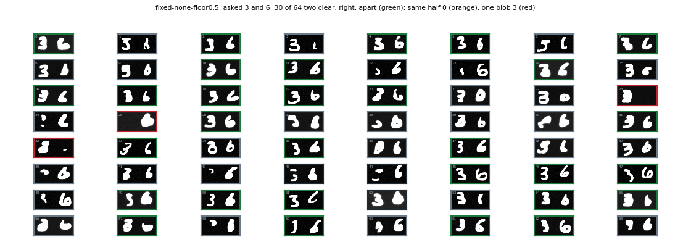

# 32: do two digit experts that never met compose, with and without the checkers' pushes

⬅️ [Stage 1: one model that saw a few pairs](../01-one-model-that-saw-a-few-pairs/README.md) | ⬆️ [The whole story](../README.md) | [Stage 3: composing while sampling](../03-composing-the-two-models-while-sampling/README.md) ➡️

[Plan 32](../../../../plans/32-two-digit-experts-that-never-met.md), judged by
[its review file](../../../../plans/review/32-two-digit-experts-that-never-met.md), where every bar was written
before the run and every reading and correction is dated. Counts are two clear, right digits on different halves,
out of 320 (five pairs, 64 seeds each, 0 to 63), by the third judge. Numbers are in `counts.json` (the per-cell
`counts/` folders hold each cell's full call tally); sheets are the first sampled canvases of each cell,
seeds 0 to 63 in order, framed green when counted.

## the experts alone

Each expert draws one clear, right digit on its own digit, 64 seeds, bar 58. The 0–4 expert (digit on either
side): 62, 63, 63, 58, 59. The 5–9 expert: 62, 62, 58, **55**, 62 (digit 8 misses). Its seed-1 retrain gave 62, 61,
55, 56, 62 and was not used. Fixed-side: the 0–4 left expert 63, 64, 63, 62, 63; the 5–9 right expert 59, 63,
**57**, 60, 62 (digit 7 misses).

`e59-either-alone-8.png` is on the cluster at `/datasets/mmolefe/poe_repair_min/artifacts-archive/2-classifier-guidance/artifacts/results/can-two-digits-compose-on-mnist/02-two-models-trained-apart/sheets/e59-either-alone-8.png`

## the fixed-side control, and the base

**What it shows.** A 0–4 expert that always draws on the left and a 5–9 expert that always draws on the right are
the case the factorised-conditionals argument says composes exactly. The product needs a base; the best was the
blank canvas given a spread of 0.5: **139 of 320**, against a bar of 256, so the control fails. By base: average of
the two no-digit predictions 1; spread 0.03, 0.1 and the point mass 0 (canvases saturate to white); 0.3: 60; 0.5:
139; 0.7: 132; 1.0: 82; 1.5: 9; 2, 3 and 10: 0. `verified`

`fixed-none-floor0.5-1-9.png` is on the cluster at `/datasets/mmolefe/poe_repair_min/artifacts-archive/2-classifier-guidance/artifacts/results/can-two-digits-compose-on-mnist/02-two-models-trained-apart/sheets/fixed-none-floor0.5-1-9.png`

## both pushes on the fixed-side experts

Both pushes (strength 10 each, cap 0.1, eta 1.0) lift the control from 139 to **168 of 320**, by pair 52, 46, 28,
21, 21 against 46, 30, 33, 10, 20. The no-harm bar holds. Where the product keeps mass the pushes help; they do
not reach 224. `verified`

`fixed-both-floor0.5-3-6.png` is on the cluster at `/datasets/mmolefe/poe_repair_min/artifacts-archive/2-classifier-guidance/artifacts/results/can-two-digits-compose-on-mnist/02-two-models-trained-apart/sheets/fixed-both-floor0.5-3-6.png`

## the side-mixed experts: the pushes do not help

Experts that draw their digit on either side, base spread 0.5, pair-aware checker retrained twice on its own pushed
renders (4, then 0 of 240 judged right, so almost nothing to learn from): plain product **0**, zero push 0
(byte-identical to no push), random push 2, both pushes **4**, one-half ink push **0**. Against the bars (224 to
support, within 32 of plain for a null) both pushes are a null. By eye the canvases are single saturated white
blobs in one half, so the product is destroyed before a push acts. One tuning round on 2 & 8 and 0 & 5 (strength 3
and 30, cap 0.3, eta 0.5) gave 0 everywhere. `verified`

`side-none-guided-e59-either-4-7.png` is on the cluster at `/datasets/mmolefe/poe_repair_min/artifacts-archive/2-classifier-guidance/artifacts/results/can-two-digits-compose-on-mnist/02-two-models-trained-apart/sheets/side-none-guided-e59-either-4-7.png`
`side-both-guided-e59-either-4-7.png` is on the cluster at `/datasets/mmolefe/poe_repair_min/artifacts-archive/2-classifier-guidance/artifacts/results/can-two-digits-compose-on-mnist/02-two-models-trained-apart/sheets/side-both-guided-e59-either-4-7.png`

## what to know

The 5–9 expert's shortfall on 8 (55 of 64) and the fixed-side 5–9 expert's on 7 (57) are reported beside the counts
that used them. Pasted pairs were allowed in the pair-aware checker's training; the one-half ink checker saw only
single digits and blank halves and did no better. The pixel checkers, judge and settings are the plan's; the
setting that was never tested is a base the two experts share.
