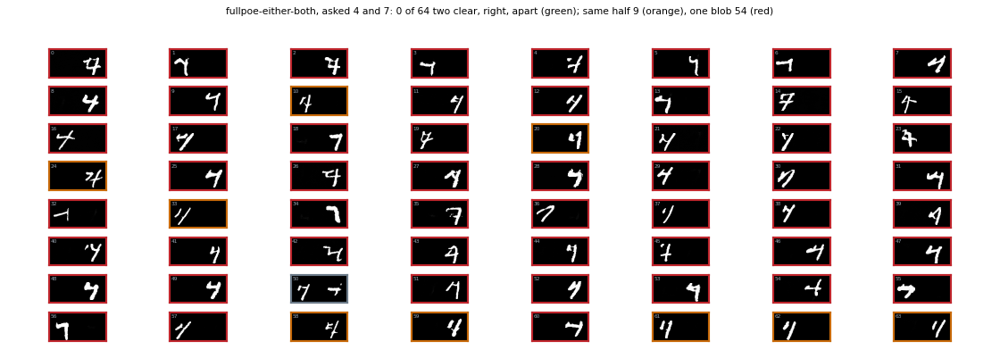

# 🧪 Results: the plain product of two digit models draws nothing

⬅️ [Before this: two models trained apart](../../02-two-models-trained-apart/README.md) | ⬆️ [All steps](../README.md) | [Step 2: giving each model its own half](../02-giving-each-model-its-own-half/README.md) ➡️

**Multiplying two digit models that were trained apart draws 0 clean pairs of 320, and four attempts to repair it reach at most 4.** Each model expects exactly one digit of its own kind, so a canvas holding one digit from each has no chance under either model.

<table>
<tr>
<td>`side-none-guided-e59-either-4-7.png` is on the cluster at `/datasets/mmolefe/poe_repair_min/artifacts-archive/2-classifier-guidance/artifacts/results/can-two-digits-compose-on-mnist/02-two-models-trained-apart/sheets/side-none-guided-e59-either-4-7.png`</td>
<td>`digits-4-and-7.png` is on the cluster at `/datasets/mmolefe/poe_repair_min/artifacts-archive/2-classifier-guidance/artifacts/results/can-two-digits-compose-on-mnist/03-composing-the-two-models-while-sampling/01-the-plain-product-draws-nothing/sheets/each-model-sees-the-whole-canvas/digits-4-and-7.png`</td>
</tr>
<tr>
<td>Plain product: 0 of 64 clean for 4 and 7, mostly fat white blobs</td>
<td>Each model kept on one half: 1 of 64 clean, mostly a single digit</td>
</tr>
</table>

## Table of contents

- [Words this page uses](#words-this-page-uses)
- [Why the product has nothing to draw](#why-the-product-has-nothing-to-draw)
- [Why a new background or a push does not help](#why-a-new-background-or-a-push-does-not-help)
- [Why keeping each model on one half is not enough](#why-keeping-each-model-on-one-half-is-not-enough)
- [What each part adds](#what-each-part-adds)
- [The code that does it](#the-code-that-does-it)
- [What this cannot claim](#what-this-cannot-claim)
- [Every picture and number here](#every-picture-and-number-here)

## Words this page uses

Navigation: 📋 [TOC](#table-of-contents) | [Next](#why-the-product-has-nothing-to-draw) ➡️

**Canvas:** one 32 by 64 pixel image with room for a digit in its left half and its right half.

**The two models:** one trained only on digits 0 to 4 and one only on digits 5 to 9. Each saw one digit per canvas, in either half, and neither has ever seen the other's digits.

**Clean pair:** a finished canvas that the digit-reading judge calls two clear, correct digits, one in each half.

**Sampling step:** one of the 50 steps that turn pure noise into a picture. Step 1 is almost all noise, and step 50 is the finished canvas.

**Noise prediction:** what a model outputs at each sampling step, its guess of which part of the canvas is noise. The sampler removes that part and moves on.

## Why the product has nothing to draw

Navigation: ⬅️ [Words](#words-this-page-uses) | 📋 [TOC](#table-of-contents) | [Next](#why-a-new-background-or-a-push-does-not-help) ➡️

**A canvas needs a real chance under both models to survive multiplication, and a canvas with one digit from each has zero under both.**

The 0 to 4 model has never seen a 7, and the 5 to 9 model has never seen a 4. Each one learned that a canvas holds exactly one digit of its own kind. This small table uses made-up chances to show what multiplying them does:

| Canvas | 0 to 4 model's chance | 5 to 9 model's chance | Multiplied |
|---|---:|---:|---:|
| a 4 alone | 1 | 0 | 1 × 0 = 0 |
| a 7 alone | 0 | 1 | 0 × 1 = 0 |
| a 4 and a 7 | 0 | 0 | 0 × 0 = 0 |

Every row holds a zero, so the last column is zero everywhere and the sampler has no canvas to aim for.

🔤 **The name:** plain product
- **Product:** the result of multiplying. On the table, it is the last column.
- **Plain:** with nothing added. The two models run as trained, with no pushes, no extra steps and no cutting into halves.
- **Consequence:** raise the made-up chance of "a 4 and a 7" from 0 to 0.1 under both models and its product goes from 0 to 0.01, which gives the sampler something to draw. The real plain product draws 0 clean pairs of 320.

The sampler never handles these chances directly. Multiplying two chances becomes adding the two models' noise predictions and subtracting one shared prediction for the empty canvas.

🔤 **The name:** background
- **Background:** what sits behind the subject of a picture. Here it is the empty canvas, which both models already include in their predictions.
- **Where it sits:** the subtraction. For one pixel, with made-up values, the 0 to 4 model says 0.7, the 5 to 9 model says 0.6 and the background says 0.5, so the combined prediction is 0.7 + 0.6 − 0.5 = 0.8.
- **Consequence:** drop the subtraction and that pixel goes from 0.8 to 1.3, because the background is counted twice. On the real models, swapping a blank background with a spread of 0.5 for the average of the two models' "no digit" predictions leaves the count at 0 of 320.

## Why a new background or a push does not help

Navigation: ⬅️ [Why the product has nothing to draw](#why-the-product-has-nothing-to-draw) | 📋 [TOC](#table-of-contents) | [Next](#why-keeping-each-model-on-one-half-is-not-enough) ➡️

**A third model, the checker pushes and extra denoising steps leave the count at 0 or 1 of 320, because none of them gives a two-digit canvas a chance under both models.**

<table>
<tr>
<td>`digits-4-and-7.png` is on the cluster at `/datasets/mmolefe/poe_repair_min/artifacts-archive/2-classifier-guidance/artifacts/results/can-two-digits-compose-on-mnist/03-composing-the-two-models-while-sampling/01-the-plain-product-draws-nothing/sheets/shared-background-from-a-third-model/digits-4-and-7.png`</td>
<td><a href="sheets/plain-product-with-both-pushes/digits-4-and-7.png"></a></td>
<td>`digits-4-and-7.png` is on the cluster at `/datasets/mmolefe/poe_repair_min/artifacts-archive/2-classifier-guidance/artifacts/results/can-two-digits-compose-on-mnist/03-composing-the-two-models-while-sampling/01-the-plain-product-draws-nothing/sheets/plain-product-with-both-pushes-and-extra-steps/digits-4-and-7.png`</td>
</tr>
<tr>
<td>Third model as background: 0 of 64</td>
<td>Both pushes: 0 of 64</td>
<td>Both pushes and extra steps: 0 of 64</td>
</tr>
</table>

The three sheets look alike. Most canvases hold a 4 and a 7 fused into one shape, and some hold two strokes crowded into one half. The judge's calls over all five digit pairs say the same:

| Repair | Clean pairs | One joined shape | Two shapes in one half | Anything else | Total |
|---|---:|---:|---:|---:|---:|
| Third model as background | 0 | 290 | 29 | 1 | 320 |
| Both pushes | 1 | 296 | 18 | 5 | 320 |
| Both pushes and extra steps | 0 | 291 | 29 | 0 | 320 |

🔤 **The name:** third model as background
- **Third model:** a separate model trained on all ten digits, one digit per canvas.
- **Where it sits:** its "no digit" prediction takes the place of the subtraction in the sum above.
- **Consequence:** the two digit models still rule out each other's digits, and clean pairs stay at 0 of 320.

🔤 **The name:** both pushes
- **Push:** a small nudge added to the noise prediction at each step. It is capped at 10% of the prediction's size.
- **Both:** two small trained checkers each supply one. One asks whether the canvas shows the pair, and the other asks about each digit separately. [Step 3](../03-adding-the-checker-pushes/README.md) explains them.
- **Consequence:** with the same background, clean pairs go from 0 to 1 of 320.

🔤 **The name:** extra steps
- **Extra:** added on top of the 50 sampling steps. Before every step except the last, the sampler takes 5 more small steps at the same noise level.
- **Step:** each one moves the canvas a little toward what the models prefer and adds a little fresh noise. Its size is 3 times the amount of noise the schedule adds at that level.
- **Consequence:** added to both pushes, clean pairs go from 1 to 0 of 320.

## Why keeping each model on one half is not enough

Navigation: ⬅️ [Why a new background or a push does not help](#why-a-new-background-or-a-push-does-not-help) | 📋 [TOC](#table-of-contents) | [Next](#what-each-part-adds) ➡️

**Keeping each model's prediction on one half gives 4 of 320, and 314 of the 320 canvases hold a single shape.**

A coin flip per seed gives one model the left half and the other the right. Both models still look at the whole canvas, and only the half each one owns is kept. Whatever a model tries to draw in the other half is thrown away, and the top-right picture shows the result: almost every canvas holds one 4 or one 7.

The likely reason shows in one step of the cropped run from Step 2 (on the cluster at `/datasets/mmolefe/poe_repair_min/artifacts-archive/2-classifier-guidance/artifacts/results/can-two-digits-compose-on-mnist/03-composing-the-two-models-while-sampling/02-giving-each-model-its-own-half/one-sampling-step-explainer.png`). Shown that whole canvas, both models put their digit in the right half, so the left half, which the 0 to 4 model owns on that seed, would be nearly empty. Nobody counted how often this happens across the 320 canvases.

🔤 **The name:** half assignment
- **Half:** the left or right 32 by 32 part of the canvas.
- **Assignment:** handing each model one part to answer for. The coin does the handing, and neither model is told.
- **Consequence:** clean pairs go from 0 for the plain product to 4 of 320.

<table>
<tr>
<td>`digits-1-and-9.png` is on the cluster at `/datasets/mmolefe/poe_repair_min/artifacts-archive/2-classifier-guidance/artifacts/results/can-two-digits-compose-on-mnist/03-composing-the-two-models-while-sampling/01-the-plain-product-draws-nothing/sheets/each-model-sees-the-whole-canvas/digits-1-and-9.png`</td>
<td>`digits-1-and-9.png` is on the cluster at `/datasets/mmolefe/poe_repair_min/artifacts-archive/2-classifier-guidance/artifacts/results/can-two-digits-compose-on-mnist/03-composing-the-two-models-while-sampling/01-the-plain-product-draws-nothing/sheets/whole-canvas-with-a-zero-strength-push/digits-1-and-9.png`</td>
</tr>
<tr>
<td>No push: 2 of 64 clean for 1 and 9</td>
<td>Push of strength zero: the same 2 of 64</td>
</tr>
</table>

**A push of strength zero changes nothing, which is the check that the push code is harmless.** Below their titles, the two runs' sheets match pixel for pixel on all five digit pairs.

## What each part adds

Navigation: ⬅️ [Why keeping each model on one half is not enough](#why-keeping-each-model-on-one-half-is-not-enough) | 📋 [TOC](#table-of-contents) | [Next](#the-code-that-does-it) ➡️

**Every run stays under 32 of 320, the line the plan wrote in advance for "no effect".** Each cell counts clean pairs out of 64 canvases, on seeds 0 to 63.

| What was run | 1 and 9 | 3 and 6 | 4 and 7 | 2 and 8 | 0 and 5 | All five, of 320 |
|---|---:|---:|---:|---:|---:|---:|
| Plain product, blank background with spread 0.5 | 0 | 0 | 0 | 0 | 0 | 0 |
| Plain product, average "no digit" background | 0 | 0 | 0 | 0 | 0 | 0 |
| The same with both pushes | 1 | 0 | 0 | 0 | 0 | 1 |
| The same with both pushes and extra steps | 0 | 0 | 0 | 0 | 0 | 0 |
| Third model as background | 0 | 0 | 0 | 0 | 0 | 0 |
| Each model kept on one half | 2 | 0 | 1 | 0 | 1 | 4 |
| The same with a push of strength zero | 2 | 0 | 1 | 0 | 1 | 4 |

## The code that does it

Navigation: ⬅️ [What each part adds](#what-each-part-adds) | 📋 [TOC](#table-of-contents) | [Next](#what-this-cannot-claim) ➡️

**Three short passages in [the two-model sampler](../../../../../scripts/mnist/two_experts.py) build the product, the third-model version and the half assignment.**

`2-classifier-guidance/scripts/mnist/two_experts.py`, lines 51 to 60:

```python
    def f(x, t):
        ya = torch.full((x.shape[0],), a, device=x.device)
        yb = torch.full((x.shape[0],), b, device=x.device)
        if base == "avgnull":
            n = torch.full((x.shape[0],), 10, device=x.device)
            ref = 0.5 * (A(x, t, n) + B(x, t, n))
        else:
            ref = blank_eps(x, t) if base == "blank" else floor_eps(x, t, tau)
        return A(x, t, ya) + B(x, t, yb) - ref
    return f
```

| Line | What it does |
|---|---|
| `ya`, `yb` | the two digits asked for, one per model |
| `n = ... 10` | label 10 means "no digit" |
| `ref = 0.5 * ...` | the average "no digit" background |
| `ref = blank_eps ...` | the blank-canvas background, with or without a spread |
| `A(...) + B(...) - ref` | the product: add both predictions, subtract the background once |

Lines 151 to 155:

```python
    def f(x, t):
        ya = torch.full((x.shape[0],), a, device=x.device); yb = torch.full((x.shape[0],), b, device=x.device)
        n = torch.full((x.shape[0],), 10, device=x.device)
        return A(x, t, ya) + B(x, t, yb) - U(x, t, n)
    return f
```

| Line | What it does |
|---|---|
| `U(x, t, n)` | the third model's "no digit" prediction, used as the background |

Lines 78 to 81:

```python
        eA, eB = A(x, t, ya), B(x, t, yb)
        m = torch.zeros_like(x); m[..., :32] = 1
        pick_a = torch.where(left, m, 1 - m)                          # 1 where A's prediction is used
        return pick_a * eA + (1 - pick_a) * eB
```

| Line | What it does |
|---|---|
| `A(x, t, ya), B(x, t, yb)` | both models look at the whole canvas |
| `m[..., :32] = 1` | marks the left half |
| `pick_a = ...` | follows the coin flip to mark the half owned by the first model |
| `pick_a * eA + (1 - pick_a) * eB` | keeps each prediction on its own half and throws the rest away |

## What this cannot claim

Navigation: ⬅️ [The code](#the-code-that-does-it) | 📋 [TOC](#table-of-contents) | [Next](#every-picture-and-number-here) ➡️

> [!WARNING]
> **The zero-chance reason is an argument, and no run measured a chance.** These models output noise predictions and never report how likely a canvas is. What was measured is the count of clean pairs, and the argument is the plan's explanation of why that count is near zero.

**Why the half assignment fails is inferred.** The picture of both models choosing the right half is one seed at one step.

**The extra-steps count has no written reading.** [The plan's review file](../../../../../plans/review/33-experts-that-compose-at-inference.md) still lists this run as running. Its 0 of 320 comes from [the run's count file](counts/plain-product-with-both-pushes-and-extra-steps.json), and its settings come from [the launch script](../../../../../scripts/mnist/two_experts_fullpoe.sh).

**The judge and the eye describe the plain-product sheet differently.** [Plan 32's review](../../../../../plans/review/32-two-digit-experts-that-never-met.md) reads most canvases as one fat white blob. On the blank background with spread 0.5, the judge calls 99 of 320 one shape and 194 two shapes that are not both clear. Both readings give 0 clean pairs.

**This is five digit pairs and one judge.** Every count uses the pairs 1 and 9, 3 and 6, 4 and 7, 2 and 8, and 0 and 5, on seeds 0 to 63. No person checked these canvases one by one.

## Every picture and number here

Navigation: ⬅️ [What this cannot claim](#what-this-cannot-claim) | 📋 [TOC](#table-of-contents)

**This folder holds five runs and their counts, and the plain product's numbers come from the folder before it.** Each run here has one sheet per digit pair. A sheet shows 64 canvases, and the frame colour is the judge's call: green for clean, red for one shape, orange for two shapes in one half, grey for two shapes that are not both clear and right, and near-black for damaged.

| Thing | What it shows | How we got it | Also called |
|---|---|---|---|
| Plain product on 4 and 7 (on the cluster at `/datasets/mmolefe/poe_repair_min/artifacts-archive/2-classifier-guidance/artifacts/results/can-two-digits-compose-on-mnist/02-two-models-trained-apart/sheets/side-none-guided-e59-either-4-7.png`) with its counts (on the cluster at `/datasets/mmolefe/poe_repair_min/artifacts-archive/2-classifier-guidance/artifacts/results/can-two-digits-compose-on-mnist/02-two-models-trained-apart/counts/cells/side-none-guided-e59-either/counts.json`) | blank background with spread 0.5, 0 of 320 | `two_experts.py cells --base floor --tau 0.5 --push none`, in plan 32 | `side-none-guided-e59-either` |
| [Counts for the average background](../../02-two-models-trained-apart/counts/cells/side-none-avgnull/counts.json) | plain product with the average "no digit" background, 0 of 320, no sheet kept | `two_experts.py cells --base avgnull --tau 0 --push none`, in plan 32 | `side-none-avgnull` |
| Each model sees the whole canvas (on the cluster at `/datasets/mmolefe/poe_repair_min/artifacts-archive/2-classifier-guidance/artifacts/results/can-two-digits-compose-on-mnist/03-composing-the-two-models-while-sampling/01-the-plain-product-draws-nothing/sheets/each-model-sees-the-whole-canvas`) with its counts (on the cluster at `/datasets/mmolefe/poe_repair_min/artifacts-archive/2-classifier-guidance/artifacts/results/can-two-digits-compose-on-mnist/03-composing-the-two-models-while-sampling/01-the-plain-product-draws-nothing/counts/each-model-sees-the-whole-canvas.json`) | 5 sheets, 4 of 320 | `two_experts.py cells --compose region --push none`, on the cluster | `e0-region` |
| The same with a zero-strength push (on the cluster at `/datasets/mmolefe/poe_repair_min/artifacts-archive/2-classifier-guidance/artifacts/results/can-two-digits-compose-on-mnist/03-composing-the-two-models-while-sampling/01-the-plain-product-draws-nothing/sheets/whole-canvas-with-a-zero-strength-push`) with its counts (on the cluster at `/datasets/mmolefe/poe_repair_min/artifacts-archive/2-classifier-guidance/artifacts/results/can-two-digits-compose-on-mnist/03-composing-the-two-models-while-sampling/01-the-plain-product-draws-nothing/counts/whole-canvas-with-a-zero-strength-push.json`) | 5 sheets, 4 of 320, matching the row above | the same command with `--push zero` | `e0-region-zero` |
| Background from a third model (on the cluster at `/datasets/mmolefe/poe_repair_min/artifacts-archive/2-classifier-guidance/artifacts/results/can-two-digits-compose-on-mnist/03-composing-the-two-models-while-sampling/01-the-plain-product-draws-nothing/sheets/shared-background-from-a-third-model`) with its counts (on the cluster at `/datasets/mmolefe/poe_repair_min/artifacts-archive/2-classifier-guidance/artifacts/results/can-two-digits-compose-on-mnist/03-composing-the-two-models-while-sampling/01-the-plain-product-draws-nothing/counts/shared-background-from-a-third-model.json`) | 5 sheets, 0 of 320 | `two_experts.py cells --base union --push none` | `e1-union` |
| [Plain product with both pushes](sheets/plain-product-with-both-pushes/) with its counts (on the cluster at `/datasets/mmolefe/poe_repair_min/artifacts-archive/2-classifier-guidance/artifacts/results/can-two-digits-compose-on-mnist/03-composing-the-two-models-while-sampling/01-the-plain-product-draws-nothing/counts/plain-product-with-both-pushes.json`) | 5 sheets, 1 of 320 | `two_experts.py cells --base avgnull --compose product --push both` | `fullpoe-either-both` |
| The same with extra steps (on the cluster at `/datasets/mmolefe/poe_repair_min/artifacts-archive/2-classifier-guidance/artifacts/results/can-two-digits-compose-on-mnist/03-composing-the-two-models-while-sampling/01-the-plain-product-draws-nothing/sheets/plain-product-with-both-pushes-and-extra-steps`) with [its counts](counts/plain-product-with-both-pushes-and-extra-steps.json) | 5 sheets, 0 of 320 | the same command with `--lang-k 5 --lang-c 3` | `fullpoe-either-both-lang` |

**Where it came from.** The bars were written before these runs in [plan 33's review file](../../../../../plans/review/33-experts-that-compose-at-inference.md), and [plan 33](../../../../../plans/33-experts-that-compose-at-inference.md) holds the design. The launch scripts are [the half-assignment and third-model script](../../../../../scripts/mnist/two_experts_e0e1.sh) and [the pushes script](../../../../../scripts/mnist/two_experts_fullpoe.sh). The two half-assignment count files list a background with spread 0.3, and that code path never reads it. Every file's original location and checksum is in [the file origins list](../file-origins.tsv). The models and raw canvases stay in `data/mnist-canvas/33-mnist-experts-at-inference/` and on the cluster at `/home-mscluster/mmolefe/poe_repair_min_scratch/mnist-canvas/33-experts-at-inference/`.

<!-- built-to: PAGE_LOOK_FORMAT v1 -->
