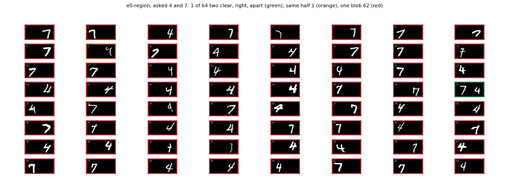
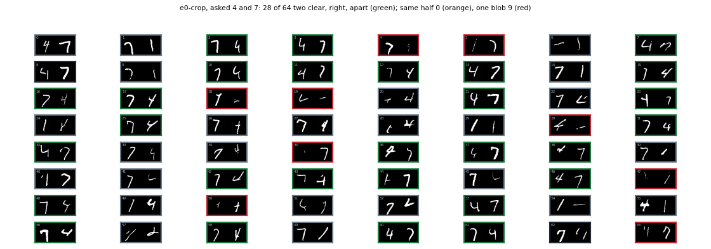
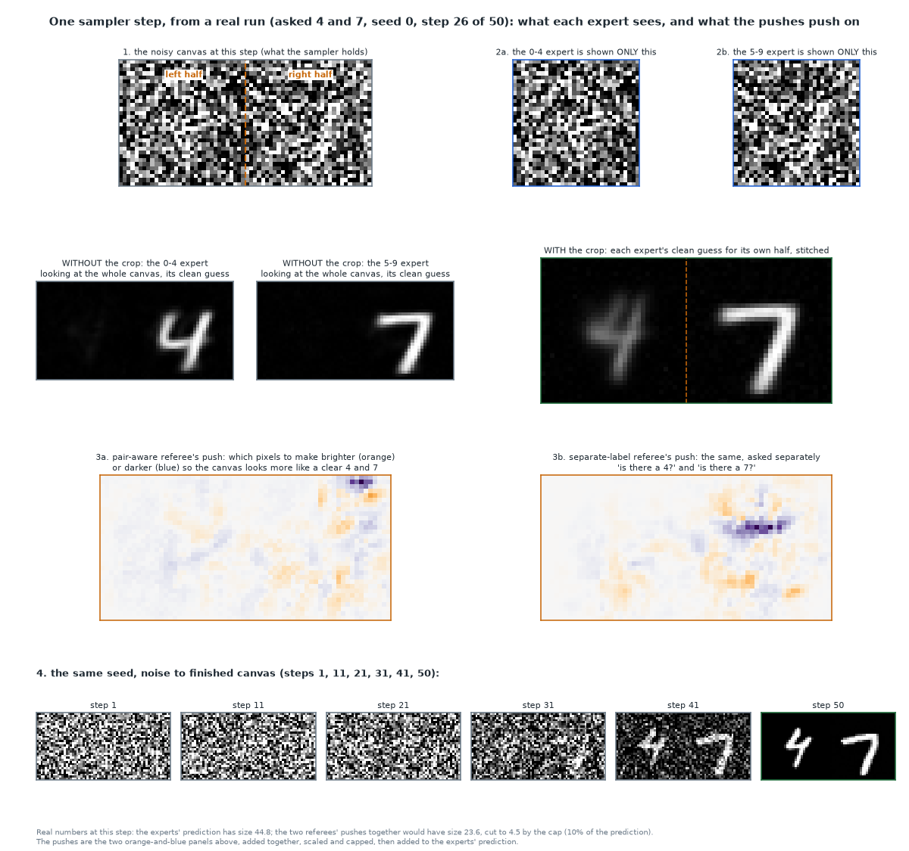
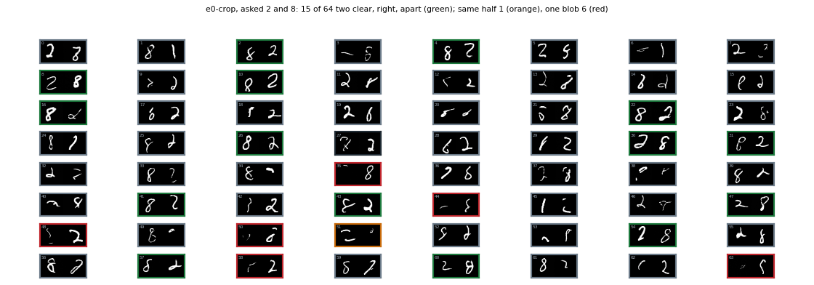

# 🧪 Results: giving each model its own half of the canvas

⬅️ [Step 1: the plain product draws nothing](../01-the-plain-product-draws-nothing/README.md) | ⬆️ [All steps](../README.md) | [Step 3: adding the checker pushes](../03-adding-the-checker-pushes/README.md) ➡️

**Showing each model only its own half of the canvas, with a coin flip per seed picking the side, raises clean pairs from 4 to 124 of 320 with no training.** The two models never met, and this is the first count above the plan's no-effect line of 32 for models that can draw on either side. A crop only works when the two regions are known in advance.

<table>
<tr>
<td><a href="../01-the-plain-product-draws-nothing/sheets/each-model-sees-the-whole-canvas/digits-4-and-7.png"></a></td>
<td><a href="sheets/each-model-on-its-own-half/digits-4-and-7.png"></a></td>
</tr>
<tr>
<td>Each model shown the whole canvas: 1 of 64 clean for 4 and 7</td>
<td>Each model shown only its half: 28 of 64 clean for 4 and 7</td>
</tr>
</table>

## Table of contents

- [Words this page uses](#words-this-page-uses)
- [What one sampling step does](#what-one-sampling-step-does)
- [How the side gets picked](#how-the-side-gets-picked)
- [What the other 196 canvases hold](#what-the-other-196-canvases-hold)
- [What each part adds](#what-each-part-adds)
- [The code that does it](#the-code-that-does-it)
- [What this cannot claim](#what-this-cannot-claim)
- [Every picture and number here](#every-picture-and-number-here)

## Words this page uses

Navigation: 📋 [TOC](#table-of-contents) | [Next](#what-one-sampling-step-does) ➡️

**Canvas:** one 32 by 64 pixel image with room for a digit in its left half and its right half.

**The two models:** one trained only on digits 0 to 4 and one only on digits 5 to 9. Neither has ever seen the other's digits.

**Clean pair:** a finished canvas that the digit-reading judge calls two clear, correct digits, one in each half.

**Sampling step:** one of the 50 steps that turn pure noise into a picture. Step 1 is almost all noise, and step 50 is the finished canvas.

**Noise prediction:** what a model outputs at each sampling step, its guess of which part of the canvas is noise.

**Seed:** the number that fixes a canvas's starting noise. Seeds 0 to 63 give the 64 canvases for each digit pair.

## What one sampling step does

Navigation: ⬅️ [Words](#words-this-page-uses) | 📋 [TOC](#table-of-contents) | [Next](#how-the-side-gets-picked) ➡️

**Each step cuts the noisy canvas in two, gives one half to each model, and joins their two noise predictions.**

<a href="one-sampling-step-explainer.png"></a>

The picture is step 26 of 50 from a real run asked for 4 and 7 on seed 0, where the coin gave the left half to the 0 to 4 model.

| Row of the picture | What you see |
|---|---|
| Top | the noisy canvas, then the left half shown to the 0 to 4 model and the right half shown to the 5 to 9 model |
| Second, left | each model's guess at the clean canvas when it sees all of it: the 4 and the 7 both land in the right half |
| Second, right | the two guesses from the crops, joined: a blurred 4 on the left and a sharp 7 on the right |
| Third | the two checker pushes, which [Step 3](../03-adding-the-checker-pushes/README.md) adds |
| Bottom | the same seed at steps 1, 11, 21, 31, 41 and 50, ending in a 4 on the left and a 7 on the right |

> [!NOTE]
> This picture was drawn from a run with both pushes on, so its finished canvas is not one of the 124 counted here. At this step the pushes have size 23.6 before their cap and 4.5 after it, against a noise prediction of size 44.8.

🔤 **The name:** crop
- **Crop:** to cut out part of a picture and use only that part. On the picture, it is the two square panels at the top right.
- **Half-canvas:** each crop is 32 by 32 pixels. The model sees that square and nothing of the other half.
- **Consequence:** with the same models and the same coin flips, showing the whole canvas gives 4 of 320 and showing the crop gives 124 of 320.

## How the side gets picked

Navigation: ⬅️ [What one sampling step does](#what-one-sampling-step-does) | 📋 [TOC](#table-of-contents) | [Next](#what-the-other-196-canvases-hold) ➡️

**A coin flip decides which model gets which half, and the canvas keeps that choice for all 50 steps.** Here are the first eight seeds:

| Seed | 0 | 1 | 2 | 3 | 4 | 5 | 6 | 7 |
|---|---|---|---|---|---|---|---|---|
| 0 to 4 model's half | left | right | right | left | right | left | right | left |
| 5 to 9 model's half | right | left | left | right | left | right | left | right |

🔤 **The name:** coin flip per seed
- **Coin flip:** a random choice between two outcomes. Here the outcomes are the two ways of sharing the canvas.
- **Per seed:** each starting noise gets one flip, and that flip is the same on every digit pair.
- **Consequence:** seed 0 draws the 4 on the left and seed 2 draws it on the right. Across the 64 seeds, the 0 to 4 model gets the left half on 27 and the right half on 37, and neither model has any say.

## What the other 196 canvases hold

Navigation: ⬅️ [How the side gets picked](#how-the-side-gets-picked) | 📋 [TOC](#table-of-contents) | [Next](#what-each-part-adds) ➡️

**Most of the 196 canvases that miss hold two shapes, and the judge cannot read at least one of them as the asked digit.**

<a href="sheets/each-model-on-its-own-half/digits-2-and-8.png"></a>

The sheet is the weakest pair, 2 and 8, at 15 of 64. Many grey tiles hold one good digit beside a thin or broken stroke. On the 4 and 7 sheet, a stroke like a 1 often stands where the 4 belongs.

| The judge's call | Canvases of 320 | What it looks like |
|---|---:|---|
| Clean pair | 124 | two clear, correct digits, one in each half |
| Two shapes, not both clear and right | 138 | a digit beside a thin stroke, a 1 or a broken digit |
| One shape | 42 | one digit, with a faint mark or nothing in the other half |
| Damaged | 15 | no shape at all, or more than two |
| Two shapes in one half | 1 | both shapes on the same side |

## What each part adds

Navigation: ⬅️ [What the other 196 canvases hold](#what-the-other-196-canvases-hold) | 📋 [TOC](#table-of-contents) | [Next](#the-code-that-does-it) ➡️

**The crop adds 120 clean pairs, and every digit pair gains.** Each row is 64 canvases per pair, on seeds 0 to 63.

| Digit pair | Whole canvas shown | Only its own half shown |
|---|---:|---:|
| 1 and 9 | 2 | 37 |
| 3 and 6 | 0 | 24 |
| 4 and 7 | 1 | 28 |
| 2 and 8 | 0 | 15 |
| 0 and 5 | 1 | 20 |
| All five, of 320 | 4 | 124 |

The plan wrote two lines before this run: under 32 means no effect, and 160 or more means promising. At 124 this run sits between them, so by the bar as written it is neither supported nor sent on. A second run of the same setting also gives 124, and below their titles its sheets match the first run's pixel for pixel on all five pairs.

## The code that does it

Navigation: ⬅️ [What each part adds](#what-each-part-adds) | 📋 [TOC](#table-of-contents) | [Next](#what-this-cannot-claim) ➡️

**Two short passages in [the two-model sampler](../../../../../scripts/mnist/two_experts.py) flip the coin and join the two crops.**

`2-classifier-guidance/scripts/mnist/two_experts.py`, lines 160 to 162:

```python
    if args.compose in ("region", "crop"):
        sides = [int(np.random.default_rng(1000 + s).integers(2)) for s in (EVAL_SEEDS if seeds is None else seeds)]
        return region_eps(A, B, a, b, sides, args.compose == "crop")
```

| Line | What it does |
|---|---|
| `default_rng(1000 + s).integers(2)` | the coin: 0 gives the first model the left half and 1 gives it the right, fixed by the seed |
| `args.compose == "crop"` | switches between showing the crop and showing the whole canvas |

Lines 72 to 77:

```python
        if crop:
            xl, xr = x[..., :32], x[..., 32:]
            eA_l, eA_r = A(xl, t, ya), A(xr, t, ya)
            eB_l, eB_r = B(xl, t, yb), B(xr, t, yb)
            e_left = torch.where(left, eA_l, eB_l); e_right = torch.where(left, eB_r, eA_r)
            return torch.cat([e_left, e_right], dim=-1)
```

| Line | What it does |
|---|---|
| `xl, xr = ...` | cuts the canvas into its left and right 32 by 32 halves |
| `A(xl, ...)`, `B(xr, ...)` | runs each model on each half, so either side is ready whichever way the coin fell |
| `torch.where(left, ...)` | keeps, for each canvas, the prediction from the model the coin gave that half |
| `torch.cat(...)` | joins the two halves back into one 32 by 64 prediction |

## What this cannot claim

Navigation: ⬅️ [The code](#the-code-that-does-it) | 📋 [TOC](#table-of-contents) | [Next](#every-picture-and-number-here) ➡️

> [!WARNING]
> **A crop needs the two regions known in advance.** Here they are a fixed left and right half with one digit each. A cat and a dog in one photo share the canvas and can overlap, so this method does not carry over to them, and it does not meet the plan's goal of composing with no cropping.

**The side comes from outside the models.** A coin places each digit, so this page says nothing about whether the models could choose a layout themselves. [Step 6](../06-letting-the-models-choose-their-side/README.md) tests that.

**"First" holds only for models that can draw on either side.** [The plan's review](../../../../../plans/review/33-experts-that-compose-at-inference.md) calls 124 the first non-zero composition of two models that never met. Smaller non-zero counts came before it: 4 of 320 with the whole canvas shown, and 4 of 320 with both pushes in [plan 32](../../02-two-models-trained-apart/README.md). Plan 32's fixed-side models, each of which only ever draws on one side, reached 139 of 320 with no training.

**Each model sees a shape it never trained on.** The models trained on 32 by 64 canvases and here receive 32 by 32 squares. No run measured what that costs.

**These five pairs are the tuning pairs.** Later settings were chosen on them. The same crop with no pushes, on 20 other pairs and seeds 64 to 127, gives 454 of 1,280 in [Step 5](../05-first-test-on-20-unseen-pairs/README.md).

**The judge made these counts.** No person checked these 320 canvases one by one, and the review puts the judge about 5% below a careful eye. Tile 0 of the 4 and 7 sheet reads as a 4 and a 7 by eye and still has a grey frame.

## Every picture and number here

Navigation: ⬅️ [What this cannot claim](#what-this-cannot-claim) | 📋 [TOC](#table-of-contents)

**This folder holds one explainer and two runs of the same setting with their counts.** Each run has one sheet per digit pair. A sheet shows 64 canvases, and the frame colour is the judge's call: green for clean, red for one shape, orange for two shapes in one half, grey for two shapes that are not both clear and right, and near-black for damaged.

| Thing | What it shows | How we got it | Also called |
|---|---|---|---|
| [One sampling step](one-sampling-step-explainer.png) | step 26 of 50, asked for 4 and 7, seed 0, from a run with both pushes | drawn by `make_plan33_step.py` | `one-sampler-step` |
| [Each model on its own half](sheets/each-model-on-its-own-half/) with [its counts](counts/each-model-on-its-own-half.json) | 5 sheets, 124 of 320 | `two_experts.py cells --compose crop --push none`, on the cluster | `e0-crop` |
| [The second run](sheets/each-model-on-its-own-half-second-run/) with [its counts](counts/each-model-on-its-own-half-second-run.json) | 5 sheets, 124 of 320, matching the row above | the same setting, run again as the no-push reference in the batch that tests the checker pushes | `crop-nc-none` |

**Where it came from.** The bars were written before these runs in [plan 33's review file](../../../../../plans/review/33-experts-that-compose-at-inference.md), and [plan 33](../../../../../plans/33-experts-that-compose-at-inference.md) holds the design. The launch scripts are [the first run's script](../../../../../scripts/mnist/two_experts_e0e1.sh) and [the second run's script](../../../../../scripts/mnist/two_experts_crop_e4.sh), and [the explainer's script](../../../../../scripts/mnist/make_plan33_step.py) draws the picture. Both count files list a background with spread 0.3, and the crop code path never reads it. Every file's original location and checksum is in [the file origins list](../file-origins.tsv). The models and raw canvases stay in `data/mnist-canvas/33-mnist-experts-at-inference/` and on the cluster at `/home-mscluster/mmolefe/poe_repair_min_scratch/mnist-canvas/33-experts-at-inference/`.

<!-- built-to: PAGE_LOOK_FORMAT v1 -->
