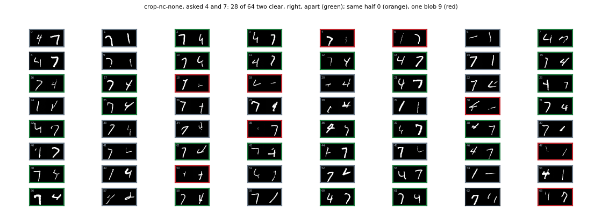
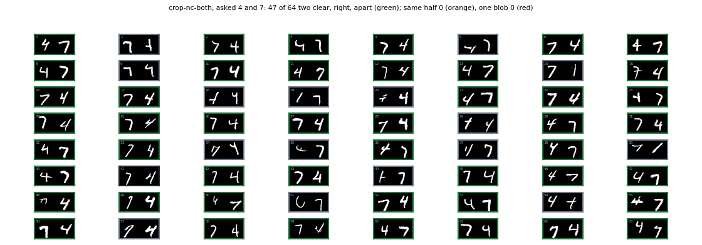
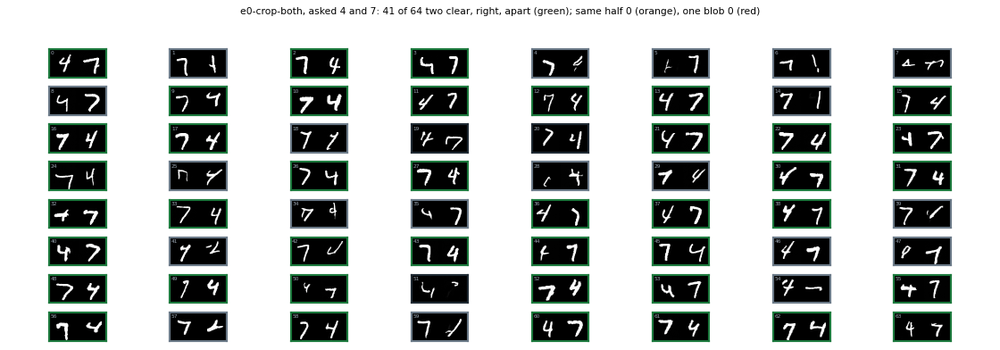
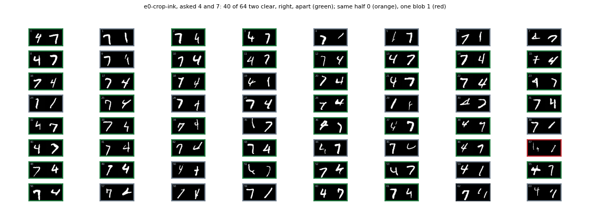
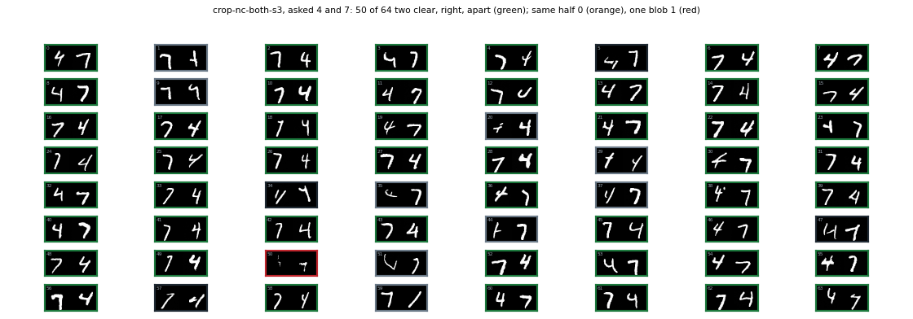
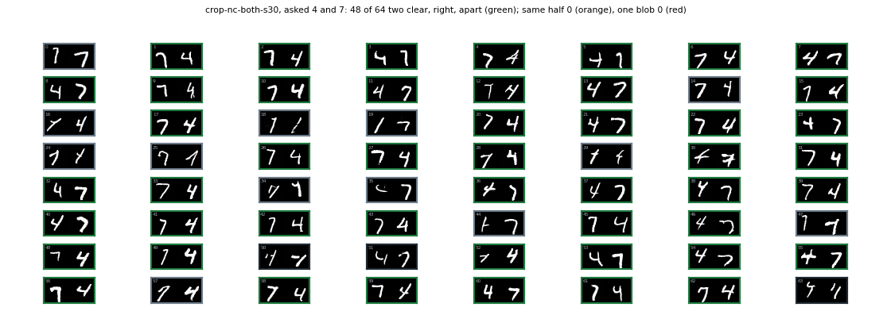
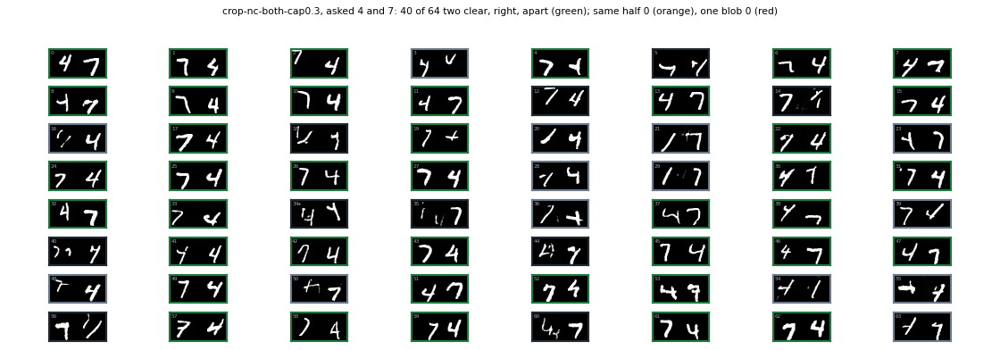
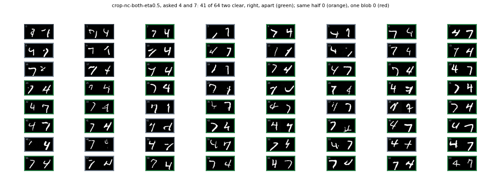

# 🧪 Results: adding two checker pushes to each sampling step

⬅️ [Step 2: giving each model its own half](../02-giving-each-model-its-own-half/README.md) | ⬆️ [All steps](../README.md) | [Step 4: adding extra denoising steps](../04-adding-extra-denoising-steps/README.md) ➡️

**Two small trained checkers that push every sampling step raise clean pairs from 124 to 257 of 320.** The count covers five digit pairs used for tuning, with 64 canvases per pair. Four changes to the push settings were then tried one at a time, and none added the 10 clean pairs required, so the default settings stay.

<table>
<tr>
<td><a href="../02-giving-each-model-its-own-half/sheets/each-model-on-its-own-half-second-run/digits-4-and-7.png"></a></td>
<td><a href="sheets/both-pushes-retrained-checkers/digits-4-and-7.png"></a></td>
</tr>
<tr>
<td>No pushes: 28 of 64 clean for 4 and 7</td>
<td>Both pushes: 47 of 64 clean for 4 and 7</td>
</tr>
</table>

## Table of contents

- [Words this page uses](#words-this-page-uses)
- [What a push does](#what-a-push-does)
- [The three checkers](#the-three-checkers)
- [Why the checkers were retrained](#why-the-checkers-were-retrained)
- [A push of zero changes nothing](#a-push-of-zero-changes-nothing)
- [Changing one setting at a time](#changing-one-setting-at-a-time)
- [What each part adds](#what-each-part-adds)
- [The code that does it](#the-code-that-does-it)
- [What this cannot claim](#what-this-cannot-claim)
- [Every picture and number here](#every-picture-and-number-here)

## Words this page uses

Navigation: 📋 [TOC](#table-of-contents) | [Next](#what-a-push-does) ➡️

**Canvas:** one 32 by 64 pixel image with room for a digit in its left half and its right half.

**The two models:** one trained only on digits 0 to 4 and one only on digits 5 to 9. Neither has ever seen the other's digits.

**Own half:** each canvas randomly assigns one model to the left half and the other to the right, and each model sees and draws only its half. [Step 2](../02-giving-each-model-its-own-half/README.md) introduces this and reaches 124 of 320.

**Clean pair:** a finished canvas that the digit-reading judge calls two clear, correct digits, one in each half.

**Sampling step:** one of the 50 steps that turn pure noise into a picture. Step 1 is almost all noise, and step 50 is the finished canvas.

**Noise prediction:** a model's guess at the noise in the canvas. The sampler removes part of that guess at every step.

**Sheet:** the 64 canvases for one digit pair, from starting-noise seeds 0 to 63. A green frame is clean, grey is two marks that are not both clear and right, red is one blob, and a dark frame is a damaged canvas.

## What a push does

Navigation: ⬅️ [Words](#words-this-page-uses) | 📋 [TOC](#table-of-contents) | [Next](#the-three-checkers) ➡️

**A push is a small change to each step's noise prediction, aimed at a canvas the checker scores higher.**

```text
noisy canvas at this step
   │
   ├── each model predicts the noise on its own half ──► joined noise prediction
   │                                                               │
   └── the checkers score the canvas ──► their gradient            │
                                         is the push  ────────► added together
                                                                   │
                                                                   ▼
                                                     next, less noisy canvas
```

A checker reads the noisy canvas and gives a score. Its gradient says, for every pixel, how much changing that pixel would raise the score. The sampler subtracts the noise prediction from the canvas, so subtracting the gradient from that prediction moves the canvas toward a higher score.

🔤 **The name:** checker push
- **Checker:** something that inspects work and says how well it passes. Here it is a small trained network, the lower branch of the diagram.
- **Push:** a small shove in one direction. Here it is the checker's gradient, scaled and added to the noise prediction before the step is taken.
- **Consequence:** take the pushes away and clean pairs fall from 257 to 124 of 320, with the same models, seeds and sampler.

## The three checkers

Navigation: ⬅️ [What a push does](#what-a-push-does) | 📋 [TOC](#table-of-contents) | [Next](#why-the-checkers-were-retrained) ➡️

**"Both pushes" adds two checkers together, and a third checker that never saw two digits reaches 213 of 320 alone.**

| Checker | What it reads | What it answers | What it trained on |
|---|---|---|---|
| Pair checker | the whole canvas and the asked pair | one score for "this becomes the asked pair, clear, one digit in each half" | pasted pairs, then its own pushed canvases labelled by the judge |
| Separate-label checker | the whole canvas | ten answers, one per digit: "is this digit here?" | pasted canvases with known digits |
| One-half ink checker | one 32 by 32 half at a time | "is there a digit in this half?" | halves of one-digit canvases and blank halves |

The first two checkers run together as both pushes. Their two pushes are summed, and the size limit applies to the sum. The ink checker runs alone.

<table>
<tr>
<td><a href="sheets/both-pushes-first-checkers/digits-4-and-7.png"></a></td>
<td><a href="sheets/one-half-ink-push-first-checkers/digits-4-and-7.png"></a></td>
</tr>
<tr>
<td>Both pushes, first checkers: 41 of 64 for 4 and 7, 241 of 320 overall</td>
<td>Ink push alone: 40 of 64 for 4 and 7, 213 of 320 overall. Several rejected canvases hold a bare stroke where the 4 belongs</td>
</tr>
</table>

🔤 **The name:** one-half ink push
- **Ink:** the white strokes of a digit on the black canvas. This checker asks only whether a half holds any digit, and it has no idea which one.
- **One-half:** it reads the left and right halves separately, so it never looks at two digits together.
- **Consequence:** with no pair data at all, this push lifts clean pairs from 124 to 213 of 320, a gain of 89.

## Why the checkers were retrained

Navigation: ⬅️ [The three checkers](#the-three-checkers) | 📋 [TOC](#table-of-contents) | [Next](#a-push-of-zero-changes-nothing) ➡️

**The first checkers had trained on the digit pairs the final test uses, so the pair and separate-label checkers were trained again without them.**

A 0 to 4 digit and a 5 to 9 digit can be paired in 25 ways. Five of those pairs tune the method on this page, and the other 20 are held for the final test. The first checkers' pasted training pairs included those 20, which would make a final test through them a test on pairs they had already seen.

| Checkers | Digit pairs in the pasted training data | Of those, pairs the final test uses |
|---|---:|---:|
| First | 40 | 20 |
| Retrained | 20 | 0 |

🔤 **The name:** cross-range pair
- **Range:** the digits one model trained on, either 0 to 4 or 5 to 9.
- **Cross:** going from one side to the other. A cross-range pair has one digit from each range, like 4 and 7. The pair 2 and 3 stays within one range.
- **Consequence:** remove every cross-range pair and the pasted training list falls from 40 pairs to 20, shown in the table above.

The ink checker kept its original training because it only ever saw single digits.

**The first retraining threw away the pushed canvases it was meant to learn from.** The pair checker trains in rounds on its own pushed canvases of the five tuning pairs, and the judge called 170 of the first 240 right. The next training then reported 0 drawn examples, because the trainer was built to drop any canvas of those five pairs, which had been held out in the earlier work. That checker had learned from pasted data only, so it was discarded. A new switch keeps those canvases, the training restarted from the first round's 240, and the judge called 192 of the second round's 240 right.

<table>
<tr>
<td><a href="sheets/both-pushes-first-checkers/digits-4-and-7.png"></a></td>
<td><a href="sheets/both-pushes-retrained-checkers/digits-4-and-7.png"></a></td>
</tr>
<tr>
<td>First checkers: 41 of 64 for 4 and 7, 241 of 320 overall</td>
<td>Retrained checkers: 47 of 64 for 4 and 7, 257 of 320 overall</td>
</tr>
</table>

## A push of zero changes nothing

Navigation: ⬅️ [Why the checkers were retrained](#why-the-checkers-were-retrained) | 📋 [TOC](#table-of-contents) | [Next](#changing-one-setting-at-a-time) ➡️

**A push of exactly zero gives the same 124 of 320 as no push, so the push code adds nothing of its own.**

<table>
<tr>
<td><a href="../02-giving-each-model-its-own-half/sheets/each-model-on-its-own-half-second-run/digits-4-and-7.png"></a></td>
<td><a href="sheets/zero-strength-push/digits-4-and-7.png"></a></td>
</tr>
<tr>
<td>No push: 28 of 64 for 4 and 7</td>
<td>Zero push: the same 64 canvases, 28 of 64</td>
</tr>
</table>

On all five saved sheets, every canvas matches the no-push run pixel for pixel. Only the printed title differs.

## Changing one setting at a time

Navigation: ⬅️ [A push of zero](#a-push-of-zero-changes-nothing) | 📋 [TOC](#table-of-contents) | [Next](#what-each-part-adds) ➡️

**None of the four changes added the 10 clean pairs required, so the default settings stay at 257 of 320.**

| Setting | Default | Tried | Clean pairs of 320 | Change from 257 |
|---|---:|---:|---:|---:|
| Strength | 10 | 3 | 251 | −6 |
| Strength | 10 | 30 | 247 | −10 |
| Size limit | 0.1 | 0.3 | 211 | −46 |
| Sampler noise | 1.0 | 0.5 | 197 | −60 |

<table>
<tr>
<td><a href="sheets/both-pushes-retrained-checkers/digits-4-and-7.png"></a></td>
<td><a href="sheets/both-pushes-strength-3/digits-4-and-7.png"></a></td>
<td><a href="sheets/both-pushes-strength-30/digits-4-and-7.png"></a></td>
</tr>
<tr>
<td>Default: 47 of 64 for 4 and 7</td>
<td>Strength 3: 50 of 64, looks much like the default</td>
<td>Strength 30: 48 of 64, some digits bent or scratched</td>
</tr>
<tr>
<td><a href="sheets/both-pushes-size-limit-0-3/digits-4-and-7.png"></a></td>
<td><a href="sheets/both-pushes-sampler-noise-0-5/digits-4-and-7.png"></a></td>
<td></td>
</tr>
<tr>
<td>Size limit 0.3: 40 of 64, stray marks and smudges beside the digits</td>
<td>Sampler noise 0.5: 41 of 64, several digits with extra strokes</td>
<td></td>
</tr>
</table>

Strength 3 scores 50 on 4 and 7, above the default's 47, and still scores lower overall because it loses 5 clean canvases on 2 and 8 and another 5 on 0 and 5. A single pair can move against the total, so the setting is judged on all five.

🔤 **The name:** strength
- **Strength:** how hard the push shoves. It is the number multiplied onto the checker's gradient, the first two rows of the table.
- **Consequence:** move it from 10 down to 3 and clean pairs go from 257 to 251. Move it up to 30 and they go to 247.

🔤 **The name:** size limit
- **Limit:** a ceiling that a value may not pass. The push may be at most this fraction of the noise prediction's length, measured separately on each canvas.
- **Where it sits:** a prediction that looks like ordinary unit noise over 2,048 pixels has a length of about 45, so a limit of 0.1 allows a push of about 4.5 and a limit of 0.3 allows about 13.6.
- **Consequence:** raise it from 0.1 to 0.3 and clean pairs fall from 257 to 211.

🔤 **The name:** sampler noise
- **Sampler noise:** the fresh random noise added at each sampling step. A setting of 1.0 adds the full amount the schedule allows and 0 adds none. The code calls this `eta`.
- **Consequence:** halve it from 1.0 to 0.5 and clean pairs fall from 257 to 197.

## What each part adds

Navigation: ⬅️ [Changing one setting](#changing-one-setting-at-a-time) | 📋 [TOC](#table-of-contents) | [Next](#the-code-that-does-it) ➡️

**The retrained pushes add 133 clean pairs over no pushes, more than the 64 the plan asked for.** Each row is 64 canvases per pair, on seeds 0 to 63.

| Digit pair | No pushes | Ink push alone | Both pushes, first checkers | Both pushes, retrained checkers |
|---|---:|---:|---:|---:|
| 1 and 9 | 37 | 56 | 57 | 53 |
| 3 and 6 | 24 | 39 | 46 | 54 |
| 4 and 7 | 28 | 40 | 41 | 47 |
| 2 and 8 | 15 | 35 | 48 | 48 |
| 0 and 5 | 20 | 43 | 49 | 55 |
| All five, of 320 | 124 | 213 | 241 | 257 |

The plan's line for this composition on the tuning pairs is 288 of 320 (90%). At 257 it is still short of that line, so the work moves to [extra denoising steps in step 4](../04-adding-extra-denoising-steps/README.md).

## The code that does it

Navigation: ⬅️ [What each part adds](#what-each-part-adds) | 📋 [TOC](#table-of-contents) | [Next](#what-this-cannot-claim) ➡️

**Four short passages build the push, limit its size and decide what the checkers train on.**

`2-classifier-guidance/scripts/mnist/pixel_checker.py`, lines 70 to 79:

```python
def pair_push(head, a, b, s):
    def push(x, t, eps):
        with torch.enable_grad():
            xx = x.detach().requires_grad_(True)
            pair = torch.tensor([[a, b]], device=x.device).expand(x.shape[0], 2)
            logit = head(xx, t, pair)[:, 0]
            g, = torch.autograd.grad(logit.sum(), xx)
        inside = (logit.detach().abs() < LOGIT_CLIP).float()[:, None, None, None]
        return -s * _rate(t, x) * g * inside
    return push
```

| Line | What it does |
|---|---|
| `logit = head(xx, t, pair)[:, 0]` | the pair checker's score for this canvas and asked pair |
| `torch.autograd.grad(...)` | the gradient: how the score changes with every pixel |
| `inside = ...` | turns the push off on a canvas whose score has reached the checker's limit, 11.5 in size |
| `-s * _rate(t, x) * g * inside` | the push: strength times the step's noise level times the gradient, negative because the sampler subtracts the noise prediction |

`2-classifier-guidance/scripts/mnist/canvas_unet.py`, lines 180 to 188:

```python
def per_sample_cap(push, eps, cap):
    """Scale each sample's push to at most cap times that sample's eps norm; report which fired."""
    if cap is None:
        return push, torch.zeros(push.shape[0], dtype=torch.bool, device=push.device)
    pn = push.flatten(1).norm(dim=1)
    lim = cap * eps.flatten(1).norm(dim=1)
    fired = pn > lim
    scale = torch.where(fired, lim / pn.clamp_min(1e-12), torch.ones_like(pn))
    return push * scale[:, None, None, None], fired
```

| Line | What it does |
|---|---|
| `lim = cap * ...` | the size limit for this canvas, as a fraction of the noise prediction's length |
| `scale = ...` | shrinks a push that passes the limit down to it, and leaves a smaller push alone |

`2-classifier-guidance/scripts/mnist/pixel_checker.py`, lines 27 to 30:

```python
EVAL_PAIRS = [(1, 9), (3, 6), (4, 7), (2, 8), (0, 5)]
TRAIN_PAIRS = [(a, b) for a in range(10) for b in range(a + 1, 10) if (a, b) not in EVAL_PAIRS]
if os.environ.get("PC_NOCROSS"):          # plan 33: no cross-range pair (a 0-4 digit with a 5-9 digit) in a checker's pasted data
    TRAIN_PAIRS = [(a, b) for a, b in TRAIN_PAIRS if not (a <= 4 < b)]
```

| Line | What it does |
|---|---|
| `TRAIN_PAIRS = ...` | every digit pair except the five tuning pairs: 40 pairs |
| `not (a <= 4 < b)` | drops each pair with one digit from each range, leaving 20 |

Lines 163 to 168:

```python
    if kind == "pair" and draws:
        xs, ps, ok = [], [], []
        for p in draws:
            d = np.load(p)
            keep = np.array([bool(os.environ.get("PC_KEEP_EVAL_DRAWS")) or tuple(sorted(q)) not in EVAL_PAIRS for q in d["pair"]])
            xs.append(d["x"][keep]); ps.append(d["pair"][keep]); ok.append(d["ok"][keep])
```

| Line | What it does |
|---|---|
| `not in EVAL_PAIRS` | the rule that silently dropped every pushed canvas of the five tuning pairs |
| `PC_KEEP_EVAL_DRAWS` | the switch that keeps those canvases for the retrained pair checker |

## What this cannot claim

Navigation: ⬅️ [The code](#the-code-that-does-it) | 📋 [TOC](#table-of-contents) | [Next](#every-picture-and-number-here) ➡️

> [!WARNING]
> **The move from 241 to 257 mixes two changes.** The retraining removed the cross-range pairs and also trained the pair checker on pushed canvases of these same five pairs. The first checkers never saw these five pairs, so the gain of 16 cannot be credited to either change alone, and 257 is a tuning number. [Step 5](../05-first-test-on-20-unseen-pairs/README.md) tests a later setting on 20 unseen pairs.

**The two ink rows are one checker run twice.** The ink checker was never retrained. Its 213 and its saved canvases are the same in both runs, so the ink result adds no second measurement.

**This still splits the canvas into two known halves.** Each model is handed a fixed half, so the page does not show two models composing on one shared canvas, and it does not meet the plan's no-cropping goal.

**Each setting ran once.** One run on one set of 64 seeds per pair cannot say how much of a gap of 6 or 10 clean pairs is run-to-run scatter. The rule of adding at least 10 was written before these runs and is applied as written.

**The judge made these counts.** No person checked these canvases one by one, and [the plan's review file](../../../../../plans/review/33-experts-that-compose-at-inference.md) puts the judge about 5% below a careful eye.

## Every picture and number here

Navigation: ⬅️ [What this cannot claim](#what-this-cannot-claim) | 📋 [TOC](#table-of-contents)

**This folder holds nine runs and their counts.** Each run has five sheets, one per digit pair, and the title printed on a sheet is the name in the last column.

| Thing | What it shows | How we got it | Also called |
|---|---|---|---|
| [Both pushes, first checkers](sheets/both-pushes-first-checkers/) with [its counts](counts/both-pushes-first-checkers.json) | 241 of 320; most 4 and 7 canvases are clear, with a bare stroke for the 4 in some | `two_experts.py cells --compose crop --push both`, on the cluster, with the checkers from plan 32 | `e0-crop-both` |
| [One-half ink push, first run](sheets/one-half-ink-push-first-checkers/) with [its counts](counts/one-half-ink-push-first-checkers.json) | 213 of 320; several 4 and 7 canvases hold a bare stroke for the 4 | the same command with `--push ink` | `e0-crop-ink` |
| [Both pushes, retrained checkers](sheets/both-pushes-retrained-checkers/) with [its counts](counts/both-pushes-retrained-checkers.json) | 257 of 320, the default every later row is compared with | [the retraining script](../../../../../scripts/mnist/two_experts_crop_e4b.sh) with `--push both` | `crop-nc-both` |
| [One-half ink push, second run](sheets/one-half-ink-push-second-run/) with [its counts](counts/one-half-ink-push-second-run.json) | 213 of 320; canvases identical to the first ink run | the same script with `--push ink`, using the unchanged ink checker | `crop-nc-ink` |
| [Zero-strength push](sheets/zero-strength-push/) with [its counts](counts/zero-strength-push.json) | 124 of 320; canvases identical to the no-push run in step 2 | the same script with `--push zero` | `crop-nc-zero` |
| [Strength 3](sheets/both-pushes-strength-3/) with [its counts](counts/both-pushes-strength-3.json) | 251 of 320; looks much like the default | [the settings script](../../../../../scripts/mnist/two_experts_crop_tune.sh) with `--s 3` | `crop-nc-both-s3` |
| [Strength 30](sheets/both-pushes-strength-30/) with [its counts](counts/both-pushes-strength-30.json) | 247 of 320; some digits bent or scratched | the same script with `--s 30` | `crop-nc-both-s30` |
| [Size limit 0.3](sheets/both-pushes-size-limit-0-3/) with [its counts](counts/both-pushes-size-limit-0-3.json) | 211 of 320; stray marks and smudges beside the digits | the same script with `--cap 0.3` | `crop-nc-both-cap0.3` |
| [Sampler noise 0.5](sheets/both-pushes-sampler-noise-0-5/) with [its counts](counts/both-pushes-sampler-noise-0-5.json) | 197 of 320; several digits with extra strokes | the same script with `--eta 0.5` | `crop-nc-both-eta0.5` |

**Where it came from.** The bars were written before these runs in [plan 33's review file](../../../../../plans/review/33-experts-that-compose-at-inference.md), and [plan 33](../../../../../plans/33-experts-that-compose-at-inference.md) holds the design. Every file's original location and checksum is in [the file origins list](../file-origins.tsv). The two models and the retrained checkers are in `2-classifier-guidance/data/mnist-canvas/33-mnist-experts-at-inference/models/`, and each run's raw canvases are on the cluster at `/home-mscluster/mmolefe/poe_repair_min_scratch/mnist-canvas/33-experts-at-inference/`.

<!-- built-to: PAGE_LOOK_FORMAT v1 -->
