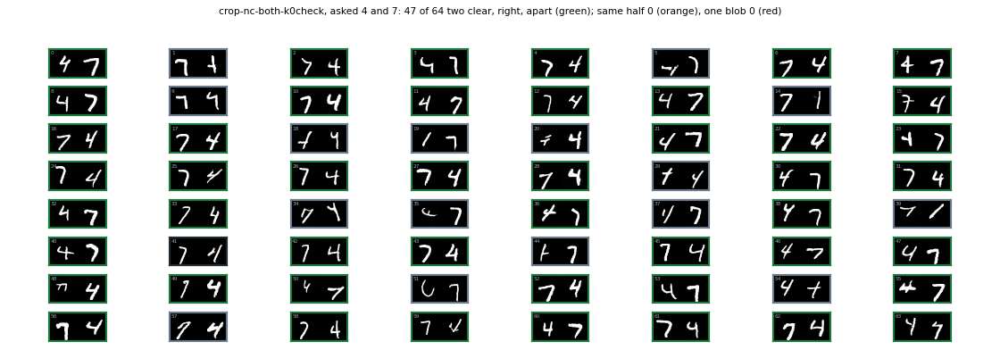
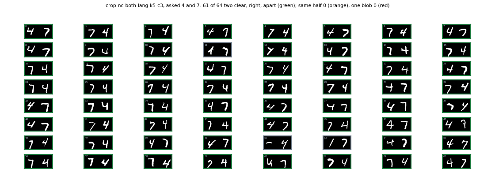
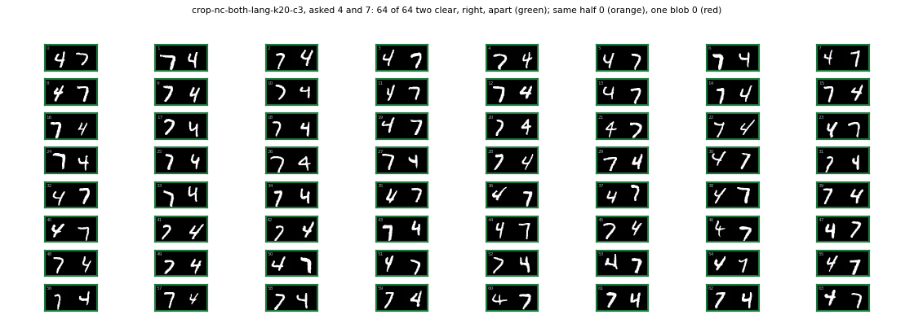
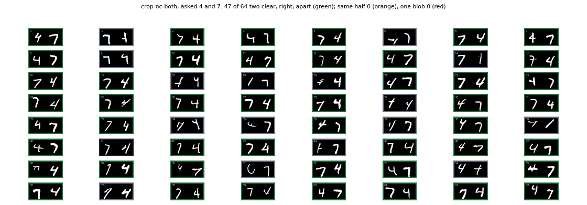

# 🧪 Results: adding extra denoising steps before each sampling step

⬅️ [Step 3: adding the checker pushes](../03-adding-the-checker-pushes/README.md) | ⬆️ [All steps](../README.md) | [Step 5: first test on 20 unseen pairs](../05-first-test-on-20-unseen-pairs/README.md) ➡️

**Five extra denoising steps before each sampling step raise clean pairs from 257 to 298 of 320, and twenty raise them to 306.** Neither gain reached its bar. Five steps added 41 where the plan asked for 64, and going to twenty added 8 more where it asked for 10.

<table>
<tr>
<td><a href="sheets/zero-extra-steps/digits-4-and-7.png"></a></td>
<td><a href="sheets/five-extra-steps/digits-4-and-7.png"></a></td>
<td><a href="sheets/twenty-extra-steps/digits-4-and-7.png"></a></td>
</tr>
<tr>
<td>No extra steps: 47 of 64 clean for 4 and 7</td>
<td>Five extra steps: 61 of 64</td>
<td>Twenty extra steps: 64 of 64</td>
</tr>
</table>

## Table of contents

- [Words this page uses](#words-this-page-uses)
- [What one extra step does](#what-one-extra-step-does)
- [Zero extra steps leaves every judge call the same](#zero-extra-steps-leaves-every-judge-call-the-same)
- [Five extra steps, then twenty](#five-extra-steps-then-twenty)
- [What each part adds](#what-each-part-adds)
- [The code that does it](#the-code-that-does-it)
- [What this cannot claim](#what-this-cannot-claim)
- [Every picture and number here](#every-picture-and-number-here)

## Words this page uses

Navigation: 📋 [TOC](#table-of-contents) | [Next](#what-one-extra-step-does) ➡️

**Canvas:** one 32 by 64 pixel image with room for a digit in its left half and its right half. Its pixels run from −1 for black to 1 for white.

**The two models:** one trained only on digits 0 to 4 and one only on digits 5 to 9. Neither has ever seen the other's digits.

**Clean pair:** a finished canvas that the digit-reading judge calls two clear, correct digits, one in each half.

**Sampling step:** one of the 50 steps that turn pure noise into a picture. Each step lowers the noise level, from 999 at step 1 to 0 at step 50.

**Noise prediction:** a model's guess at the noise in the canvas. On this page it is the two models' joined guess with both checker pushes added.

**The default:** each model on its own half with both pushes from the retrained checkers, the setting that reaches 257 of 320 in [step 3](../03-adding-the-checker-pushes/README.md).

**Sheet:** the 64 canvases for one digit pair, from starting-noise seeds 0 to 63. A green frame is clean, grey is two marks that are not both clear and right, red is one blob, and a dark frame is a damaged canvas.

## What one extra step does

Navigation: ⬅️ [Words](#words-this-page-uses) | 📋 [TOC](#table-of-contents) | [Next](#zero-extra-steps-leaves-every-judge-call-the-same) ➡️

**An extra step moves the canvas a little along the noise prediction and adds a small random kick, while the noise level stays where it is.**

```text
canvas at noise level t
   │
   ├── repeat 5 or 20 times, noise level stays at t
   │      drift: move each pixel a little, using the noise prediction
   │      kick:  add a little fresh random noise
   │
   ▼
the normal sampling step, down to the next noise level
```

🔤 **The name:** Langevin corrector
- **Langevin:** Paul Langevin, a French physicist. In 1908 he wrote down how a tiny grain in water moves, like the pollen specks that jitter under a microscope as water molecules hit them. His equation has a steady drift plus random kicks, and the two lines inside the loop above are those two parts.
- **Drift:** the steady part of the motion. Here it is a small move set by the noise prediction.
- **Kick:** the random part. Here it is fresh noise, a different draw on every extra step.
- **Corrector:** something that fixes work before it moves on. It adjusts the canvas at the current noise level before the sampling step lowers that level.
- **Consequence:** add five of these steps before each sampling step and clean pairs go from 257 to 298 of 320.

**One made-up pixel shows the arithmetic.** At sampling step 25 the step size is 0.0308, the noise spread is 0.964, and a random draw of 1 gives a kick of 0.248. Take a pixel at 0.40 whose noise prediction is 0.50, with a random draw of 1:

| Part | Sum | Result |
|---|---|---:|
| Start | | 0.400 |
| Drift | 0.0308 × (−0.50 ÷ 0.964) | −0.016 |
| Kick | 0.248 × 1 | +0.248 |
| New pixel | 0.400 − 0.016 + 0.248 | 0.632 |

The step size is 3 times the schedule's own noise amount at that level, written β. Kicks shrink as the canvas gets cleaner, so the late extra steps disturb it far less than the early ones:

| Sampling step | Noise level | Step size, 3 × β | Kick for a random draw of 1 |
|---:|---:|---:|---:|
| 1 | 999 | 0.0600 | 0.346 |
| 25 | 510 | 0.0308 | 0.248 |
| 49 | 20 | 0.0015 | 0.055 |

Step 50 gets no extra steps, because it is the last one.

## Zero extra steps leaves every judge call the same

Navigation: ⬅️ [What one extra step does](#what-one-extra-step-does) | 📋 [TOC](#table-of-contents) | [Next](#five-extra-steps-then-twenty) ➡️

**With the extra steps set to zero, the sampler gets 47 of 64 on 4 and 7, and the judge's call matches the default on all 64 canvases.**

<table>
<tr>
<td><a href="../03-adding-the-checker-pushes/sheets/both-pushes-retrained-checkers/digits-4-and-7.png"></a></td>
<td><a href="sheets/zero-extra-steps/digits-4-and-7.png"></a></td>
</tr>
<tr>
<td>The default from step 3: 47 of 64</td>
<td>Zero extra steps: 47 of 64, with the same frame colour on every canvas</td>
</tr>
</table>

The saved pictures differ slightly. On the sheets, 58 of the 64 canvases differ from the default by at least one pixel, and the largest difference is 320 pixels on one canvas. The code skips the extra steps entirely when their number is zero, so they cannot be the source, and the cause of the small difference has not been traced.

## Five extra steps, then twenty

Navigation: ⬅️ [Zero extra steps](#zero-extra-steps-leaves-every-judge-call-the-same) | 📋 [TOC](#table-of-contents) | [Next](#what-each-part-adds) ➡️

**Five extra steps add 41 clean pairs for 5.9 times the noise predictions, and going to twenty adds 8 more for 20.6 times.**

| Extra steps before each sampling step | Noise predictions per canvas | Clean pairs of 320 | Gain | Gain the plan asked for | Reached? |
|---:|---:|---:|---:|---:|---|
| 0 (the default) | 50 | 257 | | | |
| 5 | 295 | 298 | 41 over the default | 64 | no |
| 20 | 1,030 | 306 | 8 over five steps | 10 | no |

The middle column counts one prediction for each of the 50 sampling steps plus the extra steps before the first 49. Each prediction runs both models and both checkers.

By the rule written before the run, five extra steps are not adopted, because 41 is under 64. The 298 does pass the plan's separate line of 288 of 320 (90%) on these tuning pairs. Twenty steps miss their bar too, and the five-step setting is the one [the first test on unseen pairs](../05-first-test-on-20-unseen-pairs/README.md) uses.

## What each part adds

Navigation: ⬅️ [Five extra steps, then twenty](#five-extra-steps-then-twenty) | 📋 [TOC](#table-of-contents) | [Next](#the-code-that-does-it) ➡️

**Five extra steps raise every pair, and going to twenty raises three, leaves 1 and 9 unchanged and costs 0 and 5 one clean canvas.** Each row is 64 canvases per pair, on seeds 0 to 63.

| Digit pair | Default, no extra steps | Five extra steps | Twenty extra steps |
|---|---:|---:|---:|
| 1 and 9 | 53 | 63 | 63 |
| 3 and 6 | 54 | 59 | 64 |
| 4 and 7 | 47 | 61 | 64 |
| 2 and 8 | 48 | 57 | 58 |
| 0 and 5 | 55 | 58 | 57 |
| All five, of 320 | 257 | 298 | 306 |

## The code that does it

Navigation: ⬅️ [What each part adds](#what-each-part-adds) | 📋 [TOC](#table-of-contents) | [Next](#what-this-cannot-claim) ➡️

**One short passage in [the sampler](../../../../../scripts/mnist/canvas_unet.py) forms the noise prediction and runs the extra steps.**

`2-classifier-guidance/scripts/mnist/canvas_unet.py`, lines 214 to 227:

```python
        def full_eps(xx):
            e = eps_fn(xx, tt) if eps_fn is not None else product_eps(model, xx, tt, labels, g)
            fr = None
            if push_fn is not None:
                push, fr = per_sample_cap(push_fn(xx, tt, e), e, cap)
                e = e + push
            return e, fr
        if langevin is not None and langevin[0] > 0 and langevin[1] > 0 and i + 1 < len(ts):
            beta_t = float(BETAS[int(t)]); delta = float(langevin[1]) * beta_t
            sigma_t = (1 - abar[t]).sqrt()
            for _ in range(int(langevin[0])):
                e, _ = full_eps(x)
                z = torch.stack([torch.randn(x.shape[1:], generator=gg) for gg in (gens or [torch.Generator().manual_seed(7)] * x.shape[0])]).to(device)
                x = x + delta * (-e / sigma_t) + (2 * delta) ** 0.5 * z
```

| Line | What it does |
|---|---|
| `def full_eps(xx)` | one noise prediction: the joined models, then the size-limited push added |
| `langevin[0] > 0 ... i + 1 < len(ts)` | runs the extra steps only when their number is above zero and this is not the last sampling step |
| `delta = ... * beta_t` | the step size, 3 times the schedule's noise amount β at this level |
| `delta * (-e / sigma_t)` | the drift |
| `(2 * delta) ** 0.5 * z` | the kick, with `z` a fresh random draw |

## What this cannot claim

Navigation: ⬅️ [The code](#the-code-that-does-it) | 📋 [TOC](#table-of-contents) | [Next](#every-picture-and-number-here) ➡️

> [!WARNING]
> **Five extra steps went forward without meeting their own bar.** The gain of 41 is under the 64 written before the run. The review file records that the count passes the separate 288 line and then names the five-step setting for the first test on unseen pairs, with no separate decision setting the 64 aside.

**These five pairs were used for tuning.** The pair checker trained on pushed canvases of these same five pairs, so 298 and 306 are tuning numbers. [Step 5](../05-first-test-on-20-unseen-pairs/README.md) holds the first test on 20 pairs that no model or checker has seen.

**This page measures that the count rises and does not show why.** Nothing here separates the effect of the drift from the effect of the kicks, and only one step size, 3 times β, was run.

**The zero-step check covers one pair.** It ran on 4 and 7 only, and its pictures differ slightly from the default as described above, so it confirms the judge's calls and falls short of the byte-identical check the [review file's controls](../../../../../plans/review/33-experts-that-compose-at-inference.md#controls) ask for.

**This still splits the canvas into two known halves.** Each model is handed a fixed half, so the page does not show two models composing on one shared canvas, and it does not meet the plan's no-cropping goal.

**The judge made these counts.** No person checked these canvases one by one, and [the plan's review file](../../../../../plans/review/33-experts-that-compose-at-inference.md) puts the judge about 5% below a careful eye.

## Every picture and number here

Navigation: ⬅️ [What this cannot claim](#what-this-cannot-claim) | 📋 [TOC](#table-of-contents)

**This folder holds three runs and their counts.** The zero-step run has one sheet, for 4 and 7, and the other two have one sheet per digit pair. The title printed on a sheet is the name in the last column.

| Thing | What it shows | How we got it | Also called |
|---|---|---|---|
| [Zero extra steps](sheets/zero-extra-steps/) with [its counts](counts/zero-extra-steps.json) | 1 sheet, 47 of 64 on 4 and 7, with the same judge calls as the default | [the extra-step script](../../../../../scripts/mnist/two_experts_langevin.sh) with `--lang-k 0 --lang-c 0 --pairs 4-7` | `crop-nc-both-k0check` |
| [Five extra steps](sheets/five-extra-steps/) with [its counts](counts/five-extra-steps.json) | 5 sheets, 298 of 320; on 4 and 7, 61 of 64 show a clear pair | the same script with `LK=5 LC=3` | `crop-nc-both-lang-k5-c3` |
| [Twenty extra steps](sheets/twenty-extra-steps/) with [its counts](counts/twenty-extra-steps.json) | 5 sheets, 306 of 320; every frame on 4 and 7 is green | the same script with `LK=20 LC=3` | `crop-nc-both-lang-k20-c3` |

**Where it came from.** The bars were written before these runs in [plan 33's review file](../../../../../plans/review/33-experts-that-compose-at-inference.md), and [plan 33](../../../../../plans/33-experts-that-compose-at-inference.md) holds the design. Every file's original location and checksum is in [the file origins list](../file-origins.tsv). The two models and the retrained checkers are in `2-classifier-guidance/data/mnist-canvas/33-mnist-experts-at-inference/models/`, and each run's raw canvases are on the cluster at `/home-mscluster/mmolefe/poe_repair_min_scratch/mnist-canvas/33-experts-at-inference/`.

<!-- built-to: PAGE_LOOK_FORMAT v1 -->
