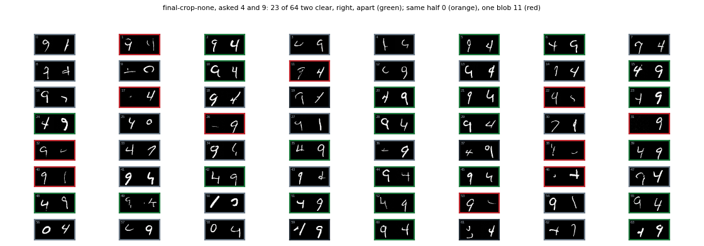
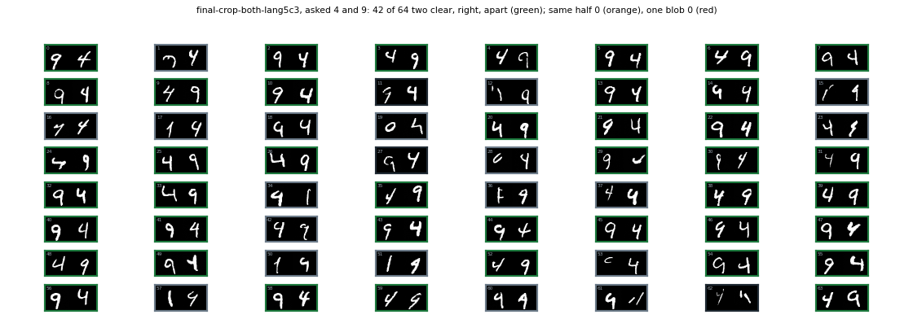
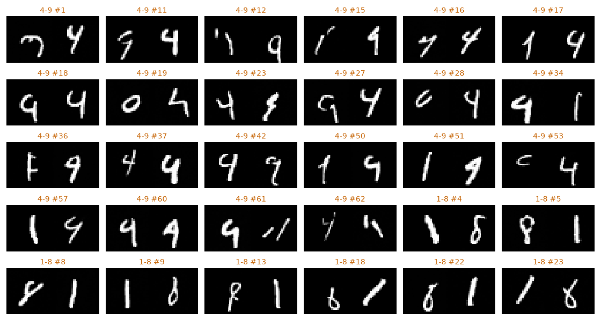
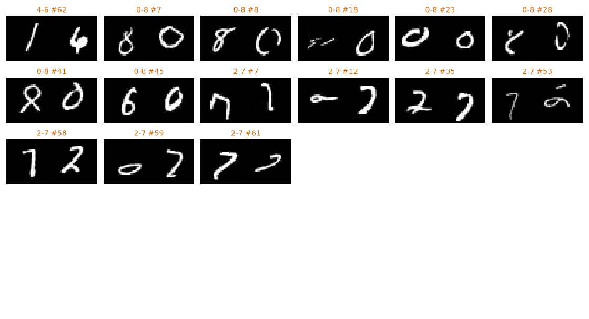
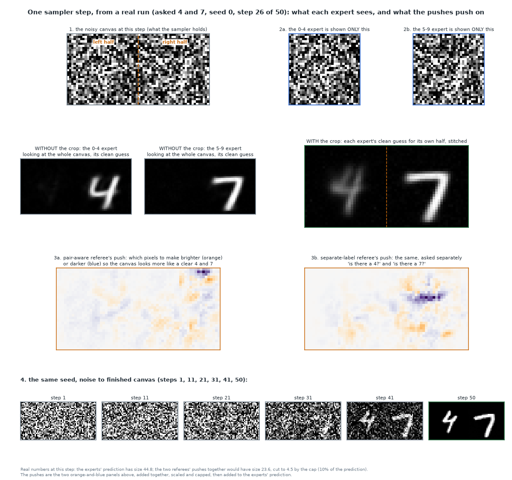

# 🧪 Results: the first test on 20 digit pairs no model had seen

⬅️ [Step 4: adding extra denoising steps](../04-adding-extra-denoising-steps/README.md) | ⬆️ [All steps](../README.md) | [Step 6: letting the models choose their side](../06-letting-the-models-choose-their-side/README.md) ➡️

**On 20 digit pairs no model had seen, the setting from step 4 drew 1,088 clean pairs of 1,280 by the judge (85%), and a careful look puts the count between 1,136 and about 1,190, so the 90% target of 1,152 is neither met nor missed.** Each model was told which half to fill and shown only that half, so this result is stitching with a given layout and leaves the plan's no-crop goal unanswered.

<table>
<tr>
<td><a href="sheets/no-pushes/digits-4-and-9.png"></a></td>
<td><a href="sheets/both-pushes-and-five-extra-steps/digits-4-and-9.png"></a></td>
</tr>
<tr>
<td>No pushes, no extra steps: 23 of 64 clean for 4 and 9</td>
<td>Both pushes and five extra steps: 42 of 64 clean for 4 and 9, the weakest of the 20 pairs</td>
</tr>
</table>

## Table of contents

- [Words this page uses](#words-this-page-uses)
- [How the test was kept fair](#how-the-test-was-kept-fair)
- [What the judge counted](#what-the-judge-counted)
- [What the eye found in the rejected tiles](#what-the-eye-found-in-the-rejected-tiles)
- [Why the 90% target is neither met nor missed](#why-the-90-target-is-neither-met-nor-missed)
- [Why this result is stitching](#why-this-result-is-stitching)
- [What each part adds](#what-each-part-adds)
- [The code that does it](#the-code-that-does-it)
- [What this cannot claim](#what-this-cannot-claim)
- [Every picture and number here](#every-picture-and-number-here)

## Words this page uses

Navigation: 📋 [TOC](#table-of-contents) | [Next](#how-the-test-was-kept-fair) ➡️

**Canvas:** one 32 by 64 pixel image with room for a digit in its left half and its right half.

**The two models:** one trained only on digits 0 to 4 and one only on digits 5 to 9. Neither has ever seen the other's digits.

**Tile:** one canvas on a sheet. A sheet shows 64 tiles for one digit pair, one per seed.

**Seed:** the number that fixes a canvas's starting noise, so the same seed can be drawn again.

**The judge:** a small network that reads digits. It finds the separate shapes on a canvas and reads each one.

**Clean pair:** a canvas with exactly two shapes, one in each half, that the judge reads as the two asked digits, at least 90% sure of each.

**Sampling step:** one of the 50 steps that turn pure noise into a picture.

**Both pushes:** two small trained checkers that nudge each step toward a canvas showing the asked pair. [Step 3](../03-adding-the-checker-pushes/README.md) introduces them.

**Five extra denoising steps:** before every sampling step except the last, the sampler takes five small correction steps at the same noise level. [Step 4](../04-adding-extra-denoising-steps/README.md) introduces them.

## How the test was kept fair

Navigation: ⬅️ [Words](#words-this-page-uses) | 📋 [TOC](#table-of-contents) | [Next](#what-the-judge-counted) ➡️

**The setting was chosen on five digit pairs and then read once on the other 20, at seeds it had never used.**

There are 25 ways to pair a digit from 0 to 4 with a digit from 5 to 9, and the work splits them like this:

| Digit pairs | How many | Seeds | Used for |
|---|---:|---|---|
| 1 and 9, 2 and 8, 3 and 6, 4 and 7, 0 and 5 | 5 | 0 to 63 | choosing the setting |
| the other 20 | 20 | 64 to 127 | this one read |

Each pair gets 64 canvases, so the test holds 20 × 64 = 1,280. No setting was changed after this read. A later setting gets its own read at seeds 128 to 191, in [step 8](../08-final-test-on-20-unseen-pairs/README.md).

🔤 **The name:** unseen pair
- **Pair:** one digit from each model's range. On a sheet, it is the two digits in a tile.
- **Unseen:** absent from training. Neither model saw a digit from the other's range, and the checkers behind the pushes were retrained with none of these 20 pairs in their data.
- **Consequence:** the same setting reads 298 of 320 (93%) on the five tuning pairs and 1,088 of 1,280 (85%) on the unseen pairs.

## What the judge counted

Navigation: ⬅️ [How the test was kept fair](#how-the-test-was-kept-fair) | 📋 [TOC](#table-of-contents) | [Next](#what-the-eye-found-in-the-rejected-tiles) ➡️

**The judge accepted 1,088 of 1,280 canvases, and 163 of the 192 it rejected still hold two shapes.**

The frame around each tile on a sheet is the judge's call, so the colours in the two sheets at the top of this page are these rows:

| The judge's call | Frame | No pushes, no extra steps | Both pushes, five extra steps |
|---|---|---:|---:|
| Two clear, right digits, one per half | green | 454 | 1,088 |
| Two shapes, not both clear and right | grey | 524 | 163 |
| One shape | red | 216 | 3 |
| Two shapes in the same half | orange | 2 | 0 |
| Damaged: no shape, or more than two | near black | 84 | 26 |
| All canvases | | 1,280 | 1,280 |

## What the eye found in the rejected tiles

Navigation: ⬅️ [What the judge counted](#what-the-judge-counted) | 📋 [TOC](#table-of-contents) | [Next](#why-the-90-target-is-neither-met-nor-missed) ➡️

**Reading the 165 rejected tiles on the 12 weakest pairs by eye found 48 clearly right, 38 plausible and 79 wrong.** The 12 weakest pairs are the ones the judge scored under 58 of 64. Each of their rejected tiles was enlarged to three times its size and called strictly.

<table>
<tr>
<td><a href="eye-check/rejected-tiles-sheet-1.png"></a></td>
<td><a href="eye-check/rejected-tiles-sheet-6.png"></a></td>
</tr>
<tr>
<td>Sheet 1: tile <code>4-9 #27</code> is a readable 9 and 4, and <code>4-9 #19</code> has a 0 where the 9 should be</td>
<td>Sheet 6: tile <code>0-8 #41</code> is an 8 and a 0, and <code>0-8 #23</code> is two 0s</td>
</tr>
</table>

| Call by eye | Tiles | What it looks like | One example |
|---|---:|---|---|
| Clearly right | 48 | the asked pair, plain to read | `4-5 #13`, a 5 and a 4 |
| Plausible | 38 | a thin open-loop 8, a 9 with a curled tail, a faint 5 | `1-8 #4`, a 1 and an 8 with an open top |
| Wrong | 79 | a 1, 0 or 7 in place of the asked digit, a second copy of one digit, a stub | `0-8 #23`, two 0s |
| All called | 165 | | |

🔤 **The name:** rejected tile
- **Tile:** one canvas. The eye-check sheets label each with its pair and its number, such as `4-9 #27`.
- **Rejected:** the judge called it anything other than clean, which on a run's sheet is any frame that is not green.
- **Consequence:** `4-9 #27` is a readable 9 and 4 that the judge turned down. Moving the 48 clearly right tiles into the count raises it from 1,088 to 1,136.

## Why the 90% target is neither met nor missed

Navigation: ⬅️ [What the eye found](#what-the-eye-found-in-the-rejected-tiles) | 📋 [TOC](#table-of-contents) | [Next](#why-this-result-is-stitching) ➡️

**The target of 1,152 clean pairs sits inside the range the eye check leaves open.**

| Reading | Clean pairs of 1,280 | Share |
|---|---:|---:|
| The judge alone | 1,088 | 85.0% |
| Lower bound: add the 48 clearly right tiles | 1,136 | 88.8% |
| The target | 1,152 | 90.0% |
| Upper bound: also add the 38 plausible tiles and an estimate for the 27 tiles nobody called | about 1,190 | 93% |

The 27 uncalled tiles are the judge's rejections on the other 8 pairs. The called tiles came out clear or plausible 86 times in 165, and that rate on 27 tiles adds about 14. So the upper bound is 1,088 + 48 + 38 + 14 = 1,188, which the review rounds to about 1,190.

🔤 **The name:** lower and upper bound
- **Lower bound:** the count if only the surest tiles are trusted. It adds the 48 clearly right tiles and treats all 27 uncalled tiles as wrong.
- **Upper bound:** the count if the doubtful tiles are given the benefit. It also adds the 38 plausible tiles and scores the 27 uncalled tiles at the rate the called ones reached.
- **Consequence:** with the lower bound the read is 16 short of the target (1,136 against 1,152), and with the upper bound it is about 38 over (about 1,190 against 1,152).

**Every pair also had to reach 45 of 64, and 4 and 9 sits on that line too.** The judge gives it 42. By eye it reads 43 with the clearly right tiles and 46 with the plausible ones as well. Every other pair clears 45 by the judge alone.

## Why this result is stitching

Navigation: ⬅️ [Why the target is undecided](#why-the-90-target-is-neither-met-nor-missed) | 📋 [TOC](#table-of-contents) | [Next](#what-each-part-adds) ➡️

**Each model is told its half and shown only that half, so this 85% measures how well two separately drawn halves join.**

<a href="../02-giving-each-model-its-own-half/one-sampling-step-explainer.png"></a>

The picture is one real step, step 26 of 50, for the digits 4 and 7. In its second row, both models looking at the whole canvas put their digit on the right. Shown only their own halves, they put a 4 on the left and a 7 on the right, and the two halves join along the orange line.

🔤 **The name:** layout-conditioned stitching
- **Layout:** which digit goes in which half. Here a coin flip per seed picks it before sampling starts.
- **Conditioned:** handed in from outside, so the models never choose it.
- **Stitching:** two halves drawn separately and joined along the centre line.
- **Consequence:** keep the same join but show each model the whole canvas, and clean pairs on the five tuning pairs fall from 124 to 4 of 320.

## What each part adds

Navigation: ⬅️ [Why this is stitching](#why-this-result-is-stitching) | 📋 [TOC](#table-of-contents) | [Next](#the-code-that-does-it) ➡️

**The pushes and the extra steps together raise clean pairs from 454 to 1,088, and this read cannot say how much each one adds.** The comparison run has neither of them, so two things change at once. Only the five tuning pairs show them added one at a time:

| What is switched on | Clean pairs of 320, five tuning pairs |
|---|---:|
| Each model on its own half | 124 |
| Plus both pushes | 257 |
| Plus five extra steps | 298 |

On the 20 unseen pairs, each row below is 64 canvases on seeds 64 to 127, sorted from the pair the chosen setting draws worst. The two eye columns start from the judge's count for that pair.

| Digit pair | No pushes, no extra steps | Both pushes, five extra steps | By eye: clearly right added | By eye: plausible added too |
|---|---:|---:|---:|---:|
| 4 and 9 | 23 | 42 | 43 | 46 |
| 1 and 8 | 17 | 47 | 51 | 59 |
| 4 and 8 | 11 | 47 | 53 | 57 |
| 1 and 5 | 27 | 48 | 54 | 57 |
| 2 and 5 | 17 | 48 | 51 | 56 |
| 4 and 5 | 19 | 49 | 58 | 60 |
| 3 and 8 | 10 | 50 | 56 | 60 |
| 3 and 5 | 20 | 51 | 57 | 57 |
| 0 and 7 | 23 | 52 | 54 | 60 |
| 4 and 6 | 27 | 55 | 56 | 57 |
| 0 and 8 | 9 | 57 | 59 | 60 |
| 2 and 7 | 27 | 57 | 59 | 60 |
| 0 and 6 | 25 | 58 | not called | not called |
| 2 and 6 | 25 | 59 | not called | not called |
| 2 and 9 | 22 | 59 | not called | not called |
| 3 and 7 | 25 | 59 | not called | not called |
| 0 and 9 | 20 | 61 | not called | not called |
| 1 and 6 | 42 | 62 | not called | not called |
| 3 and 9 | 24 | 63 | not called | not called |
| 1 and 7 | 41 | 64 | not called | not called |
| All 20, of 1,280 | 454 | 1,088 | 1,136 | 1,174, or about 1,190 with an estimate for the uncalled tiles |

By the judge, the four pairs with a 5 average 49.0 of 64 and the four with an 8 average 50.25, against 58.0 for a 7 and 58.5 for a 6. The pairs with a 9 read 42, 59, 61 and 63, so 4 and 9 alone pulls their average down to 56.25.

## The code that does it

Navigation: ⬅️ [What each part adds](#what-each-part-adds) | 📋 [TOC](#table-of-contents) | [Next](#what-this-cannot-claim) ➡️

**Two short passages in [the two-model sampler](../../../../../scripts/mnist/two_experts.py) pick each model's half and join the halves, and two lines of [the launcher](../../../../../scripts/mnist/two_experts_final.sh) show what differs between the runs.**

`2-classifier-guidance/scripts/mnist/two_experts.py`, lines 160 to 162:

```python
    if args.compose in ("region", "crop"):
        sides = [int(np.random.default_rng(1000 + s).integers(2)) for s in (EVAL_SEEDS if seeds is None else seeds)]
        return region_eps(A, B, a, b, sides, args.compose == "crop")
```

| Line | What it does |
|---|---|
| `sides = ...` | flips one fixed coin per seed, deciding which model takes the left half |
| `region_eps(...)` | builds the prediction from those sides |

Lines 72 to 77:

```python
        if crop:
            xl, xr = x[..., :32], x[..., 32:]
            eA_l, eA_r = A(xl, t, ya), A(xr, t, ya)
            eB_l, eB_r = B(xl, t, yb), B(xr, t, yb)
            e_left = torch.where(left, eA_l, eB_l); e_right = torch.where(left, eB_r, eA_r)
            return torch.cat([e_left, e_right], dim=-1)
```

| Line | What it does |
|---|---|
| `xl, xr = ...` | cuts the canvas into a left and a right 32 by 32 crop |
| `A(xl, ...)`, `B(xr, ...)` | each model predicts on a crop, so it never sees the other half |
| `torch.where(left, ...)` | keeps the prediction from the model that owns each half |
| `torch.cat(...)` | joins the two halves along the centre line |

`2-classifier-guidance/scripts/mnist/two_experts_final.sh`, lines 13 to 14:

```bash
$PY $S cells $EX --push none --name final-crop-none
$PY $S cells $EX $H --push both --lang-k 5 --lang-c 3 --name final-crop-both-lang5c3
```

| Part | What it does |
|---|---|
| `--push none` | the comparison run, with no pushes |
| `--push both` | switches on both checkers |
| `--lang-k 5 --lang-c 3` | adds the five extra steps, each with a step size of 3 times the noise schedule's beta at that level. The comparison run lacks this switch too |

## What this cannot claim

Navigation: ⬅️ [The code](#the-code-that-does-it) | 📋 [TOC](#table-of-contents) | [Next](#every-picture-and-number-here) ➡️

> [!WARNING]
> **This crop result is layout-conditioned stitching, so it does not answer the plan's no-crop goal.** A crop needs the two regions known and separate in advance. A scene of 3D objects (the CLEVR dataset) or a cat and a dog in one picture does not give that. The plan's goal is the two models composed on the full canvas, and [step 6](../06-letting-the-models-choose-their-side/README.md) starts on it.

**Both bounds trust the judge's acceptances.** The 1,088 tiles it accepted were not read by eye, so any wrong acceptance stays inside both the lower and the upper bound.

**The eye calls were made once.** One reader called the 165 tiles, and the review records no second reader. The 27 rejected tiles on the other 8 pairs were not called.

**Unseen describes the pairs.** Each digit on its own is familiar to one model, and the checkers trained on pasted pairs from within one range. What is new here is a digit from each range on one canvas.

## Every picture and number here

Navigation: ⬅️ [What this cannot claim](#what-this-cannot-claim) | 📋 [TOC](#table-of-contents)

**This folder holds two runs, their counts and the eye check.** Each run has one sheet per digit pair, and a sheet shows 64 canvases framed in the judge's colours.

| Thing | What it shows | How we got it | Also called |
|---|---|---|---|
| [No pushes, no extra steps](sheets/no-pushes/) with [its counts](counts/no-pushes.json) | 20 sheets, 454 of 1,280 | `two_experts.py cells --compose crop --push none`, 20 pairs, seeds 64 to 127, on the cluster | `final-crop-none` |
| [Both pushes, five extra steps](sheets/both-pushes-and-five-extra-steps/) with [its counts](counts/both-pushes-and-five-extra-steps.json) | 20 sheets, 1,088 of 1,280 | the same command with `--push both --lang-k 5 --lang-c 3` | `final-crop-both-lang5c3` |
| [Rejected tiles, sheet 1](eye-check/rejected-tiles-sheet-1.png) | 30 tiles: 22 of 4 and 9, 8 of 1 and 8 | `make_plan33_eyecheck.py` enlarges every tile the judge rejected on the 12 weakest pairs | `eyecheck-1` |
| [Rejected tiles, sheet 2](eye-check/rejected-tiles-sheet-2.png) | 30 tiles: 9 of 1 and 8, 17 of 4 and 8, 4 of 1 and 5 | same script | `eyecheck-2` |
| [Rejected tiles, sheet 3](eye-check/rejected-tiles-sheet-3.png) | 30 tiles: 12 of 1 and 5, 16 of 2 and 5, 2 of 4 and 5 | same script | `eyecheck-3` |
| [Rejected tiles, sheet 4](eye-check/rejected-tiles-sheet-4.png) | 30 tiles: 13 of 4 and 5, 14 of 3 and 8, 3 of 3 and 5 | same script | `eyecheck-4` |
| [Rejected tiles, sheet 5](eye-check/rejected-tiles-sheet-5.png) | 30 tiles: 10 of 3 and 5, 12 of 0 and 7, 8 of 4 and 6 | same script | `eyecheck-5` |
| [Rejected tiles, sheet 6](eye-check/rejected-tiles-sheet-6.png) | 15 tiles: 1 of 4 and 6, 7 of 0 and 8, 7 of 2 and 7 | same script | `eyecheck-6` |
| [The eye calls](eye-check/eye-calls.json) | which tiles were called clearly right (48) and plausible (38); the other 79 of the 165 were called wrong | called by eye at three times size | `eye-calls` |
| [Which tile is on which sheet](eye-check/which-tile-is-on-which-sheet.json) | the pair and number of all 165 tiles, by sheet | written by `make_plan33_eyecheck.py` | `eyecheck-index` |
| [One sampling step](../02-giving-each-model-its-own-half/one-sampling-step-explainer.png), kept in step 2's folder | the whole canvas against the crop, step 26 of 50, 4 and 7 | `make_plan33_step.py` | `one-sampler-step` |

> [!NOTE]
> Both counts files store their total under the key `total_of_320`, a name left over from the five-pair runs. In this folder that key holds a count out of 1,280. The files also hold a looser count that allows stray marks beside the two digits: 1,098 with the pushes and extra steps, 454 without.

**Where it came from.** The bars were written before this read in [plan 33's review file](../../../../../plans/review/33-experts-that-compose-at-inference.md), and [plan 33](../../../../../plans/33-experts-that-compose-at-inference.md) holds the design. Every file's original location and checksum is in [the file origins list](../file-origins.tsv). The models and raw canvases stay in `data/mnist-canvas/33-mnist-experts-at-inference/` and on the cluster at `/home-mscluster/mmolefe/poe_repair_min_scratch/mnist-canvas/33-experts-at-inference/`.

<!-- built-to: PAGE_LOOK_FORMAT v1 -->
