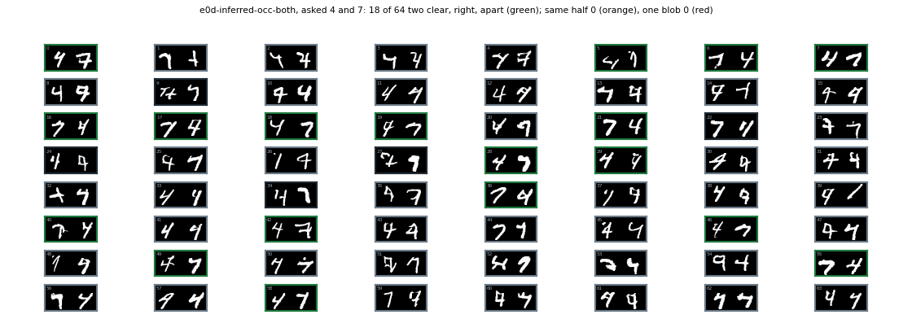

# 🧪 Results: letting the two models choose their own side

⬅️ [Step 5: the first test on 20 unseen pairs](../05-first-test-on-20-unseen-pairs/README.md) | ⬆️ [All steps](../README.md) | [Step 7: choosing the side early and holding it](../07-choosing-the-side-early-and-holding-it/README.md) ➡️

**With no side given to them, the two models draw at most 56 clean pairs of 320 on the full canvas.** Masks fail because both models want the same side, and a side chosen afresh at every step keeps swapping while the digits form.

<table>
<tr>
<td>`digits-4-and-7.png` is on the cluster at `/datasets/mmolefe/poe_repair_min/artifacts-archive/2-classifier-guidance/artifacts/results/can-two-digits-compose-on-mnist/03-composing-the-two-models-while-sampling/06-letting-the-models-choose-their-side/sheets/soft-masks-with-both-pushes/digits-4-and-7.png`</td>
<td>`digits-4-and-7.png` is on the cluster at `/datasets/mmolefe/poe_repair_min/artifacts-archive/2-classifier-guidance/artifacts/results/can-two-digits-compose-on-mnist/03-composing-the-two-models-while-sampling/06-letting-the-models-choose-their-side/sheets/side-chosen-every-step-with-both-pushes/digits-4-and-7.png`</td>
<td><a href="sheets/side-chosen-every-step-other-half-hidden-with-both-pushes/digits-4-and-7.png"></a></td>
</tr>
<tr>
<td>Soft masks: 1 of 64 clean for 4 and 7, nearly every tile one tangled shape</td>
<td>Side chosen, sides forced apart: 0 of 64, still one shape</td>
<td>Same, other half hidden: 18 of 64, two shapes in nearly every tile</td>
</tr>
</table>

All three sheets use both pushes.

## Table of contents

- [Words this page uses](#words-this-page-uses)
- [Why the side has to come from the models](#why-the-side-has-to-come-from-the-models)
- [Masks from what each label changes](#masks-from-what-each-label-changes)
- [Forcing the two digits apart](#forcing-the-two-digits-apart)
- [Hiding the other half](#hiding-the-other-half)
- [Why the side keeps swapping](#why-the-side-keeps-swapping)
- [What each part adds](#what-each-part-adds)
- [The code that does it](#the-code-that-does-it)
- [What this cannot claim](#what-this-cannot-claim)
- [Every picture and number here](#every-picture-and-number-here)

## Words this page uses

Navigation: 📋 [TOC](#table-of-contents) | [Next](#why-the-side-has-to-come-from-the-models) ➡️

**Canvas:** one 32 by 64 pixel image with room for a digit in its left half and its right half.

**The two models:** one trained only on digits 0 to 4 and one only on digits 5 to 9. Neither has ever seen the other's digits.

**Clean pair:** a finished canvas that the digit-reading judge calls two clear, correct digits, one in each half.

**Sampling step:** one of the 50 steps that turn pure noise into a picture. Step 1 is almost all noise, and step 50 is the finished canvas.

**Prediction:** at every sampling step, a model's guess of the noise in the canvas. The sampler removes that guess, so changing the prediction changes the picture.

**Both pushes:** two small trained checkers that nudge each step toward a canvas showing the asked pair. [Step 3](../03-adding-the-checker-pushes/README.md) introduces them.

## Why the side has to come from the models

Navigation: ⬅️ [Words](#words-this-page-uses) | 📋 [TOC](#table-of-contents) | [Next](#masks-from-what-each-label-changes) ➡️

**The 85% in [step 5](../05-first-test-on-20-unseen-pairs/README.md) depends on a coin flip telling each model which half to fill, and a real scene gives no such instruction.** Every run on this page drops the coin flip and the crop. Both models work at the full 32 by 64 size on the five tuning pairs, with 64 canvases per pair on seeds 0 to 63.

## Masks from what each label changes

Navigation: ⬅️ [Why the side matters](#why-the-side-has-to-come-from-the-models) | 📋 [TOC](#table-of-contents) | [Next](#forcing-the-two-digits-apart) ➡️

**A mask lets each model change the canvas only where its digit label matters most, and both models' labels matter most in the same place.**

`one-sampling-step-explainer.png` is on the cluster at `/datasets/mmolefe/poe_repair_min/artifacts-archive/2-classifier-guidance/artifacts/results/can-two-digits-compose-on-mnist/03-composing-the-two-models-while-sampling/02-giving-each-model-its-own-half/one-sampling-step-explainer.png`

The picture is one real step, step 26 of 50, for the digits 4 and 7. In its second row, the two left panels show each model's guess when it looks at the whole canvas. Both put their digit on the right.

Each model predicts the noise twice at every step, once told its digit and once told "no digit". The gap between those two predictions at a pixel is what the label adds. A mask shares each pixel between the models according to the size of their gaps. Two invented pixels show the arithmetic when both gaps are larger on the right:

| Pixel | 0 to 4 model's gap | 5 to 9 model's gap | Soft mask: 0 to 4 model's share | Hard mask: who gets the pixel |
|---|---:|---:|---:|---|
| Left half | 1 | 2 | 1 / 3 = 0.33 | 5 to 9 model |
| Right half | 3 | 4 | 3 / 7 = 0.43 | 5 to 9 model |

Neither model ends up owning a half. The soft mask blends both pixels, and the hard mask gives both to the same model. The real runs came out the same way:

| Mask | Clean pairs of 320 | Canvases with one shape, of 320 |
|---|---:|---:|
| Soft | 0 | 308 |
| Soft, both pushes | 2 | 300 |
| Hard | 0 | 302 |
| Hard, both pushes | 0 | 299 |

🔤 **The name:** soft and hard masks
- **Mask:** a stencil saying how much of each model's change reaches each pixel. On the small table, it is the last two columns.
- **Soft:** a share between 0 and 1, so the 0 to 4 model gets 0.33 of the left pixel.
- **Hard:** all or nothing, so the 5 to 9 model takes the whole left pixel.
- **Consequence:** switch the soft mask to a hard one, with both pushes on, and clean pairs go from 2 to 0 of 320.

## Forcing the two digits apart

Navigation: ⬅️ [Masks](#masks-from-what-each-label-changes) | 📋 [TOC](#table-of-contents) | [Next](#hiding-the-other-half) ➡️

**The next run forbids the two models from sharing a half, and 306 of 320 canvases still show a single shape.**

At every step, each model's label-added gap is averaged over the left half and over the right half, which gives four numbers. Only two arrangements keep the models apart: the 0 to 4 model on the left and the 5 to 9 model on the right, or the reverse. The arrangement with the larger sum wins that step. [Step 7 works one real step](../07-choosing-the-side-early-and-holding-it/README.md#how-the-side-gets-chosen), where the sums are 1.58 and 1.59 thousandths.

| Side chosen at every step | Clean pairs of 320 | Canvases with one shape, of 320 |
|---|---:|---:|
| Sides forced apart | 0 | 306 |
| Sides forced apart, both pushes | 0 | 301 |

🔤 **The name:** side chosen, forced apart
- **Side chosen:** each model's half comes from the four numbers, with no coin flip.
- **Forced apart:** the only arrangements on offer give the two models opposite halves.
- **Consequence:** with this rule and both pushes on, clean pairs stay at 0 of 320 and 301 canvases hold one shape.

## Hiding the other half

Navigation: ⬅️ [Forcing the digits apart](#forcing-the-two-digits-apart) | 📋 [TOC](#table-of-contents) | [Next](#why-the-side-keeps-swapping) ➡️

**Replacing the other model's half with a blank canvas gives the second digit back, and clean pairs rise from 0 to 34 of 320, or to 56 with both pushes.**

<table>
<tr>
<td>`digits-4-and-7.png` is on the cluster at `/datasets/mmolefe/poe_repair_min/artifacts-archive/2-classifier-guidance/artifacts/results/can-two-digits-compose-on-mnist/03-composing-the-two-models-while-sampling/06-letting-the-models-choose-their-side/sheets/side-chosen-every-step/digits-4-and-7.png`</td>
<td>`digits-4-and-7.png` is on the cluster at `/datasets/mmolefe/poe_repair_min/artifacts-archive/2-classifier-guidance/artifacts/results/can-two-digits-compose-on-mnist/03-composing-the-two-models-while-sampling/06-letting-the-models-choose-their-side/sheets/side-chosen-every-step-other-half-hidden/digits-4-and-7.png`</td>
</tr>
<tr>
<td>Each model sees the whole canvas: 0 of 64 clean for 4 and 7</td>
<td>Each model's other half hidden: 15 of 64, with two shapes in most tiles</td>
</tr>
</table>

Each model now sees its own half and, in place of the other half, a blank canvas carrying the same amount of noise. The side is still chosen from the whole canvas at every step.

| Side chosen at every step | Clean pairs of 320 | One shape | Two shapes, not both clear and right |
|---|---:|---:|---:|
| Whole canvas | 0 | 306 | 0 |
| Whole canvas, both pushes | 0 | 301 | 1 |
| Other half hidden | 34 | 18 | 237 |
| Other half hidden, both pushes | 56 | 1 | 242 |

🔤 **The name:** hiding the other half
- **Hide:** replace part of what a model is shown. The canvas keeps its full size, and the half that belongs to the other model becomes blank plus noise.
- **Consequence:** with no pushes, canvases holding one shape fall from 306 to 18 of 320, and clean pairs rise from 0 to 34.

## Why the side keeps swapping

Navigation: ⬅️ [Hiding the other half](#hiding-the-other-half) | 📋 [TOC](#table-of-contents) | [Next](#what-each-part-adds) ➡️

**The hidden-half run chooses the side again at every step, so a canvas keeps changing which model owns each half while its digits form.**

`side-flips-or-holds-explainer.png` is on the cluster at `/datasets/mmolefe/poe_repair_min/artifacts-archive/2-classifier-guidance/artifacts/results/can-two-digits-compose-on-mnist/03-composing-the-two-models-while-sampling/07-choosing-the-side-early-and-holding-it/side-flips-or-holds-explainer.png`

Look at the top grid. Each row is one canvas and each column one sampling step. Blue means the 0 to 4 model has the left half, and orange means it has the right. On these 8 canvases of 4 and 7 with both pushes, the side swaps 14.1 times per canvas on average, from 10 to 19. In all four runs that choose a side, no canvas keeps one side after the first fifth of its steps.

🔤 **The name:** side swap
- **Swap:** the two models exchange halves between one step and the next. On the top grid, it is a colour change along a row.
- **Consequence:** [step 7](../07-choosing-the-side-early-and-holding-it/README.md) stops the swaps after the first 10 steps and keeps everything else, and clean pairs rise from 56 to 310 of 320.

## What each part adds

Navigation: ⬅️ [Why the side keeps swapping](#why-the-side-keeps-swapping) | 📋 [TOC](#table-of-contents) | [Next](#the-code-that-does-it) ➡️

**Only hiding the other half moves the count: 34 of 320 alone and 56 with both pushes, against at most 2 for every other setting.** Each row is 64 canvases per pair, on seeds 0 to 63.

| Setting | 1 and 9 | 3 and 6 | 4 and 7 | 2 and 8 | 0 and 5 | All five, of 320 |
|---|---:|---:|---:|---:|---:|---:|
| Soft masks | 0 | 0 | 0 | 0 | 0 | 0 |
| Soft masks, both pushes | 0 | 1 | 1 | 0 | 0 | 2 |
| Hard masks | 0 | 0 | 0 | 0 | 0 | 0 |
| Hard masks, both pushes | 0 | 0 | 0 | 0 | 0 | 0 |
| Side chosen every step | 0 | 0 | 0 | 0 | 0 | 0 |
| Side chosen every step, both pushes | 0 | 0 | 0 | 0 | 0 | 0 |
| Side chosen, other half hidden | 6 | 4 | 15 | 3 | 6 | 34 |
| Side chosen, other half hidden, both pushes | 7 | 5 | 18 | 13 | 13 | 56 |

## The code that does it

Navigation: ⬅️ [What each part adds](#what-each-part-adds) | 📋 [TOC](#table-of-contents) | [Next](#what-this-cannot-claim) ➡️

**Three short passages in [the two-model sampler](../../../../../scripts/mnist/two_experts.py) build the masks, choose the side and hide the other half.**

`2-classifier-guidance/scripts/mnist/two_experts.py`, lines 93 to 97:

```python
        dA, dB = eA - eAn, eB - eBn
        blur = lambda d: torch.nn.functional.avg_pool2d(d.abs(), 5, 1, 2)
        sa, sb = blur(dA), blur(dB)
        ma = (sa > sb).float() if hard else sa / (sa + sb + 1e-8)
        return 0.5 * (eAn + eBn) + ma * dA + (1 - ma) * dB
```

| Line | What it does |
|---|---|
| `dA, dB = ...` | the gap each digit label adds to its model's prediction |
| `blur = ...` | takes each gap's size and averages it over a 5 by 5 pixel window |
| `ma = ...` | the 0 to 4 model's mask: all or nothing if hard, a share if soft |
| `return ...` | starts from the mean of the two no-digit predictions and adds each model's gap through its mask |

Lines 118 to 120, then 132 to 133:

```python
        dA, dB = (eA - A(x, t, n)).abs(), (eB - B(x, t, n)).abs()
        sa = (dA[..., :32].mean((1, 2, 3)) + dB[..., 32:].mean((1, 2, 3)))     # A left, B right
        sb = (dA[..., 32:].mean((1, 2, 3)) + dB[..., :32].mean((1, 2, 3)))     # A right, B left
```

```python
        else:
            left = (sa >= sb)[:, None, None, None]
```

| Line | What it does |
|---|---|
| `dA, dB = ...` | the size of each label-added gap, from whole-canvas inputs |
| `sa`, `sb` | the sums for the two arrangements |
| `left = ...` | picks the larger sum, afresh at every step |

Lines 135 to 142:

```python
        if occlude:
            ab = ABAR.to(dev)[t][:, None, None, None]
            g = torch.Generator(device=dev).manual_seed(12345 + int(t[0]))
            blank = -ab.sqrt() + (1 - ab).sqrt() * torch.randn(x.shape, generator=g, device=dev)
            mL = torch.zeros_like(x); mL[..., :32] = 1                           # 1 on the left half
            ownA = torch.where(left, mL, 1 - mL); ownB = 1 - ownA              # where each expert owns the canvas
            eA = A(ownA * x + (1 - ownA) * blank, t, ya)
            eB = B(ownB * x + (1 - ownB) * blank, t, yb)
```

| Line | What it does |
|---|---|
| `blank = ...` | a black canvas with this step's amount of noise added |
| `ownA = ...` | marks the half each model was given this step |
| `A(ownA * x + (1 - ownA) * blank, ...)` | the model sees its own half, and blank on the other half |

## What this cannot claim

Navigation: ⬅️ [The code](#the-code-that-does-it) | 📋 [TOC](#table-of-contents) | [Next](#every-picture-and-number-here) ➡️

> [!WARNING]
> **The reason the masks fail rests on one picture.** Both models placing their digit on the right is read from one canvas of 4 and 7 at step 26 of 50, in a run that used the crop method. No count says how often the two models' gaps peak on the same half across these 320 canvases.

**None of these settings reaches the level that would make it the method.** The plan calls anything under 32 of 320 no effect, and six settings here read 0 to 2. Hiding the other half reads 34 and 56, just over that line and well under the 160 that would make it the chosen full-canvas method.

**These are tuning numbers.** All of them come from the five tuning pairs at seeds 0 to 63, so no setting on this page has been tried on an unseen pair.

**The pushes were trained on pictures from the crop method.** The checkers learned from pushed renders of the cropped composition and have not been retrained on full-canvas renders, so these counts do not show what retrained pushes could do.

**The swap count comes from 8 canvases of one pair.** The 14.1 swaps per canvas comes from a separate small run of 4 and 7 with both pushes. The finding that no canvas settles on a side comes from every canvas in the four side-choosing runs.

**Nothing here explains why forced sides still give one shape.** The counts show that it happens on 306 of 320 canvases without pushes, and no test on this page isolates the cause.

**The judge made these counts.** No person checked these 2,560 canvases one by one. The judge's own limits are described in [the plan's review file](../../../../../plans/review/33-experts-that-compose-at-inference.md).

## Every picture and number here

Navigation: ⬅️ [What this cannot claim](#what-this-cannot-claim) | 📋 [TOC](#table-of-contents)

**This folder holds eight runs and their counts, and the page borrows two explainers from other steps.** Each run has one sheet per digit pair, and a sheet shows 64 canvases with a green frame around each one the judge called clean, red for one shape and orange for two shapes in the same half.

| Thing | What it shows | How we got it | Also called |
|---|---|---|---|
| Soft masks (on the cluster at `/datasets/mmolefe/poe_repair_min/artifacts-archive/2-classifier-guidance/artifacts/results/can-two-digits-compose-on-mnist/03-composing-the-two-models-while-sampling/06-letting-the-models-choose-their-side/sheets/soft-masks`) with its counts (on the cluster at `/datasets/mmolefe/poe_repair_min/artifacts-archive/2-classifier-guidance/artifacts/results/can-two-digits-compose-on-mnist/03-composing-the-two-models-while-sampling/06-letting-the-models-choose-their-side/counts/soft-masks.json`) | 5 sheets, 0 of 320, tiles nearly all one tangled shape | `two_experts.py cells --compose masked --push none`, on the cluster | `e0b-masked` |
| Soft masks, both pushes (on the cluster at `/datasets/mmolefe/poe_repair_min/artifacts-archive/2-classifier-guidance/artifacts/results/can-two-digits-compose-on-mnist/03-composing-the-two-models-while-sampling/06-letting-the-models-choose-their-side/sheets/soft-masks-with-both-pushes`) with its counts (on the cluster at `/datasets/mmolefe/poe_repair_min/artifacts-archive/2-classifier-guidance/artifacts/results/can-two-digits-compose-on-mnist/03-composing-the-two-models-while-sampling/06-letting-the-models-choose-their-side/counts/soft-masks-with-both-pushes.json`) | 5 sheets, 2 of 320, still nearly all one shape | the same command with `--push both` | `e0b-masked-both` |
| Hard masks (on the cluster at `/datasets/mmolefe/poe_repair_min/artifacts-archive/2-classifier-guidance/artifacts/results/can-two-digits-compose-on-mnist/03-composing-the-two-models-while-sampling/06-letting-the-models-choose-their-side/sheets/hard-masks`) with its counts (on the cluster at `/datasets/mmolefe/poe_repair_min/artifacts-archive/2-classifier-guidance/artifacts/results/can-two-digits-compose-on-mnist/03-composing-the-two-models-while-sampling/06-letting-the-models-choose-their-side/counts/hard-masks.json`) | 5 sheets, 0 of 320, nearly all one shape | `--compose masked-hard --push none` | `e0b-masked-hard` |
| Hard masks, both pushes (on the cluster at `/datasets/mmolefe/poe_repair_min/artifacts-archive/2-classifier-guidance/artifacts/results/can-two-digits-compose-on-mnist/03-composing-the-two-models-while-sampling/06-letting-the-models-choose-their-side/sheets/hard-masks-with-both-pushes`) with its counts (on the cluster at `/datasets/mmolefe/poe_repair_min/artifacts-archive/2-classifier-guidance/artifacts/results/can-two-digits-compose-on-mnist/03-composing-the-two-models-while-sampling/06-letting-the-models-choose-their-side/counts/hard-masks-with-both-pushes.json`) | 5 sheets, 0 of 320, nearly all one shape | `--compose masked-hard --push both` | `e0b-masked-hard-both` |
| Side chosen every step (on the cluster at `/datasets/mmolefe/poe_repair_min/artifacts-archive/2-classifier-guidance/artifacts/results/can-two-digits-compose-on-mnist/03-composing-the-two-models-while-sampling/06-letting-the-models-choose-their-side/sheets/side-chosen-every-step`) with its counts (on the cluster at `/datasets/mmolefe/poe_repair_min/artifacts-archive/2-classifier-guidance/artifacts/results/can-two-digits-compose-on-mnist/03-composing-the-two-models-while-sampling/06-letting-the-models-choose-their-side/counts/side-chosen-every-step.json`) | 5 sheets, 0 of 320, nearly all one shape | `--compose inferred --push none` | `e0d-inferred` |
| Side chosen, both pushes (on the cluster at `/datasets/mmolefe/poe_repair_min/artifacts-archive/2-classifier-guidance/artifacts/results/can-two-digits-compose-on-mnist/03-composing-the-two-models-while-sampling/06-letting-the-models-choose-their-side/sheets/side-chosen-every-step-with-both-pushes`) with its counts (on the cluster at `/datasets/mmolefe/poe_repair_min/artifacts-archive/2-classifier-guidance/artifacts/results/can-two-digits-compose-on-mnist/03-composing-the-two-models-while-sampling/06-letting-the-models-choose-their-side/counts/side-chosen-every-step-with-both-pushes.json`) | 5 sheets, 0 of 320, nearly all one shape | `--compose inferred --push both` | `e0d-inferred-both` |
| Side chosen, other half hidden (on the cluster at `/datasets/mmolefe/poe_repair_min/artifacts-archive/2-classifier-guidance/artifacts/results/can-two-digits-compose-on-mnist/03-composing-the-two-models-while-sampling/06-letting-the-models-choose-their-side/sheets/side-chosen-every-step-other-half-hidden`) with its counts (on the cluster at `/datasets/mmolefe/poe_repair_min/artifacts-archive/2-classifier-guidance/artifacts/results/can-two-digits-compose-on-mnist/03-composing-the-two-models-while-sampling/06-letting-the-models-choose-their-side/counts/side-chosen-every-step-other-half-hidden.json`) | 5 sheets, 34 of 320, two shapes in most tiles, many wrong | `--compose inferred-occ --push none` | `e0d-inferred-occ` |
| [Side chosen, other half hidden, both pushes](sheets/side-chosen-every-step-other-half-hidden-with-both-pushes/) with its counts (on the cluster at `/datasets/mmolefe/poe_repair_min/artifacts-archive/2-classifier-guidance/artifacts/results/can-two-digits-compose-on-mnist/03-composing-the-two-models-while-sampling/06-letting-the-models-choose-their-side/counts/side-chosen-every-step-other-half-hidden-with-both-pushes.json`) | 5 sheets, 56 of 320, two shapes in nearly every tile | `--compose inferred-occ --push both` | `e0d-inferred-occ-both` |
| One sampling step (on the cluster at `/datasets/mmolefe/poe_repair_min/artifacts-archive/2-classifier-guidance/artifacts/results/can-two-digits-compose-on-mnist/03-composing-the-two-models-while-sampling/02-giving-each-model-its-own-half/one-sampling-step-explainer.png`), kept in step 2's folder | each model's whole-canvas guess at step 26 of 50 for 4 and 7 | `make_plan33_step.py` | `one-sampler-step` |
| The side flips or holds (on the cluster at `/datasets/mmolefe/poe_repair_min/artifacts-archive/2-classifier-guidance/artifacts/results/can-two-digits-compose-on-mnist/03-composing-the-two-models-while-sampling/07-choosing-the-side-early-and-holding-it/side-flips-or-holds-explainer.png`), kept in step 7's folder | the side per canvas per step, 8 canvases of 4 and 7 with both pushes | `make_plan33_e0e_steps.py` | `e0e-2` |

> [!NOTE]
> The counts files say `base: floor`. That is a default the script writes, and these runs never use it: the masks start from the mean of the two no-digit predictions, and the side-choosing runs use the two models' predictions directly.

**Where it came from.** The bars were written before these runs in [plan 33's review file](../../../../../plans/review/33-experts-that-compose-at-inference.md), and [plan 33](../../../../../plans/33-experts-that-compose-at-inference.md) holds the design. Every file's original location and checksum is in [the file origins list](../file-origins.tsv). The models and raw canvases stay in `data/mnist-canvas/33-mnist-experts-at-inference/` and on the cluster at `/home-mscluster/mmolefe/poe_repair_min_scratch/mnist-canvas/33-experts-at-inference/`.

<!-- built-to: PAGE_LOOK_FORMAT v1 -->
