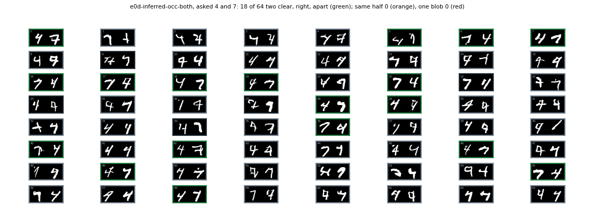
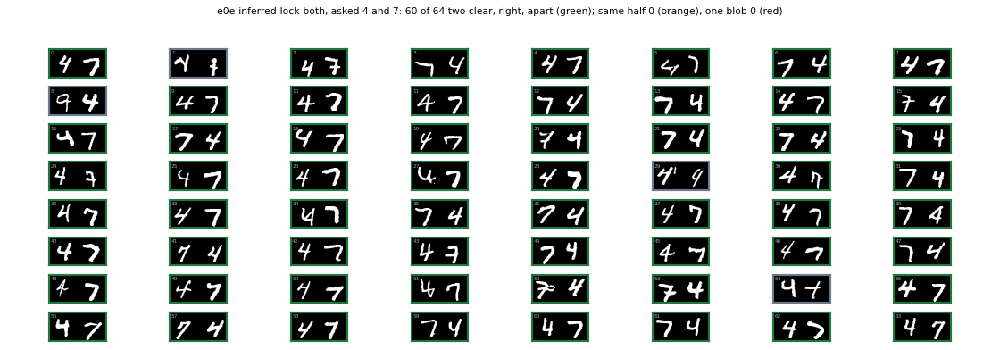

# 🧪 Results: choosing each digit's side early and holding it

⬅️ [Step 6: letting the models choose their side](../06-letting-the-models-choose-their-side/README.md) | ⬆️ [All steps](../README.md) | [Step 8: the final test](../08-final-test-on-20-unseen-pairs/README.md) ➡️

**Choosing the side during the first 10 of 50 sampling steps and then holding it raises clean pairs from 56 to 310 of 320.** Two digit models that were trained apart now draw a separate, correct digit each, on five digit pairs used for tuning.

<table>
<tr>
<td><a href="../06-letting-the-models-choose-their-side/sheets/side-chosen-every-step-other-half-hidden-with-both-pushes/digits-4-and-7.png"></a></td>
<td><a href="sheets/side-held-with-both-pushes/digits-4-and-7.png"></a></td>
</tr>
<tr>
<td>Side chosen again at every step: 18 of 64 clean for 4 and 7</td>
<td>Side chosen early, then held: 60 of 64 clean for 4 and 7</td>
</tr>
</table>

## Table of contents

- [Words this page uses](#words-this-page-uses)
- [How the side gets chosen](#how-the-side-gets-chosen)
- [Why holding the side matters](#why-holding-the-side-matters)
- [Why the other half is hidden](#why-the-other-half-is-hidden)
- [What each part adds](#what-each-part-adds)
- [The code that does it](#the-code-that-does-it)
- [What this cannot claim](#what-this-cannot-claim)
- [Every picture and number here](#every-picture-and-number-here)

## Words this page uses

Navigation: 📋 [TOC](#table-of-contents) | [Next](#how-the-side-gets-chosen) ➡️

**Canvas:** one 32 by 64 pixel image with room for a digit in its left half and its right half.

**The two models:** one trained only on digits 0 to 4 and one only on digits 5 to 9. Neither has ever seen the other's digits.

**Clean pair:** a finished canvas that the digit-reading judge calls two clear, correct digits, one in each half.

**Sampling step:** one of the 50 steps that turn pure noise into a picture. Step 1 is almost all noise, and step 50 is the finished canvas.

**Both pushes:** two small trained checkers that nudge each step toward a canvas showing the asked pair. [Step 3](../03-adding-the-checker-pushes/README.md) introduces them.

## How the side gets chosen

Navigation: ⬅️ [Words](#words-this-page-uses) | 📋 [TOC](#table-of-contents) | [Next](#why-holding-the-side-matters) ➡️

**Each model shows where its digit wants to go, and the two sides are assigned together so they can never share a half.**

`where-each-model-wants-its-digit-explainer.png` is on the cluster at `/datasets/mmolefe/poe_repair_min/artifacts-archive/2-classifier-guidance/artifacts/results/can-two-digits-compose-on-mnist/03-composing-the-two-models-while-sampling/07-choosing-the-side-early-and-holding-it/where-each-model-wants-its-digit-explainer.png`

The picture is one real step, step 4 of 50, for the digits 4 and 7. Each model predicts the noise twice, once told its digit and once told "nothing". The bright map is how much the digit label changed that prediction, and its average over each half gives four numbers, in thousandths:

| Model | Left half | Right half |
|---|---:|---:|
| 0 to 4 model, told "4" | 0.81 | 0.80 |
| 5 to 9 model, told "7" | 0.79 | 0.77 |

Only two arrangements keep the digits apart, so the step adds up each one:

| Arrangement | Sum | This step's vote |
|---|---:|---|
| 4 on the left, 7 on the right | 0.81 + 0.77 = 1.58 | |
| 4 on the right, 7 on the left | 0.80 + 0.79 = 1.59 | ✅ larger |

🔤 **The name:** inferred side
- **Side:** the left or right half of the canvas. On the table above, it is the column.
- **Inferred:** worked out from evidence and never told. No person or coin picks the side here, because the choice comes from the four numbers.
- **Consequence:** raise the 0.81 by 0.02 to 0.83 and the sums become 1.60 and 1.59, so the vote flips. A change that small decides this step, which is why one step's vote is too weak to trust alone.

## Why holding the side matters

Navigation: ⬅️ [How the side gets chosen](#how-the-side-gets-chosen) | 📋 [TOC](#table-of-contents) | [Next](#why-the-other-half-is-hidden) ➡️

**A canvas whose side keeps changing receives half-drawn digits in both halves, so the vote is added up over the noisy steps and then frozen.**

`side-flips-or-holds-explainer.png` is on the cluster at `/datasets/mmolefe/poe_repair_min/artifacts-archive/2-classifier-guidance/artifacts/results/can-two-digits-compose-on-mnist/03-composing-the-two-models-while-sampling/07-choosing-the-side-early-and-holding-it/side-flips-or-holds-explainer.png`

Each row of the picture is one canvas and each column one sampling step. Blue means the 0 to 4 model has the left half, and orange means it has the right. The top grid chooses again at every step, and the bottom grid stops choosing at the white line.

| How the side is chosen | Side swaps per canvas, 8 canvases | Clean pairs of 320 |
|---|---|---:|
| Again at every step | 14.1 on average, from 10 to 19 | 56 |
| Added up over steps 1 to 10, then held | 0 after step 10 | 310 |

🔤 **The name:** holding the side
- **Hold:** keep something fixed and stop reconsidering it. On the picture, it is every row staying one colour after the white line.
- **Early:** while the noise level is at least 800 of 1,000, which is about the first 10 of 50 steps.
- **Consequence:** stop holding and clean pairs fall from 310 to 56 of 320, with everything else the same.

## Why the other half is hidden

Navigation: ⬅️ [Why holding matters](#why-holding-the-side-matters) | 📋 [TOC](#table-of-contents) | [Next](#what-each-part-adds) ➡️

**Each model is shown its own half and a blank half, because a digit it never trained on makes it draw the wrong thing.**

`hide-the-other-half-and-join-explainer.png` is on the cluster at `/datasets/mmolefe/poe_repair_min/artifacts-archive/2-classifier-guidance/artifacts/results/can-two-digits-compose-on-mnist/03-composing-the-two-models-while-sampling/07-choosing-the-side-early-and-holding-it/hide-the-other-half-and-join-explainer.png`

In the middle row of the picture, the 0 to 4 model looks at the whole canvas and starts a second 4 where the 7 belongs. With the other half replaced by a blank canvas carrying the same amount of noise, it draws one 4 in its own half. Each model's prediction is then kept on its own half only, and the two halves are joined.

🔤 **The name:** hiding the other half
- **Hide:** replace what a model would see. The canvas keeps its full size, and the half that belongs to the other model becomes blank plus noise.
- **Consequence:** with the side chosen at every step and no pushes, showing the whole canvas gives 0 of 320 and hiding the other half gives 34 of 320.

## What each part adds

Navigation: ⬅️ [Why the other half is hidden](#why-the-other-half-is-hidden) | 📋 [TOC](#table-of-contents) | [Next](#the-code-that-does-it) ➡️

**The held side does most of the work, and the pushes add the last 51 clean pairs.** Each row is 64 canvases per pair, on seeds 0 to 63.

| Digit pair | Side held, no pushes | Side held, both pushes |
|---|---:|---:|
| 1 and 9 | 59 | 59 |
| 3 and 6 | 50 | 64 |
| 4 and 7 | 47 | 60 |
| 2 and 8 | 50 | 64 |
| 0 and 5 | 53 | 63 |
| All five, of 320 | 259 | 310 |

## The code that does it

Navigation: ⬅️ [What each part adds](#what-each-part-adds) | 📋 [TOC](#table-of-contents) | [Next](#what-this-cannot-claim) ➡️

**Two short passages in [the two-model sampler](../../../../../scripts/mnist/two_experts.py) choose the side and hide the other half.**

`2-classifier-guidance/scripts/mnist/two_experts.py`, lines 119 to 129:

```python
        sa = (dA[..., :32].mean((1, 2, 3)) + dB[..., 32:].mean((1, 2, 3)))     # A left, B right
        sb = (dA[..., 32:].mean((1, 2, 3)) + dB[..., :32].mean((1, 2, 3)))     # A right, B left
        if lock_t is not None:                              # E0e: accumulate while t >= lock_t, then hold
            st = state
            if "d" not in st or int(t[0]) > st["t"]:
                st.clear(); st["d"] = torch.zeros_like(sa); st["t"] = int(t[0])
            st["t"] = int(t[0])
            if int(t[0]) >= lock_t:
                st["d"] = st["d"] + (sa - sb)
            st["last"] = (sa >= sb)
            left = (st["d"] >= 0)[:, None, None, None]
```

| Line | What it does |
|---|---|
| `sa`, `sb` | the two sums from the vote table |
| `int(t[0]) >= lock_t` | true during the noisy early steps, at noise level 800 or more |
| `st["d"] + (sa - sb)` | keeps a running total of the vote, and stops adding once the noise drops below 800 |
| `left = ...` | the side for this step, read from that total, so it cannot change after the early steps |

Lines 135 to 145:

```python
        if occlude:
            ab = ABAR.to(dev)[t][:, None, None, None]
            g = torch.Generator(device=dev).manual_seed(12345 + int(t[0]))
            blank = -ab.sqrt() + (1 - ab).sqrt() * torch.randn(x.shape, generator=g, device=dev)
            mL = torch.zeros_like(x); mL[..., :32] = 1                           # 1 on the left half
            ownA = torch.where(left, mL, 1 - mL); ownB = 1 - ownA              # where each expert owns the canvas
            eA = A(ownA * x + (1 - ownA) * blank, t, ya)
            eB = B(ownB * x + (1 - ownB) * blank, t, yb)
        m = torch.zeros_like(x); m[..., :32] = 1
        pick_a = torch.where(left, m, 1 - m)
        return pick_a * eA + (1 - pick_a) * eB
```

| Line | What it does |
|---|---|
| `blank = ...` | a black canvas with this step's amount of noise added |
| `ownA * x + (1 - ownA) * blank` | model A's input: its own half of the canvas, and blank on the other half |
| `pick_a * eA + (1 - pick_a) * eB` | joins the two predictions, each kept on its own half |

## What this cannot claim

Navigation: ⬅️ [The code](#the-code-that-does-it) | 📋 [TOC](#table-of-contents) | [Next](#every-picture-and-number-here) ➡️

> [!WARNING]
> **This is still composition over two known halves.** Hiding a fixed left or right half gives each model the same information a crop would. It does not show that two models can place objects freely or overlap them, so it does not meet the plan's no-cropping goal.

**The vote may be no better than a coin flip.** The example above is decided by 1.59 against 1.58, and nothing has compared the inferred side with a random side on these models. On a small exact toy, a held coin flip gave 3,859 of 4,000 and the vote 3,840, so the toy shows no gain from voting.

**These five pairs were used for tuning.** The pair-aware checker trained on pushed pictures of these same five pairs, so 310 of 320 is a tuning number. [Step 8](../08-final-test-on-20-unseen-pairs/README.md) holds the test on 20 pairs kept out of tuning, which no model or checker trained on.

**The judge made these counts.** No person checked these 640 canvases one by one. The judge's own limits are described in [the plan's review file](../../../../../plans/review/33-experts-that-compose-at-inference.md).

## Every picture and number here

Navigation: ⬅️ [What this cannot claim](#what-this-cannot-claim) | 📋 [TOC](#table-of-contents)

**This folder holds three explainers, two runs and their counts.** Each run has one sheet per digit pair, and a sheet shows 64 canvases with a green frame around each one the judge called clean.

| Thing | What it shows | How we got it | Also called |
|---|---|---|---|
| Where each model wants its digit (on the cluster at `/datasets/mmolefe/poe_repair_min/artifacts-archive/2-classifier-guidance/artifacts/results/can-two-digits-compose-on-mnist/03-composing-the-two-models-while-sampling/07-choosing-the-side-early-and-holding-it/where-each-model-wants-its-digit-explainer.png`) | one real step of the vote | drawn by `make_plan33_e0e_steps.py` from a run on 4 and 7 | `e0e-1` |
| The side flips or holds (on the cluster at `/datasets/mmolefe/poe_repair_min/artifacts-archive/2-classifier-guidance/artifacts/results/can-two-digits-compose-on-mnist/03-composing-the-two-models-while-sampling/07-choosing-the-side-early-and-holding-it/side-flips-or-holds-explainer.png`) | the side per canvas per step, both methods | same script | `e0e-2` |
| Hide the other half and join (on the cluster at `/datasets/mmolefe/poe_repair_min/artifacts-archive/2-classifier-guidance/artifacts/results/can-two-digits-compose-on-mnist/03-composing-the-two-models-while-sampling/07-choosing-the-side-early-and-holding-it/hide-the-other-half-and-join-explainer.png`) | one model's guess with and without hiding | same script | `e0e-3` |
| Side held, no pushes (on the cluster at `/datasets/mmolefe/poe_repair_min/artifacts-archive/2-classifier-guidance/artifacts/results/can-two-digits-compose-on-mnist/03-composing-the-two-models-while-sampling/07-choosing-the-side-early-and-holding-it/sheets/side-held-no-pushes`) with its counts (on the cluster at `/datasets/mmolefe/poe_repair_min/artifacts-archive/2-classifier-guidance/artifacts/results/can-two-digits-compose-on-mnist/03-composing-the-two-models-while-sampling/07-choosing-the-side-early-and-holding-it/counts/side-held-no-pushes.json`) | 5 sheets, 259 of 320 | `two_experts.py cells --compose inferred-lock --push none`, on the cluster | `e0e-inferred-lock` |
| [Side held, both pushes](sheets/side-held-with-both-pushes/) with its counts (on the cluster at `/datasets/mmolefe/poe_repair_min/artifacts-archive/2-classifier-guidance/artifacts/results/can-two-digits-compose-on-mnist/03-composing-the-two-models-while-sampling/07-choosing-the-side-early-and-holding-it/counts/side-held-with-both-pushes.json`) | 5 sheets, 310 of 320 | the same command with `--push both` | `e0e-inferred-lock-both` |

**Where it came from.** The bars were written before these runs in [plan 33's review file](../../../../../plans/review/33-experts-that-compose-at-inference.md), and [plan 33](../../../../../plans/33-experts-that-compose-at-inference.md) holds the design. Every file's original location and checksum is in [the file origins list](../file-origins.tsv). The models and raw canvases stay in `data/mnist-canvas/33-mnist-experts-at-inference/` and on the cluster at `/home-mscluster/mmolefe/poe_repair_min_scratch/mnist-canvas/33-experts-at-inference/`.

<!-- built-to: PAGE_LOOK_FORMAT v1 -->
