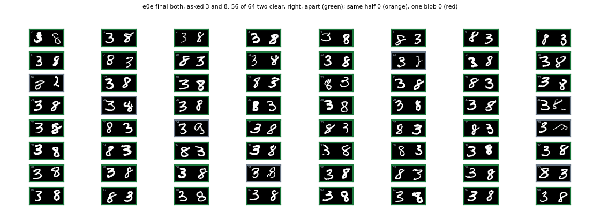

# 🧪 Results: the final test on 20 digit pairs kept out of tuning

⬅️ [Step 7: choosing the side early and holding it](../07-choosing-the-side-early-and-holding-it/README.md) | ⬆️ [All steps](../README.md) | [Side road: training with clutter](../side-road-training-with-clutter/README.md) ➡️

**The setting from step 7 draws 1,200 clean pairs of 1,280 (94%) on the 20 digit pairs kept out of tuning, and 1,043 (81%) without its pushes.** The judge's count clears both written bars. The count by eye is recorded and waits for the owner.

<table>
<tr>
<td>`digits-3-and-8.png` is on the cluster at `/datasets/mmolefe/poe_repair_min/artifacts-archive/2-classifier-guidance/artifacts/results/can-two-digits-compose-on-mnist/03-composing-the-two-models-while-sampling/08-final-test-on-20-unseen-pairs/sheets/no-pushes/digits-3-and-8.png`</td>
<td><a href="sheets/with-both-pushes/digits-3-and-8.png"></a></td>
</tr>
<tr>
<td>No pushes: 45 of 64 clean for 3 and 8</td>
<td>Both pushes: 56 of 64 clean for 3 and 8, the weakest of the 20 pairs</td>
</tr>
</table>

> [!WARNING]
> **This does not reach the plan's real goal.** Each model still works over a known left or right half with an inferred side, so the plan's no-cropping goal is unmet. Nothing has tested the inferred side against a coin flip on these models.

## Table of contents

- [Words this page uses](#words-this-page-uses)
- [What the final test reads](#what-the-final-test-reads)
- [How a canvas gets counted](#how-a-canvas-gets-counted)
- [Whether it cleared the written bars](#whether-it-cleared-the-written-bars)
- [The second count, by eye](#the-second-count-by-eye)
- [What each part adds](#what-each-part-adds)
- [The code that does it](#the-code-that-does-it)
- [What this cannot claim](#what-this-cannot-claim)
- [Every picture and number here](#every-picture-and-number-here)

## Words this page uses

Navigation: 📋 [TOC](#table-of-contents) | [Next](#what-the-final-test-reads) ➡️

**Canvas:** one 32 by 64 pixel image with room for a digit in its left half and its right half.

**The two models:** one trained only on digits 0 to 4 and one only on digits 5 to 9. Neither has ever seen the other's digits.

**Digit pair:** one digit from 0 to 4 with one from 5 to 9, which makes 25 possible pairs.

**Seed:** the number that picks a canvas's starting noise. Each seed gives one canvas per digit pair.

**The judge:** a small trained digit reader that calls every finished canvas.

**Clean pair:** a finished canvas that the judge calls two clear, correct digits, one in each half.

**Both pushes:** two small trained checkers that nudge each step toward a canvas showing the asked pair. [Step 3](../03-adding-the-checker-pushes/README.md) introduces them.

**The held side:** the method from [step 7](../07-choosing-the-side-early-and-holding-it/README.md). Each digit's side is chosen during the first 10 of 50 sampling steps and then kept, and each model has the other half hidden from it.

## What the final test reads

Navigation: ⬅️ [Words](#words-this-page-uses) | 📋 [TOC](#table-of-contents) | [Next](#how-a-canvas-gets-counted) ➡️

**One setting, chosen on five tuning pairs, is read once on the other 20 digit pairs at new seeds.**

| Read | Digit pairs | Seeds | Canvases | What it was for |
|---|---:|---|---:|---|
| Tuning | 5 | 0 to 63 | 320 | choosing the setting, steps 1 to 7 |
| [First test](../05-first-test-on-20-unseen-pairs/README.md) | 20 | 64 to 127 | 1,280 | the setting from step 4 |
| This test | 20 | 128 to 191 | 1,280 | the setting from step 7 |

The 20 pairs are 0 with 6, 7, 8 or 9; 1 with 5, 6, 7 or 8; 2 with 5, 6, 7 or 9; 3 with 5, 7, 8 or 9; and 4 with 5, 6, 8 or 9.

🔤 **The name:** unseen pair
- **Pair:** one digit from each model's range, such as 3 and 8. Each row of the [table of all 20 pairs](#what-each-part-adds) is one.
- **Unseen:** no model and no checker trained on a canvas holding this pair. Each model saw only its own five digits. The checkers saw pasted pairs from inside one range, and pushed pictures of the five tuning pairs.
- **Consequence:** move from the five tuning pairs to these 20 and the clean rate with both pushes goes from 96.9% (310 of 320) to 93.8% (1,200 of 1,280).

## How a canvas gets counted

Navigation: ⬅️ [What the final test reads](#what-the-final-test-reads) | 📋 [TOC](#table-of-contents) | [Next](#whether-it-cleared-the-written-bars) ➡️

**A canvas is clean only when the judge finds exactly two blobs, one in each half, each read at least 0.9 sure as the asked digit.** Every canvas gets exactly one of five calls, so each column adds up to 1,280.

| The judge's call | No pushes | Both pushes |
|---|---:|---:|
| Two clear, right, apart (a clean pair) | 1,043 | 1,200 |
| Two blobs, not both clear and right | 183 | 65 |
| One blob | 37 | 3 |
| Damaged: no blobs, or more than two | 17 | 11 |
| Two blobs in the same half | 0 | 1 |

The pushes mostly repair badly drawn digits. The second row falls from 183 to 65, and the one-blob row falls from 37 to 3.

🔤 **The name:** clean pair
- **Clear:** the judge is at least 0.9 sure of each digit. It is the 0.9 in the sentence above the table.
- **Right:** the two digits it reads are the two that were asked for, in either order.
- **Apart:** one blob in each half, with no third blob.
- **Consequence:** relax "no third blob" so extra marks are allowed, and the count with both pushes goes from 1,200 to 1,203, and without pushes from 1,043 to 1,045. Stray marks explain almost none of the rejected canvases.

## Whether it cleared the written bars

Navigation: ⬅️ [How a canvas gets counted](#how-a-canvas-gets-counted) | 📋 [TOC](#table-of-contents) | [Next](#the-second-count-by-eye) ➡️

**With both pushes the judge's count clears both bars, and without them it misses both.**

| Written bar | Needed | Both pushes | No pushes |
|---|---|---:|---:|
| All 20 pairs together | at least 1,152 of 1,280 (90%) | 1,200 ✅ | 1,043 ❌ |
| The weakest single pair | at least 45 of 64 | 56 (3 and 8) ✅ | 44 (0 and 8) ❌ |

🔤 **The name:** the bar
- **Bar:** a line written down before the run, which the result then clears or misses. On the table, it is the "Needed" column.
- **Why two:** the total could hide one pair that fails badly, so every pair also has its own floor of 45 of 64.
- **Consequence:** take the pushes away and the total falls from 1,200 to 1,043, which is 109 under the bar. The weakest pair falls from 56 to 44, one under its floor.

## The second count, by eye

Navigation: ⬅️ [Whether it cleared the written bars](#whether-it-cleared-the-written-bars) | 📋 [TOC](#table-of-contents) | [Next](#what-each-part-adds) ➡️

**Counting only clear tiles gives 1,201 of 1,280 (93.8%), and counting plausible tiles too gives 1,208 (94.4%).** Pair 3 and 8 reads 57 to 60 and pair 4 and 9 reads 57 to 61. Both readings clear both bars.

The plan counts its headline by eye because the judge can reject digits a person would accept. Its rule is to look at every tile the judge rejected on any pair under 58 of 64. Two pairs qualify, which makes 15 tiles.

`eye-calls-with-reasons.png` is on the cluster at `/datasets/mmolefe/poe_repair_min/artifacts-archive/2-classifier-guidance/artifacts/results/can-two-digits-compose-on-mnist/03-composing-the-two-models-while-sampling/08-final-test-on-20-unseen-pairs/eye-check/eye-calls-with-reasons.png`

Every tile is shown above with its call and the reason for it, so any call can be overruled.

<table>
<tr>
<td>`rejected-tiles__digits-3-and-8.png` is on the cluster at `/datasets/mmolefe/poe_repair_min/artifacts-archive/2-classifier-guidance/artifacts/results/can-two-digits-compose-on-mnist/03-composing-the-two-models-while-sampling/08-final-test-on-20-unseen-pairs/eye-check/rejected-tiles__digits-3-and-8.png`</td>
<td>`rejected-tiles__digits-4-and-9.png` is on the cluster at `/datasets/mmolefe/poe_repair_min/artifacts-archive/2-classifier-guidance/artifacts/results/can-two-digits-compose-on-mnist/03-composing-the-two-models-while-sampling/08-final-test-on-20-unseen-pairs/eye-check/rejected-tiles__digits-4-and-9.png`</td>
</tr>
<tr>
<td>3 and 8: seed 183 is a clear 8 and 3. Seed 144 draws a 2 where the 3 belongs, and seeds 141, 159 and 167 draw a broken stroke where the 8 belongs.</td>
<td>4 and 9: seed 177 is a thick but readable 4 and 9. Seed 179 has a solid lump where the 9 belongs, and seed 170 a Y shape.</td>
</tr>
</table>

| Pair | Judge's clean | Called clear | Called plausible | Called wrong | Clear only | Clear and plausible |
|---|---:|---|---|---|---:|---:|
| 3 and 8 | 56 | 1 (seed 183) | 3 (seeds 153, 162, 179) | 4 (seeds 141, 144, 159, 167) | 57 | 60 |
| 4 and 9 | 57 | 0 | 4 (seeds 132, 149, 176, 177) | 3 (seeds 145, 170, 179) | 57 | 61 |
| All 20 pairs, of 1,280 | 1,200 | 1 | 7 | 7 | 1,201 | 1,208 |

🔤 **The name:** plausible tile
- **Plausible:** believable, with some doubt left. Here it means readable as the asked digits but malformed. In the left picture, seed 153 is a 3 beside an 8 with extra strokes on its top loop.
- **Clear and wrong:** a clear tile holds two clean, correct digits. A wrong tile has a digit missing, wrong, or drawn twice.
- **Consequence:** count the 7 plausible tiles as good and the total moves from 1,201 to 1,208. Pair 3 and 8 moves from 57 to 60.

> [!NOTE]
> **Claude made these 15 calls at full size with the judge's reason hidden, and the owner can overrule any of them.** The count is recorded and awaits the owner, so the plan's bar stays unticked. The 65 other rejected tiles, on the other 18 pairs, were not called, and the tiles the judge accepted were not re-checked by eye.

## What each part adds

Navigation: ⬅️ [The second count](#the-second-count-by-eye) | 📋 [TOC](#table-of-contents) | [Next](#the-code-that-does-it) ➡️

**The held side alone reaches 1,043, and both pushes add 157 more, raising every one of the 20 pairs by between 2 and 19.** Each row is 64 canvases, on seeds 128 to 191, counted by the judge.

| Digit pair | Side held, no pushes | Side held, both pushes | Added by the pushes |
|---|---:|---:|---:|
| 0 and 6 | 59 | 61 | +2 |
| 0 and 7 | 52 | 61 | +9 |
| 0 and 8 | 44 | 63 | +19 |
| 0 and 9 | 53 | 61 | +8 |
| 1 and 5 | 51 | 58 | +7 |
| 1 and 6 | 57 | 59 | +2 |
| 1 and 7 | 53 | 58 | +5 |
| 1 and 8 | 45 | 58 | +13 |
| 2 and 5 | 51 | 60 | +9 |
| 2 and 6 | 56 | 62 | +6 |
| 2 and 7 | 56 | 62 | +6 |
| 2 and 9 | 52 | 58 | +6 |
| 3 and 5 | 52 | 61 | +9 |
| 3 and 7 | 56 | 60 | +4 |
| 3 and 8 | 45 | 56 | +11 |
| 3 and 9 | 56 | 62 | +6 |
| 4 and 5 | 53 | 60 | +7 |
| 4 and 6 | 53 | 64 | +11 |
| 4 and 8 | 47 | 59 | +12 |
| 4 and 9 | 52 | 57 | +5 |
| All 20, of 1,280 | 1,043 | 1,200 | +157 |

**The 5 to 9 model falls short on the digit 8.** Asked alone, it draws a clear 8 on 55 of 64 tries. The four pairs here that hold an 8 read 63, 58, 56 and 59 with both pushes.

**Step 5 is a rough reference only.** Its method read these same 20 pairs at seeds 64 to 127 and got 1,088 of 1,280 with pushes and extra steps. Both the method and the seeds differ, so the gap to 1,200 cannot be credited to the method alone.

## The code that does it

Navigation: ⬅️ [What each part adds](#what-each-part-adds) | 📋 [TOC](#table-of-contents) | [Next](#what-this-cannot-claim) ➡️

**This test adds no new sampling code, and one short function in [the two-model sampler](../../../../../scripts/mnist/two_experts.py) decides which call each canvas gets.**

`2-classifier-guidance/scripts/mnist/two_experts.py`, lines 214 to 224:

```python
def call_two(rd, pair):
    if len(rd) == 0 or len(rd) > 2:
        return "damaged"
    if len(rd) == 1:
        return "one blob"
    if sorted(int(x >= 32) for x, _ in rd) != [0, 1]:
        return "same half"
    d = [p[:10] / p[:10].sum() for _, p in rd]
    if sorted(int(q.argmax()) for q in d) == sorted(pair) and all(q.max() >= 0.9 for q in d):
        return "two clear, right, apart"
    return "two, not both clear and right"
```

| Line | What it does |
|---|---|
| `len(rd) == 0 or len(rd) > 2` | no blobs, or more than two, is damaged |
| `int(x >= 32)` | which half a blob's centre sits in, since the canvas is 64 wide |
| `sorted(int(q.argmax()) ...) == sorted(pair)` | the two digits read must be the two asked for, in either order |
| `q.max() >= 0.9` | the judge must be at least 0.9 sure of each digit |

## What this cannot claim

Navigation: ⬅️ [The code](#the-code-that-does-it) | 📋 [TOC](#table-of-contents) | [Next](#every-picture-and-number-here) ➡️

> [!WARNING]
> **This is composition over two known halves with an inferred side.** Hiding a fixed left or right half gives each model the same information a crop would, so the plan's no-cropping goal is unmet, and nothing here shows two models placing objects freely or overlapping them. Nothing has compared the inferred side with a coin flip on these models. [Step 7](../07-choosing-the-side-early-and-holding-it/README.md#what-this-cannot-claim) shows why the vote may add nothing.

**The eye count covers 15 of the 80 rejected tiles.** The other 65 rejected tiles were not called, and none of the 1,200 tiles the judge accepted were re-checked. So 1,201 and 1,208 are readings of this procedure, and neither is a firm lower or upper limit on the true count.

**These 20 pairs have been read once before.** Step 5 read them at seeds 64 to 127, and the method in step 7 was designed after that. The seeds here are new and the setting was chosen on the five tuning pairs, but whoever designed step 7 had already seen how these pairs behaved.

**The written bar names other seeds.** The bar in the review file says seeds 64 to 127. This read uses 128 to 191, which the review's later entries set for any setting chosen after the first read.

**The pushes have seen two digits together.** The two models never have, but the pair-aware checker trained on pasted two-digit canvases from inside each range and on pushed pictures of the five tuning pairs. The 157 canvases the pushes add depend on that knowledge.

## Every picture and number here

Navigation: ⬅️ [What this cannot claim](#what-this-cannot-claim) | 📋 [TOC](#table-of-contents)

**This folder holds two runs with their counts, and the eye check on the two weakest pairs.** Each run has one sheet per digit pair, and a sheet shows 64 canvases with a green frame around each one the judge called clean.

| Thing | What it shows | How we got it | Also called |
|---|---|---|---|
| Side held, no pushes (on the cluster at `/datasets/mmolefe/poe_repair_min/artifacts-archive/2-classifier-guidance/artifacts/results/can-two-digits-compose-on-mnist/03-composing-the-two-models-while-sampling/08-final-test-on-20-unseen-pairs/sheets/no-pushes`) with its counts (on the cluster at `/datasets/mmolefe/poe_repair_min/artifacts-archive/2-classifier-guidance/artifacts/results/can-two-digits-compose-on-mnist/03-composing-the-two-models-while-sampling/08-final-test-on-20-unseen-pairs/counts/no-pushes.json`) | 20 sheets, 1,043 of 1,280 | `two_experts.py cells --compose inferred-lock --push none --eval-seed0 128`, from [the final-test launcher](../../../../../scripts/mnist/two_experts_e0e_final.sh), on the cluster | `e0e-final-none` |
| [Side held, both pushes](sheets/with-both-pushes/) with its counts (on the cluster at `/datasets/mmolefe/poe_repair_min/artifacts-archive/2-classifier-guidance/artifacts/results/can-two-digits-compose-on-mnist/03-composing-the-two-models-while-sampling/08-final-test-on-20-unseen-pairs/counts/with-both-pushes.json`) | 20 sheets, 1,200 of 1,280 | the same command with `--push both` and the two retrained checkers, strength 10, cap 0.1 | `e0e-final-both` |
| Rejected tiles for 3 and 8 (on the cluster at `/datasets/mmolefe/poe_repair_min/artifacts-archive/2-classifier-guidance/artifacts/results/can-two-digits-compose-on-mnist/03-composing-the-two-models-while-sampling/08-final-test-on-20-unseen-pairs/eye-check/rejected-tiles__digits-3-and-8.png`) | the 8 canvases the judge rejected, enlarged, labelled by seed | cut from that run's saved canvases by the judge-rejection check | none |
| Rejected tiles for 4 and 9 (on the cluster at `/datasets/mmolefe/poe_repair_min/artifacts-archive/2-classifier-guidance/artifacts/results/can-two-digits-compose-on-mnist/03-composing-the-two-models-while-sampling/08-final-test-on-20-unseen-pairs/eye-check/rejected-tiles__digits-4-and-9.png`) | the 7 canvases the judge rejected, enlarged, labelled by seed | the same check | none |
| [The calls by eye](eye-check/eye-calls.json) | one call per rejected tile, 15 in all | Claude, at full size with the judge's reason hidden, on 2026-11-22 | none |

**Reading the counts files.** The field `total_of_320` holds this run's total out of 1,280, because the script names that field for the five-pair runs. The field `tolerant` is the count that allows extra marks.

**Where it came from.** The bars and the judge's counts are in [plan 33's review file](../../../../../plans/review/33-experts-that-compose-at-inference.md), and [plan 33](../../../../../plans/33-experts-that-compose-at-inference.md) holds the design. The eye calls live only in the file above, because the review still lists them as owed. Every file's original location and checksum is in [the file origins list](../file-origins.tsv). The models and raw canvases stay in `data/mnist-canvas/33-mnist-experts-at-inference/` and on the cluster at `/home-mscluster/mmolefe/poe_repair_min_scratch/mnist-canvas/33-experts-at-inference/`.

<!-- built-to: PAGE_LOOK_FORMAT v1 -->
