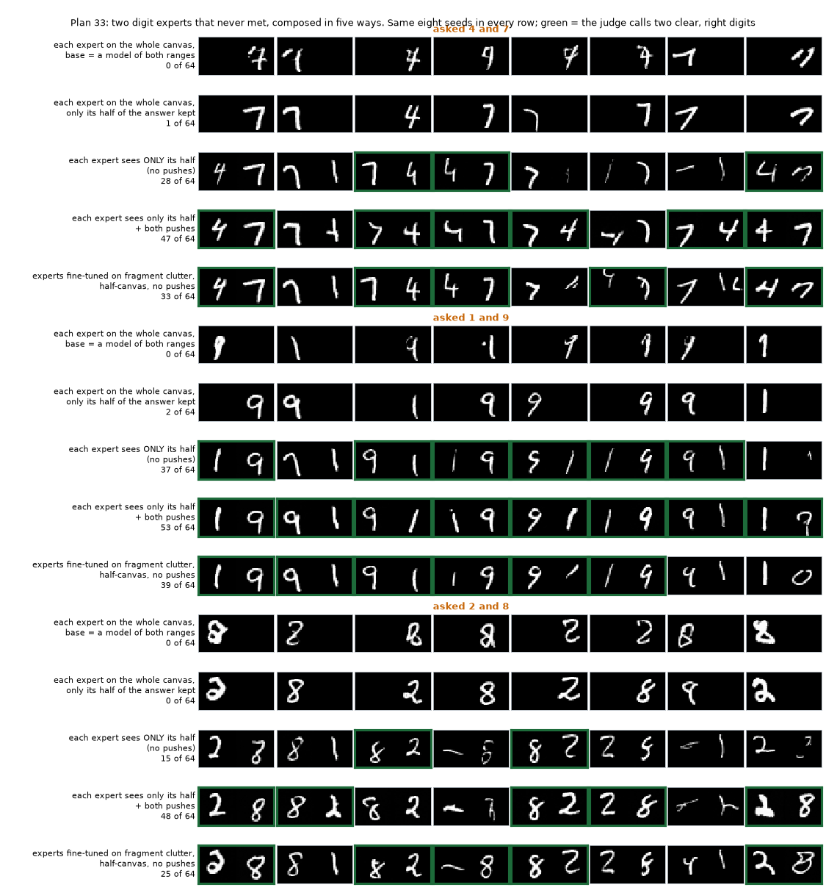
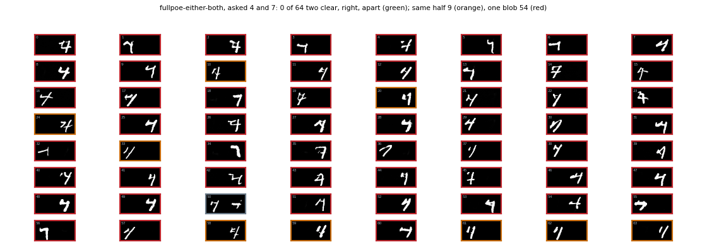
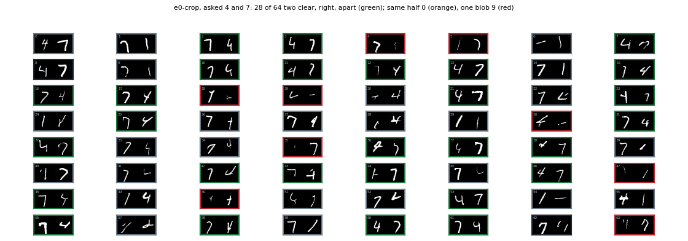
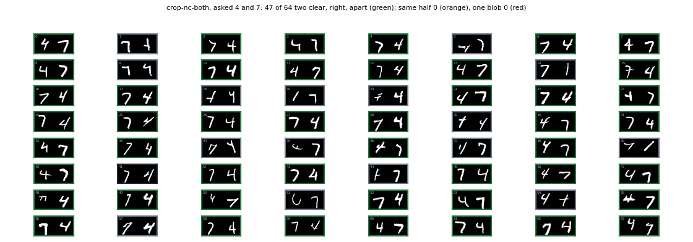
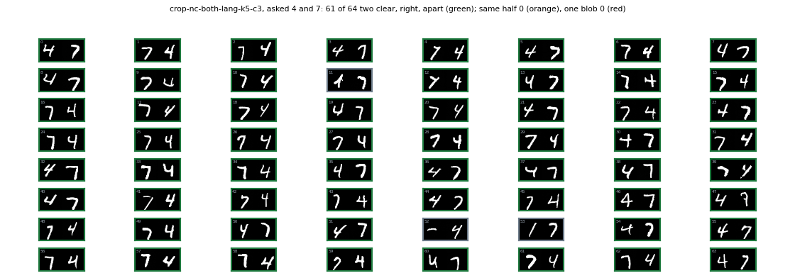
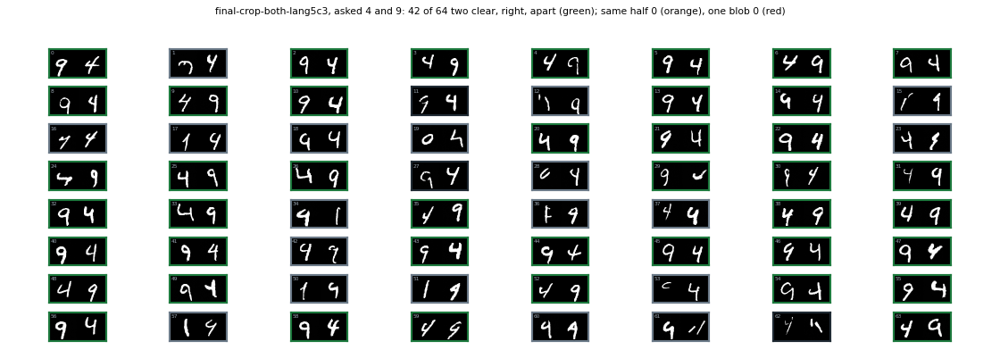
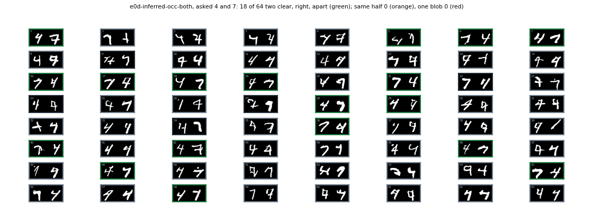
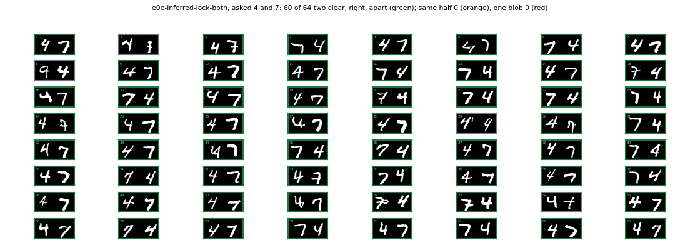
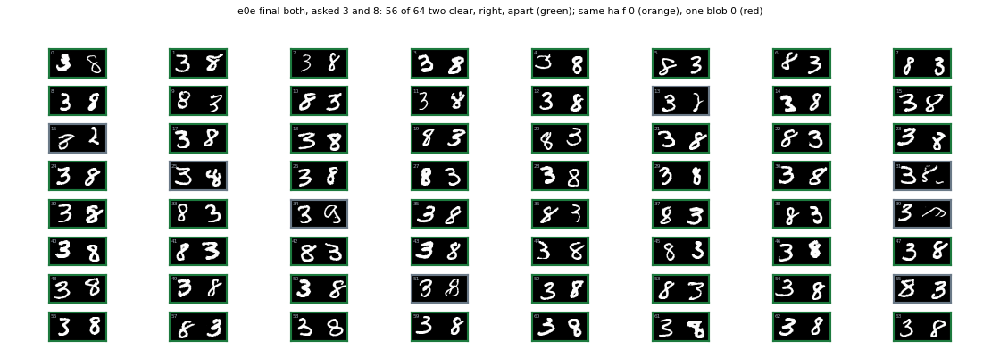

# 🧪 Results: composing two separately trained digit models while sampling

⬅️ [Stage 2: two models trained apart](../02-two-models-trained-apart/README.md) | ⬆️ [The whole story](../README.md)

**Eight steps take two digit models that never met from 0 clean pairs to 1,200 of 1,280 on digit pairs held out of tuning.** Each model still works on its own known half of the canvas, so this answers the question for two fixed regions and leaves free placement open.

The picture shows five ways of combining the same two models on the same eight seeds. A green frame marks a canvas the judge calls two clear, correct digits. The rows fill with green as each model is shown only its own half and the checker pushes are added.

## Table of contents

- [The steps in order](#the-steps-in-order)
- [The one idea behind the ladder](#the-one-idea-behind-the-ladder)
- [How far to trust the ladder](#how-far-to-trust-the-ladder)
- [Every file here](#every-file-here)

## The steps in order

Navigation: 📋 [TOC](#table-of-contents) | [Next](#the-one-idea-behind-the-ladder) ➡️

**Each row says what changed and what it did to the count.** Steps 2 to 5 pick each model's side by coin flip, and steps 6 to 8 let the models choose it.

| Step | What changed | Clean pairs | One sheet |
|---|---|---:|---|
| [1. The plain product draws nothing](01-the-plain-product-draws-nothing/README.md) | the two models multiplied on one canvas | 0 of 320, at most 4 with repairs |  |
| [2. Giving each model its own half](02-giving-each-model-its-own-half/README.md) | each model sees only its half | 124 of 320 |  |
| [3. Adding the checker pushes](03-adding-the-checker-pushes/README.md) | two small checkers nudge every step | 257 of 320 |  |
| [4. Adding extra denoising steps](04-adding-extra-denoising-steps/README.md) | five extra steps before each sampling step | 298 of 320 |  |
| [5. First test on 20 unseen pairs](05-first-test-on-20-unseen-pairs/README.md) | step 4's setting, on pairs kept out of tuning | 1,088 of 1,280 |  |
| [6. Letting the models choose their side](06-letting-the-models-choose-their-side/README.md) | no coin flip, side chosen at every step | at most 56 of 320 |  |
| [7. Choosing the side early and holding it](07-choosing-the-side-early-and-holding-it/README.md) | the side is fixed after the first 10 of 50 steps | 310 of 320 |  |
| [8. Final test on 20 unseen pairs](08-final-test-on-20-unseen-pairs/README.md) | step 7's setting, at new seeds | 1,200 of 1,280 |  |
| [Side road: training with clutter](side-road-training-with-clutter/README.md) | models retrained with stroke fragments, on one shared canvas | 121 of 320 at best | `digits-4-and-7.png` is on the cluster at `/datasets/mmolefe/poe_repair_min/artifacts-archive/2-classifier-guidance/artifacts/results/can-two-digits-compose-on-mnist/03-composing-the-two-models-while-sampling/side-road-training-with-clutter/sheets/fine-tuned-models-whole-canvas-with-both-pushes-and-extra-steps/digits-4-and-7.png` |

## The one idea behind the ladder

Navigation: ⬅️ [The steps in order](#the-steps-in-order) | 📋 [TOC](#table-of-contents) | [Next](#how-far-to-trust-the-ladder) ➡️

**Each model only knows canvases holding one digit of its own kind, so it fails as soon as it sees the other model's digit.** Every step that helped either keeps that digit out of a model's view or repairs the damage afterwards.

🔤 **The name:** product of two models
- **Product:** the result of multiplying. Two models are multiplied so a canvas scores high only when both like it.
- **Where it sits:** step 1's sheets. The 0 to 4 model scores a canvas holding a 7 near zero, and the 5 to 9 model does the same for a canvas holding a 4.
- **Consequence:** a canvas holding one digit from each scores near zero under both, so the product has almost nothing to draw: 0 of 320. Show each model only its own half and that conflict disappears: 124 of 320.

## How far to trust the ladder

Navigation: ⬅️ [The one idea](#the-one-idea-behind-the-ladder) | 📋 [TOC](#table-of-contents) | [Next](#every-file-here) ➡️

> [!WARNING]
> **The top of the ladder still needs two known halves.** Steps 2 to 8 all split the canvas into a fixed left and right. The plan's real goal is composition with no cropping. The closest run, on the side road, reaches 121 of 320 against a bar of 288.

**Steps 5 and 8 are different settings on different seeds.** The same 20 digit pairs were read at step 5 and again at step 8, so step 8 is the second look at those pairs, on fresh seeds.

**Choosing the side has not been tested against chance.** Step 8's result may owe nothing to the models' vote, because no run holds a random side with everything else the same.

**Most counts come from the judge.** Only the rejected tiles on the weakest pairs were called by eye. The by-eye reading of step 8 is 1,201 to 1,208 of 1,280, and it waits for the owner.

## Every file here

Navigation: ⬅️ [How far to trust the ladder](#how-far-to-trust-the-ladder) | 📋 [TOC](#table-of-contents)

**Each step folder holds its own page, sheets and counts, and this folder adds one picture and one list.**

| File | What it is | How we got it |
|---|---|---|
| [Ways of composing, side by side](ways-of-composing-side-by-side.png) | five composition methods on eight seeds of three pairs | drawn by `make_plan33_qual.py` from saved canvases; also called `qualitative-ways-of-composing` |
| [File origins](file-origins.tsv) | every copied file, where it came from and its checksum | written when this folder was built from the cluster's 42 runs and the laptop's plan 33 folder |

The bars for every step were written before the runs in [plan 33's review file](../../../../plans/review/33-experts-that-compose-at-inference.md), and [plan 33](../../../../plans/33-experts-that-compose-at-inference.md) holds the design.

<!-- built-to: PAGE_LOOK_FORMAT v1 -->
