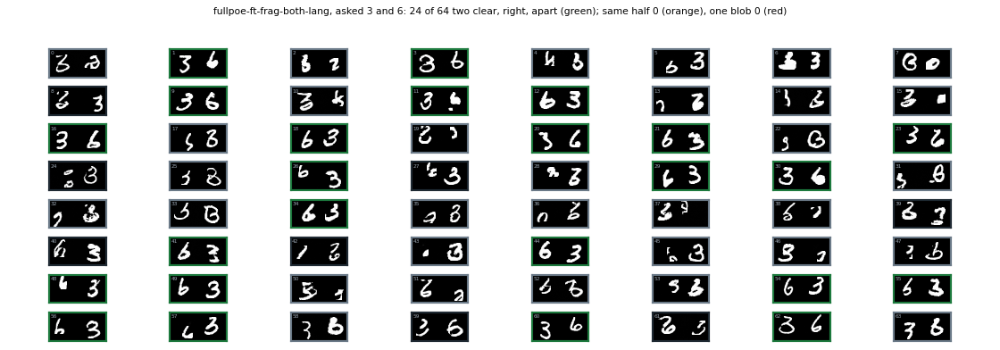

# 🧪 Results: training the two models with clutter

⬆️ [All steps](../README.md)

**Training each model with stroke fragments lifts the whole-canvas product from 0 to 121 clean pairs of 320, the closest any run comes to the plan's real goal and still well under its bar of 288.** This page is a side road, unnumbered because nothing in steps 1 to 8 depends on it.

<table>
<tr>
<td>`digits-3-and-6.png` is on the cluster at `/datasets/mmolefe/poe_repair_min/artifacts-archive/2-classifier-guidance/artifacts/results/can-two-digits-compose-on-mnist/03-composing-the-two-models-while-sampling/01-the-plain-product-draws-nothing/sheets/plain-product-with-both-pushes-and-extra-steps/digits-3-and-6.png`</td>
<td><a href="sheets/fine-tuned-models-whole-canvas-with-both-pushes-and-extra-steps/digits-3-and-6.png"></a></td>
</tr>
<tr>
<td>Original models: 0 of 64 clean for 3 and 6, with the ink fused into one half on all 64</td>
<td>Fine-tuned on clutter, same sampler: 24 of 64 clean for 3 and 6, the middle of the five pairs</td>
</tr>
</table>

## Table of contents

- [Words this page uses](#words-this-page-uses)
- [What the clutter is](#what-the-clutter-is)
- [Two ways to train with it](#two-ways-to-train-with-it)
- [Why the whole-canvas runs matter](#why-the-whole-canvas-runs-matter)
- [What each part adds](#what-each-part-adds)
- [Whether each model can still draw its digits](#whether-each-model-can-still-draw-its-digits)
- [The code that does it](#the-code-that-does-it)
- [What this cannot claim](#what-this-cannot-claim)
- [Every picture and number here](#every-picture-and-number-here)

## Words this page uses

Navigation: 📋 [TOC](#table-of-contents) | [Next](#what-the-clutter-is) ➡️

**Canvas:** one 32 by 64 pixel image with room for a digit in its left half and its right half.

**The two models:** one trained only on digits 0 to 4 and one only on digits 5 to 9. Neither has ever seen the other's digits.

**Original models:** the pair used in steps 1 to 8, trained with one digit on an otherwise empty canvas.

**Plain product:** both models' predictions added together at every sampling step, over a shared "no digit" prediction. [Step 1](../01-the-plain-product-draws-nothing/README.md) shows it drawing nothing useful.

**Own halves:** each model works on its own half of the canvas and the halves are joined. [Step 2](../02-giving-each-model-its-own-half/README.md) introduces it.

**Clean pair:** a finished canvas that the digit-reading judge calls two clear, correct digits, one in each half.

**Both pushes:** two small trained checkers that nudge each step toward a canvas showing the asked pair. [Step 3](../03-adding-the-checker-pushes/README.md) introduces them.

## What the clutter is

Navigation: ⬅️ [Words](#words-this-page-uses) | 📋 [TOC](#table-of-contents) | [Next](#two-ways-to-train-with-it) ➡️

**Each model trains on its own digit with broken pieces of its own digits lying elsewhere on the canvas, so ink beside its digit stops being impossible.**

`fragments-and-speckle-explainer.png` is on the cluster at `/datasets/mmolefe/poe_repair_min/artifacts-archive/2-classifier-guidance/artifacts/results/can-two-digits-compose-on-mnist/03-composing-the-two-models-while-sampling/side-road-training-with-clutter/fragments-and-speckle-explainer.png`

The top two blocks of the picture are what these models trained on. A model that has only seen one digit on an empty canvas treats a second mark as something that cannot happen, so the product of two such models has almost nothing to draw. Fragments give each model canvases where something else sits beside its digit, and neither model ever sees the other's digits.

| Training canvas | How often | What is on it | Label |
|---|---|---|---|
| Digit alone | about 45% | one digit in one half | that digit |
| Digit with a fragment | about 45% | one digit, and one fragment in the opposite half | that digit |
| Clutter only | 10% | one or two fragments, no digit | "no digit" |

🔤 **The name:** fragment clutter
- **Clutter:** unrelated things lying around. On the picture, the small broken strokes beside the digits.
- **Fragment:** a broken-off piece. Here it is a rectangle 10 to 16 pixels on each side, cut from a digit in the model's own range, holding at least 25 bright pixels.
- **Consequence:** with the same sampler (whole canvas, both pushes), the original models give 1 clean pair of 320 and the models trained from scratch on fragments give 66.

> [!NOTE]
> **Two other clutter designs appear in this folder, and no model on this page trained on either.** The bottom two blocks above show speckle, random bright dots, and the review records no count for it. The clothing picture (on the cluster at `/datasets/mmolefe/poe_repair_min/artifacts-archive/2-classifier-guidance/artifacts/results/can-two-digits-compose-on-mnist/03-composing-the-two-models-while-sampling/side-road-training-with-clutter/training-canvases-with-clutter.png`) shows items from Fashion-MNIST, which the review rules out so that no second dataset enters a model.

## Two ways to train with it

Navigation: ⬅️ [What the clutter is](#what-the-clutter-is) | 📋 [TOC](#table-of-contents) | [Next](#why-the-whole-canvas-runs-matter) ➡️

**Adding clutter to the finished models scores higher than training with it from the start on all four runs the two sets share.** The fine-tuned models also have 4,000 more training steps in total, so this comparison mixes when the clutter arrives with how long the models trained.

| Models | How they were trained | Whole canvas, both pushes, extra steps | Own halves, no pushes |
|---|---|---:|---:|
| Fragment models | 40,000 steps from scratch, with clutter | 94 | 146 |
| Fine-tuned models | the original models' 40,000 steps, then 4,000 more with clutter | 121 | 157 |

🔤 **The name:** fine-tuned
- **Fine:** small.
- **Tuned:** adjusted. The model keeps what it learned and is adjusted for a short while on new data.
- **Where it sits:** the second row. These are the original models, each given 4,000 more training steps on its own digits plus fragments.
- **Consequence:** swap the from-scratch fragment models for the fine-tuned ones and the whole-canvas run goes from 94 to 121 of 320, and own halves from 146 to 157.

## Why the whole-canvas runs matter

Navigation: ⬅️ [Two ways to train with it](#two-ways-to-train-with-it) | 📋 [TOC](#table-of-contents) | [Next](#what-each-part-adds) ➡️

**The whole-canvas runs use no crop and no side assignment, so they are the closest of any run to the plan's real goal.** The plan wants two models composed on the full canvas, because a real scene with a cat and a dog gives no clean left and right halves to split.

| Line from the plan, clean pairs of 320 | Needed | Best whole-canvas run, strict (extra marks allowed) |
|---|---:|---:|
| Above the no-effect line | 32 | 121 (123) ✅ |
| Promising, worth carrying forward | 160 | 121 (123) ❌ |
| Supports the method | 288 | 121 (123) ❌ |

🔤 **The name:** whole canvas
- **Whole:** both models see all 32 by 64 pixels at every step, and neither has a half cut out or hidden.
- **Where it sits:** the first three rows of [the table below](#what-each-part-adds).
- **Consequence:** hold the fragment models and both pushes fixed, and switching from own halves to the whole canvas drops the count from 260 to 66 of 320. That gap is what a known split is worth here.

🔤 **The name:** extra steps
- **Extra:** added to the 50 sampling steps. Before each sampling step except the last, the sampler takes 5 more small noise-removing steps at the same noise level, a Langevin corrector with step size 3 times the schedule's beta. [Step 4](../04-adding-extra-denoising-steps/README.md) introduces it.
- **Consequence:** on the fine-tuned models the whole-canvas run goes from 75 to 121 of 320, at about six times the sampling cost.

## What each part adds

Navigation: ⬅️ [Why the whole-canvas runs matter](#why-the-whole-canvas-runs-matter) | 📋 [TOC](#table-of-contents) | [Next](#whether-each-model-can-still-draw-its-digits) ➡️

**Clutter helps most where the models share the whole canvas, and on own halves with both pushes the fragment models add 3 clean pairs over the original models.** Each cell is clean pairs of 320, on five tuning pairs at seeds 0 to 63.

| How the two models are combined | Original models | Fragment models | Fine-tuned models |
|---|---:|---:|---:|
| Plain product, whole canvas | 0 | 9 | 11 |
| Whole canvas, both pushes | 1 | 66 | 75 |
| Whole canvas, both pushes, extra steps | 0 | 94 | 121 |
| Own halves, no pushes | 124 | 146 | 157 |
| Own halves, both pushes | 257 | 260 | no run |

Clutter leaves marks in some finished canvases, and the strict judge rejects any canvas with a third blob. The plan therefore reads these models with a second count, shown beside the strict one below.

| Run | 1 and 9 | 3 and 6 | 4 and 7 | 2 and 8 | 0 and 5 | Strict, of 320 | Extra marks allowed, of 320 |
|---|---:|---:|---:|---:|---:|---:|---:|
| Fragment models, plain product | 7 | 0 | 2 | 0 | 0 | 9 | 9 |
| Fragment models, own halves | 34 | 28 | 29 | 19 | 36 | 146 | 148 |
| Fragment models, own halves, both pushes | 46 | 55 | 51 | 53 | 55 | 260 | 263 |
| Fragment models, whole canvas, both pushes | 18 | 13 | 20 | 7 | 8 | 66 | 69 |
| Fragment models, whole canvas, both pushes, extra steps | 26 | 18 | 25 | 16 | 9 | 94 | 96 |
| Fine-tuned models, plain product | 7 | 0 | 1 | 2 | 1 | 11 | 11 |
| Fine-tuned models, own halves | 39 | 30 | 33 | 25 | 30 | 157 | 158 |
| Fine-tuned models, whole canvas, both pushes | 18 | 19 | 19 | 6 | 13 | 75 | 77 |
| Fine-tuned models, whole canvas, both pushes, extra steps | 29 | 24 | 33 | 19 | 16 | 121 | 123 |

🔤 **The name:** extra marks allowed
- **Strict count:** exactly two blobs on the canvas, one per half. The per-pair columns use this count.
- **Extra marks allowed:** one blob read at least 0.9 sure as each asked digit, in different halves, with other blobs ignored. The plan's bars for clutter models apply to this count.
- **Consequence:** on the fragment models with own halves and both pushes, allowing extra marks moves the count from 260 to 263. Against the original models' 257, the gain from clutter is 3 by the strict count and 6 by this one.

## Whether each model can still draw its digits

Navigation: ⬅️ [What each part adds](#what-each-part-adds) | 📋 [TOC](#table-of-contents) | [Next](#the-code-that-does-it) ➡️

**Both clutter pairs miss the plan's own-digit check on some digits: 1, 4, 7 and 8 for the fragment models, and 1, 7 and 8 for the fine-tuned ones.** Each cell is how many of 64 tries one model draws its digit clearly when asked alone, with extra marks allowed. The bar is 58, and ❌ marks a miss.

| Models | 0 | 1 | 2 | 3 | 4 | 5 | 6 | 7 | 8 | 9 |
|---|---:|---:|---:|---:|---:|---:|---:|---:|---:|---:|
| Fragment models | 64 | 53 ❌ | 58 | 58 | 55 ❌ | 62 | 58 | 53 ❌ | 56 ❌ | 63 |
| Fine-tuned models | 63 | 52 ❌ | 61 | 58 | 58 | 61 | 59 | 56 ❌ | 56 ❌ | 60 |

The plan's rule retrains a from-scratch clutter model once if it misses. The fragment models were left as they are, because they add so little over the original models on own halves with both pushes. The fine-tuned models are an exploratory set and were not retrained either. Every count on this page carries this shortfall.

## The code that does it

Navigation: ⬅️ [Whether each model can still draw](#whether-each-model-can-still-draw-its-digits) | 📋 [TOC](#table-of-contents) | [Next](#what-this-cannot-claim) ➡️

**Two short functions in [the two-model sampler](../../../../../scripts/mnist/two_experts.py) make the whole-canvas product and the count that allows extra marks.** The fragments themselves are cut in `item` and placed in `one_half_clutter` and `clutter_only`, at lines 48 to 91 of [the canvas builder](../../../../../scripts/mnist/canvas_sheet.py).

`2-classifier-guidance/scripts/mnist/two_experts.py`, lines 49 to 60:

```python
def two_eps(A, B, a, b, base="floor", tau=0.3):
    """base: blank (point mass), floor (blank with spread tau), avgnull (mean of the two experts' no-digit predictions)."""
    def f(x, t):
        ya = torch.full((x.shape[0],), a, device=x.device)
        yb = torch.full((x.shape[0],), b, device=x.device)
        if base == "avgnull":
            n = torch.full((x.shape[0],), 10, device=x.device)
            ref = 0.5 * (A(x, t, n) + B(x, t, n))
        else:
            ref = blank_eps(x, t) if base == "blank" else floor_eps(x, t, tau)
        return A(x, t, ya) + B(x, t, yb) - ref
    return f
```

| Line | What it does |
|---|---|
| `n = torch.full(..., 10, ...)` | label 10 means "no digit" |
| `ref = 0.5 * (A(x, t, n) + B(x, t, n))` | the shared background: the average of the two models' no-digit predictions |
| `A(x, t, ya) + B(x, t, yb) - ref` | the product, with both models looking at the whole canvas |

Lines 234 to 240:

```python
def call_tolerant(rd, pair):
    """Clutter-tolerant (plan 33, E2): one blob read at least 0.9 as the asked digit a and one as b, in different halves, other blobs allowed."""
    a, b = pair
    def hits(d):
        return [x >= 32 for x, p in rd if (p[:10] / p[:10].sum())[d] >= 0.9 and int((p[:10] / p[:10].sum()).argmax()) == d]
    ha, hb = hits(a), hits(b)
    return len(ha) == 1 and len(hb) == 1 and ha[0] != hb[0]
```

| Line | What it does |
|---|---|
| `hits(d)` | for digit `d`, lists which half holds each blob read at least 0.9 sure as `d` |
| `len(ha) == 1 and len(hb) == 1` | exactly one confident blob for each asked digit, with any other blobs ignored |
| `ha[0] != hb[0]` | the two digits sit in different halves |

## What this cannot claim

Navigation: ⬅️ [The code](#the-code-that-does-it) | 📋 [TOC](#table-of-contents) | [Next](#every-picture-and-number-here) ➡️

> [!WARNING]
> **No whole-canvas run reaches the plan's bars.** The best is 121 of 320 (38%), or 123 on the count the plan's clutter bars use. That is 165 short of the 288 that would support it and under the 160 promising line. These runs are the closest to the plan's goal, and the goal remains unmet.

**All of this is on the five tuning pairs.** No clutter run was read on the 20 test pairs. The pair-aware checker also trained on pushed pictures of these same five pairs, so every count with pushes is a tuning number.

**The checkers were not retrained for these models.** The pair-aware checker learned partly from pictures made by the own-halves method on the original models, so these counts say nothing about a checker trained on whole-canvas pictures.

**The judge made these counts.** No person checked these canvases one by one. On the best run's sheet for 3 and 6, green frames include thick or lumpy digits, such as tile 11 (a 3 beside a lumpy 6 with a speck) and tile 30 (a 6 with its loop filled in).

**A gain of 3 or 6 clean pairs is too small to read.** Each setting is one run of 64 seeds per pair, and no repeat at other seeds measures how far a count moves by chance.

## Every picture and number here

Navigation: ⬅️ [What this cannot claim](#what-this-cannot-claim) | 📋 [TOC](#table-of-contents)

**This folder holds two pictures of the training data and nine runs with their counts.** Each run has five sheets, one per digit pair, and a sheet shows 64 canvases with a green frame around each one the judge called clean. "What it shows" describes the 3 and 6 sheet.

| Thing | What it shows | How we got it | Also called |
|---|---|---|---|
| Fragments and speckle (on the cluster at `/datasets/mmolefe/poe_repair_min/artifacts-archive/2-classifier-guidance/artifacts/results/can-two-digits-compose-on-mnist/03-composing-the-two-models-while-sampling/side-road-training-with-clutter/fragments-and-speckle-explainer.png`) | 16 training canvases per model for fragments, then for speckle | a saved picture from the plan's data folder; no script in the repository names this file | `clutter-fragments-speckle` |
| Clothing as clutter (on the cluster at `/datasets/mmolefe/poe_repair_min/artifacts-archive/2-classifier-guidance/artifacts/results/can-two-digits-compose-on-mnist/03-composing-the-two-models-while-sampling/side-road-training-with-clutter/training-canvases-with-clutter.png`) | 16 training canvases per model with Fashion-MNIST clothing beside digits; no model here trained on it | a saved picture from the same folder; no script in the repository names this file | `clutter-training-canvases` |
| Fragment models, plain product (on the cluster at `/datasets/mmolefe/poe_repair_min/artifacts-archive/2-classifier-guidance/artifacts/results/can-two-digits-compose-on-mnist/03-composing-the-two-models-while-sampling/side-road-training-with-clutter/sheets/fragment-models-plain-product`) with its counts (on the cluster at `/datasets/mmolefe/poe_repair_min/artifacts-archive/2-classifier-guidance/artifacts/results/can-two-digits-compose-on-mnist/03-composing-the-two-models-while-sampling/side-road-training-with-clutter/counts/fragment-models-plain-product.json`) | 9 of 320; mostly one fused shape in one half, sometimes a stray stroke in the other | `two_experts.py cells --push none`, from [the fragment evaluation launcher](../../../../../scripts/mnist/two_experts_frag_eval.sh) | `frag-avgnull` |
| Fragment models, own halves (on the cluster at `/datasets/mmolefe/poe_repair_min/artifacts-archive/2-classifier-guidance/artifacts/results/can-two-digits-compose-on-mnist/03-composing-the-two-models-while-sampling/side-road-training-with-clutter/sheets/fragment-models-own-halves`) with its counts (on the cluster at `/datasets/mmolefe/poe_repair_min/artifacts-archive/2-classifier-guidance/artifacts/results/can-two-digits-compose-on-mnist/03-composing-the-two-models-while-sampling/side-road-training-with-clutter/counts/fragment-models-own-halves.json`) | 146 of 320; a digit in each half, many half-drawn | the same launcher with `--compose crop` | `frag-crop` |
| Fragment models, own halves, both pushes (on the cluster at `/datasets/mmolefe/poe_repair_min/artifacts-archive/2-classifier-guidance/artifacts/results/can-two-digits-compose-on-mnist/03-composing-the-two-models-while-sampling/side-road-training-with-clutter/sheets/fragment-models-own-halves-with-both-pushes`) with its counts (on the cluster at `/datasets/mmolefe/poe_repair_min/artifacts-archive/2-classifier-guidance/artifacts/results/can-two-digits-compose-on-mnist/03-composing-the-two-models-while-sampling/side-road-training-with-clutter/counts/fragment-models-own-halves-with-both-pushes.json`) | 260 of 320; mostly a clear 3 and 6 side by side | the same launcher with `--compose crop --push both` | `frag-crop-both` |
| Fragment models, whole canvas, both pushes (on the cluster at `/datasets/mmolefe/poe_repair_min/artifacts-archive/2-classifier-guidance/artifacts/results/can-two-digits-compose-on-mnist/03-composing-the-two-models-while-sampling/side-road-training-with-clutter/sheets/fragment-models-whole-canvas-with-both-pushes`) with its counts (on the cluster at `/datasets/mmolefe/poe_repair_min/artifacts-archive/2-classifier-guidance/artifacts/results/can-two-digits-compose-on-mnist/03-composing-the-two-models-while-sampling/side-road-training-with-clutter/counts/fragment-models-whole-canvas-with-both-pushes.json`) | 66 of 320; often a thick shape on one side and a stub on the other | `--compose product --push both`, from [the whole-canvas launcher](../../../../../scripts/mnist/two_experts_fullpoe.sh) | `fullpoe-frag-both` |
| Fragment models, whole canvas, both pushes, extra steps (on the cluster at `/datasets/mmolefe/poe_repair_min/artifacts-archive/2-classifier-guidance/artifacts/results/can-two-digits-compose-on-mnist/03-composing-the-two-models-while-sampling/side-road-training-with-clutter/sheets/fragment-models-whole-canvas-with-both-pushes-and-extra-steps`) with its counts (on the cluster at `/datasets/mmolefe/poe_repair_min/artifacts-archive/2-classifier-guidance/artifacts/results/can-two-digits-compose-on-mnist/03-composing-the-two-models-while-sampling/side-road-training-with-clutter/counts/fragment-models-whole-canvas-with-both-pushes-and-extra-steps.json`) | 94 of 320; more canvases with two separate shapes, many still thick or broken | the same with `--lang-k 5 --lang-c 3` | `fullpoe-frag-both-lang` |
| Fine-tuned models, plain product (on the cluster at `/datasets/mmolefe/poe_repair_min/artifacts-archive/2-classifier-guidance/artifacts/results/can-two-digits-compose-on-mnist/03-composing-the-two-models-while-sampling/side-road-training-with-clutter/sheets/fine-tuned-models-plain-product`) with its counts (on the cluster at `/datasets/mmolefe/poe_repair_min/artifacts-archive/2-classifier-guidance/artifacts/results/can-two-digits-compose-on-mnist/03-composing-the-two-models-while-sampling/side-road-training-with-clutter/counts/fine-tuned-models-plain-product.json`) | 11 of 320; mostly one fused shape in one half | `two_experts.py cells --push none`, from [the fine-tuned evaluation launcher](../../../../../scripts/mnist/two_experts_ft_eval.sh) | `ft-frag-avgnull` |
| Fine-tuned models, own halves (on the cluster at `/datasets/mmolefe/poe_repair_min/artifacts-archive/2-classifier-guidance/artifacts/results/can-two-digits-compose-on-mnist/03-composing-the-two-models-while-sampling/side-road-training-with-clutter/sheets/fine-tuned-models-own-halves`) with its counts (on the cluster at `/datasets/mmolefe/poe_repair_min/artifacts-archive/2-classifier-guidance/artifacts/results/can-two-digits-compose-on-mnist/03-composing-the-two-models-while-sampling/side-road-training-with-clutter/counts/fine-tuned-models-own-halves.json`) | 157 of 320; a digit in each half, many half-drawn | the same launcher with `--compose crop` | `ft-frag-crop` |
| Fine-tuned models, whole canvas, both pushes (on the cluster at `/datasets/mmolefe/poe_repair_min/artifacts-archive/2-classifier-guidance/artifacts/results/can-two-digits-compose-on-mnist/03-composing-the-two-models-while-sampling/side-road-training-with-clutter/sheets/fine-tuned-models-whole-canvas-with-both-pushes`) with its counts (on the cluster at `/datasets/mmolefe/poe_repair_min/artifacts-archive/2-classifier-guidance/artifacts/results/can-two-digits-compose-on-mnist/03-composing-the-two-models-while-sampling/side-road-training-with-clutter/counts/fine-tuned-models-whole-canvas-with-both-pushes.json`) | 75 of 320; often a thick shape beside a stub | `--compose product --push both`, from the whole-canvas launcher | `fullpoe-ft-frag-both` |
| [Fine-tuned models, whole canvas, both pushes, extra steps](sheets/fine-tuned-models-whole-canvas-with-both-pushes-and-extra-steps/) with its counts (on the cluster at `/datasets/mmolefe/poe_repair_min/artifacts-archive/2-classifier-guidance/artifacts/results/can-two-digits-compose-on-mnist/03-composing-the-two-models-while-sampling/side-road-training-with-clutter/counts/fine-tuned-models-whole-canvas-with-both-pushes-and-extra-steps.json`) | 121 of 320; two separate digits on 24 of the 64 canvases for 3 and 6, the rest a thick digit beside a stub | the same with `--lang-k 5 --lang-c 3` | `fullpoe-ft-frag-both-lang` |

**Where it came from.** The bars, the own-digit counts and most run counts are in [plan 33's review file](../../../../../plans/review/33-experts-that-compose-at-inference.md), and [plan 33](../../../../../plans/33-experts-that-compose-at-inference.md) holds the design. The review does not record the four whole-canvas counts with pushes (66, 94, 75 and 121), so those four come only from the counts files here, copied from the cluster. The fine-tuning command is in [the fine-tuning launcher](../../../../../scripts/mnist/two_experts_finetune.sh). Every file's original location and checksum is in [the file origins list](../file-origins.tsv). The models and raw canvases stay in `data/mnist-canvas/33-mnist-experts-at-inference/` and on the cluster at `/home-mscluster/mmolefe/poe_repair_min_scratch/mnist-canvas/33-experts-at-inference/`.

<!-- built-to: PAGE_LOOK_FORMAT v1 -->
