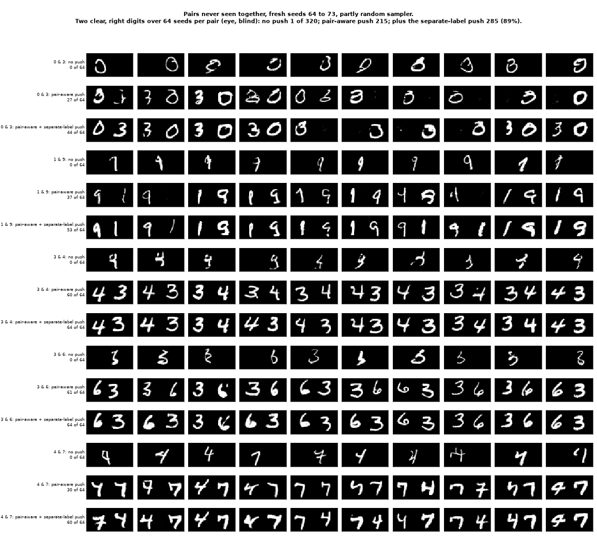
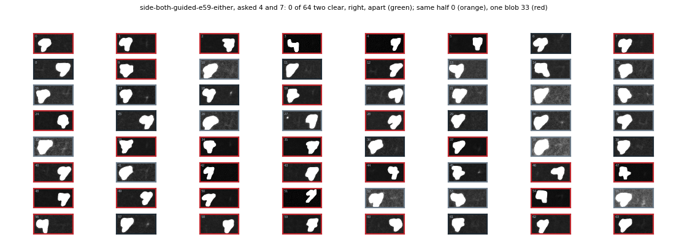
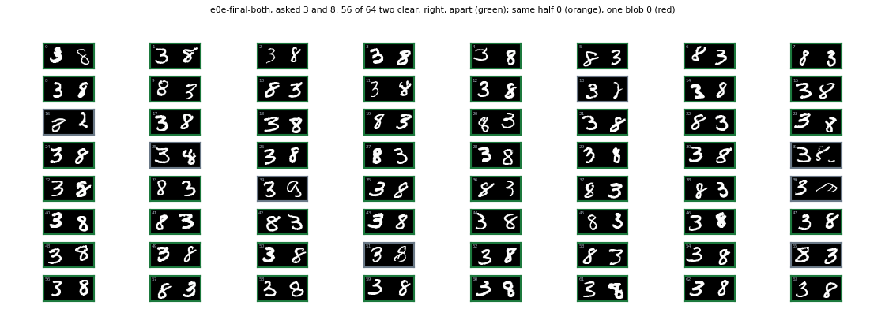

# 🧪 Results: can two digits compose on MNIST

**Two digit models trained apart now draw two clean digits on 94% of canvases, across 20 digit pairs held out of tuning, when each model works on its own known half.** Placing the two digits freely on one shared canvas is still unsolved: the best run that does this reaches 121 of 320.

The work asks one question in three stages. Each stage removes a piece of help the one before it had, so the folders are numbered in the order to read them.

<table>
<tr>
<td></td>
<td></td>
<td></td>
</tr>
<tr>
<td>Stage 1: one model, 285 of 320 by eye</td>
<td>Stage 2: two models multiplied, white blobs, 4 of 320</td>
<td>Stage 3: each on its own half, 1,200 of 1,280</td>
</tr>
</table>

## Table of contents

- [The three stages](#the-three-stages)
- [How to read these folders](#how-to-read-these-folders)
- [What is still open](#what-is-still-open)

## The three stages

Navigation: 📋 [TOC](#table-of-contents) | [Next](#how-to-read-these-folders) ➡️

**Each stage takes away something the last one relied on.**

| Stage | What the models get | Without the checker pushes | With the checker pushes |
|---|---|---|---|
| [1. One model that saw a few pairs](01-one-model-that-saw-a-few-pairs/README.md) | one model, with 1% of its training canvases holding two digits | 1 of 320 | 285 of 320 by eye, 275 by the judge |
| [2. Two models trained apart](02-two-models-trained-apart/README.md) | two models that never saw each other's digits, multiplied | 0 of 320 | 4 of 320 |
| [3. Composing the two models while sampling](03-composing-the-two-models-while-sampling/README.md) | the same two models, each given its own half, with the side chosen early and held | 1,043 of 1,280 | 1,200 of 1,280 by the judge |

> [!NOTE]
> The three rows are not one clean comparison. Stages 1 and 2 count five digit pairs at 64 canvases each, and stage 3's final row counts 20 different pairs. Read each row on its own.

## How to read these folders

Navigation: ⬅️ [The three stages](#the-three-stages) | 📋 [TOC](#table-of-contents) | [Next](#what-is-still-open) ➡️

**A number on a folder means its order is real, and an unnumbered folder is a side road nothing later depends on.** Stage 3 follows this pattern throughout:

| Inside a step | What it holds |
|---|---|
| `README.md` | the step's page: what it found, the idea, the code and its limits |
| `sheets/<setting>/digits-a-and-b.png` | 64 finished canvases for one setting and one digit pair |
| `counts/<setting>.json` | the judge's call on every canvas in that setting |
| `eye-check/` | the tiles a person or Claude called by eye, and those calls |
| `*-explainer.png` | a drawing of how the step works |

The models and raw canvases stay in `2-classifier-guidance/data/mnist-canvas/` and on the cluster. Earlier names of these folders are in `RENAMES.md`, and the move's checksums are in [the move manifest](../../../../artifacts/notes/session-closes/mnist-results-move-manifest.tsv).

## What is still open

Navigation: ⬅️ [How to read these folders](#how-to-read-these-folders) | 📋 [TOC](#table-of-contents)

**Free placement.** Stage 3's best result hides a fixed left or right half from each model, which needs the two regions known in advance. A cat and a dog in one photo do not come with that split. [The side road](03-composing-the-two-models-while-sampling/side-road-training-with-clutter/README.md) holds the closest attempt on a shared canvas.

**Whether choosing the side helps at all.** Nothing has compared the models' chosen side with a coin flip on these models, and in [step 7's example](03-composing-the-two-models-while-sampling/07-choosing-the-side-early-and-holding-it/README.md) the choice is decided by 1.59 against 1.58.

**The owner's call on the by-eye count.** Claude's calls on the 15 rejected tiles give 1,201 to 1,208 of 1,280, and they wait for the owner in [step 8](03-composing-the-two-models-while-sampling/08-final-test-on-20-unseen-pairs/README.md).

<!-- built-to: PAGE_LOOK_FORMAT v1 -->
