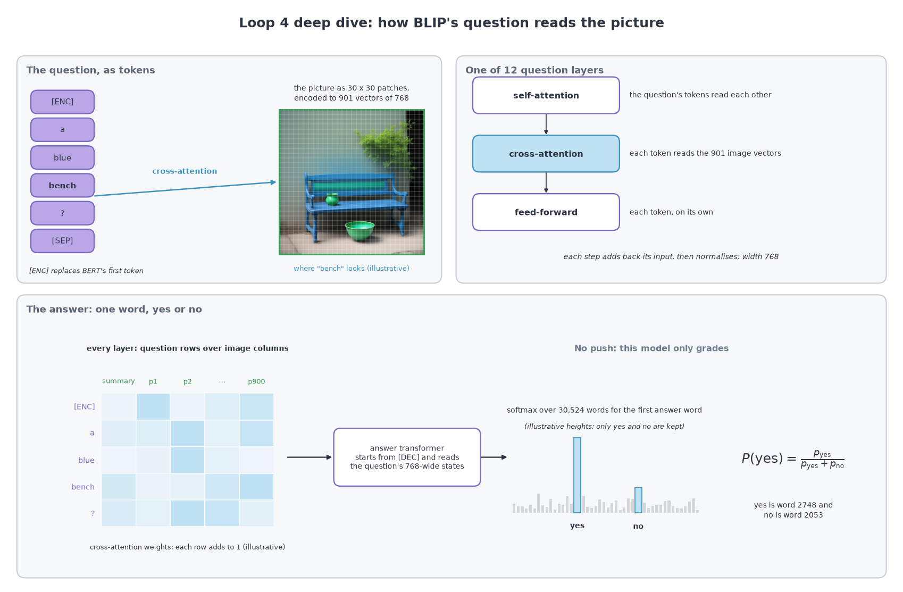
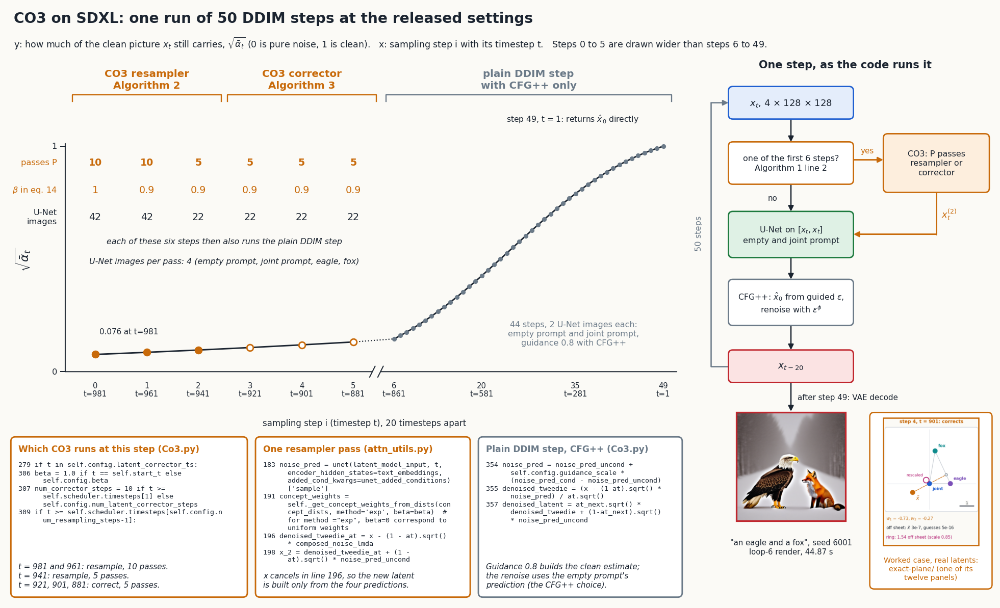
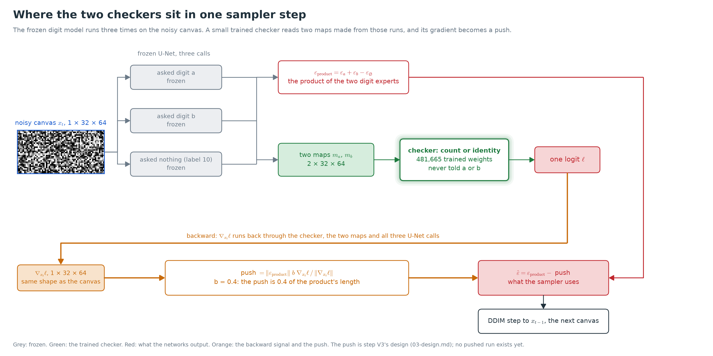
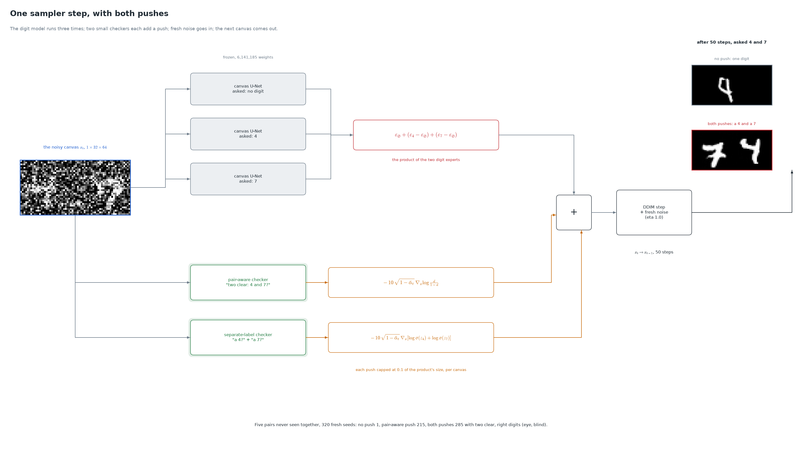
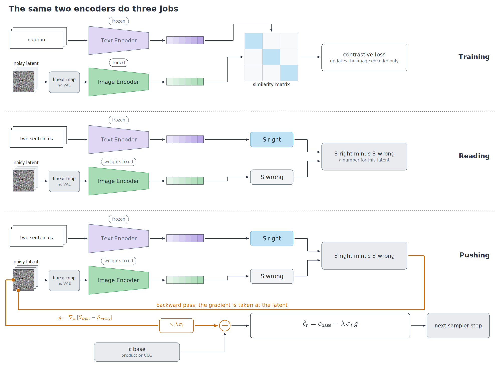
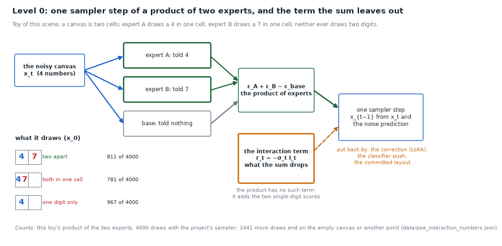
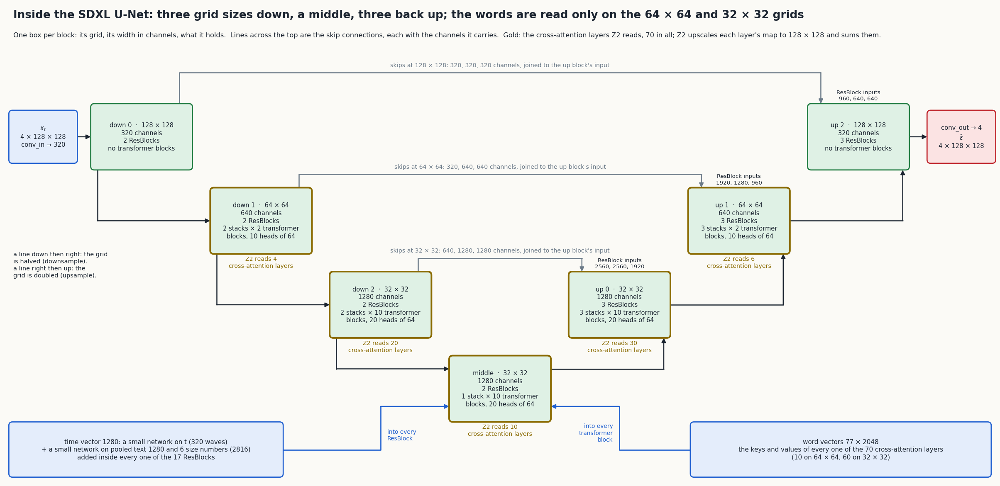
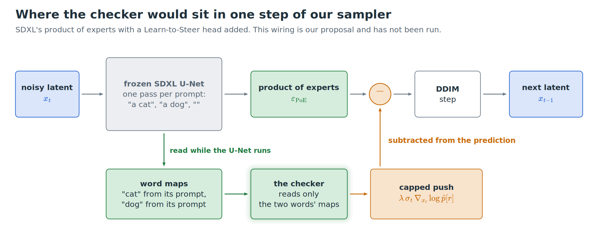

# Scenes: Classifier guidance

<!-- index: written by scripts/regroup/artifacts_index.py; edit the items, not this file -->

| Scene | What it is | Picture | Last change |
|---|---|---|---|
| [Annotated overviews of the loops' methods](annotated-overviews/README.md) | One figure per loop, each following one real picture from input to result in the annotated explainer style. |  | 2026-11-24 |
| [Classifier guidance on PoE](classifier-guidance-on-poe/README.md) | How a small trained checker pushes SDXL's product-of-experts drawing away from fused cat-dogs, in three zoom levels: one sampling step (three frozen U | — | 2026-11-19 |
| [CO3 on SDXL: a zoom ladder](co3-sampler/README.md) | This ladder explains CO3, the sampler Paper 2 improves: an annotated overview of its 50-step loop at the released settings, one figure each for the resampler, the corrector, equation 15's weights and the step schedule, and the authors' code under each equation. |  | 2026-11-24 |
| [The digit-map checkers: a zoom ladder](digit-map-checkers/README.md) | This ladder teaches the two small classifiers Loop 8 trains on noisy digit canvases: a count checker ("two digits, one in each half?") and an identity |  | 2026-11-24 |
| [Classifier guidance on MNIST digits, explained](mnist-guidance-explained/README.md) | Everything here explains step 7b (plan 24): one canvas U-Net that has seen every digit, with a pair-aware and a separate-label checker pushing the pro |  | 2026-11-22 |
| [The MNIST judge: how its explainer figures were built](mnist-judge/README.md) | This folder holds one file, the build record, for the pictures that explain the judge of route step 7b. | — | 2026-11-22 |
| [NoisyCLIP as a sentence-score push: a zoom ladder](noisyclip-sentence-score/README.md) | This ladder explains one candidate for Paper 2's abstract checkers: a noise-aware CLIP reads a half-drawn SDXL latent, scores it against a right and a |  | 2026-11-24 |
| [The product of experts and the interaction term it drops](product-of-experts-interaction-term/README.md) | The real-run pictures from the digit runs, which show the same ideas on the trained experts: the four steps of E0e, the layout flips or holds, hide th |  | 2026-11-21 |
| [SDXL from the prompt down to one attention head: a zoom ladder](sdxl-down-the-layers/README.md) | This ladder places CO3's fix and Loop 12's Z2 readings inside SDXL: the eagle and fox picture through the text encoders, U-Net and VAE; the U-Net's blocks with the 70 cross-attention layers Z2 reads; one transformer block; the noise guess and the Tweedie mean; one cross-attention head worked by hand beside the real maps. |  | 2026-11-24 |
| [The word-map spatial checker: a zoom ladder](word-map-checker/README.md) | This ladder teaches the first of Paper 2's five proposed checkers, the one that reads the spatial relation between two subjects from their word attent |  | 2026-11-23 |
