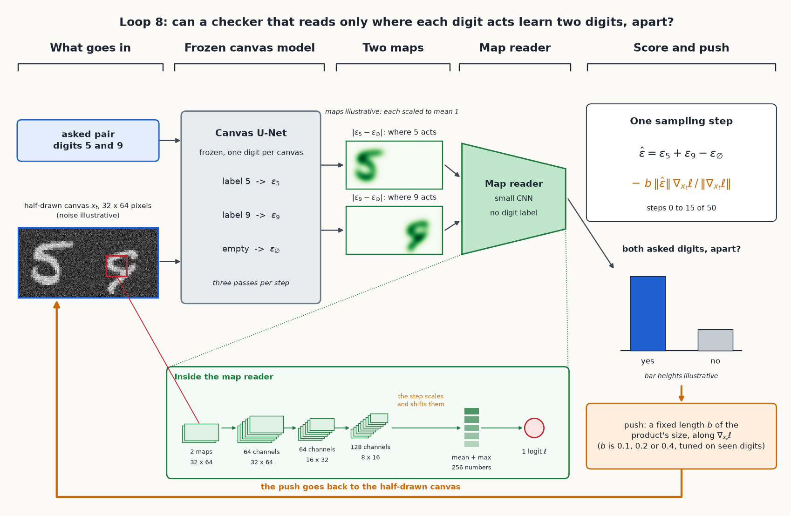
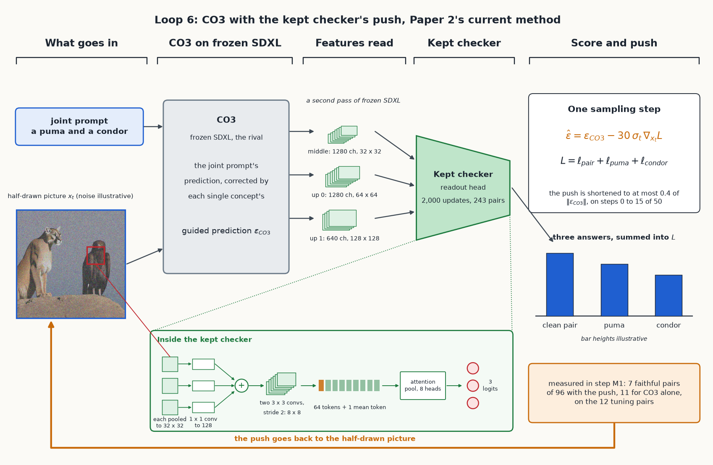
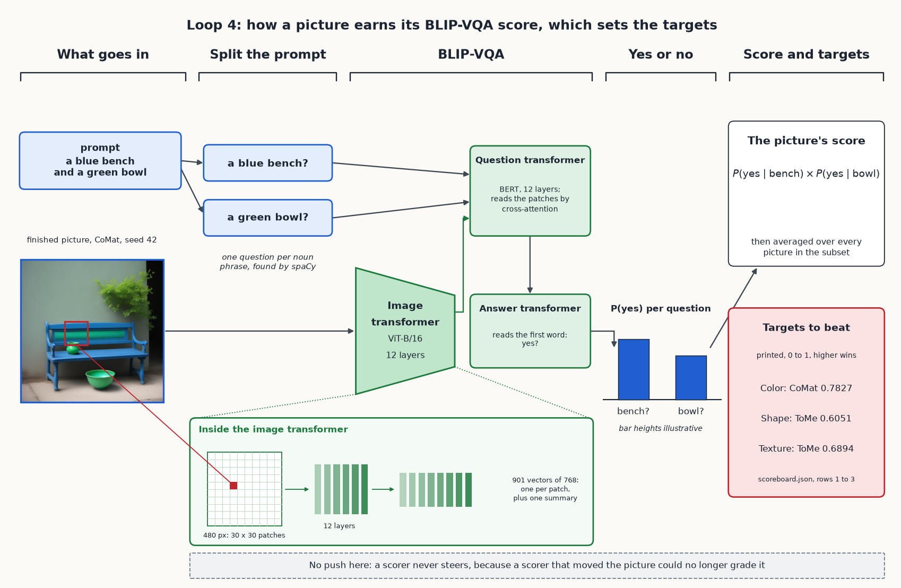

# Annotated overviews of the loops' methods

One figure per loop, each following one real picture from input to result in the annotated explainer style. Each figure's zoomed inset opens the network at the heart of that loop, with sizes read from its code. These are overview figures: deeper per-component figures can follow each one.

| Figure | What it shows |
|---|---|
| <a href="loop-8.png"></a> | **Loop 8, step V2.** An unseen canvas asked for 5 and 9 goes through the frozen canvas U-Net three times, becomes two maps of where each digit acts, and is read by a small CNN with no digit label. The inset opens that CNN: 2 maps of 32 x 64, then 64, 64 and 128 channels down to 8 x 16, mean and max pooling to 256 numbers, then one logit. The push has a fixed length tuned on seen digits. |
| <a href="loop-6.png"></a> | **Loop 6, Paper 2's current method.** A puma and condor picture goes through CO3 on frozen SDXL, and a second SDXL pass hands the middle block and up blocks 0 and 1 to the kept checker. The inset opens the checker: each tap pooled to 32 x 32 and projected to 128 channels, summed, two stride-2 convolutions to 8 x 8, 64 tokens plus one mean token, attention pooling with 8 heads, then 3 logits. The box at the lower right gives step M1's measured counts. |
| <a href="loop-4.png"></a> | **Loop 4, how a picture earns its BLIP-VQA score.** A CoMat picture for "a blue bench and a green bowl" is split into one question per noun phrase, BLIP-VQA answers each one, and the yes-probabilities multiply. The inset opens BLIP's image transformer: 480 pixels in 30 x 30 patches, 12 layers, 901 vectors of 768. The targets come from rows 1 to 3 of `artifacts/notes/progress/scoreboard.json`. |

## How these were made

Each figure is drawn by `make_overviews.py` from the devices in `~/.claude/skills/zoom-ladder/scripts/annotated_explainer.py`. Each function's docstring names the code its sizes come from. Rebuild with:

```bash
~/.claude/venvs/figures/bin/python make_overviews.py loop-8 loop-6 loop-4
```

**Sources of the pictures.** Loop 8's canvas is the fourth tile of the `apart` row in `artifacts/notes/progress/abstract-checkers/04-environment/canvas-kinds.png`. Loop 6's picture is the middle panel of `artifacts/notes/progress/method-search/01-beat-the-baseline/smoke-puma-and-condor-seed-6001.png`. Loop 4's picture is the top middle tile of `artifacts/notes/progress/reproductions/CoMat/comat-one-percent-seed42.png`.

**What is illustrative.** The noise added to the input pictures, Loop 8's two maps and every bar height are drawn to show the shape of each step. No run produced them. The real numbers are the layer sizes, step M1's counts on Loop 6's figure and the printed targets on Loop 4's figure.
