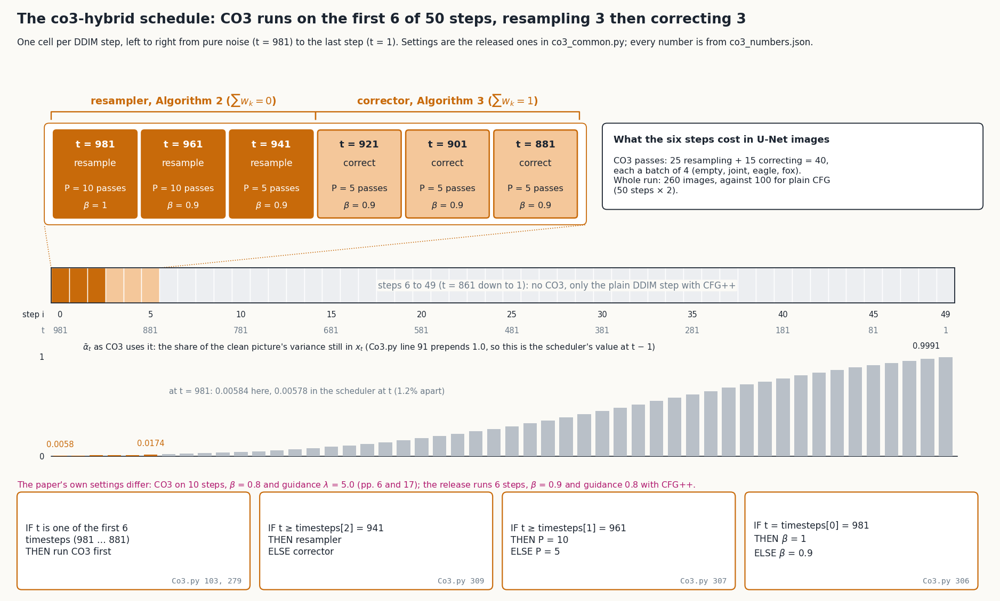
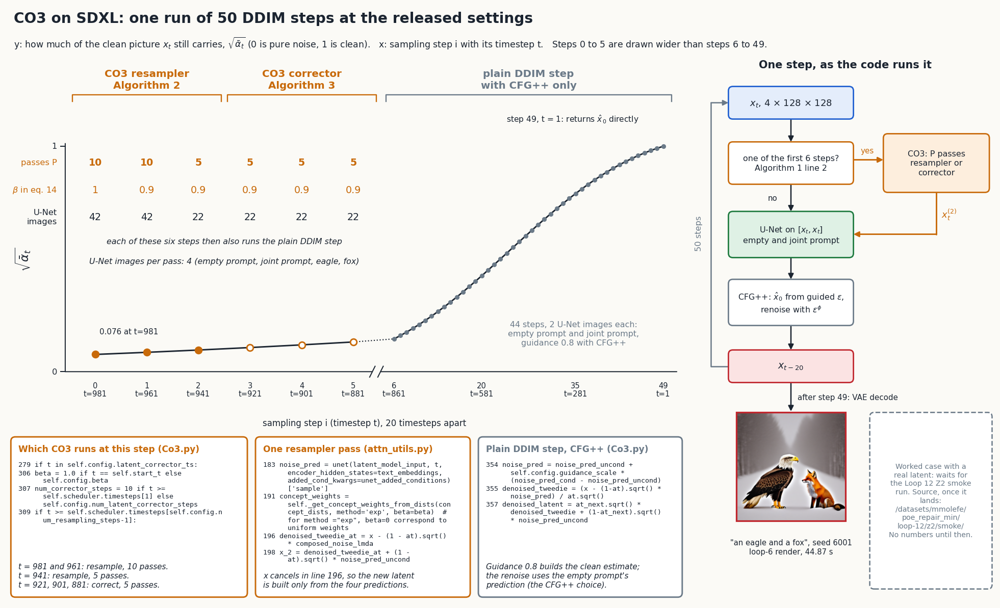
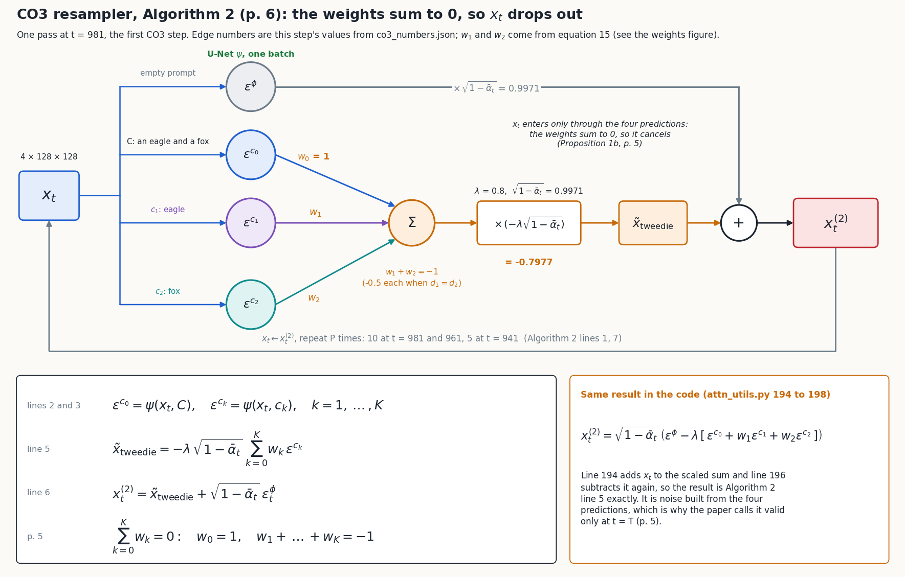
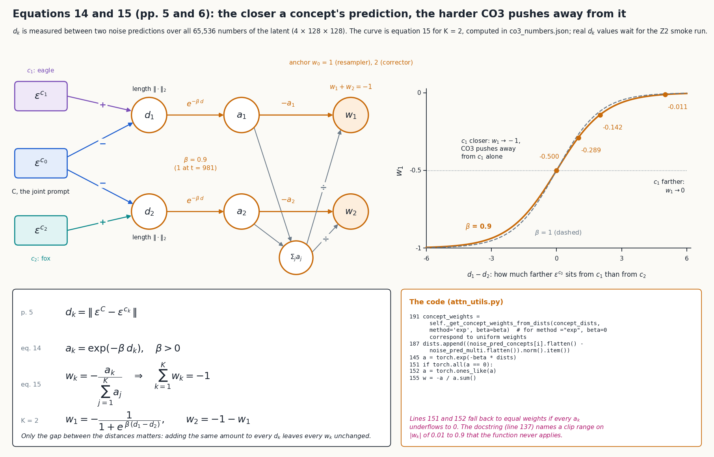
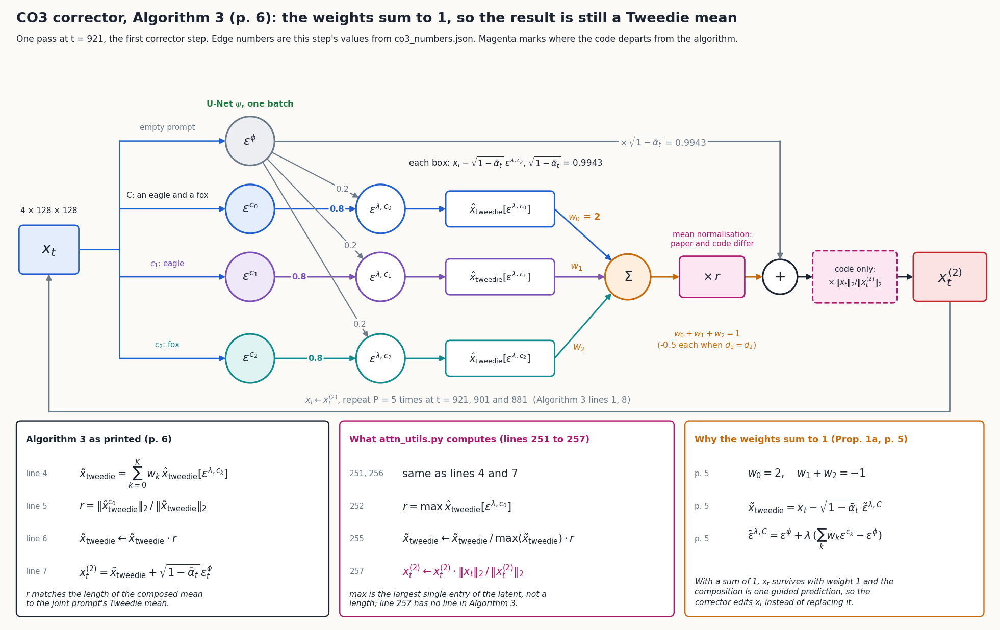

# CO3's code, line by line

The authors' code for "Steer Away From Mode Collisions" (CO3), read in the order it runs, each block of lines under the
equation it computes. It is level 3 of the CO3 ladder; the [reading page](index.md) puts it after the
[overview](co3-overview.png) and the four figures it links below.

Code: `/home/molef/PhD/replications/co3` at commit `35ea972313276014716dca3d821023728e8bc917`. Settings: the released ones the project runs,
from `co3_common.py` (guidance_scale 0.8, use_cfgpp True, n_timesteps 50, num_ts_to_correct 6, num_latent_corrector_steps 5, num_resampling_steps 3, corrector_algo co3-hybrid, modulate_comp_weights True, beta 0.9, lmda 0.8).
Written by `gen_codewalk.py`, which reads every block from the files and stops if a line has moved; every number is
from `co3_numbers.json`. Symbols are in [the notation file](NOTATION.md).

**The roles.** Sections 1, 2 and 7 are the ordinary sampler, the same for any SDXL run. Sections 3 to 6 are the
paper's own method, CO3.

## 1. Ordinary sampler: the schedule and the list of steps

**In words.** Fifty timesteps, 20 apart, from 981 down to 1, and the noise level
$\bar\alpha_t$ at each one. CO3 is switched on for the first 6 of them.

**The source.** Algorithm 1 line 1 (p. 4): $\text{for } t = T \text{ down to } 1$, with $\bar\alpha_t$ the
cumulative product of the noising schedule (p. 3).

`composers/Co3.py`, lines 85 to 91:

```python
 85 |         self.scheduler = DDIMScheduler.from_pretrained(model_key, subfolder="scheduler")
 86 |         N_ts = len(self.scheduler.timesteps)
 87 |         self.scheduler.set_timesteps(self.config.n_timesteps, device=self.unet.device)
 88 |         
 89 |         self.skip = N_ts // self.config.n_timesteps
 90 |         self.final_alpha_cumprod = self.scheduler.final_alpha_cumprod.to(self.unet.device)
 91 |         self.scheduler.alphas_cumprod = torch.cat([torch.tensor([1.0]), self.scheduler.alphas_cumprod])
```

`composers/Co3.py`, lines 99 to 103:

```python
 99 |         self.config.latent_corrector_ts = []
100 |         if self.config.perform_latent_correction:
101 |             if config.latent_corrector_type == 'Co3Corrector':
102 |                 t_cond = self.config.num_ts_to_correct
103 |                 self.config.latent_corrector_ts = self.scheduler.timesteps[:t_cond] if t_cond >= 0 else []  # self.scheduler.timesteps[:3]
```

`composers/Co3.py`, lines 200 to 202:

```python
200 |     def alpha(self, t):
201 |         at = self.scheduler.alphas_cumprod[t] if t >= 0 else self.final_alpha_cumprod
202 |         return at
```

**Symbols.** `self.scheduler.timesteps` is the list $t_0 = 981, \dots, t_{49} = 1$
(the scheduler's "leading" spacing plus an offset of 1). `self.skip` is the gap between steps, 20.
`self.alpha(t)` is $\bar\alpha_t$. `latent_corrector_ts` is the first 6 timesteps,
[981, 961, 941, 921, 901, 881].

**Exactness.** Line 91 puts 1.0 in front of the scheduler's list, so `self.alpha(t)` returns the scheduler's
$\bar\alpha$ at $t-1$. At t = 981 the code uses 0.005844 where the scheduler holds
0.005775 at t itself, 1.2% apart. The paper does not say which
index it means. Every $\bar\alpha_t$ in the figures is the code's value.

<a href="co3-schedule.png"></a>

## 2. Ordinary sampler: the loop over the 50 steps

**In words.** Start from Gaussian noise the size of one SDXL latent and call one denoising step per timestep.

**The source.** Algorithm 1 (p. 4): require $x_T$; for $t = T$ down to 1, run lines 2 to 6.

`composers/Co3.py`, lines 366 to 381:

```python
366 |     def init_sampling(self):
367 |         self.start_t = self.scheduler.timesteps[0]
368 |         self.last_t_corr = self.scheduler.timesteps[self.config.num_ts_to_correct-1] if self.config.perform_latent_correction else self.scheduler.timesteps[1]
369 |         os.makedirs(self.config.output_path_all, exist_ok=True)
370 |         
371 |     def run_sampling(self):
372 |         self.init_sampling()
373 |         normal = torch.randn(1,4,self.config.resolution_h//8,self.config.resolution_w//8).to(self.unet.device)  * self.scheduler.init_noise_sigma
374 |         image = self.sample_loop(normal)
375 |         return image
376 |     
377 |     @torch.no_grad()
378 |     def sample_loop(self, x):
379 |         with torch.autocast(device_type='cuda', dtype=torch.float16):
380 |             for i, t in enumerate(tqdm(self.scheduler.timesteps, desc="Sampling")):
381 |                 x = self.denoise_step(x, t, i)
```

**Symbols.** `normal` is $x_T$, shape 1 × 4 × 128 × 128
(65,536 numbers), drawn from a standard Gaussian and multiplied by `init_noise_sigma`, which is 1.0
for DDIM. The project draws this noise itself (`start_noise` in `co3_common.py`) so every method shares one starting
latent per seed. `self.start_t` is $t_0 = 981$, used below to pick $\beta$.

**Exactness.** The loop is Algorithm 1's loop exactly. After it, lines 383 to 415 decode the latent with the VAE.

<a href="co3-overview.png"></a>

## 3. The method: whether CO3 runs at this step, and which one

**In words.** On the first 6 steps, run CO3 on $x_t$ before the ordinary step. The first
3 of those use the resampler, the next 3 the
corrector.

**The source.** Algorithm 1 lines 2 to 4 (p. 4):

$$\text{if } t > T_c:\quad x_t^{(2)} \leftarrow \mathrm{CO3}(x_t, C, c_1, \dots, c_K),\qquad x_t \leftarrow x_t^{(2)}$$

and the hybrid rule on p. 5: resample while $t > T_R$, correct while $T_C < t < T_R$.

`composers/Co3.py`, lines 279 to 283:

```python
279 |         if t in self.config.latent_corrector_ts:
280 |             text_embed_corrector = text_embed_cond[:-1]  # Exclude the last concept for correction
281 |             text_embed_pool_corrector = text_embed_cond_pool[:-1]  # Exclude the last concept for correction
282 |             corrector_added_conditions = {"time_ids": self.add_time_ids.repeat(text_embed_corrector.shape[0], 1)}
283 |             corrector_added_conditions.update({"text_embeds": text_embed_pool_corrector})
```

`composers/Co3.py`, lines 302 to 333:

```python
302 |             elif self.config.corrector_algo == 'co3-hybrid':
303 |                 # for first 3 steps perform sum_zero resampling but only T will have 10 steps. 
304 |                 # then sum_1 correction.
305 |                 assert self.config.num_resampling_steps > 0, "num_resampling_steps should be > 0 for co3-hybrid"
306 |                 beta = 1.0 if t == self.start_t else self.config.beta
307 |                 num_corrector_steps = 10 if t >= self.scheduler.timesteps[1] else self.config.num_latent_corrector_steps
308 | 
309 |                 if t >= self.scheduler.timesteps[self.config.num_resampling_steps-1]:  
310 |                     print(f"resampling step at t={t.item()}")
311 |                     # if t == self.start_t or t==self.scheduler.timesteps[1]: # 10 steps at T and T-1
312 |                     x, _ = self.latentCorrector.co3_resampling(num_corrector_steps=num_corrector_steps, 
313 |                             text_embeddings=text_embed_corrector, 
314 |                             unet=self.unet, x=x, 
315 |                             unet_added_conditions=corrector_added_conditions, 
316 |                             t=t,
317 |                             at=at, add_time_ids=self.add_time_ids,
318 |                             step_size=1.0,
319 |                             beta=beta
320 |                             )
321 | 
322 |                 else:
323 |                     print(f"correction step at t={t.item()}")
324 |                     x, _ = self.latentCorrector.co3_corrector(num_corrector_steps=num_corrector_steps, 
325 |                             text_embeddings=text_embed_corrector, 
326 |                             unet=self.unet, x=x, 
327 |                             unet_added_conditions=corrector_added_conditions, 
328 |                             t=t,
329 |                             at=at, add_time_ids=self.add_time_ids,
330 |                             step_size=1.0,
331 |                             beta=beta
332 |                             )  
333 |             
```

**Symbols.** `text_embed_corrector` holds four prompt encodings in this order: "(empty prompt)", "an eagle and a fox", "eagle", "fox".
The release appends the full prompt once more at the end of its prompt string, and line 280 drops that last copy.
`num_corrector_steps` is $P$, the number of passes. `beta` is $\beta$ in equation 14.

**What the branch decides**, computed in `co3_numbers.json` and matching the run log
`source/run-log-excerpt-l6-m1-p2-93468.txt` line for line:

| step | t | CO3 | passes P | $\beta$ |
|---|---|---|---|---|
| 0 | 981 | resampler | 10 | 1 |
| 1 | 961 | resampler | 10 | 0.9 |
| 2 | 941 | resampler | 5 | 0.9 |
| 3 | 921 | corrector | 5 | 0.9 |
| 4 | 901 | corrector | 5 | 0.9 |
| 5 | 881 | corrector | 5 | 0.9 |

**Exactness.** This is the paper's hybrid with $T_R$ and $T_C$ set by step count. The comment on line 303 says only
$T$ gets 10 passes; line 307 gives 10 to both t = 981 and t = 961.

<a href="co3-schedule.png"></a>

## 4. The method: the resampler, weights summing to 0

**In words.** Ask the U-Net for four noise predictions at the same $x_t$, add the joint prompt's prediction and
subtract a weighted share of each concept's, scale that onto the noise level, and add the empty prompt's prediction
back. The old $x_t$ cancels, so the new latent is noise built from the predictions alone.

**The source.** Algorithm 2 (p. 6):

$$\epsilon^{c_0} = \psi(x_t, C),\quad \epsilon^{c_k} = \psi(x_t, c_k)$$
$$\tilde{x}_{\mathrm{tweedie}} = -\lambda\sqrt{1-\bar\alpha_t}\sum_{k=0}^{K} w_k\,\epsilon^{c_k},\qquad
x_t^{(2)} = \tilde{x}_{\mathrm{tweedie}} + \sqrt{1-\bar\alpha_t}\,\epsilon^{\phi}_t$$

with $\sum_k w_k = 0$ and $w_0 = 1$ (p. 5).

`composers/utils/attn_utils.py`, lines 170 to 177:

```python
170 |         iteration = 0
171 |         num_concepts = len(text_embeddings[2:])
172 |         intermediates = None
173 |         dists = []
174 | 
175 |         # Define composition weights here
176 |         concept_weights = [-1.0/num_concepts]*num_concepts
177 |         composition_weights = [1.0] + concept_weights #[-1.0/num_concepts]*num_concepts # \sum = 0 weights
```

Lines 176 and 177 start from equal weights: $w_0 = 1$ and $w_k = -0.5$ for
the K = 2 concepts, sum 0.

`composers/utils/attn_utils.py`, lines 179 to 185:

```python
179 |         while iteration < num_corrector_steps:
180 |             iteration += 1
181 |             unet.zero_grad()
182 |             latent_model_input = torch.cat([x] * (num_concepts + 2))  # Concatenate for uncond, multi, and concepts
183 |             noise_pred = unet(latent_model_input, t, encoder_hidden_states=text_embeddings, added_cond_kwargs=unet_added_conditions)['sample']
184 |             noise_pred_uncond, noise_pred_multi = noise_pred[:1], noise_pred[1:2]
185 |             noise_pred_concepts = noise_pred[2:]
```

Algorithm 2 lines 1 to 3: one U-Net call on a batch of 4 copies of $x_t$, giving $\epsilon^{\phi}$
(`noise_pred_uncond`), $\epsilon^{c_0}$ (`noise_pred_multi`) and $\epsilon^{c_1}, \epsilon^{c_2}$
(`noise_pred_concepts`), each 1 × 4 × 128 × 128.

`composers/utils/attn_utils.py`, lines 186 to 192:

```python
186 |             for i in range(num_concepts):
187 |                 dists.append((noise_pred_concepts[i].flatten() - noise_pred_multi.flatten()).norm().item())
188 | 
189 |             if self.modulate_comp_weights:
190 |                 concept_dists = torch.tensor(dists)
191 |                 concept_weights = self._get_concept_weights_from_dists(concept_dists, method='exp', beta=beta)  # for method ="exp", beta=0 correspond to uniform weights
192 |                 composition_weights = [1.0] + concept_weights.tolist()
```

Equations 14 and 15, recomputed on every pass from that pass's predictions (section 5).

`composers/utils/attn_utils.py`, lines 194 to 200:

```python
194 |             composed_noise_lmda = self._get_sumzero_tweedie_composed_noise(x, noise_pred_multi, noise_pred_concepts, composition_weights, at, lmda=self.lmda)
195 |             # intermediate latent 1 (= at.sqrt() * denoised_tweedie)
196 |             denoised_tweedie_at = x - (1 - at).sqrt() * composed_noise_lmda
197 |             # Manifold aware noise addition
198 |             x_2 = denoised_tweedie_at + (1 - at).sqrt() * noise_pred_uncond
199 | 
200 |             x = x_2
```

`composers/utils/attn_utils.py`, lines 67 to 84:

```python
 67 |     def _get_sumzero_tweedie_composed_noise(self, x, noise_pred_multi, noise_pred_concepts, weights, alpha_t, lmda=1.0):
 68 |         """ 
 69 |             sum_zero composing.
 70 |         """
 71 |         assert len(weights) == len(noise_pred_multi) + len(noise_pred_concepts), f"weights length {len(weights)} does not match number of concepts {len(noise_pred_concepts)} and multi {len(noise_pred_multi)}"
 72 | 
 73 |         num_concepts = len(noise_pred_concepts)
 74 |         composed_noise = 0
 75 | 
 76 |         # composed_noise = composed_noise + num_concepts * noise_pred_multi
 77 |         composed_noise = composed_noise + weights[0] * noise_pred_multi
 78 |         for cc in range(num_concepts):
 79 |             composed_noise = composed_noise + weights[cc+1] * noise_pred_concepts[cc]
 80 |         if self.use_cfg_corrector:
 81 |             composed_noise = lmda * composed_noise
 82 | 
 83 |         composed_noise = (x + (1-alpha_t).sqrt() * composed_noise) / (1-alpha_t).sqrt()
 84 |         return composed_noise
```

**Exactness.** The helper returns $(x_t + \sqrt{1-\bar\alpha_t}\,\lambda\sum_k w_k\epsilon^{c_k})/\sqrt{1-\bar\alpha_t}$,
and line 196 computes $x_t - \sqrt{1-\bar\alpha_t}$ times that, which is
$-\lambda\sqrt{1-\bar\alpha_t}\sum_k w_k\epsilon^{c_k}$: Algorithm 2 line 5 exactly, up to rounding in half
precision. Line 198 is line 6 and line 200 is line 7. At t = 981, $\lambda$ = 0.8 and
$\sqrt{1-\bar\alpha_t}$ = 0.9971. $\lambda$ here is `self.lmda`, a different
number from the ordinary step's guidance scale.

<a href="co3-resampler.png"></a>

## 5. The method: the concept weights of equation 15

**In words.** Measure how far each concept's prediction sits from the joint prompt's, turn each distance into an
affinity that shrinks as the distance grows, and share a total weight of $-1$ among the concepts by affinity. The
closest concept gets the most negative weight, so CO3 pushes hardest away from it.

**The source.** p. 5 and equations 14 and 15 (pp. 5 and 6):

$$d_k = \lVert \epsilon^{C} - \epsilon^{c_k} \rVert,\qquad a_k = \exp(-\beta\, d_k),\qquad
w_k = -\frac{a_k}{\sum_{j=1}^{K} a_j}$$

`composers/utils/attn_utils.py`, lines 118 to 156:

```python
118 |     @staticmethod
119 |     def _get_concept_weights_from_dists(
120 |         dists: torch.Tensor,
121 |         method: str = 'exp',    # 'exp' or 'invpow'
122 |         beta: float = 1.0,     # for 'exp'
123 |         p: float = 2.0,         # for 'invpow'
124 |         eps: float = 1e-6,
125 |         w_min_mag: float = 0.01,
126 |         w_max_mag: float = 0.9,
127 |     ) -> torch.Tensor:
128 |         """
129 |         Compute adaptive concept weights based on distances.
130 |         
131 |         Args:
132 |             dists: 1D tensor of distances [K]
133 |             method: 'exp' or 'invpow'
134 |             beta: sensitivity for exp kernel
135 |             p: exponent for invpow kernel
136 |             eps: small constant for stability
137 |             w_min_mag, w_max_mag: clipping range on |weights|
138 |         
139 |         Returns:
140 |             weights: 1D tensor [K], negative, sum = -1
141 |         """
142 |         dists = dists.float()
143 | 
144 |         if method == 'exp':
145 |             a = torch.exp(-beta * dists)
146 |         elif method == 'invpow':
147 |             a = 1.0 / (torch.pow(dists + eps, p))
148 |         else:
149 |             raise ValueError("method must be 'exp' or 'invpow'")
150 | 
151 |         if torch.all(a == 0):
152 |             a = torch.ones_like(a)
153 | 
154 |         # Normalize to sum to -1
155 |         w = -a / a.sum()
156 |         return w
```

**Symbols.** `dists` is $(d_1, \dots, d_K)$, each the length of the difference between two predictions over all
65,536 numbers of the latent (lines 187 and 243). `beta` is $\beta$: 1 at
t = 981 and 0.9 afterwards (section 3).

**Exactness.** Line 145 is equation 14 and line 155 is equation 15. With two concepts the weight depends only on the
gap: $w_1 = -1/(1 + e^{\beta (d_1 - d_2)})$. At $\beta$ = 0.9 a gap of 1 gives $w_1$ =
-0.289, a gap of 2 gives -0.142 and a gap of 5
gives -0.011. Lines 151 and 152, not in the paper, fall back to equal weights if
every affinity underflows to 0. The docstring (line 137) names a clip range on $|w_k|$ of 0.01 to 0.9 that the
function never applies.

<a href="co3-weights.png"></a>

## 6. The method: the corrector, weights summing to 1

**In words.** Guide each prediction with the empty prompt's, form each one's Tweedie mean, add the joint prompt's
mean twice and subtract a weighted share of each concept's, rescale, and add the empty prompt's prediction back at the
noise level. The weights sum to 1, so $x_t$ survives and the corrector edits it.

**The source.** Algorithm 3 (p. 6), with $\epsilon^{\lambda,c} = \epsilon^{\phi} + \lambda(\epsilon^{c} - \epsilon^{\phi})$
(equation 4, p. 3) and $\hat{x}_{\mathrm{tweedie}}[\epsilon] = x_t - \sqrt{1-\bar\alpha_t}\,\epsilon$ (p. 3):

$$\tilde{x}_{\mathrm{tweedie}} = \sum_{k=0}^{K} w_k\,\hat{x}_{\mathrm{tweedie}}[\epsilon^{\lambda,c_k}],\qquad
r = \frac{\lVert \hat{x}^{c_0}_{\mathrm{tweedie}} \rVert_2}{\lVert \tilde{x}_{\mathrm{tweedie}} \rVert_2},\qquad
\tilde{x}_{\mathrm{tweedie}} \leftarrow r\,\tilde{x}_{\mathrm{tweedie}},\qquad
x_t^{(2)} = \tilde{x}_{\mathrm{tweedie}} + \sqrt{1-\bar\alpha_t}\,\epsilon^{\phi}_t$$

with $\sum_k w_k = 1$ and $w_0 = 2$ (p. 5).

`composers/utils/attn_utils.py`, lines 226 to 233:

```python
226 |         iteration = 0
227 |         num_concepts = len(text_embeddings[2:])
228 |         intermediates = None
229 |         dists = []
230 |         
231 |         # Define composition weights here
232 |         concept_weights = [-1.0/num_concepts]*num_concepts
233 |         composition_weights = [2.0] + concept_weights # \sum = 0 weights
```

$w_0 = 2$ and $w_k = -0.5$, sum 1. The comment on line
233 says the weights sum to 0; they sum to 1.

`composers/utils/attn_utils.py`, lines 235 to 249:

```python
235 |         while iteration < num_corrector_steps:
236 |             iteration += 1
237 |             unet.zero_grad()
238 |             latent_model_input = torch.cat([x] * (num_concepts + 2))  # Concatenate for uncond, multi, and concepts
239 |             noise_pred = unet(latent_model_input, t, encoder_hidden_states=text_embeddings, added_cond_kwargs=unet_added_conditions)['sample']
240 |             noise_pred_uncond, noise_pred_multi = noise_pred[:1], noise_pred[1:2]
241 |             noise_pred_concepts = noise_pred[2:]
242 |             for i in range(num_concepts):
243 |                 dists.append((noise_pred_concepts[i].flatten() - noise_pred_multi.flatten()).norm().item())
244 | 
245 | 
246 |             if self.modulate_comp_weights:
247 |                 concept_dists = torch.tensor(dists)
248 |                 concept_weights = self._get_concept_weights_from_dists(concept_dists, method='exp', beta=beta) # for method ="exp", beta=0 correspond to uniform weights
249 |                 composition_weights = [2.0] + concept_weights.tolist()
```

Algorithm 3 lines 1 to 3, then equations 14 and 15, the same as the resampler.

`composers/utils/attn_utils.py`, lines 251 to 258:

```python
251 |             composed_tweedie = self._get_contrastive_tweedie(x, noise_pred_multi, noise_pred_uncond, noise_pred_concepts, composition_weights, at, lmda=self.lmda)
252 |             r = (x  - (noise_pred_uncond + self.lmda * (noise_pred_multi - noise_pred_uncond)) * (1 - at).sqrt()).max() #at.sqrt() * x.max()
253 |             
254 |             #! normalized 
255 |             composed_tweedie = composed_tweedie / composed_tweedie.max() * r
256 |             x_2 = composed_tweedie + (1-at).sqrt() * noise_pred_uncond #noise_pred_multi
257 |             x_2 = x_2 * (x.norm()/ x_2.norm())
258 |             x = x_2
```

`composers/utils/attn_utils.py`, lines 99 to 115:

```python
 99 |     def _get_contrastive_tweedie(self, x, noise_pred_multi, noise_pred_uncond, noise_pred_concepts, weights, alpha_t, lmda=1.0):
100 |         """ Order of weights should be [multi, concept1, concept2, ..., conceptN]
101 |         """
102 | 
103 |         assert len(weights) == len(noise_pred_multi) + len(noise_pred_concepts), f"weights length {len(weights)} does not match number of concepts {len(noise_pred_concepts)} and multi {len(noise_pred_multi)}"
104 | 
105 | 
106 |         num_concepts = len(noise_pred_concepts)
107 |         noise_pred = noise_pred_uncond + lmda * (noise_pred_multi - noise_pred_uncond)
108 |         tweedie_multi = x - (1 - alpha_t).sqrt() * noise_pred
109 |  
110 |         tweedie_multi = weights[0] * tweedie_multi 
111 |         for i in range(num_concepts):
112 |             noise_pred_single = noise_pred_uncond + lmda * (noise_pred_concepts[i:i+1] - noise_pred_uncond)
113 |             tweedie_single = x - (1 - alpha_t).sqrt() * noise_pred_single
114 |             tweedie_multi = tweedie_multi + weights[i+1] * tweedie_single  # concept weights start from index 1. And we are summing because weights are negative for concepts
115 |         return tweedie_multi
```

**Exactness.** The helper (lines 99 to 115) is Algorithm 3 line 4 exactly, and line 256 is line 7. Lines 252 and 255
differ from lines 5 and 6: the code sets $r$ to the largest single entry of the joint prompt's Tweedie mean and divides
the composed mean by its own largest entry before multiplying by $r$, so it matches the largest entries where the paper
matches the lengths. Line 257 has no line in Algorithm 3: it rescales $x_t^{(2)}$ to the length of the incoming
$x_t$. At t = 921, $\sqrt{1-\bar\alpha_t}$ = 0.9943.

<a href="co3-corrector.png"></a>

## 7. Ordinary sampler: one DDIM step with CFG++

**In words.** Ask the U-Net for the empty prompt's and the joint prompt's predictions, mix them with guidance
0.8, estimate the clean latent, and step to the next timestep. The renoise uses the empty prompt's
prediction, which is what CFG++ changes about ordinary guidance.

**The source.** Equations 4 to 6 (p. 3):

$$\epsilon^{\lambda,c}_t = \lambda\,\epsilon_\theta(x_t, c, t) + (1-\lambda)\,\epsilon_\theta(x_t, \varnothing, t),\qquad
\hat{x}_0 = \frac{x_t - \sqrt{1-\bar\alpha_t}\,\epsilon^{\lambda,c}_t}{\sqrt{\bar\alpha_t}},\qquad
x_{t-1} = \sqrt{\bar\alpha_{t-1}}\,\hat{x}_0 + \sqrt{1-\bar\alpha_{t-1}}\,\epsilon^{\lambda,c}_t$$

`composers/Co3.py`, lines 263 to 277:

```python
263 |         text_embed_cond,text_embed_cond_pool=self.text_embeds
264 | 
265 |         next_t = t - self.skip
266 |         at = self.alpha(t)
267 |         at_next = self.alpha(next_t)
268 | 
269 |         sizes = x.shape
270 |         log_step  = int(1000 - t.item())
271 |            
272 | 
273 |         text_embed_uncond = text_embed_cond[0].unsqueeze(0)
274 |         text_embed_multi = text_embed_cond[1].unsqueeze(0)
275 | 
276 |         text_embed_uncond_pool = text_embed_cond_pool[0].unsqueeze(0)
277 |         text_embed_multi_pool = text_embed_cond_pool[1].unsqueeze(0)
```

`composers/Co3.py`, lines 338 to 364:

```python
338 |         latent_model_input = torch.cat([x]+[x])
339 |         text_embed = torch.cat([ text_embed_uncond
340 |                             ,text_embed_multi], dim=0)
341 |         text_embed_pool = torch.cat([text_embed_uncond_pool
342 |                             ,text_embed_multi_pool], dim=0)
343 | 
344 |         unet_added_conditions = {"time_ids": self.add_time_ids.repeat(text_embed.shape[0], 1)}
345 |         unet_added_conditions.update({"text_embeds": text_embed_pool})
346 | 
347 |         # with torch.no_grad():
348 |         noise_pred = self.unet(latent_model_input, t, encoder_hidden_states=text_embed,added_cond_kwargs=unet_added_conditions)['sample']
349 |         
350 |         noise_pred_uncond = noise_pred[:1]
351 |         # ------------------------------
352 |         
353 |         noise_pred_cond = noise_pred[1:2]
354 |         noise_pred = noise_pred_uncond + self.config.guidance_scale * (noise_pred_cond - noise_pred_uncond)
355 |         denoised_tweedie = (x - (1-at).sqrt() * noise_pred) / at.sqrt()
356 |         if self.config.use_cfgpp:
357 |             denoised_latent = at_next.sqrt() * denoised_tweedie + (1-at_next).sqrt() * noise_pred_uncond
358 |         else:
359 |             denoised_latent = at_next.sqrt() * denoised_tweedie + (1-at_next).sqrt() * noise_pred
360 |     
361 |         if t == 1:
362 |             denoised_latent = denoised_tweedie
363 |         
364 |         return denoised_latent
```

**Symbols.** `noise_pred_uncond` is $\epsilon^{\phi}$, `noise_pred_cond` the joint prompt's prediction,
`self.config.guidance_scale` is $\lambda$ = 0.8, `at` and `at_next` are $\bar\alpha_t$ and
$\bar\alpha_{t-20}$ (the paper writes $t-1$ for the next step), `denoised_tweedie` is $\hat{x}_0$.

**Exactness.** Line 354 is equation 4 written as $\epsilon^{\phi} + \lambda(\epsilon^{c} - \epsilon^{\phi})$ and line
355 is equation 5. Line 357 differs from equation 6 by design: with `use_cfgpp` on, the renoise uses $\epsilon^{\phi}$
in place of the guided prediction. On the last step, t = 1, line 362 returns $\hat{x}_0$ directly. The paper's
experiments state guidance $\lambda$ = 5.0 with plain DDIM (p. 6); the release runs 0.8 with CFG++.

<a href="co3-overview.png"></a>

## Where the paper and the code disagree

Pages are in the PDF on the shelf, arXiv 2509.25940v2. Lines are in the checkout at commit `35ea972`.

| What | Paper | Code | Effect |
|---|---|---|---|
| Corrector's mean normalisation | Algorithm 3 lines 5 and 6 (p. 6): $r$ is a ratio of lengths, $\lVert\hat{x}^{c_0}\rVert_2 / \lVert\tilde{x}\rVert_2$ | `attn_utils.py` 252 and 255: $r$ is the largest entry of $\hat{x}^{c_0}$, and $\tilde{x}$ is divided by its own largest entry | matches peaks, where the paper matches lengths |
| Extra rescale after the corrector | not in Algorithm 3 | `attn_utils.py` 257: $x^{(2)} \leftarrow x^{(2)}\,\lVert x_t\rVert_2 / \lVert x^{(2)}\rVert_2$ | each pass keeps the latent's length |
| Guidance in the ordinary step | $\lambda$ = 5.0, plain DDIM (p. 6); equation 6 renoises with the guided prediction (p. 3) | guidance 0.8 with CFG++, renoise with $\epsilon^{\phi}$ (`Co3.py` 354 to 357; `co3_common.py`) | a different sampler from the one the paper's equations describe |
| How many steps get CO3, and $\beta$ | 10 steps, $\beta$ = 0.8 (pp. 6 and 17) | 6 steps, $\beta$ = 0.9, and 1 at t = 981 (`Co3.py` 306; `co3_common.py`) | the release's settings sit inside the paper's own ablation range (A.8, pp. 19 and 20) |
| Algorithm 1 line 6's label | "Reverse DDIM" in the v2 PDF (p. 4); the screenshot in `source/` reads "Inverse DDIM", and which version it came from is not recorded | an ordinary denoising DDIM step (`Co3.py` 354 to 362) | a label only |
| Which $\bar\alpha$ belongs to t | not stated | `Co3.py` 91 prepends 1.0, so t uses the scheduler's value at $t-1$ | 1.2% at t = 981 |
| Code comments | none | line 303 says only T gets 10 passes (line 307 gives two steps 10); line 233 says the corrector's weights sum to 0 (they sum to 1); the docstring at line 137 names a clip on $\lvert w_k\rvert$ that is never applied | comments only |

Agreements worth stating: Algorithm 2 is computed exactly (section 4), Algorithm 3 line 4 and line 7 exactly
(section 6), and equations 14 and 15 exactly (section 5). The anchors $w_0$ = 1 and
2 match p. 5.
