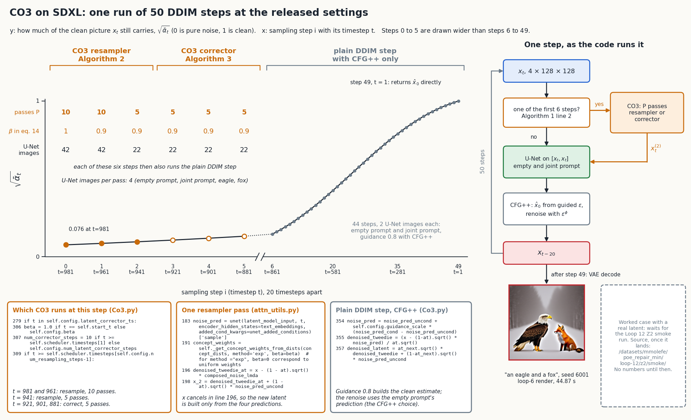
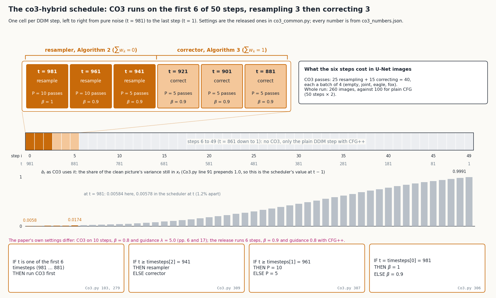
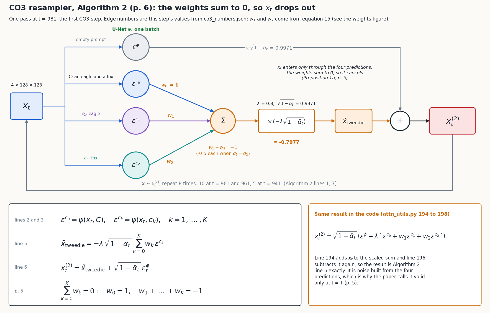
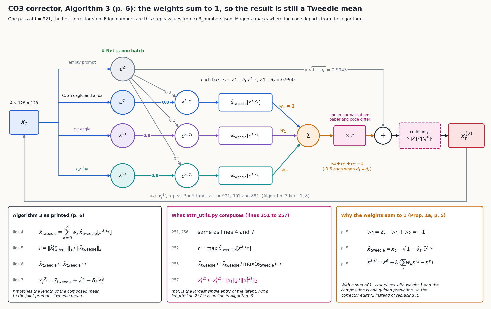
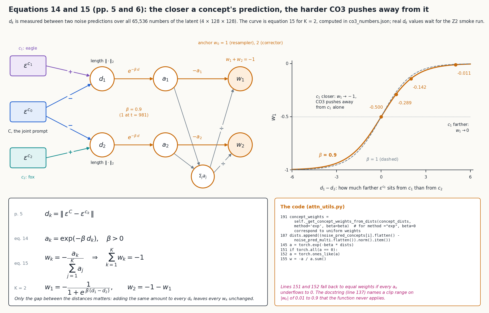

# CO3, from the whole run down to the code

CO3 ("Steer Away From Mode Collisions", Dutta et al., arXiv 2509.25940) is a sampler for prompts that name two things.
Before each of SDXL's first six denoising steps it asks the U-Net for the joint prompt's prediction and for each
concept's own, then moves the latent away from whichever concept the joint prediction sits closest to. This page reads
it in three levels: the whole run, one figure per part, and the authors' code line by line. Symbols are in
[the notation file](NOTATION.md); every number comes from `co3_numbers.json`.

## The whole run

Start from noise the size of one SDXL latent (4 × 128 × 128) and run 50 DDIM steps, from t = 981 down to t = 1. Every
step ends the ordinary way: the U-Net predicts the noise under the empty prompt and under "an eagle and a fox", the two
are mixed with guidance 0.8, and CFG++ steps to the next timestep. CO3 adds work in front of the first six steps only.
On the overview's curve those are the steps where the latent is still almost all noise: at t = 981 it carries 0.076 of
the clean picture on the $\sqrt{\bar\alpha_t}$ scale. The paper reports that resampling helps only near the start and
that the corrector's gains level off by about t = 0.75T (p. 5, Figure 2).

Those six steps split in two. At t = 981, 961 and 941 CO3 **resamples**: it throws the latent away and rebuilds it
from the four predictions, as the [resampler figure](co3-resampler.png) draws. At t = 921, 901 and 881 it **corrects**:
it edits the latent and keeps it, as the [corrector figure](co3-corrector.png) draws. How hard each pass pushes away
from each concept is set by equation 15, drawn in the [weights figure](co3-weights.png), and which step gets which
algorithm, how many passes and which $\beta$ is laid out in the [schedule figure](co3-schedule.png).

The picture at the end of the overview is the project's own CO3 render of "an eagle and a fox", seed 6001, from the
Loop 6 paper-2 run (`/datasets/mmolefe/poe_repair_min/loop-6/m1/paper-2/full/renders/co3/an_eagle__x__a_fox/`).

> [!NOTE]
> **Waiting for the Loop 12 Z2 smoke run.** A worked case with a real latent (the distances $d_1$ and $d_2$ at each
> pass, the weights they give, and the latent before and after each of the six CO3 steps) belongs here. Its source
> will be `/datasets/mmolefe/poe_repair_min/loop-12/z2/smoke/`, which did not exist on 2026-11-24. No numbers are shown
> until it lands. The project's loader sets the corrector's `verbose` to False, so the run must log `dists` and
> `weights` itself for this slot to be filled.

## One figure per part

**The schedule.** CO3 runs on 6 of the 50 steps. The first two get 10 passes each, the rest 5, for 40 passes in all,
and each pass sends 4 copies of the latent through the U-Net. The whole run costs 260 U-Net images against 100 for
plain guidance. The bars under the strip are $\bar\alpha_t$ as the code reads it, which is the scheduler's value one
timestep earlier.

**The resampler, Algorithm 2.** The weights are 1 on the joint prompt's prediction and $-0.5$ on each concept's when
the two concepts are equally close. They sum to 0, so the old latent cancels out of the result (Proposition 1b, p. 5)
and the new latent is noise built from the four predictions. That is why the paper allows it only near t = T.

**The corrector, Algorithm 3.** Each prediction is first guided with the empty prompt's ($\lambda$ = 0.8), turned into
a Tweedie mean, and the means are summed with weights 2, $w_1$, $w_2$, which sum to 1. The latent survives with weight
1, so this pass edits it. The figure's boxed rules set the printed algorithm beside what the code computes, because
the rescale step differs.

**The weights, equations 14 and 15.** Each concept's distance $d_k$ from the joint prompt's prediction becomes an
affinity $e^{-\beta d_k}$, and the concepts share a total weight of $-1$ by affinity. With two concepts only the gap
$d_1 - d_2$ matters: at $\beta$ = 0.9 a gap of 1 gives $w_1 = -0.289$ and a gap of 5 gives $-0.011$.

## The code, line by line

[The code walk](code-walk.md) reads the authors' `Co3.py` and `attn_utils.py` (commit `35ea972`) in the order they
run, each block under the equation it computes. Sections 1, 2 and 7 are the ordinary sampler; sections 3 to 6 are CO3.
It closes with a table of the seven places where the paper and the code disagree. The two that change numbers are
the corrector's rescale (the code matches largest entries where Algorithm 3 matches lengths, and then adds a second
rescale of its own) and the ordinary step (the paper reports guidance 5.0 with plain DDIM, the release runs 0.8 with
CFG++).

## Not built yet

The miniature (a small network with integer weights) and the illustrated rung were set aside by the owner, who chose
the overview, the algorithms and the code first. The [route file](route-zoom-ladder-co3.md) holds the prompt for
each. The rebuild companion and the closing page wait on the miniature.
