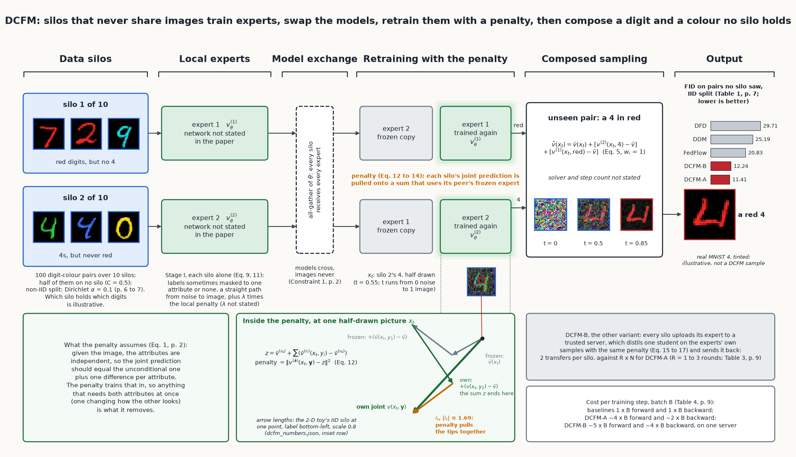

# DCFM in one picture

DCFM (Morshed and Boddeti, arXiv 2606.10153, ICML 2026) trains generators in data silos that may never share an image, and then asks
for attribute combinations no silo holds, such as a red 4 when one silo has only red digits that are not 4s and another has only 4s
that are not red. This page is the ladder's top rung: one picture followed through the method's six stages, from the silos that hold
the attributes to the composed output.

The full picture is [the overview figure](figures/00-overview.png) (also as [SVG](figures/00-overview.svg)), drawn by
[the overview script](make_overview.py) from [the numbers file](dcfm_numbers.json).

## What to read in it, stage by stage

**Data silos.** Two of Colored MNIST's 10 silos. The digits are real MNIST test images tinted; which silo holds which digits is
illustrative, since the paper splits 100 digit-colour pairs over 10 silos with half of them on no silo (𝒞 = 0.5) and a Dirichlet split
with α = 0.1 for the non-IID case (p. 6 to 7). Opened in [figure 01a](01-the-network-view.md#stage-i-one-silo-trains-alone).

**Local experts.** Each silo trains its own flow model on its own images, with labels sometimes cut to one attribute or none (Eq. 8 to 9),
and with the local penalty (Eq. 10 to 11). The network is not stated in the paper, so the box says so.

**Model exchange.** An all-gather: every silo receives every other silo's trained expert. Models cross; images never do (Constraint 1,
p. 2). The DCFM-B card in the bottom right gives the other route, through a trusted server. Opened in
[figure 01d](01-the-network-view.md#what-crosses-between-silos-and-when).

**Retraining with the penalty.** DCFM-A: each silo trains its own expert again (green, glowing) while a copy of its peer's expert stays
frozen (grey). The penalty pulls the silo's joint prediction onto a sum built partly from the frozen peer (Eq. 12 to 14). The traced
window follows silo 2's 4, half drawn, down into the inset.

**The inset: inside the penalty.** At one half-drawn picture, velocities are added tip to tail: the unconditional one, then one
difference per attribute. The sum ends at z. The silo's own joint prediction ends elsewhere, and the orange arrow between the two tips
is I_t, which the penalty pulls to zero. The arrow lengths are the 2-D toy's numbers at one point (|I_t| = 1.69), scaled; the figure
says so. Opened in [figure 01c](01-the-network-view.md#the-penalty-one-network-called-four-times).

**Composed sampling.** Asked for a 4 in red, the sampler follows the sum rule (Eq. 5 with w_i = 1): silo 2's expert supplies "4",
silo 1's supplies "red". The strip shows a picture moving from noise at t = 0 toward the image at t = 1. Opened in
[figure 01b](01-the-network-view.md#the-sum-rule-velocities-added-tip-to-tail).

**Output.** The red 4 is a real MNIST 4, tinted, and labelled illustrative: it is not a DCFM sample. The bars beside it are printed
numbers: FID on digit-colour pairs no silo saw, IID split, Table 1 (p. 7), lower is better: DFD 29.71, DDM 25.19, FedFlow 20.83,
DCFM-B 12.24, DCFM-A 11.41.

**Bottom left: what the penalty assumes.** Given the image, the attributes are independent (Eq. 1). The penalty trains that in, so it
removes whatever needs both attributes at once.

## Where to go next

The [network view](01-the-network-view.md) opens each stage. The [maths page](02-the-maths-step-by-step.md) takes every equation one at a
time, and [the toy](03-the-toy.md) runs the method on DCFM's own two-dimensional example. [The closing page](README.md) reads the
whole method through the toy.
