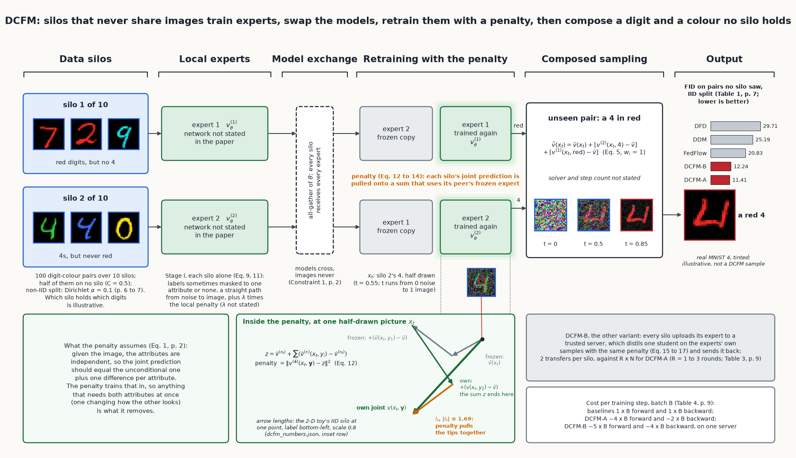
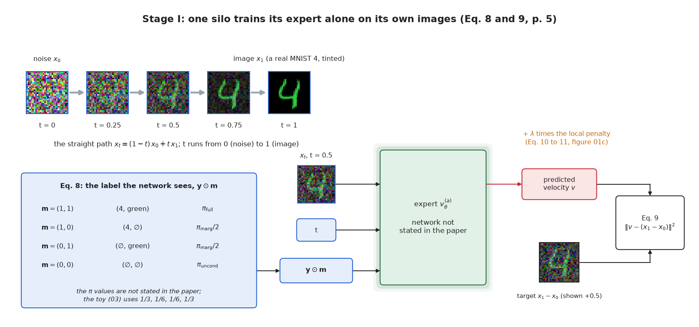
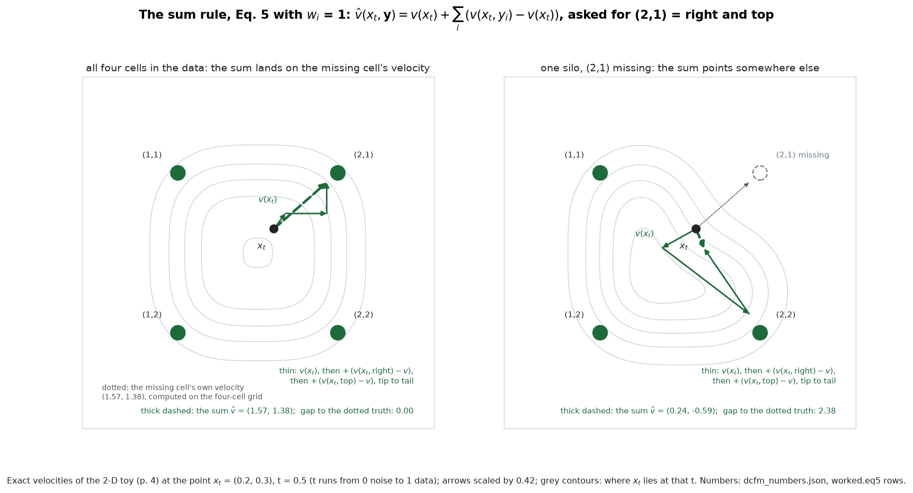
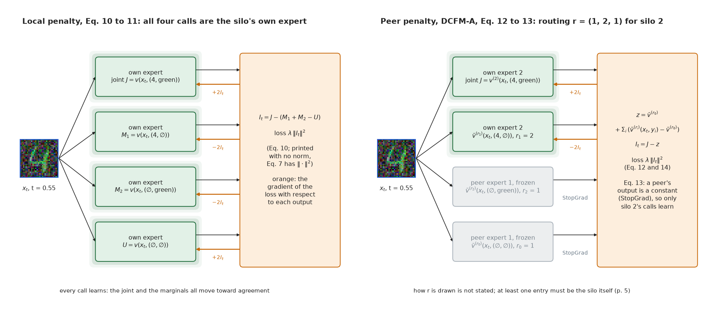
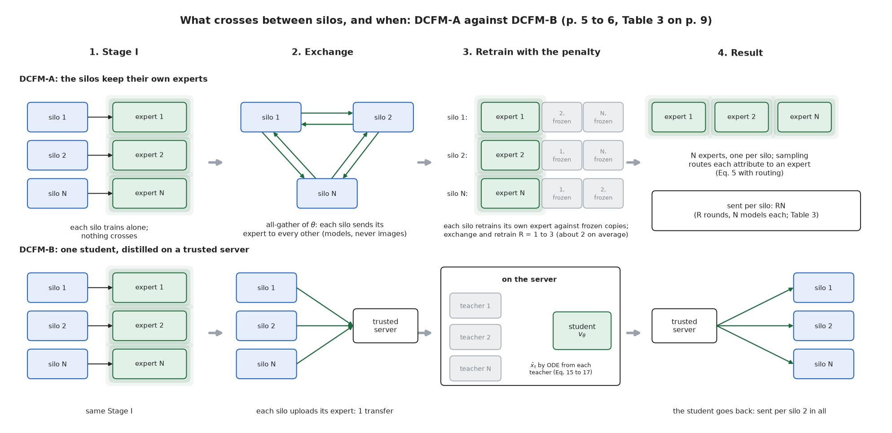

# DCFM's network view: each stage of the overview, opened

Four figures, each opening one part of [the overview](00-the-overview.md), in the clean cheat-sheet register: thin outlines, a soft glow
on the part the figure is about, faded grey for what is frozen. The colours follow [the shared notation](NOTATION.md): blue inputs, green
experts, red outputs, orange for I_t and the penalty's gradient, grey for frozen. A network whose architecture the paper does not state
is drawn as a box that says so, never with invented layers. All four are drawn by [the network-view script](make_network_view.py) from
[the numbers file](dcfm_numbers.json); each has an SVG beside its PNG.

## Stage I: one silo trains alone

This opens the overview's "Local experts" stage (Eq. 8 to 9, p. 5). The top strip is the straight path x_t = (1 − t) x_0 + t x_1, with t
running from 0 (noise) to 1 (image). The network sees the half-made picture, the time and a label that is whole, cut to one attribute,
or empty, with probabilities π_full, π_marg/2, π_marg/2 and π_uncond; the paper does not state those values. Its output is compared with
the straight line from that noise to that image, x_1 − x_0. The one-attribute labels matter later: the sum rule needs v(x_t, 4) and
v(x_t, red) on their own, and a network that never saw a cut label would not have learned them.

## The sum rule: velocities added tip to tail

This opens "Composed sampling" (Eq. 5, p. 3), drawn as the guidance family's vector sum on the 2-D toy at one point, t = 0.5. Thin green
arrows are the unconditional velocity and the two differences, added tip to tail; the thick dashed arrow is their sum v̂; the dotted
arrow is the velocity the missing cell (2, 1) would have. When all four cells are in the data, the sum lands on it exactly
(1.57, 1.38), gap 0.00. On a silo that never held (2, 1), the same rule gives (0.24, −0.59), a gap of 2.38. The rule is only as good as
the single-attribute velocities it adds, and those come from data where "right" only ever appeared at the bottom.

## The penalty: one network called four times

This opens "Retraining with the penalty" and the overview's inset (Eq. 10, p. 5, and Eq. 12 to 13, p. 5). Left: the local penalty calls
the silo's own expert four times on the same half-made picture, forms I_t = J − (M_1 + M_2 − U), and sends the gradient of λ_CI |I_t|²
back into all four calls: +2I_t into the joint and unconditional calls, −2I_t into the two single-attribute calls. So the joint and the
marginals all move toward agreement. Right: the peer penalty of DCFM-A routes some calls to a frozen copy of another silo's expert. Those
calls get no gradient (StopGrad, Eq. 13), so silo 2 must make its own joint prediction agree with a sum its peer helps build. How the
routing r is drawn is not stated; at least one entry must be the silo itself.

## What crosses between silos, and when

This opens "Model exchange" and the DCFM-B card (Eq. 14 against Eq. 15 to 17, pp. 5 to 6; Table 3, p. 9). In DCFM-A every silo sends its
expert to every other, retrains its own against frozen copies, and repeats R = 1 to 3 times (about 2 on average), which costs RN
transfers per silo and leaves N experts that are composed by routing. In DCFM-B every silo uploads its expert once to a trusted server.
The server makes half-drawn pictures by running each frozen teacher from noise (Eq. 15), trains one student to copy them with its own
penalty (Eq. 16 to 17), and sends the student back: 2 transfers per silo. In both, images never leave a silo; models do, during
training. Paper 1's setting allows neither: its experts are finished and only their samples are used.

## What this view cannot show

The figures show where each term comes from and where the gradient goes, with no network sizes, because the paper gives none for Colored
MNIST or robot planning. Its X-ray model is a latent flow model on an unnamed pretrained autoencoder at 256 by 256 (p. 8 to 9). The
numbers on figures 01b and the overview's inset are the 2-D toy's, not MNIST's.
