# DCFM's maths, one equation at a time

Every equation DCFM uses, from the independence assumption (Eq. 1) to the student's loss (Eq. 17) and the appendix result that lets
velocities be added like scores (A.1 to A.2). Each step gives the equation in TeX with the page it is printed on, the same equation
rendered as a picture (for viewers where TeX does not render), one line per symbol saying what moves when it moves, and a small
worked number. Every number comes from [the ladder's numbers file](dcfm_numbers.json) (its `worked` and `printed` sections), made by
[the numbers script](make_dcfm_numbers.py); the symbols are the ones in [the shared notation](NOTATION.md).

**Which way time runs.** DCFM's flow starts from noise at t = 0 and ends at the data at t = 1. Diffusion, and Paper 1's experts, run
the other way. Every step below that involves t says so again.

**Where the worked numbers come from.** Unless a step says otherwise, they are exact velocities of the paper's own two-dimensional toy
(Fig. 2, p. 4) at one point, x_t = (0.2, 0.3), at t = 0.5. The toy has four Gaussian cells at (±1, ±1). Attribute y_1 is left (1) or
right (2), attribute y_2 is top (1) or bottom (2), and the cell (2, 1), right and top, is missing from the data. The cells' spread (0.15)
was read by eye from Fig. 2 and is illustrative. [The toy page](03-the-toy.md) explains how the velocities are computed.

The rendered equations are in the [maths folder](maths/), drawn by [the renderer](render_maths.py).

## Table of contents

- [Step 1: the attributes are independent given the image (Eq. 1)](#step-1-the-attributes-are-independent-given-the-image-eq-1)
- [Step 2: the least share of combinations the silos must see (Eq. 2)](#step-2-the-least-share-of-combinations-the-silos-must-see-eq-2)
- [Step 3: the generator is an integral of the velocity (Eq. 3)](#step-3-the-generator-is-an-integral-of-the-velocity-eq-3)
- [Step 4: the sum rule for diffusion noise (Eq. 4)](#step-4-the-sum-rule-for-diffusion-noise-eq-4)
- [Step 5: the sum rule for flow velocities (Eq. 5)](#step-5-the-sum-rule-for-flow-velocities-eq-5)
- [Step 6: a velocity is a scaled position plus a scaled score (Eq. 6)](#step-6-a-velocity-is-a-scaled-position-plus-a-scaled-score-eq-6)
- [Step 7: the penalty, and the gap it measures (Eq. 7)](#step-7-the-penalty-and-the-gap-it-measures-eq-7)
- [Step 8: hiding attributes from the label (Eq. 8)](#step-8-hiding-attributes-from-the-label-eq-8)
- [Step 9: Stage I, flow matching on a silo's own images (Eq. 9)](#step-9-stage-i-flow-matching-on-a-silos-own-images-eq-9)
- [Step 10: the local penalty and the local loss (Eq. 10 and 11)](#step-10-the-local-penalty-and-the-local-loss-eq-10-and-11)
- [Step 11: the peer penalty, built from other silos' experts (Eq. 12)](#step-11-the-peer-penalty-built-from-other-silos-experts-eq-12)
- [Step 12: peers are frozen (Eq. 13)](#step-12-peers-are-frozen-eq-13)
- [Step 13: DCFM-A's loss (Eq. 14)](#step-13-dcfm-as-loss-eq-14)
- [Step 14: DCFM-B copies the experts into one student (Eq. 15)](#step-14-dcfm-b-copies-the-experts-into-one-student-eq-15)
- [Step 15: the student's own penalty (Eq. 16)](#step-15-the-students-own-penalty-eq-16)
- [Step 16: DCFM-B's loss (Eq. 17)](#step-16-dcfm-bs-loss-eq-17)
- [Step 17: the sum rule for scores (A.1, Eq. 19 to 24)](#step-17-the-sum-rule-for-scores-a1-eq-19-to-24)
- [Step 18: the velocity sum rule is the score sum rule (A.2, Eq. 25 to 33)](#step-18-the-velocity-sum-rule-is-the-score-sum-rule-a2-eq-25-to-33)
- [What the maths does not say](#what-the-maths-does-not-say)

## Step 1: the attributes are independent given the image (Eq. 1)

Printed on p. 2. This is the assumption the whole method rests on, and the one its penalty trains into the network.

$$p(\mathbf{y}\mid\mathbf{x})=\prod_{i=1}^{k} p(y_i\mid\mathbf{x})$$

<a href="maths/eq01.png">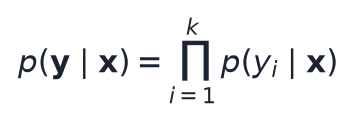</a>

- **x**: the image. Change it and every probability on both sides changes.
- **y = (y_1, …, y_k)**: the attributes, k of them (k = 2 on Colored MNIST: digit and colour). Asking for another combination changes the left side.
- **p(y_i | x)**: how sure a reader of the image is about attribute i alone. The assumption says the joint certainty is the product of these, so knowing the digit tells you nothing more about the colour once you have the image.

**Worked number.** At the point, on the full four-cell grid, p(right | x) = 0.6862 and p(top | x) = 0.7638; their product is 0.5241,
and p((2,1) | x) is also 0.5241, so Eq. 1 holds. On one silo of the toy, where (2, 1) is missing, the product is 0.1715 but p((2,1) | x)
is 0: the data break Eq. 1 at exactly the missing combination (`worked.eq1_posteriors_at_point`).

## Step 2: the least share of combinations the silos must see (Eq. 2)

Printed on p. 3, as Definition 3.1. No time runs here.

$$\mathcal{C}\ \geq\ \mathcal{C}_{\min}=\frac{1+\sum_{i=1}^{k}(|\mathcal{Y}_i|-1)}{|\mathcal{Y}|}$$

<a href="maths/eq02.png">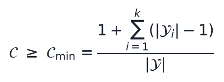</a>

- **𝒞**: the share of all combinations that appear on some silo. More silos holding more pairs raises it.
- **|𝒴_i|**: how many values attribute i takes (10 digits, 10 colours). Adding a value adds 1 to the top and multiplies the bottom.
- **|𝒴|**: the number of combinations, the product of the |𝒴_i| (100 on Colored MNIST).
- **𝒞_min**: one combination to anchor everything, plus one more per extra value of each attribute, as a share of all combinations.

**Worked number.** Colored MNIST: (1 + 9 + 9) / 100 = 0.19, so at least 19 of the 100 digit-colour pairs must be seen; DCFM runs at
𝒞 = 0.5 (p. 6). Robot planning: (1 + 3 + 3) / 16 = 0.4375; DCFM runs at 0.75 (p. 8). The paper prints neither minimum; both are
computed from Eq. 2 (`printed.colored_mnist.c_min_eq2`, `printed.robot_planning.c_min_eq2`).

## Step 3: the generator is an integral of the velocity (Eq. 3)

Printed on p. 3. Time runs from t = 0 (noise) to t = 1 (data).

$$G_\theta(\mathbf{z},\mathbf{y}) := \mathbf{x}_0+\int_0^1 \mathbf{v}_\theta(\mathbf{x}_t,t,\mathbf{y})\,dt$$

<a href="maths/eq03.png">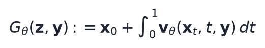</a>

- **x_0 = z**: the starting noise, drawn from a standard Gaussian. A different draw gives a different picture.
- **v_θ(x_t, t, y)**: the network's velocity: which way, and how fast, to move the half-made picture at time t when asked for y.
- **∫_0^1 … dt**: follow the velocity from t = 0 to t = 1. In practice a solver takes steps; DCFM does not state which solver or how many steps.

**Worked number.** From x_0 = (0.001, 0.299), following the exact velocity of the toy's (2, 1) cell for 200 equal Euler steps ends at
(1.0, 1.044), next to that cell's centre (1, 1) (`worked.eq3_one_path`).

## Step 4: the sum rule for diffusion noise (Eq. 4)

Printed on p. 3. This is the diffusion form, which DCFM quotes from earlier work. Diffusion's time runs from noise down to data; in
the worked number below the noise is read off DCFM's straight path instead, where t = 0 is noise.

$$\hat\epsilon_\theta(\mathbf{x}_t,\mathbf{y})=\epsilon_\theta(\mathbf{x}_t)+\sum_{i=1}^{k} w_i\,\big(\epsilon_\theta(\mathbf{x}_t,y_i)-\epsilon_\theta(\mathbf{x}_t)\big)$$

<a href="maths/eq04.png">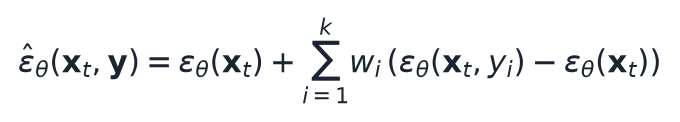</a>

- **ε_θ(x_t)**: the noise the network predicts with no attribute asked for (the ∅ label).
- **ε_θ(x_t, y_i)**: the noise it predicts when asked for attribute i alone. The difference from the line above is what attribute i adds.
- **w_i**: how hard to push toward attribute i, as in classifier-free guidance. Raising it stretches that difference.
- **ε̂**: the composed prediction: start from "anything" and add one push per attribute.

**Worked number.** On DCFM's straight path the predicted noise is ε = x_t − t v. At the point on the four-cell grid:
ε(x_t) = (0.027, 0.071), ε(x_t, right) = (−0.587, 0.071), ε(x_t, top) = (0.027, −0.391), so with w_i = 1, ε̂ = (−0.587, −0.391), which is
exactly x_t − t v̂ from step 5 (`worked.eq4_noise_form`).

## Step 5: the sum rule for flow velocities (Eq. 5)

Printed on p. 3. Time runs from t = 0 (noise) to t = 1 (data). This is the rule DCFM samples with, and figure 01b draws it.

$$\hat{\mathbf{v}}_\theta(\mathbf{x}_t,\mathbf{y})=\mathbf{v}_\theta(\mathbf{x}_t)+\sum_{i=1}^{k} w_i\,\big(\mathbf{v}_\theta(\mathbf{x}_t,y_i)-\mathbf{v}_\theta(\mathbf{x}_t)\big)$$

<a href="maths/eq05.png">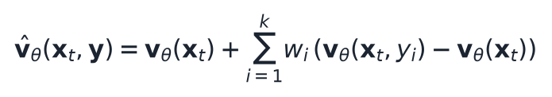</a>

- **v_θ(x_t)**: the velocity with nothing asked for: toward wherever the data are.
- **v_θ(x_t, y_i) − v_θ(x_t)**: how asking for attribute i alone bends that velocity.
- **w_i**: the weight on that bend. Eq. 7 and Eq. 10 set w_i = 1; the experiments' w_i are not stated.
- **v̂**: the composed velocity the sampler follows when asked for a combination no silo holds.

**Worked number.** At the point, on the four-cell grid: v(x_t) = (0.346, 0.458), v(x_t, right) = (1.574, 0.458), v(x_t, top) = (0.346, 1.382),
so v̂ = (1.574, 1.382), equal to the missing cell's own velocity (gap 0.00). On one silo with (2, 1) missing the same rule gives
v̂ = (0.241, −0.588), a gap of 2.38 from the cell's velocity (`worked.eq5_four_cells`, `worked.eq5_iid_silo_missing_2_1`).

<a href="figures/01b-sum-rule-tip-to-tail.png">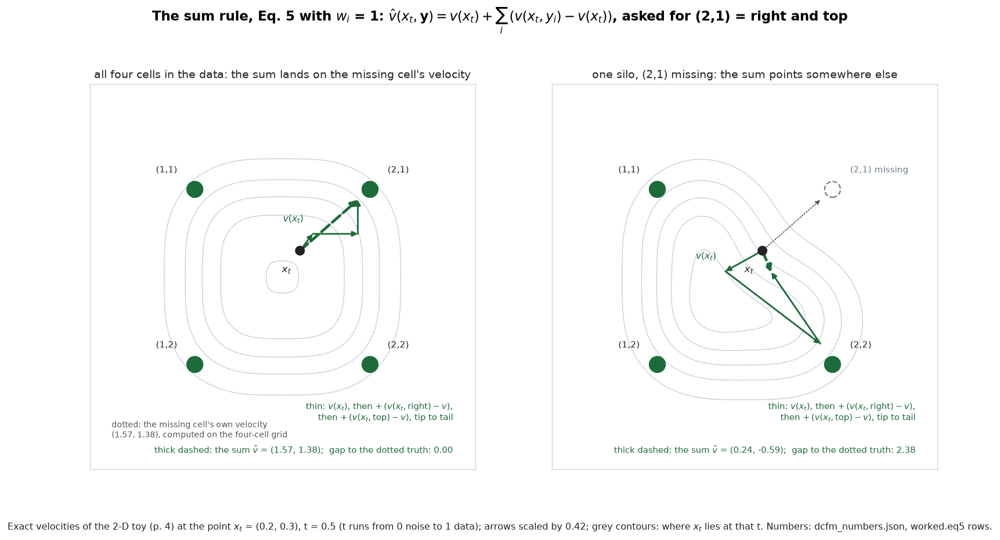</a>

## Step 6: a velocity is a scaled position plus a scaled score (Eq. 6)

Printed on p. 3, from Lemma 1 of Zheng et al. (2023), derived in A.2. Time runs from t = 0 (noise) to t = 1 (data).

$$\mathbf{v}_t(\mathbf{x}_t\mid\mathbf{y})=a_t\,\mathbf{x}_t+b_t\,\nabla\log p_t(\mathbf{x}_t\mid\mathbf{y})$$

<a href="maths/eq06.png">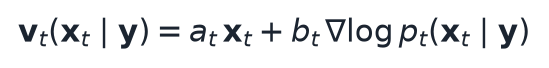</a>

- **∇ log p_t(x_t | y)**: the score: the direction that makes the half-made picture more likely under y.
- **a_t, b_t**: numbers set by the path alone, the same for every label. On the straight path a_t = 1/t and b_t = (1 − t)/t (step 18).
- **v_t**: the velocity. Because a_t and b_t do not depend on y, any sum of scores turns into the same sum of velocities.

**Worked number.** At t = 0.5 on the straight path, a_t = 2 and b_t = 1. For the (2, 1) cell alone the score at the point is
(1.174, 0.782), so 2 × (0.2, 0.3) + 1 × (1.174, 0.782) = (1.574, 1.382), the same as the velocity computed directly (`worked.eq6_a2_straight_path`).

## Step 7: the penalty, and the gap it measures (Eq. 7)

Printed on p. 3. Time runs from t = 0 (noise) to t = 1 (data). This ladder names the gap inside the norm I_t, in velocity units.

$$\mathcal{L}_{\mathrm{CI}}(\theta)=\mathbb{E}_{t,\mathbf{x}_t,\mathbf{y}\sim D_a}\,\big\Vert\,\mathbf{v}_\theta(\mathbf{x}_t,\mathbf{y})-\hat{\mathbf{v}}_\theta(\mathbf{x}_t,\mathbf{y})\,\big\Vert^2,\qquad I_t=\mathbf{v}_\theta(\mathbf{x}_t,\mathbf{y})-\hat{\mathbf{v}}_\theta(\mathbf{x}_t,\mathbf{y})$$

<a href="maths/eq07.png">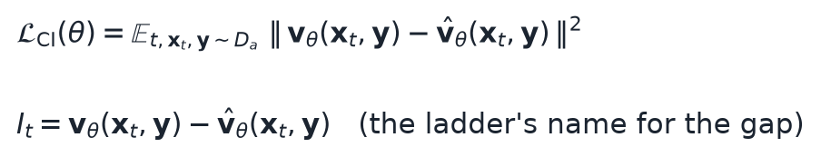</a>

- **v_θ(x_t, y)**: the joint prediction, the network asked for both attributes at once.
- **v̂_θ(x_t, y)**: the sum rule (Eq. 5, w_i = 1) built from the same network's single-attribute and unconditional calls.
- **I_t**: their gap. When Eq. 1 holds, I_t is zero everywhere; anything that needs both attributes at once shows up here.
- **𝔼 over t, x_t, y ∼ D_a**: the gap is measured only on combinations the silo holds, at half-made pictures on their paths.

**Worked number.** On one silo of the toy, label (1, 1) (top-left), at the point: joint (−2.338, 1.382), sum rule (−3.671, 2.4),
so I_t = (1.332, −1.018) and |I_t| = 1.68 (`worked.eq7_iid_silo_label_1_1`). On the four-cell grid I_t is 0 to machine precision
([the toy page](03-the-toy.md)).

## Step 8: hiding attributes from the label (Eq. 8)

Printed on p. 5. No time runs here.

$$p(\mathbf{m})=\begin{cases}\pi_{\mathrm{full}} & \text{if } \mathbf{m}=\mathbf{1}\\ \pi_{\mathrm{marg}}\cdot\frac{1}{k} & \text{if } \mathbf{m}=\mathbf{e}_i,\ i\in\{1,\ldots,k\}\\ \pi_{\mathrm{uncond}} & \text{if } \mathbf{m}=\mathbf{0}\end{cases},\qquad \mathbf{y}_{\mathbf{m}}=\mathbf{y}\odot\mathbf{m}$$

<a href="maths/eq08.png">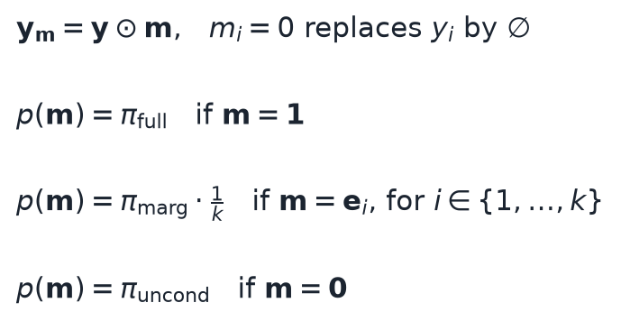</a>

- **m**: which attributes the network is shown on this training image; a 0 replaces that attribute with ∅.
- **π_full, π_marg, π_uncond**: how often the label is whole, cut to one attribute, or empty. They sum to 1; their values are not stated.
- **y ⊙ m**: the label actually fed in. Without the one-attribute case the network would never learn the v_θ(x_t, y_i) that Eq. 5 needs.

**Worked number.** The toy uses equal weights, so with k = 2 a training image is shown whole 1/3 of the time, as (4, ∅) 1/6, as
(∅, green) 1/6, and with no label 1/3 (`worked.eq8_pi_equal`; a toy choice, not the paper's).

## Step 9: Stage I, flow matching on a silo's own images (Eq. 9)

Printed on p. 5. Time is drawn uniformly between t = 0 (noise) and t = 1 (data). Figure 01a draws it.

$$\mathcal{L}^{(a)}_{\mathrm{FM}}(\theta)=\mathbb{E}_{t,\mathbf{y},\mathbf{m},\,\mathbf{x}_t\sim p_t}\Big[\big\Vert\,\mathbf{v}^{(a)}_\theta(\mathbf{x}_t,t,\mathbf{y}\odot\mathbf{m})-\mathbf{u}_t(\mathbf{x}_t\mid\mathbf{x}_1)\,\big\Vert^2\Big],\qquad \mathbf{x}_t=(1-t)\,\mathbf{x}_0+t\,\mathbf{x}_1,\quad \mathbf{u}_t=\mathbf{x}_1-\mathbf{x}_0$$

<a href="maths/eq09.png">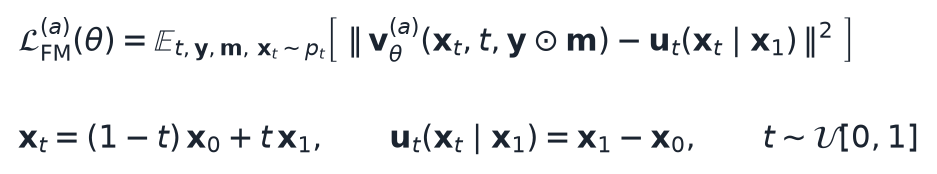</a>

- **x_1**: an image from silo a's own data D_a. No other silo's image is ever used.
- **x_0**: fresh noise. **t**: drawn uniformly; x_t slides from the noise (t = 0) to the image (t = 1).
- **u_t = x_1 − x_0**: the target velocity: the straight line from that noise to that image, the same at every t.
- **v_θ^(a)**: silo a's network, its architecture not stated in the paper, learning to predict that line from x_t, t and the masked label.

**Worked number.** With x_0 = (0.4, −1.2), x_1 = (−1, 1) and t = 0.25: x_t = (0.05, −0.65) and the target is (−1.4, 2.2) (`worked.eq9_pair`).

<a href="figures/01a-stage-one-local-training.png">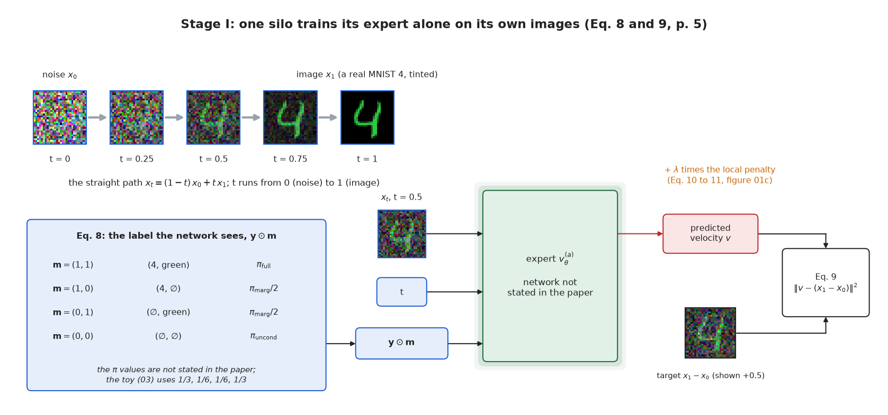</a>

## Step 10: the local penalty and the local loss (Eq. 10 and 11)

Printed on p. 5. Time runs from t = 0 (noise) to t = 1 (data). Eq. 10 is printed inside plain square brackets with no norm; Eq. 7 prints
the squared norm, and this ladder reads Eq. 10 the same way. Figure 01c, left panel, draws it.

$$\mathcal{L}^{(a)}_{\mathrm{CI}}(\theta)=\mathbb{E}_{t,\mathbf{y},\mathbf{x}_t\sim p_t}\Big[\,\mathbf{v}^{(a)}_\theta(\mathbf{x}_t,\mathbf{y})-\hat{\mathbf{v}}^{(a)}_\theta(\mathbf{x}_t,\mathbf{y})\,\Big],\qquad \mathcal{L}^{(a)}_{\mathrm{total}}(\theta)=\mathcal{L}^{(a)}_{\mathrm{FM}}(\theta)+\lambda\cdot\mathcal{L}^{(a)}_{\mathrm{CI}}(\theta)$$

<a href="maths/eq10_11.png">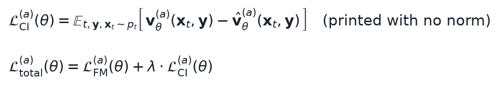</a>

- **v̂^(a)**: the sum rule built from silo a's own network: all four calls (joint, two single attributes, none) are the same network, so all four learn.
- **λ (λ_CI in this ladder)**: how much the penalty weighs against fitting the data. Not stated in the paper. Raising it trades fit for a smaller I_t.

**Worked number.** At the point of step 7, |I_t|² = 2.81, so with λ_CI = 1 the penalty adds 2.81 to the loss there (`worked.eq11_one_point`).
On the trained toy, raising λ_CI from 0 to 1 cuts the mean |I_t| from 0.371 to 0.050 ([the toy page](03-the-toy.md)).

## Step 11: the peer penalty, built from other silos' experts (Eq. 12)

Printed on p. 5. Time runs from t = 0 (noise) to t = 1 (data). Like Eq. 10, Eq. 12 is printed with no norm. Figure 01c, right panel, draws it.

$$\mathbf{z}^{(r_0)}_\theta(\mathbf{x}_t)=\bar{\mathbf{v}}^{(r_0)}_\theta(\mathbf{x}_t)+\sum_{i=1}^{k}\Big(\bar{\mathbf{v}}^{(r_i)}_\theta(\mathbf{x}_t,y_i)-\bar{\mathbf{v}}^{(r_0)}_\theta(\mathbf{x}_t)\Big),\qquad \mathcal{L}^{(a)}_{\mathrm{peerCI}}(\theta)=\mathbb{E}_{\mathbf{r},t,\mathbf{y},\mathbf{x}_t\sim p_t}\Big[\,\mathbf{v}^{(a)}_\theta(\mathbf{x}_t,\mathbf{y})-\mathbf{z}^{(r_0)}_\theta(\mathbf{x}_t)\,\Big]$$

<a href="maths/eq12.png">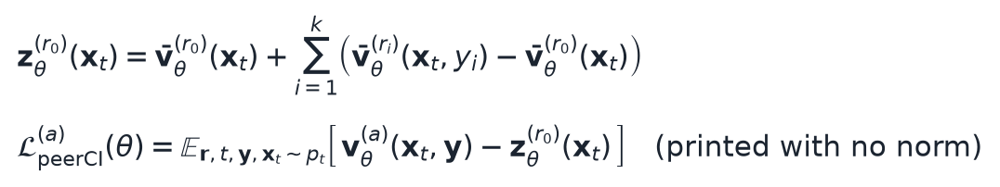</a>

- **r = (r_0, r_1, …, r_k)**: which silo's expert answers each call: r_0 the unconditional call, r_i attribute i. At least one entry is a itself. How r is drawn is not stated.
- **z**: the sum rule again, but assembled from several silos' experts, so silo a's joint prediction must agree with a sum built by its peers.
- **v^(a)(x_t, y)**: silo a's own joint prediction, on combinations silo a holds.

**Worked number.** On the toy's non-IID split, silo 1 (cells (1, 2) and (2, 2)) trains label (2, 2) with r = (2, 1, 2): the unconditional call
and the bottom call go to silo 2's expert, the right call to silo 1's. At the point: v^(2)(x_t) = (−2.338, 0.458), v^(1)(x_t, right) = (1.574, −2.53),
v^(2)(x_t, bottom) = (−2.338, −2.53), so z = (1.574, −5.518); silo 1's joint prediction is (1.574, −2.53), and the gap has length 2.99
(`worked.eq12_non_iid_silo1_label_2_2_r_2_1_2`). The two silos' experts disagree because each learned a different "unconditional" picture.

## Step 12: peers are frozen (Eq. 13)

Printed on p. 5.

$$\bar{\mathbf{v}}^{\,r}_\theta=\delta_{r,a}\,\mathbf{v}^{(a)}_\theta+(1-\delta_{r,a})\,\mathrm{StopGrad}\big(\mathbf{v}^{(r)}_\theta\big)$$

<a href="maths/eq13.png">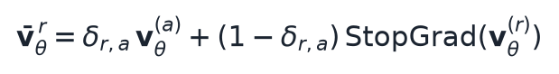</a>

- **δ_{r,a}**: 1 when the routed expert is silo a's own, 0 otherwise.
- **StopGrad**: the peer's output is used as a fixed number; no gradient flows into the peer, so only silo a's weights move.

**Worked number.** With r = (2, 1, 2) for silo 1 (step 11), the unconditional call and the bottom call come from silo 2's frozen copy and
receive no gradient; the right call is silo 1's own expert and does (`worked.eq13_r_2_1_2_for_silo1`).

## Step 13: DCFM-A's loss (Eq. 14)

Printed on p. 5.

$$\mathcal{L}^{(a)}_{\mathrm{DCFM\text{-}A}}(\theta)=\mathcal{L}^{(a)}_{\mathrm{FM}}(\theta)+\lambda\cdot\mathcal{L}^{(a)}_{\mathrm{peerCI}}(\theta)$$

<a href="maths/eq14.png">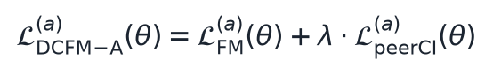</a>

- **𝓛_FM**: keep fitting the silo's own images (step 9).
- **λ · 𝓛_peerCI**: pull the silo's joint predictions onto sums its peers' frozen experts help build. After one round the peers have changed, so the exchange and retraining repeat R = 1 to 3 times (p. 9).

**Worked number.** At the point of step 11 the squared gap is 8.93, so with λ_CI = 1 that point adds 8.93 to silo 1's loss (`worked.eq14_one_point`).

## Step 14: DCFM-B copies the experts into one student (Eq. 15)

Printed on p. 6. Time runs from t = 0 (noise) to t = 1 (data): x̂_t is reached by running a frozen teacher from noise up to time t.

$$\mathcal{L}_{\mathrm{student}}(\theta)=\mathbb{E}_{t,r,\hat{\mathbf{x}}_t}\Big[\big\Vert\,\mathbf{v}_\theta(\hat{\mathbf{x}}_t,t,\mathbf{y}\odot\mathbf{m})-\bar{\mathbf{v}}^{(r)}_\theta(\hat{\mathbf{x}}_t,\mathbf{y})\,\big\Vert^2\Big],\qquad \hat{\mathbf{x}}_t=\mathrm{ODEInt}\big(\mathbf{x}_0,\bar{\mathbf{v}}^{(r)}_\theta,\mathbf{y},0,t\big)$$

<a href="maths/eq15.png">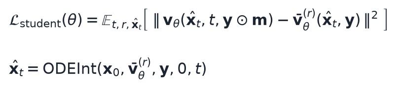</a>

- **v̄^(r)**: teacher r, one silo's frozen expert, on the server. No image leaves any silo; the teachers make their own samples.
- **x̂_t**: a half-made picture on teacher r's own path, so the teacher's velocity there can stand in for the true one.
- **v_θ**: the one student, trained to answer like whichever teacher made x̂_t.

**Worked number.** Silo 1's teacher on the non-IID toy, label (2, 2), carried from x_0 = (0.4, −1.2) to t = 0.5, reaches x̂_t = (0.702, −1.107),
where its velocity, the student's target, is (0.613, 0.16) (`worked.eq15_teacher`).

## Step 15: the student's own penalty (Eq. 16)

Printed on p. 6, with a squared norm. Time runs from t = 0 (noise) to t = 1 (data).

$$\mathbf{z}_\theta(\hat{\mathbf{x}}_t)=\mathbf{v}_\theta(\hat{\mathbf{x}}_t)+\sum_{i=1}^{k}\big(\mathbf{v}_\theta(\hat{\mathbf{x}}_t,y_i)-\mathbf{v}_\theta(\hat{\mathbf{x}}_t)\big),\qquad \mathcal{L}_{\mathrm{studentCI}}(\theta)=\mathbb{E}_{t,\mathbf{y},\hat{\mathbf{x}}_t}\big\Vert\,\mathbf{v}_\theta(\hat{\mathbf{x}}_t,\mathbf{y})-\mathbf{z}_\theta(\hat{\mathbf{x}}_t)\,\big\Vert_2^2$$

<a href="maths/eq16.png">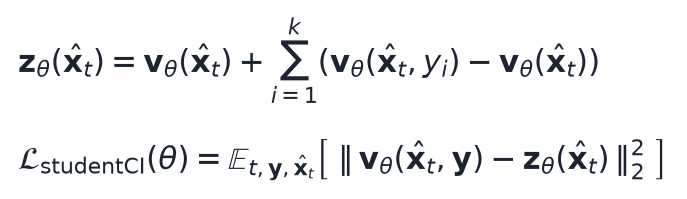</a>

- **z_θ**: the sum rule built entirely from the student's own calls; no frozen model appears, unlike Eq. 12.
- **v_θ(x̂_t, y)**: the student's joint prediction. The penalty pulls it onto z, the same pull as Eq. 7 but on the student.

**Worked number.** A student that copied the union of the two non-IID silos exactly would hold three cells, the same as one IID silo, so at
the point of step 7 its gap would be |I_t| = 1.68 for label (1, 1) (`worked.eq7_iid_silo_label_1_1`).

## Step 16: DCFM-B's loss (Eq. 17)

Printed on p. 6.

$$\mathcal{L}_{\mathrm{DCFM\text{-}B}}(\theta)=\mathcal{L}_{\mathrm{student}}(\theta)+\lambda\,\mathcal{L}_{\mathrm{studentCI}}(\theta)$$

<a href="maths/eq17.png">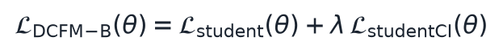</a>

- **𝓛_student**: copy the teachers on their own paths (step 14).
- **λ · 𝓛_studentCI**: while copying, keep the student's joint predictions on its own sum rule (step 15).

**Worked number.** With λ_CI = 1, the student of step 15 pays 1.68² = 2.81 at that point, the same figure as step 10, because the sum it is
pulled onto is built the same way (`worked.eq11_one_point`). DCFM-B costs each silo 2 model transfers in all (Table 3, p. 9).

## Step 17: the sum rule for scores (A.1, Eq. 19 to 24)

Printed on p. 12. Each line holds at every time t; the time direction does not enter.

$$\nabla\log p_t(\mathbf{x}\mid y_1,\ldots,y_k)=\nabla\log p_t(\mathbf{x})+\nabla\log p_t(y_1,\ldots,y_k\mid\mathbf{x})=\nabla\log p_t(\mathbf{x})+\sum_{i=1}^{k}\nabla\log p_t(y_i\mid\mathbf{x})$$
$$\nabla\log\hat p_t(\mathbf{x}\mid y_1,\ldots,y_k)=\nabla\log p_t(\mathbf{x})+\sum_{i=1}^{k}w_i\,\big(\nabla\log p_t(\mathbf{x}\mid y_i)-\nabla\log p_t(\mathbf{x})\big)$$

<a href="maths/a1.png">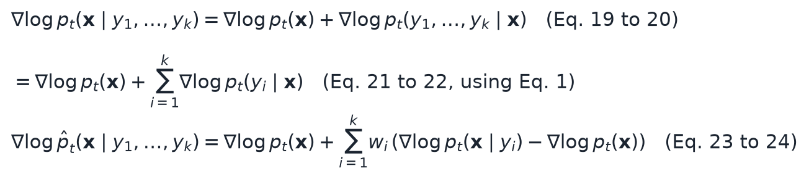</a>

- **∇ log p_t(x)**: the unconditional score. Bayes' rule adds to it the score of the labels given the picture.
- **Σ_i ∇ log p_t(y_i | x)**: Eq. 1 turns the labels' joint score into one term per attribute. This is the only place the independence assumption enters.
- **∇ log p_t(x | y_i) − ∇ log p_t(x)**: Bayes' rule again, one attribute at a time; with weights w_i this is the score form of the sum rule, the score of p_t(x)^(1 − Σ w_i) Π p_t(x | y_i)^(w_i).

**Worked number.** At the point on the four-cell grid, with scores read from the velocities by Eq. 28 (s = v − 2 x at t = 0.5): unconditional
(−0.054, −0.142), right (1.174, −0.142), top (−0.054, 0.782), so the sum rule gives (1.174, 0.782), exactly the (2, 1) cell's own score
(`worked.a1_scores_four_cells`).

## Step 18: the velocity sum rule is the score sum rule (A.2, Eq. 25 to 33)

Printed on p. 12 to 13 as a proposition: the compositional flow velocity is consistent with the compositional score. Time runs from
t = 0 (noise, α_0 = 0, σ_0 = 1) to t = 1 (data, α_1 = 1, σ_1 = 0).

$$p_t(\mathbf{x}\mid\mathbf{x}_1)=\mathcal{N}(\mathbf{x}\mid\alpha_t\mathbf{x}_1,\sigma_t^2\mathbf{I}),\qquad \mathbf{v}_t(\mathbf{x}\mid y)=a_t\mathbf{x}+b_t\nabla\log p_t(\mathbf{x}\mid y),\quad a_t=\frac{\dot\alpha_t}{\alpha_t},\quad b_t=(\dot\alpha_t\sigma_t-\alpha_t\dot\sigma_t)\frac{\sigma_t}{\alpha_t}$$
$$a_t\mathbf{x}+b_t\nabla\log\hat p_t(\mathbf{x}\mid y_1,\ldots,y_k)=\mathbf{v}_t(\mathbf{x})+\sum_{i=1}^{k}w_i\,\big(\mathbf{v}_t(\mathbf{x}\mid y_i)-\mathbf{v}_t(\mathbf{x})\big)=\hat{\mathbf{v}}_t(\mathbf{x}\mid y_1,\ldots,y_k)$$

<a href="maths/a2.png">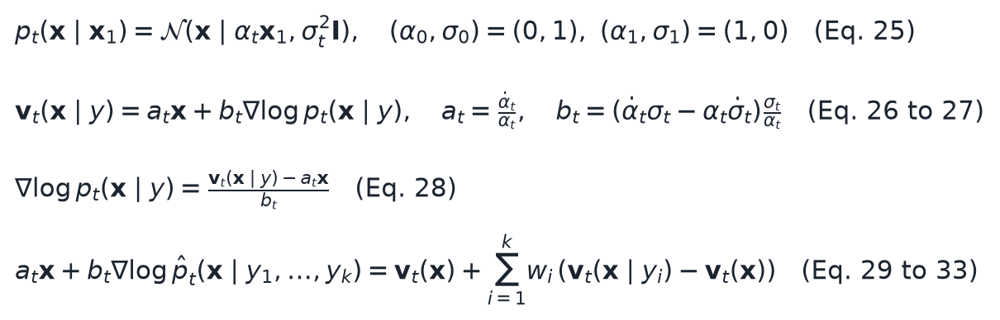</a>

- **α_t, σ_t**: how much image and how much noise the path holds at time t. On DCFM's straight path α_t = t and σ_t = 1 − t.
- **a_t, b_t**: fixed by the path, the same for every label; so solve Eq. 26 for the score (Eq. 28), put each score into the score sum rule, and the a_t x terms cancel inside every difference (Eq. 29 to 31).
- **v̂_t**: what is left (Eq. 32 to 33) is the velocity sum rule of Eq. 5, for any weights w_i. The proposition is about the rule, and holds whether or not the data satisfy Eq. 1; whether v̂ samples the combination asked for is what Eq. 1 decides.

**Worked number.** On the straight path, (a_t, b_t) = (4, 3) at t = 0.25, (2, 1) at t = 0.5 and (1.33, 0.33) at t = 0.75; both blow up as t
approaches 0, where there is no image yet. At t = 0.5 and the point: 2 × (0.2, 0.3) + 1 × (1.174, 0.782) = (1.574, 1.382) = v̂ of step 5
(`worked.a2_ab_table_straight_path`, `worked.a1_scores_four_cells`).

## What the maths does not say

**Values the equations leave open.** λ (Eq. 11, 14, 17), the masking weights π (Eq. 8), the guidance weights w_i used in the experiments
(Eq. 5), how the routing vector r is drawn (Eq. 12), the ODE solver and its step count (Eq. 3, 15), and the network that computes
v_θ on Colored MNIST and robot planning. The X-ray model is "a latent flow matching model" on a pretrained autoencoder at 256 by 256
(p. 8 to 9), with the autoencoder not named.

**Printing.** Eq. 10 and Eq. 12 are printed with plain square brackets and no norm, while Eq. 7 and Eq. 16 print a squared norm.
Read literally, an expectation of a signed difference can be zero while the gap is large; this ladder reads all four as the squared distance.

**What the penalty costs.** Step 7's I_t is exactly the part of the joint prediction that needs both attributes at once. Every penalty here
(Eq. 7, 10, 12, 16) trains it toward zero, and no equation or experiment in the paper measures what an image loses when it does.
