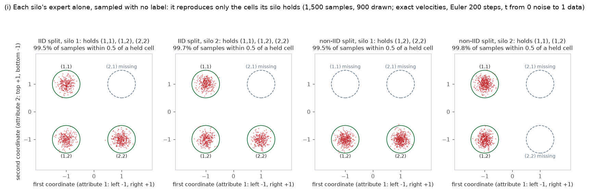
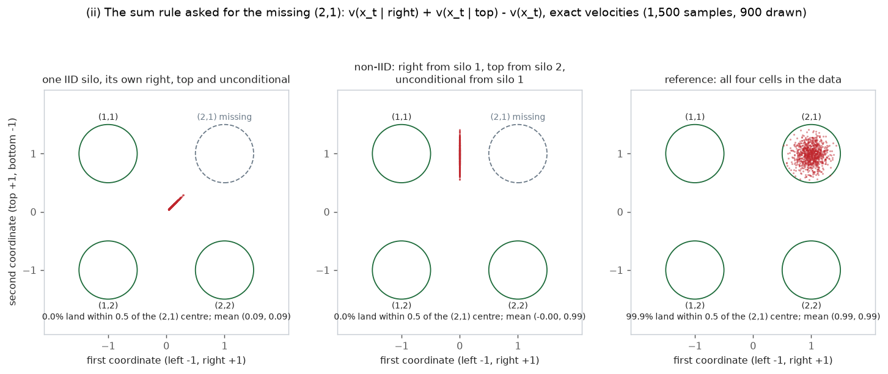
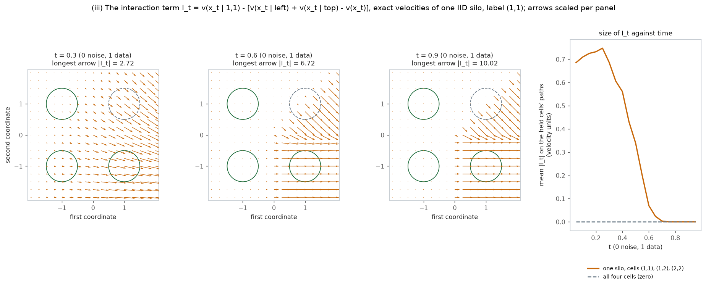
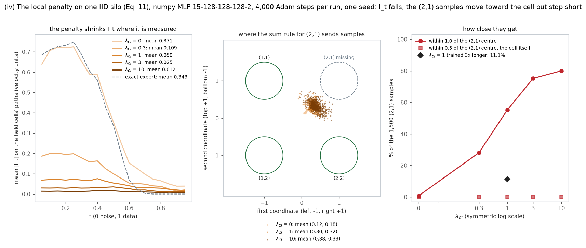
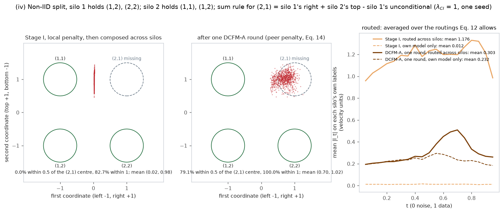

# DCFM's own toy, rebuilt and run

DCFM's paper shows its method first on a two-dimensional toy (Figs. 2 and 3, p. 4): four Gaussian clouds at (±1, ±1), labelled by a
horizontal attribute (left 1, right 2) and a vertical one (top 1, bottom 2), with the cloud (2, 1), right and top, missing from every
silo. This page rebuilds that toy on the laptop's CPU in numpy and asks it four things: what each silo's expert does alone, whether the
sum rule reaches the missing cloud, what the gap I_t looks like, and what the penalty does to I_t and to the missing cloud.

Every number below is in [the numbers file](dcfm_numbers.json), section `toy`, written by [the numbers script](make_dcfm_numbers.py)
from [the toy module](toy_dcfm.py); the figures are drawn by [the toy figure script](make_toy_figures.py) from it and from
`toy_arrays.npz`. Time runs from t = 0 (noise) to t = 1 (data) throughout.

## How the toy is built

**The data.** Four cells at (−1, 1) for (1, 1), (−1, −1) for (1, 2), (1, −1) for (2, 2) and (1, 1) for the missing (2, 1), read from
Fig. 2 (p. 4). Each cell is a Gaussian with spread 0.15, read by eye from the figure and so illustrative. In the IID split both silos
hold (1, 1), (1, 2) and (2, 2). In the non-IID split silo 1 holds (1, 2) and (2, 2), and silo 2 holds (1, 1) and (1, 2), as Fig. 2b draws it.

**Exact experts.** For a mixture of Gaussian cells on the straight path x_t = (1 − t) x_0 + t x_1, the velocity a perfectly trained
flow-matching network would learn, E[x_1 − x_0 | x_t], has a closed form: inside one cell it is μ + c_t (x − t μ) with
c_t = (0.15² t − (1 − t)) / ((1 − t)² + 0.15² t²), and across cells it is the average weighted by how likely each cell is at x_t. A label
picks which cells enter the average. Parts (i) to (iii) use these exact velocities, so nothing there depends on training.

**Trained experts.** Part (iv) needs a network for the penalty to act on, so it trains a small numpy MLP (inputs x_t, t and a one-hot
label with a null token; 15 → 128 → 128 → 128 → 2, SiLU, Adam, 4,000 steps of 512) with Eq. 9's masked loss, with and without the
penalty. The paper does not state its toy network, λ, the masking weights, the solver, or how r is drawn; the toy's choices for each
are listed under `toy.choices` in the numbers file. Sampling is Euler integration, 200 equal steps, of 1,500 starting noises.

## (i) Each silo's expert alone

Asked for nothing, each silo's exact expert reproduces its own cells: 99.5% and 99.7% of samples land within 0.5 of a held cell for the
two IID silos, and 99.5% and 99.8% for the two non-IID silos (`toy.i_silo_alone`). None lands in the missing cell. This is the starting
point every method shares.

## (ii) Does the sum rule reach the missing cell?

Eq. 5 with w_i = 1 asks for (2, 1) as v(x_t | right) + v(x_t | top) − v(x_t). With exact velocities:

- within one IID silo, 0.0% of samples land within 0.5 of the missing cell's centre at (1, 1); they collapse near the middle, mean (0.09, 0.09);
- across the non-IID silos (right from silo 1, top from silo 2, the unconditional velocity from silo 1), 0.0% again, in a streak at x = 0, mean (0.00, 0.99);
- with all four cells in the data, 99.9% land in the cell, mean (0.99, 0.99) (`toy.ii_sum_rule_missing`).

The rule fails on the silos for a plain reason. In their data "right" only ever appears at the bottom and "top" only on the left, so
v(x_t | right) pulls toward (1, −1) and v(x_t | top) toward (−1, 1), and their sum minus the unconditional pull points between them.
On the four-cell grid the identity v(x | 1,1) + v(x | 2,2) − v(x | 1,2) = v(x | 2,1) holds at every point and time (largest gap
3.6 × 10⁻¹⁵ over 4,000 points and 5 times, `toy.parallelogram_max_abs_gap`), because each cell's velocity is affine in its centre. That
is the sense in which independent attributes compose: the missing cell's velocity is already written in the three cells that exist.

## (iii) The interaction term as a field

I_t = v(x_t | 1,1) − [v(x_t | left) + v(x_t | top) − v(x_t)], on one IID silo, with exact velocities. The fields show I_t at every point
of a 17 by 17 grid at t = 0.3, 0.6 and 0.9; the longest arrow grows from 2.72 to 6.72 to 10.02 velocity units, all in the right half of
the plane, where the silo's "right" cell lives. Averaged over half-made pictures on the held cells' own paths, |I_t| is largest early,
about 0.7 velocity units before t = 0.3, and falls to almost zero after t = 0.7, mean 0.343 over t from 0.05 to 0.95. On the four-cell
grid it is zero to machine precision, 2.8 × 10⁻¹⁶ (`toy.iii_I_t_mean_norm`).

## (iv) What the penalty does to I_t

**On one silo (the local penalty, Eq. 11).**

| λ_CI | mean \|I_t\| on the held cells' paths | (2, 1) samples within 1.0 of the cell's centre at (1, 1) | within 0.5, the cell itself | mean of the (2, 1) samples |
|---:|---:|---:|---:|---|
| 0 | 0.371 | 0.7% | 0.0% | (0.12, 0.18) |
| 0.3 | 0.109 | 28.0% | 0.0% | (0.25, 0.29) |
| 1 | 0.050 | 55.1% | 0.0% | (0.30, 0.32) |
| 3 | 0.025 | 75.2% | 0.0% | (0.36, 0.32) |
| 10 | 0.012 | 80.0% | 0.0% | (0.38, 0.33) |
| 1, trained 12,000 steps | 0.042 | 11.1% | 0.0% | (0.19, 0.32) |

From `toy.iv_iid_local_penalty` and `toy.iv_iid_local_penalty_12000_steps`; one seed per row. The penalty does what it is built to do:
the mean gap falls about 30 times, from 0.371 to 0.012, as λ_CI rises from 0 to 10. The samples asked for (2, 1) move up and right from the middle, but none reaches
the cell, and a λ_CI = 1 run trained three times longer, with about the same gap (0.042), sends only 11.1% within 1.0 of it. A small I_t
on the held cells' paths does not decide where the missing cell's samples go: the penalty is measured only where silo data exist, and
the network's answer near (1, 1) is extrapolation. This matches the smeared red samples the paper shows for its baselines with the local
penalty on the IID split (Fig. 3, right half).

**Across silos (one DCFM-A round, Eq. 14).**

| Non-IID, λ_CI = 1 | gap routed across silos | gap with own model only | (2, 1) samples within 0.5 of the cell's centre at (1, 1) | within 1.0 | mean |
|---|---:|---:|---:|---:|---|
| Stage I with the local penalty | 1.176 | 0.012 | 0.0% | 82.7% | (0.02, 0.98) |
| after one DCFM-A round | 0.303 | 0.232 | 79.1% | 100.0% | (0.70, 1.02) |

From `toy.iv_non_iid`; one seed. "Routed" averages |J − z| over all 22 routings Eq. 12 allows on the two silos' held labels; "own model
only" is the local gap of Eq. 10. After Stage I each silo is consistent with itself (0.012) but not with the other (1.176), and the
composed samples sit in a streak at x = 0. One DCFM-A round brings the two silos into agreement (1.176 → 0.303), at the price of each
silo's own consistency (0.012 → 0.232), and 79.1% of the (2, 1) samples land in the missing cell. This is the result the paper draws in
Fig. 3's bottom row, here measured.

## What this toy cannot tell you

**One seed, one network, choices of ours.** Every trained row is one seed. The network, λ_CI, the masking weights, the routing draw and
the solver are the toy's choices, not the paper's (none are stated). The 12,000-step row shows the IID result moves with training length.

**Nothing about images.** Each cell's velocity is affine in its centre, so on the four-cell grid the attributes are exactly independent
and I_t is exactly zero. In a picture where one attribute changes how the other looks, the true I_t is not zero, and a penalty that drives
it to zero removes that change. The toy has no such effect to lose, so it cannot measure that cost.

**Why the IID local penalty stops short and DCFM-A does not.** Not settled here. One reading, not tested: on the IID split the silo has
no data near (1, 1) and the penalty only constrains the network where data are, while in the non-IID split the routed penalty ties each
silo's "right" or "top" velocity to the other silo's joint labels, which constrains the same velocities from two directions.
