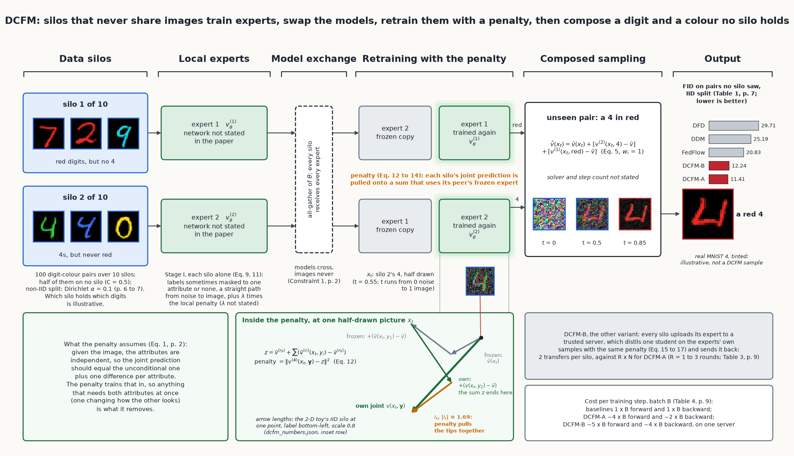

# DCFM, read through its own toy

DCFM (Morshed and Boddeti, "Compositional Generative Modeling from Decentralized Data", arXiv 2606.10153, ICML 2026) lets data silos
that never share an image train generators that can still be asked for attribute combinations no silo holds. This page is the
ladder's closing page: the method in plain sentences through the toy, then the rungs, then what the paper leaves out.

## The method in plain sentences

**A combination nobody holds is asked for by adding velocities.** Each silo trains a flow model that can be asked for one attribute or
none. A missing combination is sampled by starting from the "anything" velocity and adding one bend per attribute (Eq. 5). On the toy's
full four-cell grid this lands exactly on the missing cell's velocity, because there the attributes are independent.

**On real silos the sum misses.** A silo's "right" only ever appeared at the bottom, so its "right" velocity pulls to the bottom. With
exact velocities, the sum asked for right-and-top puts 0.0% of samples in the missing cell, on one silo and across two
([the toy, part ii](03-the-toy.md#ii-does-the-sum-rule-reach-the-missing-cell)).

**The penalty trains the sum in.** I_t, the joint prediction minus the sum, is nonzero wherever the data break independence. DCFM adds
λ_CI |I_t|² to training, first inside each silo, then (DCFM-A) against frozen copies of the other silos' experts, or (DCFM-B) inside one
student distilled on a server. On the toy's non-IID silos one DCFM-A round cuts the gap between silos from 1.176 to 0.303 velocity units
and sends 79.1% of the samples into the missing cell, from 0.0%. On one IID silo the local penalty shrinks I_t from 0.371 to 0.012 but
never puts a sample in the cell, and longer training sends fewer near it.

**In the paper's notation.** Eq. 5: v̂_θ(x_t, y) = v_θ(x_t) + Σ_i w_i (v_θ(x_t, y_i) − v_θ(x_t)); Eq. 7: 𝓛_CI = 𝔼 ‖v_θ(x_t, y) − v̂_θ(x_t, y)‖²;
Eq. 12 replaces the calls inside v̂ by routed, frozen peers. [The maths page](02-the-maths-step-by-step.md) takes each equation with a worked number.

## The rungs

| Rung | Page | What it adds |
|---|---|---|
| level 0 | [the overview](00-the-overview.md) | one picture through the six stages, with Table 1's novel-pair FIDs as the result |
| level 0.5 | [the network view](01-the-network-view.md) | Stage I's masked training, the sum rule tip to tail, the penalty's four calls and gradients, what crosses between silos in DCFM-A and DCFM-B |
| maths | [the maths, step by step](02-the-maths-step-by-step.md) | Eq. 1 to 17 and A.1 to A.2, each rendered, each symbol's role, each with a worked number |
| level 2 | [the toy](03-the-toy.md) | DCFM's 2-D toy run: each silo alone, the sum rule, I_t as a field, and the penalty measured on one silo and across silos |
| level 1 | skipped | the owner skipped the illustrations for DCFM |
| level 3 | skipped | no public code (below) |

[The shared notation](NOTATION.md) holds every symbol and the colour key, shared with Paper 1's ladder. [The ladder record](ladder.json)
holds each rung's state and files, and [the route](route-zoom-ladder-dcfm.md) rebuilds any rung with one command. Every value comes from
[the numbers file](dcfm_numbers.json).

## What the paper does not state

The network architecture for Colored MNIST and for robot planning; which pretrained autoencoder the X-ray latent flow model uses (it is
"a latent flow matching model" at 256 by 256, p. 8 to 9); the ODE solver and its step count; the penalty weight λ; the masking weights π;
the guidance weights w_i used in the experiments; how the routing vector r is drawn; and the number of samples behind each FID. Eq. 10
and Eq. 12 are printed with no norm, while Eq. 7 and Eq. 16 print a squared norm; this ladder reads all four as the squared distance.

## Why there is no code rung

DCFM's code is not public: the paper carries no code link, the arXiv record lists none, and no matching repository exists under the
first author's or the lab's GitHub account (checked 2026-11-25). CoInD's public code (github.com/sachit3022/compositional-generation)
implements the independence penalty DCFM carries across silos; it is cited here and was not cloned or run. The toy's numpy
implementation is ours, written from the equations.

## DCFM's fix against a push at sampling time

DCFM fixes composition while training: it retrains the experts so their joint prediction equals the sum of their single-attribute ones,
which needs the experts to be exchanged and trained again (R = 1 to 3 rounds, or a distilled student). A push at sampling time leaves
finished experts as they are and adds a correction while the picture is being drawn, so it can run where models are never exchanged,
which is Paper 1's setting. The price DCFM pays is the interaction term itself: the penalty drives I_t to zero, which removes exactly
what needs both attributes at once (one thing hiding or shading another, one X-ray finding changing how another looks), and the paper
never measures that loss. The toy also shows that a small I_t where data exist does not by itself place the missing combination: on one
silo the penalty shrank I_t 30-fold and still put no sample in the missing cell.
