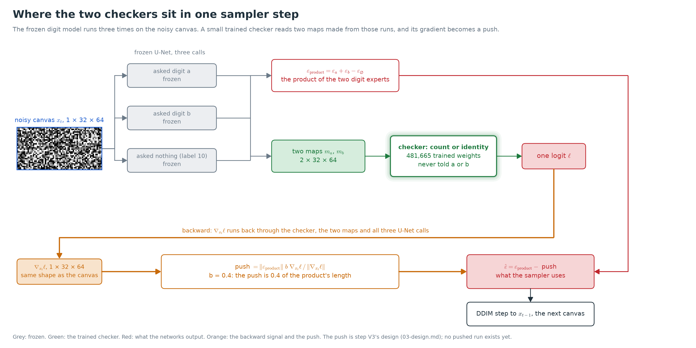
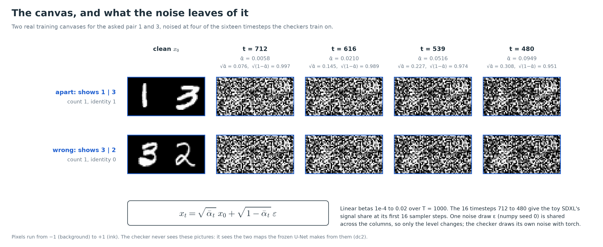
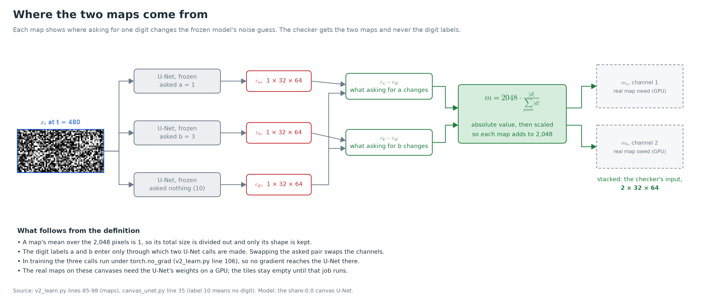
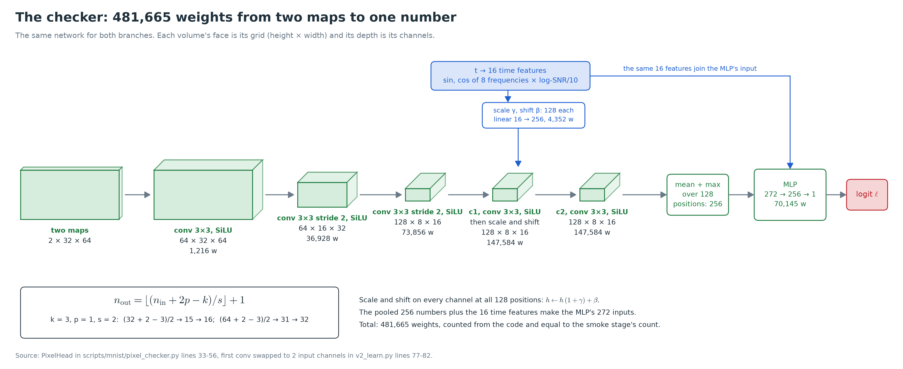
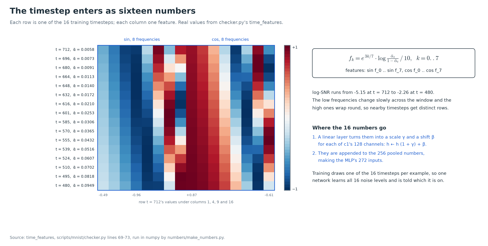
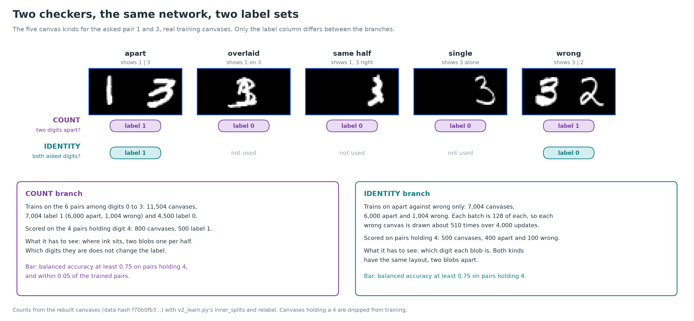
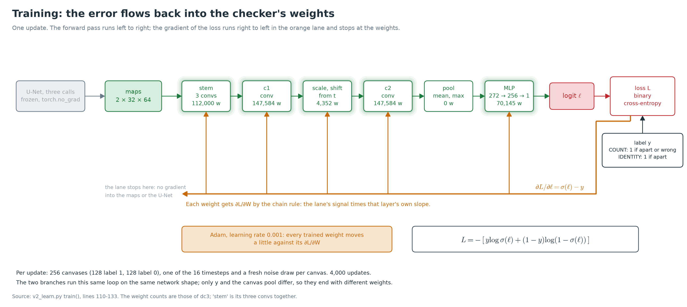
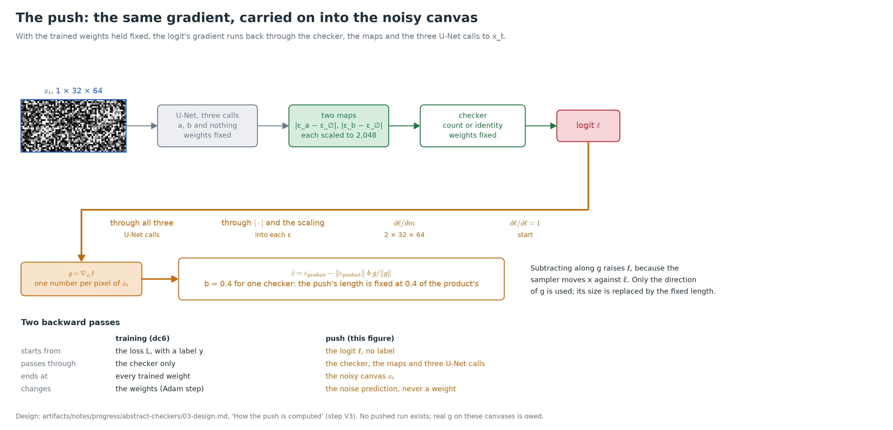

# The network view

Eight figures that open the checkers from the sampler step down to their weights, in zoom order. The first five are shared by both checkers; dc5 is where the count and identity branches split, and dc6 and dc7 hold for either branch with its own labels and weights.

Every size and count comes from `../numbers/numbers.json`. The canvases are real, rebuilt with the data hash `f70b0fb3...`. The noise on them is one numpy draw for display. The two maps are empty slots, because computing them needs the frozen U-Net on a GPU.

## Shared: the step, the canvas, the maps, the network, the timestep

**Where the checkers sit in one sampler step**

The toy's three U-Net calls make both the product's noise guess and the checker's input. The push is step V3's design; no pushed run exists. The step without a checker is [the 7b sampler step](../../mnist-guidance-explained/1-the-sampler-step/nv7b-1-one-sampler-step.png), whose two checkers are different networks.

**The canvas, and what the noise leaves of it**

At the 16 timesteps the checkers train on, $\sqrt{\bar\alpha_t}$ runs from 0.076 to 0.308, and on these two canvases the digits cannot be seen by eye at any of the four levels shown.

**Where the two maps come from**

**The checker network**

**The timestep as sixteen numbers**

## The branch: two label sets

**Two checkers, the same network, two label sets**

## Either branch: the two backward passes

**Training: the error flows back into the checker's weights**

**The push: the same gradient carried on into the noisy canvas**

## How these were made

`make_network_view.py` draws all eight with `../figure_kit.py`, which refuses to write a figure where a line crosses a box or label. Run it with `~/.claude/venvs/figures/bin/python -I make_network_view.py`; each figure prints `0 crossings`.
