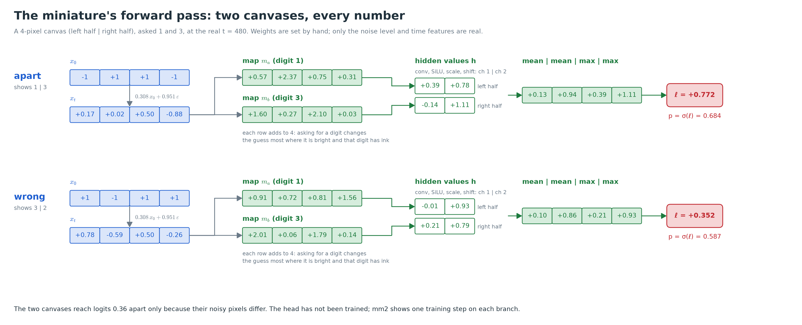
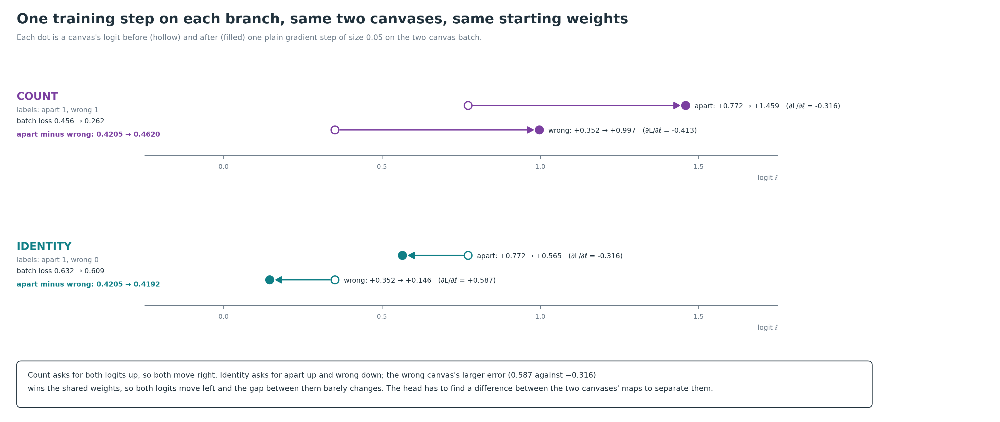
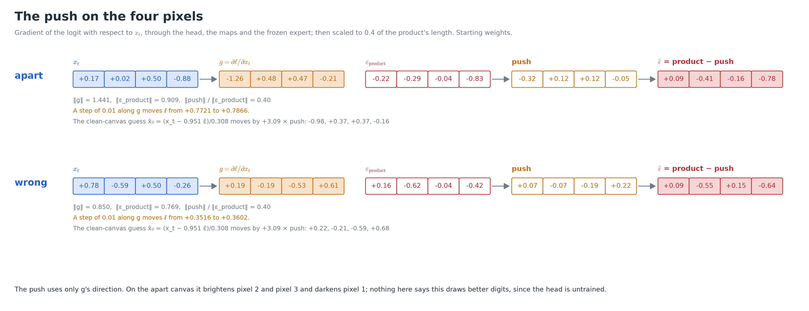

# The miniature

The checker shrunk to a 4-pixel canvas, small enough to follow every number by hand. It is illustrative: the weights and the frozen "U-Net" are set by hand. Two things in it are real, the noise level (the toy's t = 480, $\bar\alpha = 0.094869$) and the two time features of the first frequency at that timestep.

## The design

**The canvas.** Four pixels, a left half $p_1, p_2$ and a right half $p_3, p_4$, from −1 to +1. A "1" is $[-1, +1]$ inside a half, a "3" is $[+1, -1]$ and a "2" is $[+1, +1]$. The asked pair is 1 and 3. The apart canvas shows 1 | 3 and the wrong canvas shows 3 | 2.

**The frozen expert.** $\varepsilon_\varnothing(x) = 0.9\,x$, and asking for digit $y$ subtracts $0.5\,T_y\,\sigma(3x)$, where $T_y$ is the digit's stroke on both halves. So asking for a digit changes the guess most where the pixel is bright and that digit has ink, and the maps are built from those changes exactly as the real code builds them, scaled to add to 4 instead of 2,048.

**The head.** One convolution (2 maps in, 2 channels out, one window per half), SiLU, the scale and shift from the two time features, mean and max over the two halves, and one linear readout to the logit. The real head has three more convolutions and a hidden layer of 256 in its MLP.

**The training step.** One plain gradient step of size 0.05 on the two-canvas batch. The real code uses Adam at 0.001 on 256 canvases.

`miniature.py` derives every gradient by hand and checks each against central differences; the largest relative mismatch is 1.4e-09. Its answers are in `miniature_answer_key.json`.

## The figures

**Every number of the forward pass**

<a href="mm1-the-forward-pass-with-every-number.png"></a>

**One training step on each branch**

<a href="mm2-one-training-step-per-branch.png"></a>

The count step lowers the batch loss from 0.456 to 0.262. The identity step lowers it only from 0.632 to 0.609 and moves both logits down by about 0.2, so the gap between apart and wrong barely changes. That is the miniature's version of what identity has to overcome: the two canvases have the same layout, so the head must find a difference in the maps themselves.

**The push on the four pixels**

<a href="mm3-the-push-on-the-four-pixels.png"></a>

A step of 0.01 along $g$ raises the apart canvas's logit from 0.7721 to 0.7866, which confirms the gradient's sign.

## How to rebuild

```bash
cd /home/molef/PhD/concept-composition/2-classifier-guidance/artifacts/scenes/digit-map-checkers/2-miniature
PYTHONDONTWRITEBYTECODE=1 ~/.claude/venvs/figures/bin/python -I miniature.py
PYTHONDONTWRITEBYTECODE=1 ~/.claude/venvs/figures/bin/python -I make_miniature_figures.py
```

The first prints the largest mismatch and raises if any gradient is off; the second prints `0 crossings` for each of the three figures.
