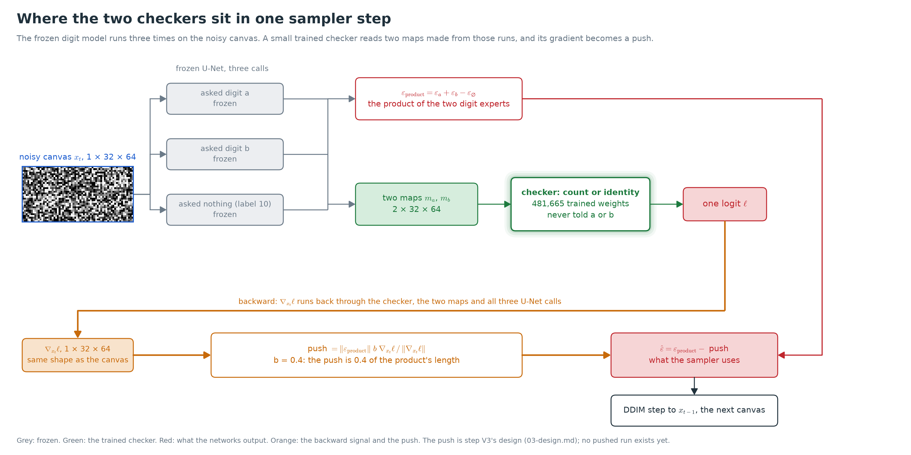

# The digit-map checkers: a zoom ladder

This ladder teaches the two small classifiers Loop 8 trains on noisy digit canvases: a count checker ("two digits, one in each half?") and an identity checker ("the two asked digits?"). They share one network, so the canvas, the noise, the maps, the network and the forward pass appear once, and the ladder branches where the labels, the loss and the two backward passes differ.

**Start at [the closing page](read-through-a-small-network.md).** It walks one canvas through both checkers, from the picture to the logit and back as gradients, and links every other rung from the place it helps.

## What is real and what is illustrative

**Real.** The canvases (rebuilt here with the data hash `f70b0fb3...`), the noise schedule and the 16 timesteps, the time features, every layer size and weight count (481,665 in all), the training and test counts per branch, the V2 rehearsal scores, and the count checker's scores from job 94085's log.

**Illustrative.** The noise draw on the example canvases (numpy seed 0; the checker draws its own), and the whole miniature apart from its noise level and time features.

**Not shown, because it does not exist yet.** Real maps, logits and gradients on the example canvases, and the identity checker's score. The [closing page's last section](read-through-a-small-network.md#9-what-is-owed) says what each needs.

## The rungs

| Level | What it shows | Where |
|---|---|---|
| 0 | the real system: one sampler step of the digit product with a checker's push | [where the checkers sit](0.5-network-view/dc0-where-the-checkers-sit.png); the step without a checker is [the 7b sampler step](../mnist-guidance-explained/1-the-sampler-step/nv7b-1-one-sampler-step.png), linked |
| 0.5 | the network view: canvas and noise, maps, network, timestep (shared), then labels and the two backward passes (per branch) | [the network view](0.5-network-view/README.md) |
| 1 | the idea, illustrated | [three prompts](1-illustrations/diagram-prompts.md), written and not rendered |
| 2 | the miniature: a 4-pixel canvas, every number, one training step per branch, the push | [the worked miniature](2-miniature/README.md) |
| 3 | the real code, block by block | [the code walk](3-code/walk-v2-learn.md), at commit `a737766d` |
| beside | each equation down to fundamentals | [the rebuild companion](rebuild-from-fundamentals.md) |
| close | the two checkers read through the small network | [the closing page](read-through-a-small-network.md) |
| owed | real maps, logits and gradients from the trained heads | needs one GPU job after the heads are saved; see the closing page |

## What is in this folder

| File | What it is |
|---|---|
| `ladder.json` | the ladder's record: each rung's state and files, the colour key, the code commit, what is owed |
| `NOTATION.md` | the symbols every rung uses, beside the names the code uses |
| `numbers/make_numbers.py`, `numbers/numbers.json` | every full-scale number, each with its source |
| `numbers/env/` | the rebuilt canvases (`dataset.npz`, 7.3 MB) and their manifest; regenerated by `build_env.py`, not worth committing |
| `numbers/examples/` | the seven example canvases, clean and noised, as `.npy` |
| `numbers/split-94085-log-lines.jsonl` | the count checker's two result lines, copied verbatim from job 94085's log |
| `numbers/make_results_figure.py`, `numbers/results-so-far.png` | the scores so far, one bar per checker |
| `numbers/check_pages.py` | checks every link and thumbnail on the ladder's pages resolves |
| `figure_kit.py` | the drawing helpers, which refuse to write a figure where a line crosses a box or label |
| `route-zoom-ladder-digit-map-checkers.md` | the steps that rebuild this ladder, each with its command |

**How it was made.** Built unattended on the laptop with no GPU and no PyTorch, from `~/.claude/venvs/figures`. The canvases were rebuilt from MNIST with the project's own `build_env.py`. The figures were drawn with matplotlib (the word-map ladder's figure kit needs cairosvg, which that environment lacks), with the same refusal to cross lines and labels. The style is the clean cheat-sheet register chosen for journey 13 and the word-map ladder, carried over without asking because the ladder was built unattended.
