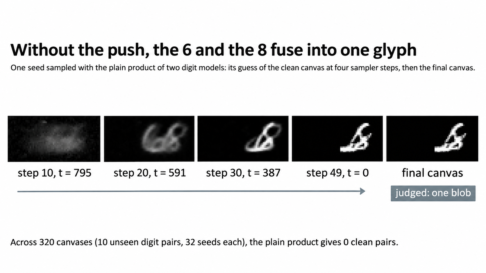
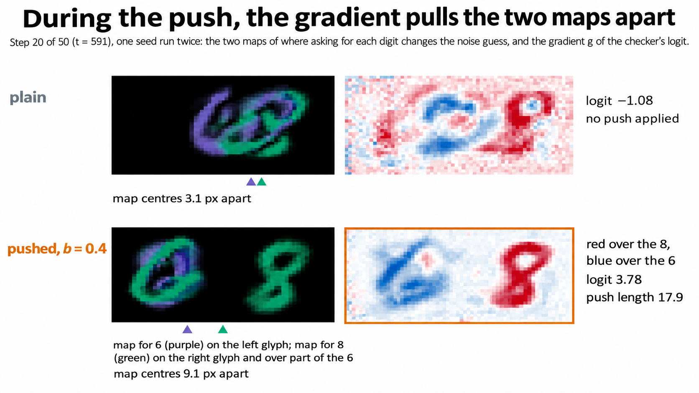
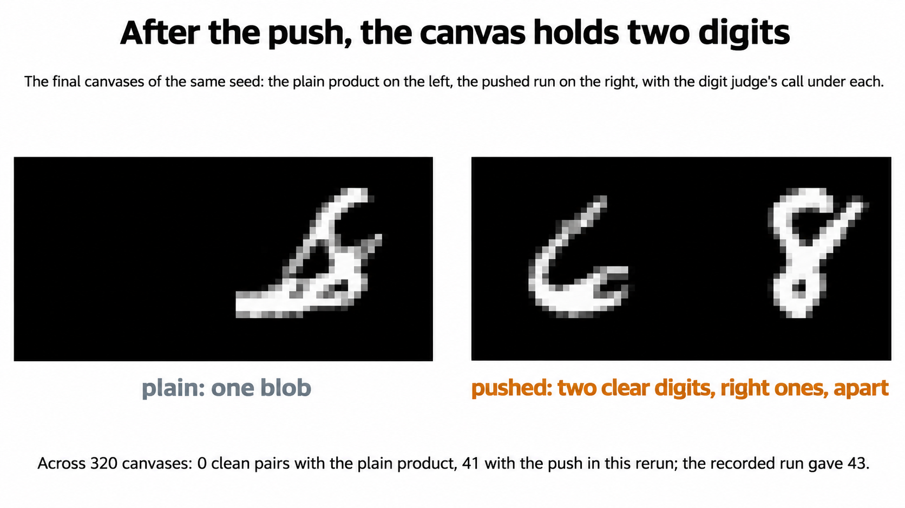
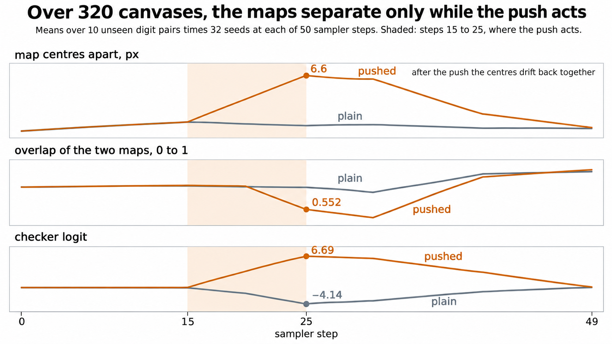

# How the push makes two digits, in four pictures

These four pictures walk how the count checker's push turns one fused glyph into two digits, using the real sampling runs of job 94161. The deep version is frame 14 of [the digit-map checkers miniature page](https://claude.ai/artifact/MX2hKBUWBXSzPQSbaxysKC#two-digits), where every sampler step can be stepped and played.

<table>
<tr>
<td width="50%"> 1. Without the push, the 6 and the 8 fuse into one glyph.</td>
<td width="50%"> 2. During the push, the gradient pulls the two maps apart.</td>
</tr>
</table>

**Read the first picture.** One seed (digits 6 and 8, seed 1000) is sampled with the plain product of the two digit models, and each panel is the model's guess of the clean canvas at that sampler step. At step 10 (t = 795) the guess is a grey cloud. By step 20 (t = 591) it is a 6 and an 8 drawn on top of each other in the right half, and by step 49 (t = 0) the overlap has hardened into one glyph that the digit judge calls "one blob". Across all 320 canvases (10 unseen pairs, 32 seeds each) the plain product ends with 0 clean pairs. After this picture you should expect the plain product to put both digits in one place on these pairs.

**Read the second picture.** The same seed at step 20, run twice with the same noise. In the plain row the map for 6 (purple) and the map for 8 (green) lie over the same fused glyph, with centres 3.1 px apart, and the logit is −1.08. In the pushed row, which has had five steps of push at length b = 0.4, the 6 and the 8 sit in separate halves: the map for 6 covers the left glyph, the map for 8 covers the right glyph and part of the 6, so its centre sits between the two, 9.1 px from the 6's. The gradient g is red over the 8 and blue over the 6, the logit is 3.78, and the push added to the noise guess at this step has length 17.9. After this picture you should be able to say where the push acts: on the pixels that move the two maps' mass apart.

<table>
<tr>
<td width="50%"> 3. After the push, the canvas holds two digits.</td>
<td width="50%"> 4. Over 320 canvases, the maps separate only while the push acts.</td>
</tr>
</table>

**Read the third picture.** The two final canvases of that seed. The plain run ends as one fused glyph, judged "one blob"; the pushed run ends as a 6 on the left and an 8 on the right, judged "two clear, right, apart". Across 320 canvases this repeat gave 41 clean pushed canvases against 0 plain. The recorded run (step V3 of the design) gave 43, and its count is the reported result. After this picture you should expect the push to win on roughly one canvas in eight on unseen pairs, and to lose on the rest.

**Read the fourth picture.** Means over all 320 canvases at each of the 50 sampler steps, grey for plain and orange for pushed, with steps 15 to 25 shaded where the push acts. The map centres move from 1.6 px apart at step 15 to 6.6 px at step 25 under the push, while the plain run stays near 1.5; the overlap of the two maps falls to 0.552 at step 25, and the logit reaches 6.69 against the plain run's −4.14. After step 25 the centres drift back together, to about 1 px by step 49 in both runs. After this picture you should read a late map's centre as saying nothing about where the digits ended up.

**What the set leaves out.** The lost seeds (one per pair, where the pushed run also ends as "one blob") are in frame 14 under "not separated"; the pairs 5 and 6 and 7 and 9 are there too; the noisy canvas at each step is drawn nowhere, and the guess of the clean canvas stands for it.

How these were made and checked

**Made by Codex** (codex-cli, read-only, image tool) from prompts that carried only the numbers below and one reference image each: real frames for stills 1 to 3, drawn from `../numbers/real/trace/trace-examples.npz` (pair 6 and 8, seed 1000), and a screenshot of frame 14's curves for still 4. Codex could not read the repo, so everything it drew came from the prompt. The maps on still 2 are drawn on black, where the page draws them on white; purple and green carry the same meaning in both.

**Numbers checked against the key**: every number drawn on the four stills is one of these values, and each matches `page_key.json` and the review's table (`artifacts/notes/progress/abstract-checkers/06-does-it-compose/review.md`, "What the two maps do while the push acts"): steps and t (10, 795; 20, 591; 30, 387; 49, 0), 320 canvases, 0 plain, 41 pushed, 43 recorded, centres 3.1 and 9.1 px, logits −1.08 and 3.78, push length 17.9, b = 0.4, and 6.6, 0.552, 6.69 and −4.14 at step 25.

**Positions checked by pixel**: still 2 went through two revisions for its centre markers. The top-row markers sit within 1% of the panel width of the true centres (40.2 and 43.3 px of 64). In the bottom row the green marker sits at 50.0% against 50.6% and the purple one at 33.9% against 36.4%, so the drawn gap is about 10.3 px against the true 9.1 px. Still 4's curves are drawn through the seven tabled steps (0, 15, 20, 25, 30, 40, 49), not all 50, and carry no y-axis scale.

**Leak check**: the prompts and pictures carry no host, address, key or private record.

