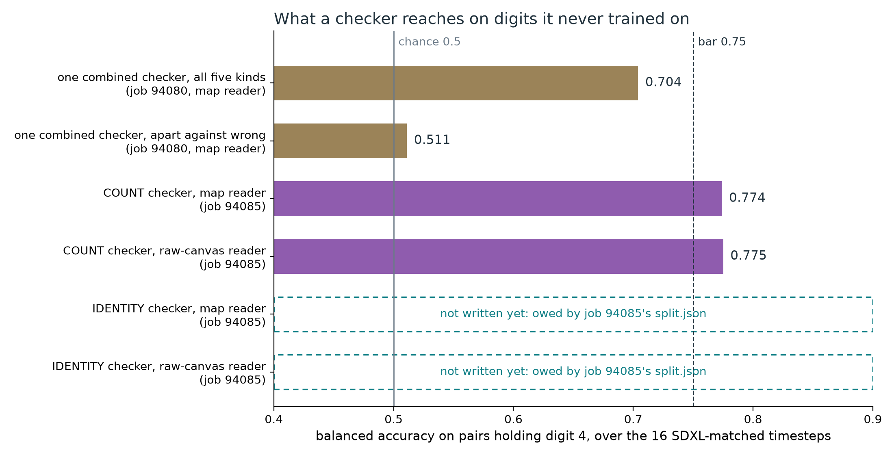

# The two digit checkers, read through a small network

Loop 8 trains two small classifiers on noisy digit canvases. The count checker answers "are there two digits, one in each half?" and the identity checker answers "are they the two digits that were asked for?". This page walks one canvas through both, from the picture to the logit and back again as gradients, one idea per section. Every picture links to its full size, and every number names where it comes from.

## Table of contents

- [1. The two questions](#1-the-two-questions)
- [2. What the noise leaves](#2-what-the-noise-leaves)
- [3. The checker reads two maps, never the digits](#3-the-checker-reads-two-maps-never-the-digits)
- [4. The network, layer by layer](#4-the-network-layer-by-layer)
- [5. One forward pass with every number](#5-one-forward-pass-with-every-number)
- [6. Training: the error flows into the weights](#6-training-the-error-flows-into-the-weights)
- [7. The push: the gradient flows into the canvas](#7-the-push-the-gradient-flows-into-the-canvas)
- [8. What the checkers reached so far](#8-what-the-checkers-reached-so-far)
- [9. What is owed](#9-what-is-owed)

## 1. The two questions

Both checkers have the same 481,665-weight network. They differ only in the labels they are trained on. Count calls an `apart` canvas (1 | 3) and a `wrong` canvas (3 | 2) both 1, because each holds two digits one per half. Identity calls `apart` 1 and `wrong` 0, and never sees the other three kinds. Both train on the 6 pairs among digits 0 to 3 and are scored on the 4 pairs holding digit 4, which they never saw.

Count's job can be done by looking at where ink sits. Identity's cannot, because `apart` and `wrong` have the same layout.

## 2. What the noise leaves

The checkers train at the 16 timesteps that give the toy SDXL's noise at its first 16 sampler steps. There $\sqrt{\bar\alpha_t}$, the weight on the clean canvas, runs from 0.076 to 0.308 and the weight on the noise from 0.997 to 0.951:

$$x_t = \sqrt{\bar\alpha_t}\,x_0 + \sqrt{1-\bar\alpha_t}\,\varepsilon .$$

On these two canvases the digits cannot be seen by eye at any of the four levels shown.

## 3. The checker reads two maps, never the digits

The frozen digit U-Net is asked three times: for digit $a$, for digit $b$, and for no digit. Where asking for $a$ changes its noise guess becomes the first map; the same for $b$ becomes the second. Each map is scaled so its mean over the 2,048 pixels is 1:

$$m_a = 2048 \cdot \frac{|\varepsilon_a - \varepsilon_\varnothing|}{\sum_{\text{pixels}} |\varepsilon_a - \varepsilon_\varnothing|}.$$

The checker gets these two maps, stacked as 2 × 32 × 64, and nothing else about the digits. In the [code walk](3-code/walk-v2-learn.md#3-the-two-maps) this is `maps()` in `v2_learn.py`.

## 4. The network, layer by layer

Three convolutions take the 2 × 32 × 64 maps to 128 × 8 × 16. The timestep enters as [16 sine and cosine numbers](0.5-network-view/dc4-the-timestep-as-sixteen-numbers.png), which set a scale and a shift on each of the 128 channels after `c1` and join the MLP's input. A mean and a max over the 128 positions give 256 numbers; with the 16 time features that is 272 inputs to an MLP that ends in one logit $\ell$. The chance it gives label 1 is $\sigma(\ell)$.

## 5. One forward pass with every number

The [miniature](2-miniature/README.md) shrinks the canvas to 4 pixels and the network to one convolution, keeping each step. Its weights are set by hand and only the noise level (t = 480) is real. On the apart canvas the map for digit 1 is largest on pixel 2, where a "1" has ink, and the logit comes out at 0.772; the wrong canvas gives 0.352.

## 6. Training: the error flows into the weights

The loss is binary cross-entropy, and its slope in the logit is the chance minus the label, $\sigma(\ell) - y$. That one number runs back through the network by the chain rule and gives every trained weight its slope; Adam then moves each weight a little against it. The maps were computed without gradients, so nothing reaches the U-Net. One update uses 256 canvases, half label 1, and there are 4,000.

In the miniature the same starting weights take one step per branch. Count wants both logits up, and both rise (0.772 to 1.459, 0.352 to 0.997). Identity wants apart up and wrong down, but the wrong canvas's larger error wins the shared weights: both logits fall by about 0.2 and the gap between them goes from 0.4205 to 0.4192. To separate the two, a head has to find something in the maps that differs between them.

## 7. The push: the gradient flows into the canvas

To steer a drawing (step V3), the trained weights stay fixed and the same backward pass is carried further: through the maps' scaling and absolute value, through all three U-Net calls, to the noisy canvas. That gives $g = \nabla_{x_t}\ell$, one number per pixel. Only its direction is used:

$$\hat\varepsilon = \varepsilon_{\text{product}} - \lVert\varepsilon_{\text{product}}\rVert\; b\; \frac{g}{\lVert g\rVert}, \qquad b = 0.4 .$$

In the miniature $\lVert g\rVert$ is 1.441 on one canvas and 0.850 on the other, and both pushes come out at exactly 0.40 of the product's length. A small step along $g$ raises the logit (0.7721 to 0.7866), which is the sign check.

## 8. What the checkers reached so far

Each bar is balanced accuracy on the pairs holding digit 4, over the 16 timesteps with 4 noise draws per canvas; 0.5 is chance and 0.75 is the bar the design set. The rows answer different questions, so read each on its own.

**One combined checker** (job 94080, [the V2 review](../../../../artifacts/notes/progress/abstract-checkers/05-does-it-learn/review.md)) learned where digits sit and not which digits: 0.704 over all five kinds and 0.511 on `apart` against `wrong`. Its score rose from 0.59 at the noisiest step to 0.81 at the least noisy, shown in [the two noise levels figure](../../../../artifacts/notes/progress/abstract-checkers/05-does-it-learn/two-noise-levels.png).

**The count checker** (job 94085) met both of its bars: the map reader scored 0.774 on pairs holding 4 and 0.781 on the trained pairs, a gap of 0.007, after passing the overfit check 16 of 16. The raw-canvas reader scored 0.775 and 0.793. These are the lines the job printed to its log; the job had not yet written `split.json` when this page was built.

**The identity checker** had not finished. Its slot stays empty until `split.json` exists.

## 9. What is owed

**The identity result.** Job 94085 writes `/datasets/mmolefe/poe_repair_min/loop-8/v2/sdxl-split/split.json` when it ends. Copy it to `numbers/split.json`, rerun `numbers/make_numbers.py` and `numbers/make_results_figure.py`, and the slot fills from the file, with per-timestep scores.

**Real maps, real logits and real gradients on these canvases.** The split run never saves its two trained heads, so nothing on this page can show what the real checkers do to the `apart` and `wrong` canvases above. That needs one short GPU job, after the owner approves V2's final read:

1. retrain the count head and the identity head with the split stage's settings (or extend `stage_split` to `torch.save` each head), on the snapshot of commit `6c3f8a16`;
2. load the frozen share-0.0 U-Net and both heads, and for the canvases `apart_1_3`, `wrong_1_3`, `apart_3_4` and `wrong_3_4` (indices in `numbers/numbers.json`) at timesteps 712, 616, 539 and 480 with the display noise in `numbers/examples/display-noise.npy`, save $m_a$, $m_b$, each head's logit, and $g = \nabla_{x_t}\ell$ computed with the maps built outside `torch.no_grad`;
3. copy that file back and redraw dc2's empty tiles and a real version of mm1 and mm3 from it.

The data, the canvases and the noise are already fixed, so the job only has to run the networks.
