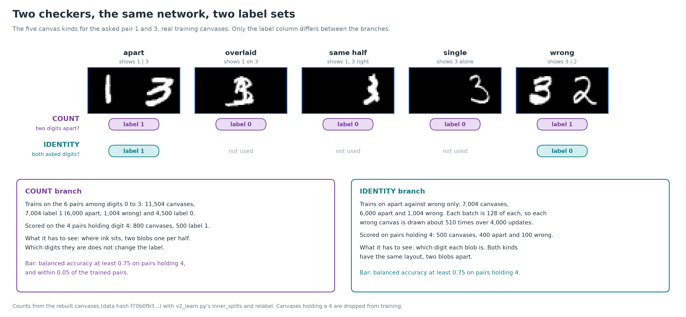
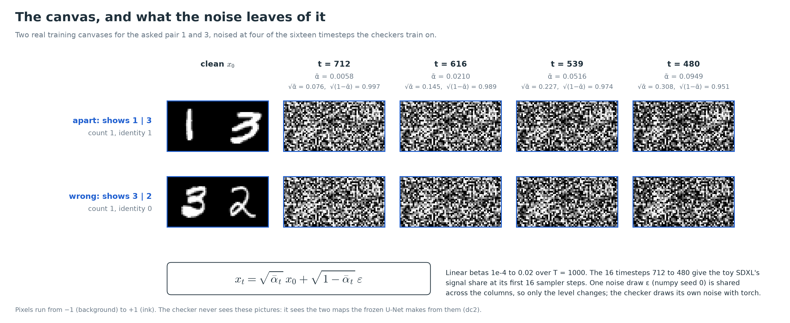
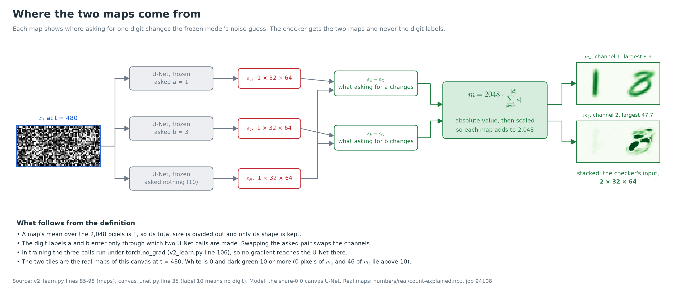
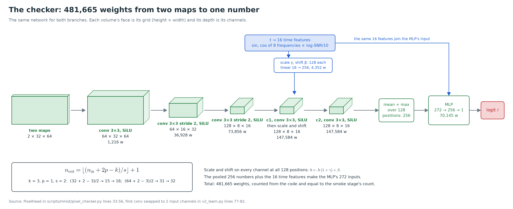
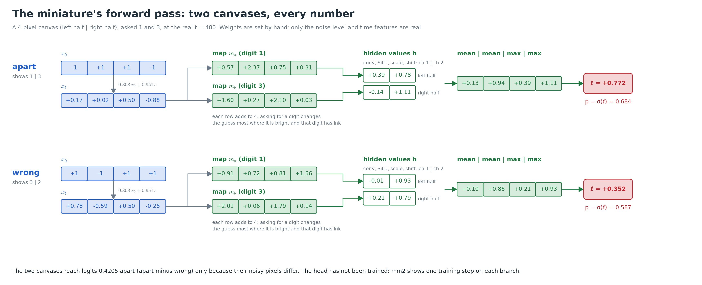
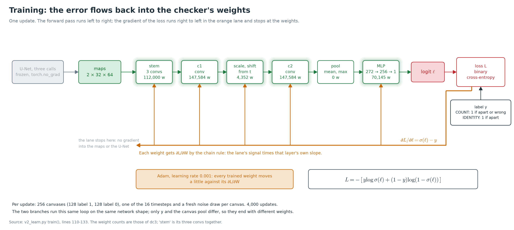
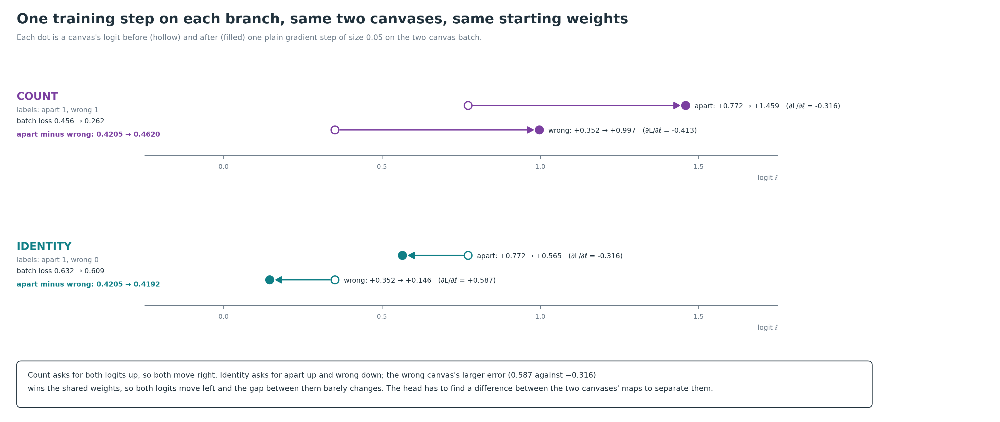
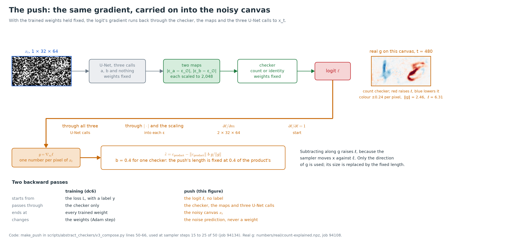
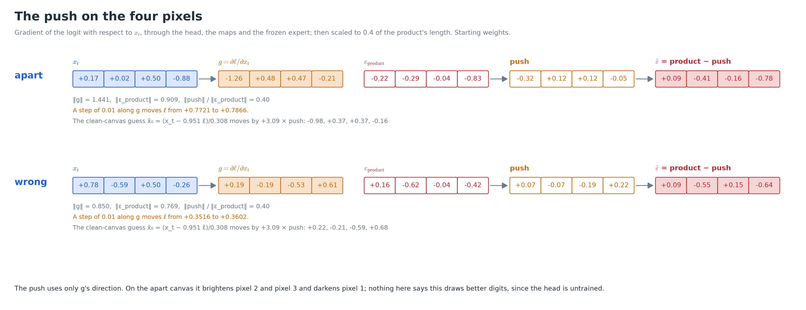

# The two digit checkers, read through a small network

Loop 8 trains two small classifiers on noisy digit canvases. The count checker answers "are there two digits, one in each half?" and the identity checker answers "are they the two digits that were asked for?". This page walks one canvas through both, from the picture to the logit and back again as gradients, one idea per section. Every picture links to its full size, and every number names where it comes from.

## Table of contents

- [1. The two questions](#1-the-two-questions)
- [2. What the noise leaves](#2-what-the-noise-leaves)
- [3. The checker reads two maps, never the digits](#3-the-checker-reads-two-maps-never-the-digits)
- [4. The network, layer by layer](#4-the-network-layer-by-layer)
- [5. One forward pass with every number](#5-one-forward-pass-with-every-number)
- [6. Training: the error flows into the weights](#6-training-the-error-flows-into-the-weights)
- [7. The push: the gradient flows into the canvas](#7-the-push-the-gradient-flows-into-the-canvas)
- [8. What the checkers reached](#8-what-the-checkers-reached)
- [9. The real count checker on these four canvases](#9-the-real-count-checker-on-these-four-canvases)

## 1. The two questions

Both checkers have the same 481,665-weight network. They differ only in the labels they are trained on. Count calls an `apart` canvas (1 | 3) and a `wrong` canvas (3 | 2) both 1, because each holds two digits one per half. Identity calls `apart` 1 and `wrong` 0, and never sees the other three kinds. Both train on the 6 pairs among digits 0 to 3 and are scored on the 4 pairs holding digit 4, which they never saw.

Count's job can be done by looking at where ink sits. Identity's cannot, because `apart` and `wrong` have the same layout.

## 2. What the noise leaves

The checkers train at the 16 timesteps that give the toy SDXL's noise at its first 16 sampler steps. There $\sqrt{\bar\alpha_t}$, the weight on the clean canvas, runs from 0.076 to 0.308 and the weight on the noise from 0.997 to 0.951:

$$x_t = \sqrt{\bar\alpha_t}\,x_0 + \sqrt{1-\bar\alpha_t}\,\varepsilon .$$

On these two canvases the digits cannot be seen by eye at any of the four levels shown.

## 3. The checker reads two maps, never the digits

The frozen digit U-Net is asked three times: for digit $a$, for digit $b$, and for no digit. Where asking for $a$ changes its noise guess becomes the first map; the same for $b$ becomes the second. Each map is scaled so its mean over the 2,048 pixels is 1:

$$m_a = 2048 \cdot \frac{|\varepsilon_a - \varepsilon_\varnothing|}{\sum_{\text{pixels}} |\varepsilon_a - \varepsilon_\varnothing|}.$$

The checker gets these two maps, stacked as 2 × 32 × 64, and nothing else about the digits. In the [code walk](3-code/walk-v2-learn.md#3-the-two-maps) this is `maps()` in `v2_learn.py`.

The two tiles in the figure are the real maps of the `apart` canvas at t = 480, where the canvas itself looks like noise. Both trace ink the eye cannot find: $m_a$ spreads over the 1 and the 3 and peaks at 8.9, and $m_b$ sits almost entirely on the 3, with 46 pixels above 10 and a peak of 47.7.

## 4. The network, layer by layer

Three convolutions take the 2 × 32 × 64 maps to 128 × 8 × 16. The timestep enters as [16 sine and cosine numbers](0.5-network-view/dc4-the-timestep-as-sixteen-numbers.png), which set a scale and a shift on each of the 128 channels after `c1` and join the MLP's input. A mean and a max over the 128 positions give 256 numbers; with the 16 time features that is 272 inputs to an MLP that ends in one logit $\ell$. The chance it gives label 1 is $\sigma(\ell)$.

## 5. One forward pass with every number

The [miniature](2-miniature/README.md) shrinks the canvas to 4 pixels and the network to one convolution, keeping each step. Its weights are set by hand and only the noise level (t = 480) is real. On the apart canvas the map for digit 1 is largest on pixel 2, where a "1" has ink, and the logit comes out at 0.772; the wrong canvas gives 0.352.

## 6. Training: the error flows into the weights

The loss is binary cross-entropy, and its slope in the logit is the chance minus the label, $\sigma(\ell) - y$. That one number runs back through the network by the chain rule and gives every trained weight its slope; Adam then moves each weight a little against it. The maps were computed without gradients, so nothing reaches the U-Net. One update uses 256 canvases, half label 1, and there are 4,000.

In the miniature the same starting weights take one step per branch. Count wants both logits up, and both rise (0.772 to 1.459, 0.352 to 0.997). Identity wants apart up and wrong down, but the wrong canvas's larger error wins the shared weights: both logits fall by about 0.2 and the gap between them goes from 0.4205 to 0.4192. To separate the two, a head has to find something in the maps that differs between them.

## 7. The push: the gradient flows into the canvas

To steer a drawing (step V3), the trained weights stay fixed and the same backward pass is carried further: through the maps' scaling and absolute value, through all three U-Net calls, to the noisy canvas. That gives $g = \nabla_{x_t}\ell$, one number per pixel. The real $g$ of the count checker on the `apart` canvas at t = 480 is drawn in the figure: it is positive along the 3's strokes and negative along the 1's. Only its direction is used:

$$\hat\varepsilon = \varepsilon_{\text{product}} - \lVert\varepsilon_{\text{product}}\rVert\; b\; \frac{g}{\lVert g\rVert}, \qquad b = 0.4 .$$

In the miniature $\lVert g\rVert$ is 1.441 on one canvas and 0.850 on the other, and both pushes come out at exactly 0.40 of the product's length. A small step along $g$ raises the logit (0.7721 to 0.7866), which is the sign check.

The real push uses the count checker alone and acts at sampler steps 15 to 25 of 50 (timesteps 693 to 489). Its length $b = 0.4$ was chosen from 0.1, 0.2 and 0.4 on the seen pairs among digits 0 to 4, where clean pairs of 320 rose 8, 20, 40. Its code is `make_push` in `v3_compose.py`, read in [the code walk's block 11](3-code/walk-v2-learn.md#11-the-push).

## 8. What the checkers reached

Each score is balanced accuracy over the 16 SDXL-matched timesteps, where 0.5 is chance and 0.75 is the bar the design set. The numbers come from the stage reviews under `artifacts/notes/progress/abstract-checkers/`, and the count checker's own from `numbers/real/count-final.json`.

**The count checker carries over to digits it never saw.** Trained on the 10 pairs among digits 0 to 4 (job 94108), it scores 0.791 on the 10 pairs among digits 5 to 9 and 0.782 on the pairs it trained on, so it meets both bars ([the V2 review](../../../../artifacts/notes/progress/abstract-checkers/05-does-it-learn/review.md)). Its score rises from 0.63 at the noisiest timestep to 0.92 at the least noisy.

**The identity checker does not learn which digits are present.** It scores 0.555 on the pairs holding digit 4 (job 94085), and the right-digits checker trained the same way scores 0.556 on digits 5 to 9. Telling `apart` from `wrong` at these noise levels is out of reach for both.

**The count checker's push draws clean pairs the plain product never draws.** On the 10 pairs among digits 5 to 9 at 32 seeds each, the push gives 43 clean pairs of 320, where the plain product gives 0, a random push of the same length 1 and the best of 4 seeds picked by the checker 0. The lead is 5.7 times its standard error of 7.58. A rerun on another node gives 41, so a pushed render is not bit-reproducible across nodes ([the V3 review](../../../../artifacts/notes/progress/abstract-checkers/06-does-it-compose/review.md)). The push splits the fused glyph into two digits on 161 of 320 canvases; about a quarter of those carry both asked digits clearly, which fits a checker that reads where digits sit and not which.

**Removing one checker at a time is null by the written rule.** With three checkers pushing together (count, right digits and order), removing count lowers the count column 28.1 points and removing order lowers the order column 40.4. A random push of the same size in its place lowers it just as much (25.8 and 45.9), so the fall comes from losing that checker's direction. Each of those two removals also moves another column by about 7 points, past the 4.2-point limit, and removing right digits lowers its own column only 2.6 points, under the 6.25-point bar. No checker meets the whole rule ([the V5 review](../../../../artifacts/notes/progress/abstract-checkers/08-remove-one-checker/review.md)).

[The Loop 8 summary](../../../../artifacts/notes/progress/abstract-checkers/09-summary/executive-summary.md) sets these against the other loops and the published rivals. None of it has been run on SDXL.

## 9. The real count checker on these four canvases

The saved count checker (job 94108) was run on the four example canvases of this ladder, with the same noise draw the figures use. Each cell is its logit $\ell$ and, in brackets, the chance $\sigma(\ell)$ it gives label 1. All four canvases have count label 1.

| Canvas | t = 712 | t = 616 | t = 539 | t = 480 |
|---|---|---|---|---|
| `apart`, 1 \| 3 | +0.54 (0.63) | +1.57 (0.83) | +3.81 (0.98) | +6.31 (1.00) |
| `wrong`, 3 \| 2 | +0.08 (0.52) | −1.11 (0.25) | −1.28 (0.22) | −1.02 (0.27) |
| `apart`, 3 \| 4 | +0.01 (0.50) | +0.08 (0.52) | +1.30 (0.79) | +3.00 (0.95) |
| `wrong`, 2 \| 3 | +0.06 (0.52) | −0.35 (0.41) | +1.27 (0.78) | +4.09 (0.98) |

At the noisiest timestep every canvas sits near 0.5, and the checker grows confident as the noise falls, as its score by timestep does. It calls the `wrong` canvas showing 3 | 2 label 0 at three of the four timesteps although that canvas has two digits one per half. This checker trained on digits 0 to 4, so all four canvases use digits it trained on; the two holding a 4 come from the test split. The file is `numbers/real/count-explained.npz`, and `numbers/real/count-stages.npz` (job 94116) holds every layer's output on the same 16 cells, which [the miniature page](https://claude.ai/artifact/MX2hKBUWBXSzPQSbaxysKC) draws.

**Not shown here.** The identity checker was never saved, so it has no real maps, logits or gradients on these canvases. The three illustrations of level 1 are written as prompts and not rendered.
