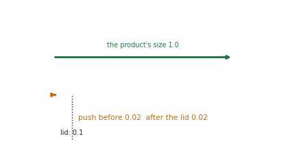
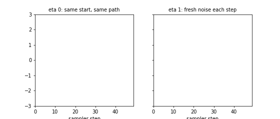
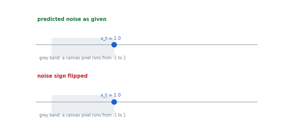
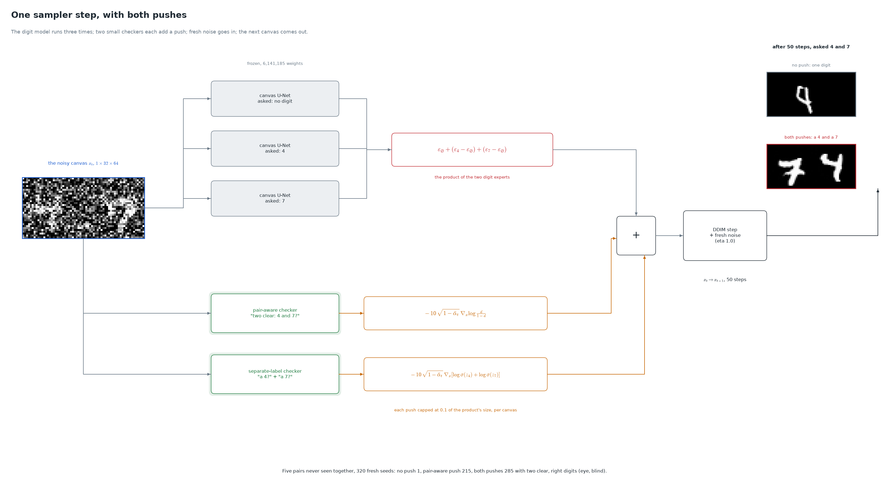
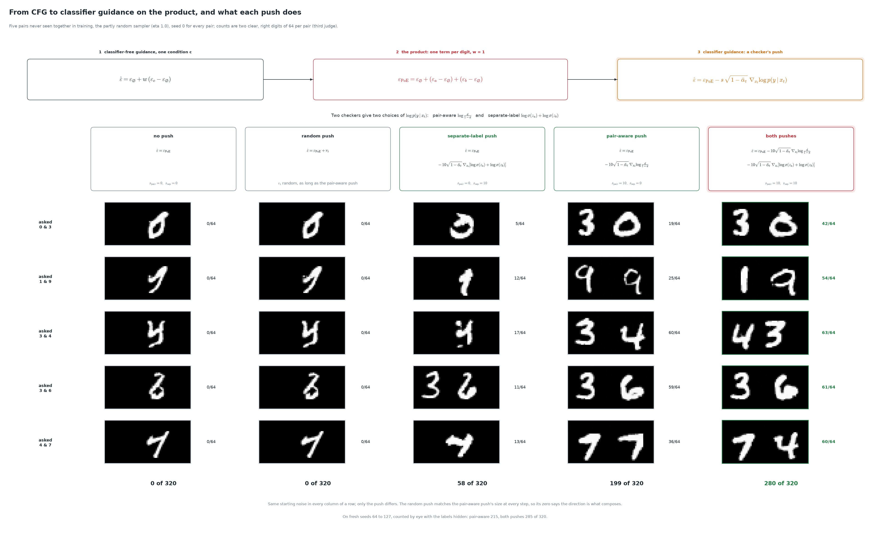

# 1. The sampler step: what happens to one canvas, and how the results compare

**The question.** In one step of the step 7b sampler, what is asked of which network, and what does each push do to the answer?

Seeds, canvases and counts come from [the step 7b results](../../results/how-good-must-the-checker-be-on-mnist/README.md). The figures were drawn by `network-view/make_network_view_figures.py` and `results-figures/make_results_figures.py` in that folder; the numbers sit in `network-view/network_view_numbers.json`.

## Words on this page, taken apart

Each toy below is ordinary and small enough to do on paper; [the toys](toys/triad_toys.py) computes every hand answer and fails if one is wrong, and its numbers are in `toys/toy_numbers.json`. Words that [journey 13](../../../../../../goal-setting/learning/deep-learning/diffusion-models/13-classifier-guidance-by-hand/textbook/00-index.md) already teaches are linked to its chapter and not taught again here: the noise prediction as a score ([chapter 1.1](../../../../../../goal-setting/learning/deep-learning/diffusion-models/13-classifier-guidance-by-hand/textbook/01-the-guided-noise-prediction.md#11-the-line-toy-and-the-score-as-a-noise-prediction)), the push ([1.3](../../../../../../goal-setting/learning/deep-learning/diffusion-models/13-classifier-guidance-by-hand/textbook/01-the-guided-noise-prediction.md#13-from-score-to-noise-the-guided-prediction)) and the product as two classifiers ([chapter 2](../../../../../../goal-setting/learning/deep-learning/diffusion-models/13-classifier-guidance-by-hand/textbook/02-the-product-as-two-classifiers.md)).

**The cap**

💥 **Broken run (without):** one push in a step can be several times larger than the picture's own prediction, and the canvas is shoved into a blob. At strength 10 on 7 and 8 this does not happen: letting the push be as large as it likes (cap 1.0) gave 49 clear pairs of 64 by eye against 47 with the cap at 0.1, no worse. At strength 30 the cap is hit by half the canvases or more on 40 of 50 steps. The cap is a seat belt, not a lever.

🔤 **The name:** a *cap* is a lid, a most. The push can be anything up to a most and no more. The most is 0.1 of the size of the product's own prediction, canvas by canvas. Written as a sentence: new push = old push × min(1, 0.1 × product size ÷ old push size).

🧸 **Toy:** a shopkeeper says a price rise may be at most 10% of today's price. Today's price is 1.0 (the product's size). A rise of 0.4 is cut to 0.1; a rise of 0.05 is under the lid and stays 0.05.

🔨 **Build:** `toys/triad_toys.py`, toy C, gives [0.1, 0.05] and asserts it.

🎞️ **Moving picture:** [toy-c-the-cap.gif](toys/toy-c-the-cap.gif): a push grows from 0.02 to 0.6 beside the product's size 1.0 and is stopped at the lid of 0.1.

**The fresh noise in a step (eta)**

🔤 **The name:** *eta* is the Greek letter used as the dial. *DDIM* is the step rule: use the predicted noise to guess the clean canvas, then step toward it. Eta set to 0 makes every step deterministic, the same start always makes the same canvas. Eta at 1 adds fresh noise of the size the schedule would have added anyway.

🧸 **Toy:** the real schedule, step 25 to 26 (t = 489 to 469, where ᾱ goes from 0.0869 to 0.1054). The fresh noise has size 0 at eta 0, 0.2078 at eta 0.5 and 0.4156 at eta 1, in a picture whose pixels run from −1 to 1.

🔨 **Build:** `toys/triad_toys.py`, toy D, computes the three sizes from the schedule.

💥 **Broken run (without):** the full broken run, with counts, is on [page 5](5-qualitative-grids.md): with no fresh noise two pushes at strength 10 give 41 clear pairs of 64 on 4 and 7, and at strength 30 only 26, strokes smeared into blobs; with fresh noise, 59 and 55.

🎞️ **Moving picture:** [toy-d-the-random-step.gif](toys/toy-d-the-random-step.gif): one pixel taking 50 steps toward a single target value of 0.8 from six starts, smooth at eta 0 and jittery at eta 1; the toy uses the real schedule.

**The DDIM step: guess the clean canvas, then step**

🔤 **The name:** *DDIM* is denoising diffusion implicit model, a step rule. From the noisy canvas x_t and the predicted noise it first guesses the clean canvas, x̂₀ = (x_t − √(1−ᾱ_t) · predicted noise) / √ᾱ_t, then builds the next, less noisy canvas from that guess and the same predicted noise.

🧸 **Toy:** t = 489, x_t = 1.0, predicted noise 0.5, where ᾱ = 0.0869. The clean guess is (1 − 0.9556 × 0.5) / 0.2948 = 1.772. The next canvas at t = 469, eta 0, is 1.048.

🔨 **Build:** `toys/triad_toys.py`, toy P.

🎞️ **Moving picture:** [toy-p-a-ddim-step.gif](toys/toy-p-a-ddim-step.gif): x_t, then the noise taken off, then the clean guess, then the next canvas, with the same step run again beneath it with the noise sign flipped.

💥 **Broken run (misuse):** flip the sign of the predicted noise and the clean guess jumps from 1.772 to 5.014, far outside a canvas whose pixels run from −1 to 1. A wrong sign looks like a plausible number, and only the range exposes it. Toy numbers.

## One step, drawn as networks

The noisy canvas goes into the same U-Net three times: asked with no digit, asked with digit a, asked with digit b. The product of those three answers is the noise prediction without any checker. Each checker then reads the canvas and adds a push. A DDIM step with fresh noise (eta 1.0) turns the result into the next canvas. The canvases at the right are finished runs: 1, 215 and 285 of 320 held-out seeds give two clear, right digits for no push, the pair-aware push alone and both pushes.

## From classifier-free guidance to the two pushes

The top row writes the same prediction three ways: classifier-free guidance with one condition, the product with two, and the product plus a checker's push. The five columns underneath each give the weights the equation takes and one finished canvas per held-out pair (seed 0 for every pair, not chosen), with the count of 64 under it. Totals out of 320, by the third judge: no push 0, random push 0, separate-label push 58, pair-aware push 199, both pushes 280. The judge counts about 5% below a careful eye.

## Both pushes inside one step

One canvas goes to three networks: the digit model, the pair-aware checker and the separate-label checker. Their terms are summed into one noise prediction, then the cap scales the two pushes down to at most 0.1 of the product's size, per canvas. Why each term has the form it has is in [the derivation](4-the-derivation.md); what the networks look like inside is in [the networks](2-the-networks.md).
