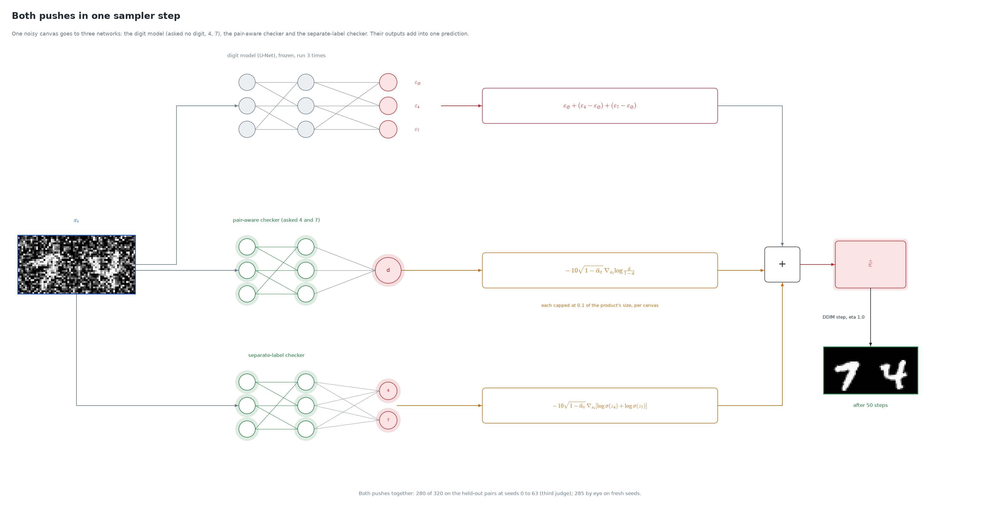

# 1. The sampler step: what happens to one canvas, and how the results compare

**The question.** In one step of the step 7b sampler, what is asked of which network, and what does each push do to the answer?

Seeds, canvases and counts come from [the step 7b results](../../results/how-good-must-the-checker-be-on-mnist/README.md). The figures were drawn by `network-view/make_network_view_figures.py` and `results-figures/make_results_figures.py` in that folder; the numbers sit in `network-view/network_view_numbers.json`.

## One step, drawn as networks

The noisy canvas goes into the same U-Net three times: asked with no digit, asked with digit a, asked with digit b. The product of those three answers is the noise prediction without any checker. Each checker then reads the canvas and adds a push. A DDIM step with fresh noise (eta 1.0) turns the result into the next canvas. The canvases at the right are finished runs: 1, 215 and 285 of 320 held-out seeds give two clear, right digits for no push, the pair-aware push alone and both pushes.

## From classifier-free guidance to the two pushes

The top row writes the same prediction three ways: classifier-free guidance with one condition, the product with two, and the product plus a checker's push. The five columns underneath each give the weights the equation takes and one finished canvas per held-out pair (seed 0 for every pair, not chosen), with the count of 64 under it. Totals out of 320, by the third judge: no push 0, random push 0, separate-label push 58, pair-aware push 199, both pushes 280. The judge counts about 5% below a careful eye.

## Both pushes inside one step

One canvas goes to three networks: the digit model, the pair-aware checker and the separate-label checker. Their terms are summed into one noise prediction, then the cap scales the two pushes down to at most 0.1 of the product's size, per canvas. Why each term has the form it has is in [the derivation](4-the-derivation.md); what the networks look like inside is in [the networks](2-the-networks.md).
