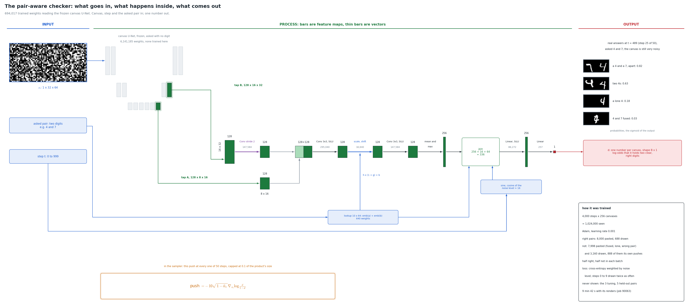
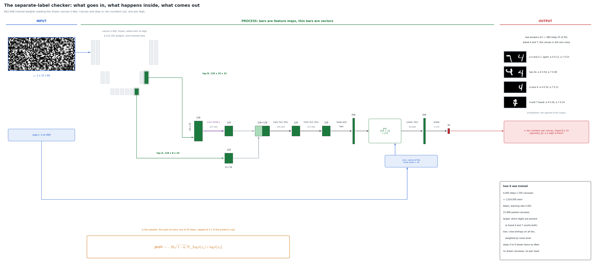
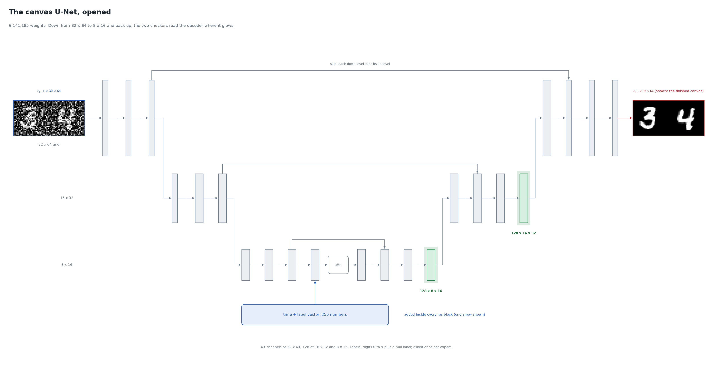
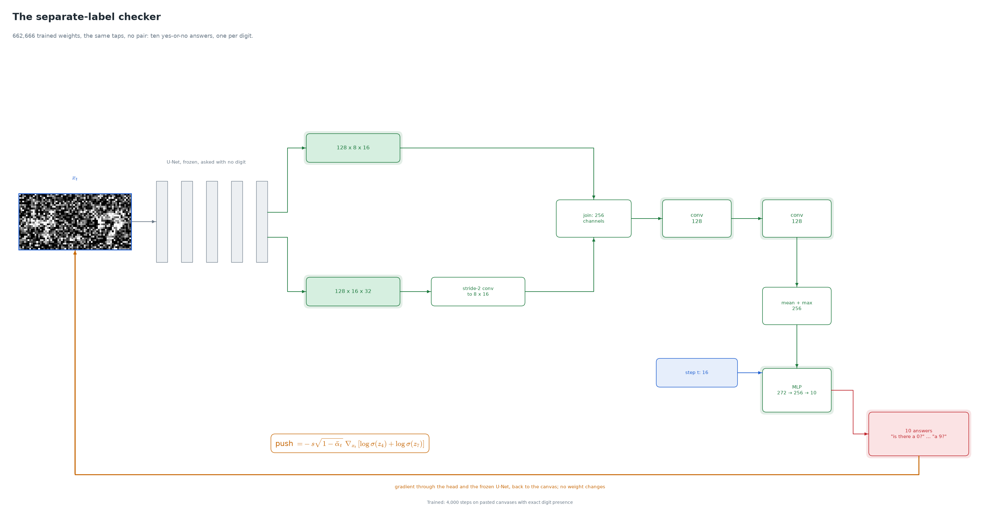
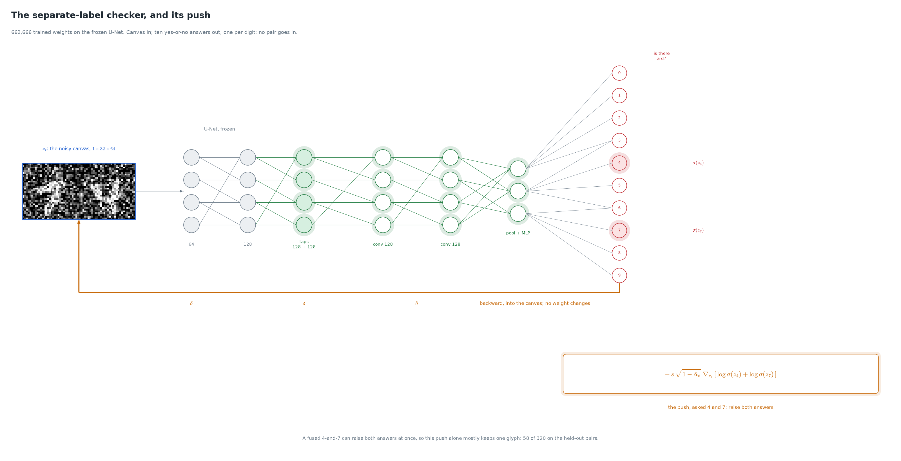

# 2. The networks: how big, what goes in, what comes out, how each was trained

**The question.** For the canvas U-Net and each of the two checkers: how many weights, what are the input and output shapes, how many layers, how long did it train, and what does it answer on a real canvas?

Every number comes from `architecture/arch_numbers.json`, read off the code, the checkpoints and the training log by `architecture/make_arch_numbers.py` (in [the step 7b results](../../results/how-good-must-the-checker-be-on-mnist/README.md)). The pictures are a real noisy canvas, the U-Net's real noise prediction for it, and four pasted MNIST test canvases noised to t = 489, asked 4 and 7.

## The canvas U-Net: 6,141,185 weights

**In and out.** A 1 x 32 x 64 noisy canvas, the step (0 to 999) and a digit label (0 to 9, or 10 for none) go in. A 1 x 32 x 64 noise prediction comes out; real output at t = 489 has mean −0.033 and spread 1.01.

**Inside.** Bars go from 32 x 64 with 64 channels down to 8 x 16 with 128 channels, through one attention block over 128 places, and back up. There are 17 ResBlocks. The step and label become 256 numbers added inside every ResBlock. The decoder's output at two depths, tap A (128 x 8 x 16) and tap B (128 x 16 x 32), is what the checkers read.

**Size.** Encoder 1,615,040, bottleneck 723,456, decoder 3,717,441, step and label embeddings 85,248.

**Training.** 40,000 steps of 128 canvases built fresh each time, so there are no fixed epochs: 5,120,000 canvases, about 85 passes over MNIST's 60,000 training digits. One canvas in 100 holds two digits (50,931 seen). Adam, learning rate 0.0002, weights averaged with EMA 0.999, squared error on the noise, label dropped to none 10% of the time, 1,000 noise levels with beta from 0.0001 to 0.02. 2 h on one RTX 3090; final loss 0.0077.

## The pair-aware checker: 694,017 weights

**In and out.** The canvas, the step and the asked pair go in; one number, d's log-odds, comes out (shape B x 1). On the four test canvases it gives 0.82 for a 4 and a 7 apart, 0.63 for two 4s, 0.18 for a lone 4 and 0.03 for the fused pair.

**Inside.** The two taps are joined to 256 channels at 8 x 16, pass through two 3 x 3 convolutions with the pair scaling and shifting between them (16,640 weights), are pooled to 256 numbers, joined with 16 step numbers and the 64-number pair embedding, and go through two linear layers.

**Training.** 4,000 steps of 256 = 1,024,000 canvases, Adam 0.001. Positives: 8,000 pasted pairs and 688 drawn; negatives: 7,998 pasted (fused, lone, wrong pair) and 3,160 drawn, 888 of them its own pushed pictures. The three tuning and five held-out pairs were never shown. 9 min 42 s including renders.

## The separate-label checker: 662,666 weights

**In and out.** The canvas and the step go in; ten numbers, one per digit, come out (shape B x 10). Each goes through its own sigmoid to a chance that digit is present; [the derivation's step 7](4-the-derivation.md#step-7-the-checkers-outputs-are-logits) says why and why there is no softmax.

**Training.** The same trunk without the pair or its scale and shift, 15,998 pasted canvases with exact digit presence, 4,000 steps of 256, no drawn canvases.

## Quicker views of the same networks

These drawings give less detail than the three sheets above and show where the networks sit in a sampler step. Their numbers come from `network-view/network_view_numbers.json`.

| Figure | What it adds |
|---|---|
|  | the U-Net as one picture, 64 channels at 32 x 64 and 128 at 16 x 32 and 8 x 16; the label joins the time vector, with no cross-attention |
|  | the pair-aware checker with the push's gradient lane back to the canvas |
|  | the separate-label checker; its push raises the two asked digits |
|  | the separate-label checker as circles, canvas in, ten answers out, the push flowing back |
|  | the pair-aware checker as circles, with the asked pair feeding every layer |
|  | how the pair-aware checker is retrained on its own pushed pictures: 444 per pass, 214 then 293 judged clean |
