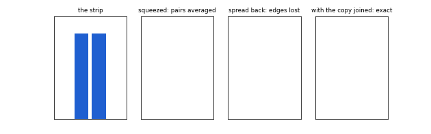
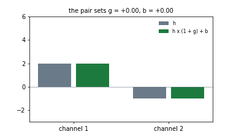
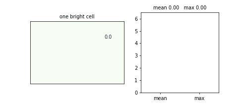
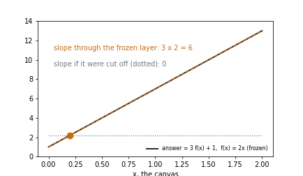
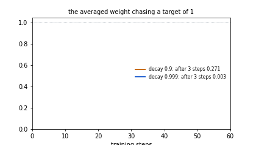
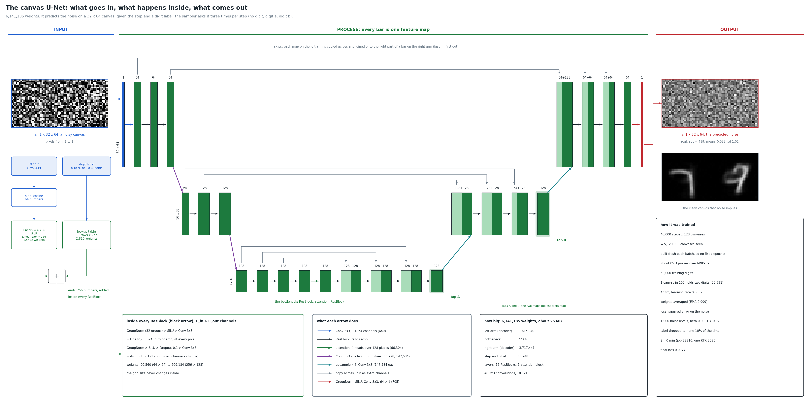
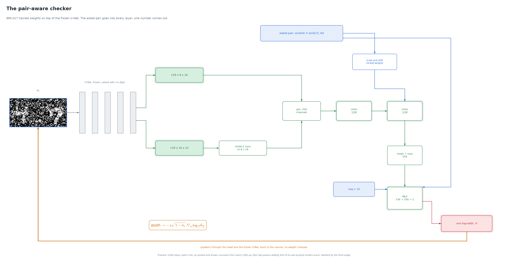
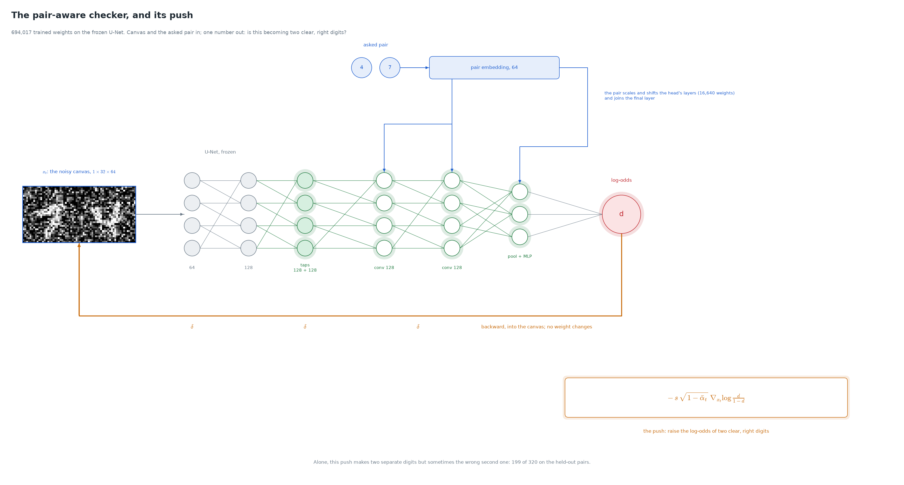
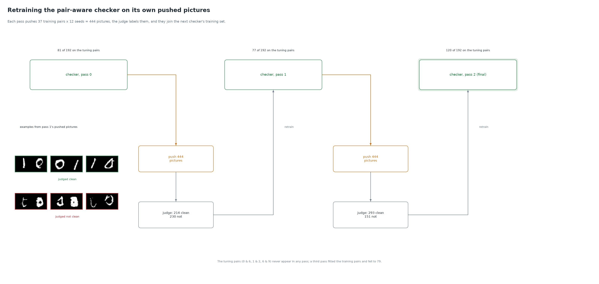

# 2. The networks: how big, what goes in, what comes out, how each was trained

**The question.** For the canvas U-Net and each of the two checkers: how many weights, what are the input and output shapes, how many layers, how long did it train, and what does it answer on a real canvas?

Every number comes from `architecture/arch_numbers.json`, read off the code, the checkpoints and the training log by `architecture/make_arch_numbers.py` (in [the step 7b results](../../results/how-good-must-the-checker-be-on-mnist/README.md)). The pictures are a real noisy canvas, the U-Net's real noise prediction for it, and four pasted MNIST test canvases noised to t = 489, asked 4 and 7.

## Words on this page, taken apart

Toys are in [the toys](toys/triad_toys.py); every hand answer is computed and asserted there.

**A skip**

💥 **Broken run (without):** squeeze a strip of four pixels [0, 4, 4, 0] down to two by averaging pairs, then spread each back to two: you get [2, 2, 2, 2], and the strip has lost its edges, an error of 8 pixel-units. With the original copied across beside it, the error is 0.

🔤 **The name:** a *skip* jumps over the middle of the network. In the U, the left arm's map at each size is copied straight across to the right arm at the same size and joined on as extra channels, which is why a right-arm bar is part light (the copy) and part dark (what it just computed).

🧸 **Toy:** the four-pixel strip above. 🔨 **Build:** `toys/triad_toys.py`, toy E, gives 8 and 0. 🎞️ **Moving picture:** [toy-e-a-skip.gif](toys/toy-e-a-skip.gif): the strip, squeezed, spread back with its edges lost (error 8), then the copy joined on (error 0).

**Scale and shift by the pair (the pair-aware checker's second layer)**

🔤 **The name:** *scale* multiplies and *shift* adds. The asked pair makes two numbers, g and b, and the layer's output h becomes h × (1 + g) + b, so the pair can turn parts of the picture up, down or off before anything else is read.

🧸 **Toy:** h = [2, −1]. Pair A gives g = 0.5, b = 1: the output is [4, −0.5]. Pair B gives g = −1, b = 0: the output is [0, 0], switched off. With no pair at all it stays [2, −1]. 🔨 **Build:** toy F.

💥 **Broken run (without):** give the pair only at the input and the checker reads held-out pairs on 84 of 320 seeds; give it to every layer and retrain on its own pushed pictures with the sampler's fresh noise, and it reads 217 of 320 (three changes at once, step 7b's loop 2, so the gain is not credited to the pair alone). 🎞️ **Moving picture:** [toy-f-scale-and-shift.gif](toys/toy-f-scale-and-shift.gif): g and b move through pair A's values and pair B's, and the two channels follow.

**Mean and max (the pooling)**

🔤 **The name:** *pool* is a shared pot; *mean* puts everyone's share in and divides, *max* keeps the biggest. The checker pools each 128-channel map over its 128 places to two numbers per channel: 128 means and 128 maxes, 256 in all.

🧸 **Toy:** a 2 × 3 map with one bright cell worth 6 and zeros elsewhere. The mean is 1 and the max is 6. A single bright stroke is washed out by the mean and stands out in the max. 🔨 **Build:** toy G. 🎞️ **Moving picture:** [toy-g-mean-and-max.gif](toys/toy-g-mean-and-max.gif).

**The two taps, and a frozen network the gradient still passes through**

🔤 **The name:** a *tap* is a place a pipe is opened to draw from. Tap A is the decoder's output at 8 × 16 and tap B at 16 × 32; *frozen* means the U-Net's weights are not trained. A frozen layer is still in the path, so the push's gradient goes straight through it to the canvas.

🧸 **Toy:** a frozen layer f(x) = 2x and a head 3 f(x) + 1. At x = 1 the answer is 7 and its slope is 3 × 2 = 6, checked by nudging x by 0.001 (slope 6.000). Cut the frozen layer off, as if it were not in the path, and the slope is 0: the checker would answer but never push. 🔨 **Build:** toy H. 🎞️ **Moving picture:** [toy-h-through-a-frozen-layer.gif](toys/toy-h-through-a-frozen-layer.gif): x slides along the answer line while the slope through the frozen layer stays 6 and the cut-off slope stays 0.

💥 **Broken run (misuse):** treating "frozen" as "no gradient" would give a push of zero at every step. The gradient figures on [page 3](3-the-gradient.md) are the measured case: it enters the frozen U-Net at the taps (0.480 and 0.784) and arrives at the canvas as 3.21.

**EMA (the weights are averaged)**

🔤 **The name:** *exponential moving average*: each new value moves the average by a small fixed share. With decay 0.9 and a target of 1, starting at 0, three steps give 1 − 0.9³ = 0.271. The U-Net uses 0.999, which moves 0.1% a step, so it follows training slowly and smooths its jitter. 🧸 **Toy and build:** toy J. 🎞️ **Moving picture:** [toy-j-a-running-average.gif](toys/toy-j-a-running-average.gif).

**Retraining on its own pushes (on-policy)**

💥 **Broken run (without):** a checker taught only on pasted pictures never sees the failures its own push makes. Retrained on 444 of its own pushed pictures per pass, the judge labelled 214 then 293 of them clean, and the tuning pairs read 81, 77 and 120 of 192 over the three checkers (step 7b's loop 2).

🔤 **The name:** *on-policy*: learning from what you yourself do, rather than from a fixed pile someone else made.

## More words from inside the U-Net

Toys are in [the toys](toys/triad_toys.py), toys K to O. Their numbers are the toy's own: none of these broken runs was measured on the 6-million-weight network, which was not trained without them, and each line says so.

**U-Net**

🔤 **The name:** the *U* is the shape the maps trace: down the left arm to a smaller grid, across the bottom, up the right arm; *net* is network. The two arms are why a copy can be carried across at each level (see the skip above). Nothing about its name says it was first built to cut cells out of microscope images; it was.

**ResBlock**

🔤 **The name:** *residual* is what is left over. The block does not replace its input x with f(x); it returns x + f(x), so the layers only learn the leftover change. In this U-Net a ResBlock is GroupNorm, SiLU, a 3 × 3 convolution, the step-and-label vector added in, then again, then the input added back.

🧸 **Toy:** each layer's own slope is 0.1. Three layers in a row without the add-back have slope 0.1 × 0.1 × 0.1 = 0.001, so what is learned downstream can barely be heard upstream. With the add-back each layer's slope is 1 + 0.1, and the three give 1.331. 🔨 **Build:** `toys/triad_toys.py`, toy L.

💥 **Broken run (without):** 0.001 against 1.331 on the toy. The network was not trained without it, so this is the toy's number, not a measured one.

**GroupNorm**

🔤 **The name:** *norm* is a standard size; *group* says which values are compared: the 64 or 128 channels are cut into 32 groups and each group is shifted to average 0 and scaled to spread 1, at each place's own values.

🧸 **Toy:** two groups, [1, 3] and [10, 30]. The first has mean 2 and spread 1 and becomes [−1, 1]. The second has mean 20 and spread 10 and becomes [−1, 1]. The range of the four numbers goes from 29 to 2. 🔨 **Build:** toy K.

💥 **Broken run (without):** with no normalising, the second group's numbers are ten times the first's, and the next layer sees almost only the second. Toy numbers, not a measured run.

**Attention**

🔤 **The name:** to *attend* is to give some things more of your notice than others. A query asks a question, each key says what its place holds, and the answer is the values mixed in proportion to how well each key matches the question. This U-Net has one attention block at the bottom, 4 heads over 128 places (the 8 × 16 grid), 66,304 weights.

🧸 **Toy:** one query [1, 0] reads three keys [1, 0], [0, 1] and [1, 0]. The match scores are 1, 0, 1; the weights are 0.4223, 0.1554, 0.4223; the three values 10, 20 and 50 mix to 28.446. A plain average of the values would be 26.667, ignoring which key matched. 🔨 **Build:** toy M.

**Embedding**

🔤 **The name:** to *embed* is to set something inside something else; the digit becomes a vector placed in the network's own number space. It is a lookup table: a digit picks one row. This U-Net's table has 11 rows of 256 numbers (2,816 weights): digits 0 to 9 and a row for "no digit".

🧸 **Toy:** a table with digit 1 = [1, 0], digit 4 = [0, 1], digit 7 = [1, 1], none = [0, 0]. Feeding the digit's own number instead would force 7 to be exactly seven times 1; a lookup lets each digit have its own row. 🔨 **Build:** toy N.

**Adam**

🔤 **The name:** *Adam* is short for adaptive moment estimation: each weight's step is its own running average of the slope (the first moment) divided by the size of its slope's own recent variation (the second moment). A weight whose slope is 100 times larger takes the same step.

🧸 **Toy:** one weight, learning rate 0.1, first step. Slope 2 gives a step of 0.1 and slope 200 also gives 0.1; plain stepping would move 0.2 and 20. 🔨 **Build:** toy O. This U-Net trained with Adam at 0.0002 (checkers at 0.001), measured to a loss of 0.0077.

💥 **Broken run (misuse):** plain stepping at a rate tuned for slope 2 jumps 20 when the slope is 200 (toy).

## The canvas U-Net: 6,141,185 weights

**In and out.** A 1 x 32 x 64 noisy canvas, the step (0 to 999) and a digit label (0 to 9, or 10 for none) go in. A 1 x 32 x 64 noise prediction comes out; real output at t = 489 has mean −0.033 and spread 1.01.

**Inside.** Bars go from 32 x 64 with 64 channels down to 8 x 16 with 128 channels, through one attention block over 128 places, and back up. There are 17 ResBlocks. The step and label become 256 numbers added inside every ResBlock. The decoder's output at two depths, tap A (128 x 8 x 16) and tap B (128 x 16 x 32), is what the checkers read.

**Size.** Encoder 1,615,040, bottleneck 723,456, decoder 3,717,441, step and label embeddings 85,248.

**Training.** 40,000 steps of 128 canvases built fresh each time, so there are no fixed epochs: 5,120,000 canvases, about 85 passes over MNIST's 60,000 training digits. One canvas in 100 holds two digits (50,931 seen). Adam, learning rate 0.0002, weights averaged with EMA 0.999, squared error on the noise, label dropped to none 10% of the time, 1,000 noise levels with beta from 0.0001 to 0.02. 2 h on one RTX 3090; final loss 0.0077.

## The pair-aware checker: 694,017 weights

**In and out.** The canvas, the step and the asked pair go in; one number, d's log-odds, comes out (shape B x 1). On the four test canvases it gives 0.82 for a 4 and a 7 apart, 0.63 for two 4s, 0.18 for a lone 4 and 0.03 for the fused pair.

**Inside.** The two taps are joined to 256 channels at 8 x 16, pass through two 3 x 3 convolutions with the pair scaling and shifting between them (16,640 weights), are pooled to 256 numbers, joined with 16 step numbers and the 64-number pair embedding, and go through two linear layers.

**Training.** 4,000 steps of 256 = 1,024,000 canvases, Adam 0.001. Positives: 8,000 pasted pairs and 688 drawn; negatives: 7,998 pasted (fused, lone, wrong pair) and 3,160 drawn, 888 of them its own pushed pictures. The three tuning and five held-out pairs were never shown. 9 min 42 s including renders.

## The separate-label checker: 662,666 weights

**In and out.** The canvas and the step go in; ten numbers, one per digit, come out (shape B x 10). Each goes through its own sigmoid to a chance that digit is present; [the derivation's step 7](4-the-derivation.md#step-7-the-checkers-outputs-are-logits) says why and why there is no softmax.

**Training.** The same trunk without the pair or its scale and shift, 15,998 pasted canvases with exact digit presence, 4,000 steps of 256, no drawn canvases.

## Quicker views of the same networks

These drawings give less detail than the three sheets above and show where the networks sit in a sampler step. Their numbers come from `network-view/network_view_numbers.json`.

| Figure | What it adds |
|---|---|
|  | the U-Net as one picture, 64 channels at 32 x 64 and 128 at 16 x 32 and 8 x 16; the label joins the time vector, with no cross-attention |
|  | the pair-aware checker with the push's gradient lane back to the canvas |
|  | the separate-label checker; its push raises the two asked digits |
|  | the separate-label checker as circles, canvas in, ten answers out, the push flowing back |
|  | the pair-aware checker as circles, with the asked pair feeding every layer |
|  | how the pair-aware checker is retrained on its own pushed pictures: 444 per pass, 214 then 293 judged clean |
