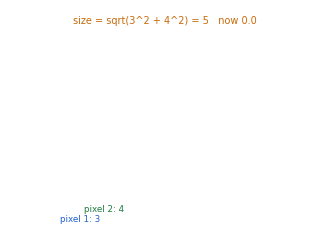
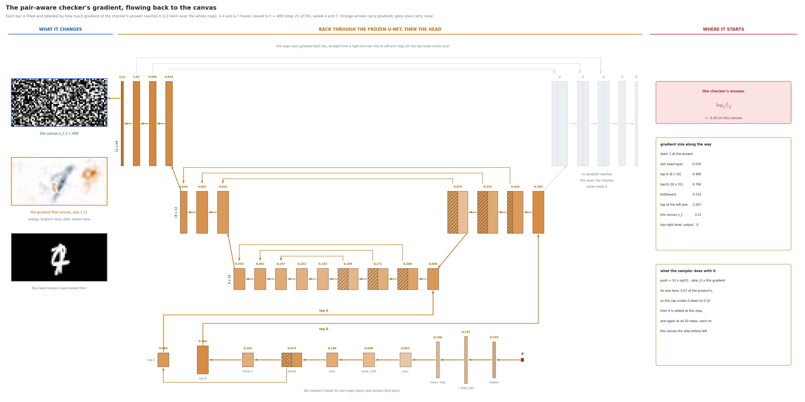
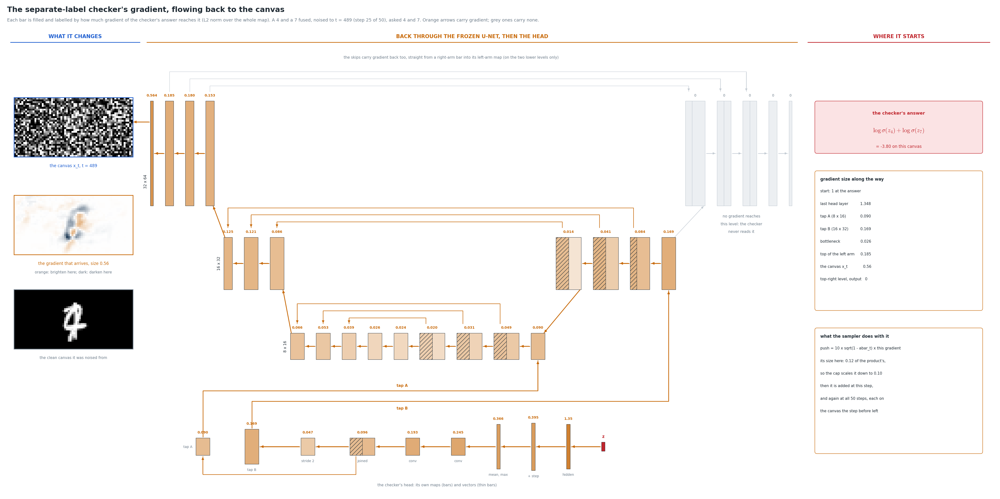
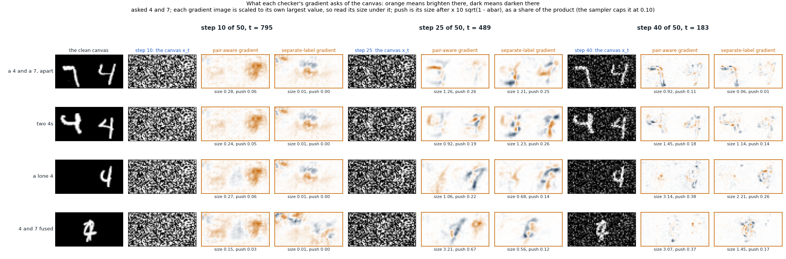

# 3. The gradient: how a checker's answer flows back to the canvas

**The question.** A push is the gradient of a checker's answer with respect to the canvas. Which maps does it pass through on the way, how big is it at each, and what does it ask the canvas to do?

Measured by `gradient-flow/make_grad_numbers.py` in [the step 7b results](../../results/how-good-must-the-checker-be-on-mnist/README.md) on the real checkpoints (`gradient-flow/grad_numbers.json`). The canvases are the four pasted MNIST test canvases used on the networks page, noised with one fixed noise, not states from a sampler run. A bar's size is the L2 norm of the gradient over every entry of that map.

## Words on this page, taken apart

**Gradient, and its size**

🔤 **The name:** a *gradient* is the slope, in every direction at once: for each pixel, how much the checker's answer rises if that pixel brightens a little. Its *size* is the L2 norm: square every entry, add, take the square root.

🧸 **Toy:** a canvas of two pixels whose gradient is [3, 4]: the first pixel's brightening raises the answer 3 per unit, the second 4. Size = √(9 + 16) = 5. 🔨 **Build:** `toys/triad_toys.py`, toy I, gives 5. 🎞️ **Moving picture:** [toy-i-the-size-of-a-gradient.gif](toys/toy-i-the-size-of-a-gradient.gif).

💥 **Broken run (without):** the push needs this arrow. A checker that only gave an answer, with the frozen network cut off from the canvas, would have size 0 at the canvas; the toy for it is on [the networks page](2-the-networks.md#words-on-this-page-taken-apart) (toy H, slope 6 with the path and 0 without).

**Going back through a chain**

🔤 **The name:** *back-propagation* is the chain rule read backwards: the slope of the whole chain is the product of each link's slope. In the toy, 3 × 2 = 6. In the figure each bar is one link, and its colour is the slope that reaches it.

🎞️ **Moving picture:** the toy's slope through the frozen layer, 3 × 2 = 6, is [toy-h-through-a-frozen-layer.gif](toys/toy-h-through-a-frozen-layer.gif) on [the networks page](2-the-networks.md#words-on-this-page-taken-apart).

## The pair-aware checker, on a fused 4 and 7 at t = 489 (step 25 of 50)

The gradient starts at the checker's answer (log d/(1−d) = −3.49 on this canvas), runs back through its head (0.259 at the last head layer), and enters the U-Net at tap A (0.480) and tap B (0.784). From there it runs down to the bottleneck (0.152) and up the left arm to the canvas (3.21). The skips on the two lower levels carry part of it straight across. The U-Net's top-right level and output layer get exactly 0, since the checker never reads them.

## The separate-label checker, same canvas

The same path with smaller numbers: 1.348 at its last head layer, 0.090 and 0.169 at the two taps, 0.56 at the canvas, about six times weaker than the pair-aware gradient there. Its sampler push is 0.12 of the product's size on this canvas against 0.67 for the pair-aware push, so the cap of 0.1 of the product's size scales the pair-aware push down and leaves the separate-label push almost whole.

## What the gradient asks of the canvas

Orange means brighten there, dark means darken. Each gradient image is scaled to its own largest value, so read its size under the image. The push figure under each is its size after multiplying by 10·√(1−ᾱ_t), as a share of the product's size.

- **Step 10 (t = 795):** the pair-aware gradient asks for a bright blob on the right half whatever the canvas (size 0.15 to 0.28); the separate-label gradient is about 0.01, so that push does almost nothing this early.
- **Step 25 (t = 489):** both gradients trace strokes. On the fused canvas they darken the fused stroke and brighten a spot beside it.
- **Step 40 (t = 183):** on a lone 4 the pair-aware gradient (size 3.14) asks for something in the empty left half.

Why the push has the form it has is in [the derivation](4-the-derivation.md); the networks themselves are on [the networks page](2-the-networks.md).
