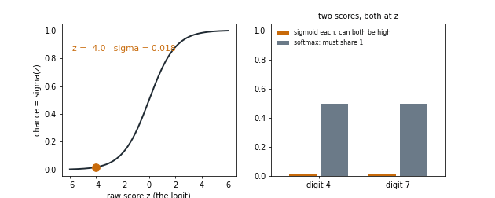
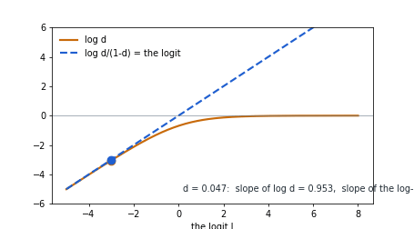
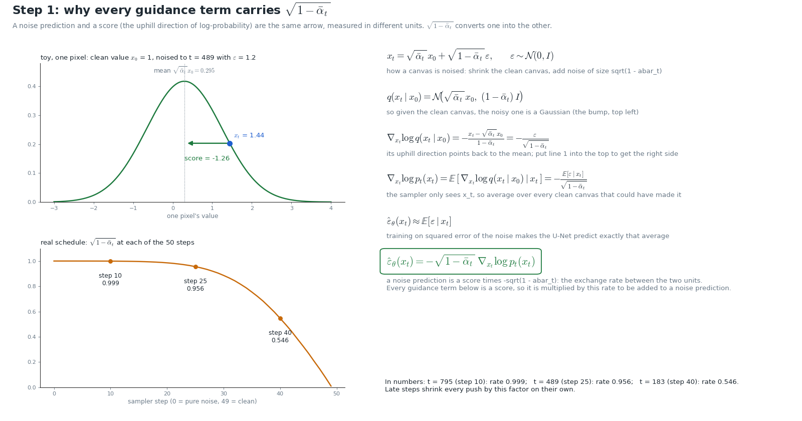
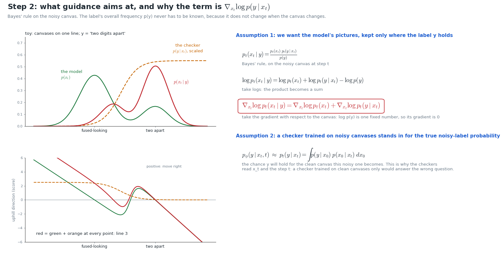
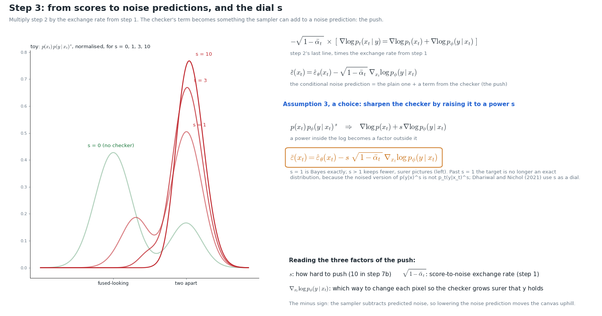
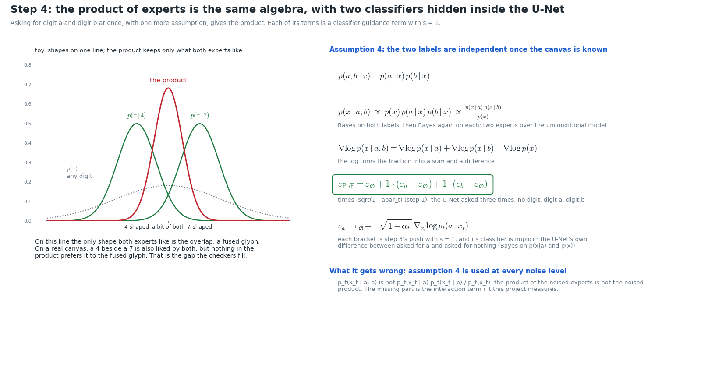
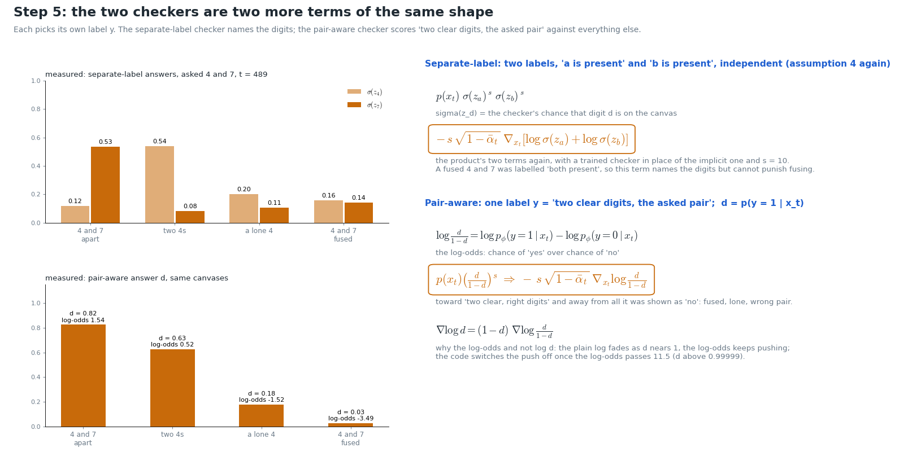
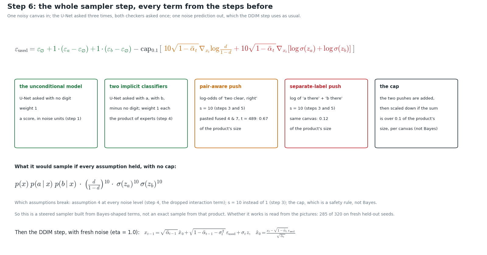
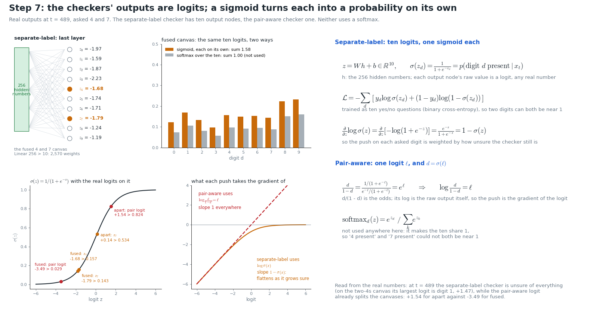

# Classifier guidance on the product of experts, from the assumptions up

The step 7b sampler adds two checker pushes to a product of experts. Every term in it comes from
Bayes' rule and one fact about what a noise-predicting network learns. This page walks through the
seven figures in order. Each section shows the figure, says what it shows, writes the maths out line
by line with each symbol named, and gives the numbers from step 7b's own networks.

Read it top to bottom: each step uses the one before. The figures are drawn by
`make_derivation_figures.py` (steps 1 to 6) and `make_logit_figure.py` (step 7), which sit in
`../classifier-guidance-on-poe/derivation/` beside `logit_numbers.json`. The measured
numbers come from the step 7b results card, on four pasted MNIST test canvases noised to t = 489,
asked 4 and 7: [the step 7b results](../../results/can-two-digits-compose-on-mnist/01-one-model-that-saw-a-few-pairs/README.md).

## Words this uses

**canvas.** The 1 x 32 x 64 image the U-Net draws two digits on. $x_0$ is a clean canvas, $x_t$ the
same canvas with noise added at noise level $t$.

**score.** The direction, at a canvas, in which log-probability rises fastest:
$\nabla_{x_t}\log p(x_t)$. It has one number per pixel, like the canvas itself.

**checker.** A small network that reads the frozen U-Net's inner maps for a noisy canvas and answers a
question about it. The separate-label checker answers "is digit $d$ there?" for each of ten digits;
the pair-aware checker answers "are these two clear digits, the asked pair?".

**push.** The term a checker adds to the U-Net's noise prediction at each sampler step.

---

## Words in the derivation, taken apart

Most of this page's names are taught, with a toy, a broken run and a build, in [journey 13](../../../../../../goal-setting/learning/deep-learning/diffusion-models/13-classifier-guidance-by-hand/textbook/00-index.md): the score as a noise prediction ([1.1](../../../../../../goal-setting/learning/deep-learning/diffusion-models/13-classifier-guidance-by-hand/textbook/01-the-guided-noise-prediction.md#11-the-line-toy-and-the-score-as-a-noise-prediction)), Bayes on the noised posterior ([1.2](../../../../../../goal-setting/learning/deep-learning/diffusion-models/13-classifier-guidance-by-hand/textbook/01-the-guided-noise-prediction.md#12-bayes-on-the-noised-posterior)), the guided prediction ([1.3](../../../../../../goal-setting/learning/deep-learning/diffusion-models/13-classifier-guidance-by-hand/textbook/01-the-guided-noise-prediction.md#13-from-score-to-noise-the-guided-prediction)), the strength s ([1.4](../../../../../../goal-setting/learning/deep-learning/diffusion-models/13-classifier-guidance-by-hand/textbook/01-the-guided-noise-prediction.md#14-the-strength-s-on-the-unconditional-base-and-the-two-slips)), the product as two classifiers ([chapter 2](../../../../../../goal-setting/learning/deep-learning/diffusion-models/13-classifier-guidance-by-hand/textbook/02-the-product-as-two-classifiers.md)) and the dropped term ([chapter 4](../../../../../../goal-setting/learning/deep-learning/diffusion-models/13-classifier-guidance-by-hand/textbook/04-the-dropped-term.md)). Three words below are not there; their toys are in [the toys](toys/triad_toys.py).

**Logit, sigmoid, and why not softmax**

🔤 **The name:** a *logit* is a raw score that can be any real number; *sigmoid* is the S-shaped curve σ(z) = 1/(1 + e^(−z)) that turns one score into a chance between 0 and 1; *softmax* divides each of several scores' exponentials by their total, so the answers share one chance. *Sigmoid* means S-shaped.

🧸 **Toy:** a taster scores the soup's saltiness z. z = −2 gives 0.119, z = 0 gives 0.5, z = 2 gives 0.881, z = 3 gives 0.953. Add 1 to the score and the chance rises less each time (0.881 to 0.953). 🔨 **Build:** `toys/triad_toys.py`, toy A.

💥 **Broken run (misuse):** two tasters each score z = 3 that "their dish is on the table" and both dishes are. Sigmoid each: 0.953 and 0.953 (sum 1.905), correct. Softmax over the two: 0.5 and 0.5, which says "one of them", wrong for a canvas with two digits. Measured: on the fused 4 and 7 canvas the ten sigmoid answers sum to 1.58, where a softmax's sum would be 1.

🎞️ **Moving picture:** [toy-a-sigmoid-and-softmax.gif](toys/toy-a-sigmoid-and-softmax.gif): a score slides along the S while the two bars show sigmoid answers rising together and softmax answers stuck sharing one.

**Log-odds, and why the push uses it**

🔤 **The name:** *odds* are the chance of yes over the chance of no, d ÷ (1 − d); *log-odds* is the log of that. With d = σ(l) the log-odds equals l, the logit itself.

🧸 **Toy:** a bulb is lit with chance d. At d = 0.5 the log-odds is 0, d = 0.9 gives 2.197, d = 0.99 gives 4.595. Nudge the logit up a little: log d grows by (1 − d) per unit, 0.5, then 0.1, then 0.01; the log-odds grows by 1 every time. 🔨 **Build:** toy B checks each slope by a finite nudge.

💥 **Broken run (without):** push on log d and the push fades to a hundredth by the time the checker is 99% sure, so a nearly-right canvas is barely nudged. Push on the log-odds and it stays at full strength. The code switches it off past a logit of 11.5.

🎞️ **Moving picture:** [toy-b-why-the-log-odds-keeps-pushing.gif](toys/toy-b-why-the-log-odds-keeps-pushing.gif): the logit slides, the two slopes are read off on the curve.

**The size of the push, "capped"**

The cap has its toy, broken run and build on [the sampler step page](1-the-sampler-step.md#words-on-this-page-taken-apart).

## Step 1: why every guidance term carries $\sqrt{1-\bar\alpha_t}$

**What the figure shows.** Top left, one pixel noised: a bump centred on the shrunk clean value, a
blue dot where the noisy value landed, and a green arrow pointing from the dot back toward the
centre. That arrow is the score. Bottom left, the real value of $\sqrt{1-\bar\alpha_t}$ at each of
the 50 sampler steps. Right, the six lines below.

**The noising.** A clean canvas is noised in one shot:

$$x_t=\sqrt{\bar\alpha_t}\,x_0+\sqrt{1-\bar\alpha_t}\,\varepsilon,\qquad \varepsilon\sim\mathcal N(0,I)$$

$\bar\alpha_t$ is the share of the clean signal's variance kept at level $t$: near 1 at the start
of noising, near 0 at the end. $\sqrt{\bar\alpha_t}$ shrinks the clean canvas and
$\sqrt{1-\bar\alpha_t}$ sizes the noise. $\varepsilon$ is fresh standard noise, one number per pixel.

**Given the clean canvas, the noisy one is a Gaussian.** Read line 1 with $x_0$ fixed:

$$q(x_t\mid x_0)=\mathcal N\!\left(\sqrt{\bar\alpha_t}\,x_0,\ (1-\bar\alpha_t)\,I\right)$$

**Its score points back to the centre.** The log of a Gaussian is a negative squared distance from its
mean divided by twice its variance, so its gradient is

$$\nabla_{x_t}\log q(x_t\mid x_0)=-\frac{x_t-\sqrt{\bar\alpha_t}\,x_0}{1-\bar\alpha_t}=-\frac{\varepsilon}{\sqrt{1-\bar\alpha_t}}$$

The second equality puts line 1 in: $x_t-\sqrt{\bar\alpha_t}\,x_0=\sqrt{1-\bar\alpha_t}\,\varepsilon$,
and one factor of $\sqrt{1-\bar\alpha_t}$ cancels.

**The sampler does not know $x_0$.** It only sees $x_t$, so the score it needs is the average of the
line above over every clean canvas that could have produced this noisy one:

$$\nabla_{x_t}\log p_t(x_t)=\mathbb E\left[\nabla_{x_t}\log q(x_t\mid x_0)\,\middle|\,x_t\right]=-\frac{\mathbb E[\varepsilon\mid x_t]}{\sqrt{1-\bar\alpha_t}}$$

**What the U-Net learns.** It is trained to minimise the squared error between its prediction
$\hat\varepsilon_\theta(x_t)$ and the true $\varepsilon$. The prediction with the smallest squared
error is the average, so $\hat\varepsilon_\theta(x_t)\approx\mathbb E[\varepsilon\mid x_t]$. Putting
the two together:

$$\boxed{\hat\varepsilon_\theta(x_t)=-\sqrt{1-\bar\alpha_t}\;\nabla_{x_t}\log p_t(x_t)}$$

A noise prediction is a score multiplied by $-\sqrt{1-\bar\alpha_t}$. That factor converts between
the two units. Every guidance term below starts as a score, so it is multiplied by
$-\sqrt{1-\bar\alpha_t}$ before it is added to a noise prediction. That is the whole reason the
factor appears.

**In numbers.** The toy pixel has $x_0=1$, noised to $t=489$ where $\bar\alpha_t=0.087$, with
$\varepsilon=1.2$. The centre is $\sqrt{0.087}=0.295$, the spread $\sqrt{0.913}=0.955$, the noisy
value $0.295+0.955\times1.2=1.44$, and the score $-1.2/0.955=-1.26$. On the real schedule the factor
is 0.999 at step 10 (t = 795), 0.956 at step 25 (t = 489) and 0.546 at step 40 (t = 183), so late in
sampling every push is shrunk by this factor alone.

---

## Step 2: what guidance aims at, and why the term is $\nabla_{x_t}\log p(y\mid x_t)$

**What the figure shows.** A toy with canvases on one line, fused-looking on the left and two digits
apart on the right. Green is the model: most of its mass sits on fused-looking canvases. Dashed orange
is a checker for $y$ = "two digits apart", rising to the right. Red is their product, which moves the
mass to the right. Below, the three scores: at every point the red curve is the green plus the orange.

**Assumption 1.** We want the model's pictures, kept only where the label $y$ holds: samples from
$p(x\mid y)$.

**Bayes' rule on the noisy canvas.**

$$p_t(x_t\mid y)=\frac{p_t(x_t)\,p_t(y\mid x_t)}{p(y)}$$

$p_t(x_t)$ is how likely the model finds this noisy canvas; $p_t(y\mid x_t)$ is the chance $y$ holds
given it; $p(y)$ is how often $y$ holds overall.

**Take logs, then the gradient with respect to the canvas.**

$$\log p_t(x_t\mid y)=\log p_t(x_t)+\log p_t(y\mid x_t)-\log p(y)$$

$$\boxed{\nabla_{x_t}\log p_t(x_t\mid y)=\nabla_{x_t}\log p_t(x_t)+\nabla_{x_t}\log p_t(y\mid x_t)}$$

$\log p(y)$ is one fixed number that does not change when the canvas changes, so its gradient is zero.
That is why guidance never needs to know how common $y$ is. The score of what we want is the model's
score plus the checker's score: the bottom panel of the figure, point by point.

**Assumption 2.** The checker $p_\phi$ stands in for the true chance on a noisy canvas:

$$p_\phi(y\mid x_t,t)\;\approx\;p_t(y\mid x_t)=\int p(y\mid x_0)\,p(x_0\mid x_t)\,dx_0$$

The right side is the chance that $y$ will hold for the clean canvas this noisy one turns into,
averaged over the clean canvases it could turn into. A checker trained only on clean canvases would
answer a different question. This is why both step 7b checkers read $x_t$ and the step $t$, and were
trained on canvases at every noise level.

---

## Step 3: from scores to noise predictions, and the dial $s$

**What the figure shows.** The toy from step 2 with the checker raised to a power $s$: green is
$s=0$ (no checker), then $s=1$, 3 and 10 in deepening red. As $s$ grows the mass leaves the fused
side and the bump on the right narrows.

**Multiply step 2 by $-\sqrt{1-\bar\alpha_t}$.** Step 1 says the model's score times that factor is
the U-Net's noise prediction, so

$$\tilde\varepsilon(x_t)=\hat\varepsilon_\theta(x_t)-\sqrt{1-\bar\alpha_t}\;\nabla_{x_t}\log p_\phi(y\mid x_t)$$

The conditional noise prediction is the plain one plus a term from the checker. That term is the push.

**Assumption 3, a choice rather than a fact.** Raise the checker to a power $s$, aiming at
$p(x_t)\,p_\phi(y\mid x_t)^{s}$. A power inside a log comes out as a factor:

$$\nabla\log\left[p(x_t)\,p_\phi(y\mid x_t)^{s}\right]=\nabla\log p(x_t)+s\,\nabla\log p_\phi(y\mid x_t)$$

$$\boxed{\tilde\varepsilon(x_t)=\hat\varepsilon_\theta(x_t)-s\,\sqrt{1-\bar\alpha_t}\;\nabla_{x_t}\log p_\phi(y\mid x_t)}$$

**Each factor of the push.**

| Factor | What it is | In step 7b |
|---|---|---|
| $s$ | how hard to push | 10 for each checker |
| $\sqrt{1-\bar\alpha_t}$ | the score-to-noise conversion from step 1 | 0.999 at step 10, 0.956 at step 25, 0.546 at step 40 |
| $\nabla_{x_t}\log p_\phi(y\mid x_t)$ | which way to change each pixel so the checker grows surer that $y$ holds | measured on the gradient-flow figures |
| the minus sign | the sampler subtracts predicted noise, so lowering the prediction moves the canvas uphill | |

At $s=1$ this is Bayes' rule exactly. Above 1 the sampler keeps fewer, surer pictures, and the target
is no longer an exact distribution: noising $p(y\mid x_0)^s$ does not give $p_t(y\mid x_t)^s$.
Dhariwal and Nichol (2021) use $s$ the same way, as a dial.

---

## Step 4: the product of experts is the same algebra

**What the figure shows.** A toy with shapes on one line: a green bump for 4-shaped, a green bump for
7-shaped, a broad dotted grey curve for any digit, and in red their product, which peaks at the
overlap: a shape that is a bit of both.

**Assumption 4.** Once the canvas is known, "it shows a 4" and "it shows a 7" are independent:

$$p(a,b\mid x)=p(a\mid x)\,p(b\mid x)$$

**Bayes on both labels, then on each.** With $p(a\mid x)=p(x\mid a)\,p(a)/p(x)$, and the same for $b$:

$$p(x\mid a,b)\;\propto\;p(x)\,p(a\mid x)\,p(b\mid x)\;\propto\;\frac{p(x\mid a)\,p(x\mid b)}{p(x)}$$

The two experts multiplied, divided by the model with no label.

**Take the score, then convert with step 1.**

$$\nabla\log p(x\mid a,b)=\nabla\log p(x\mid a)+\nabla\log p(x\mid b)-\nabla\log p(x)$$

$$\boxed{\varepsilon_{\mathrm{PoE}}=\varepsilon_\varnothing+1\cdot(\varepsilon_a-\varepsilon_\varnothing)+1\cdot(\varepsilon_b-\varepsilon_\varnothing)}$$

$\varepsilon_\varnothing$, $\varepsilon_a$ and $\varepsilon_b$ are the U-Net asked with no digit, with
digit $a$ and with digit $b$: three passes per sampler step.

**Each bracket is a step 3 push with $s=1$.** By Bayes,
$\nabla\log p(a\mid x)=\nabla\log p(x\mid a)-\nabla\log p(x)$, so

$$\varepsilon_a-\varepsilon_\varnothing=-\sqrt{1-\bar\alpha_t}\;\nabla_{x_t}\log p_t(a\mid x_t)$$

The classifier in this term is never trained. It is the U-Net's own difference between being asked
for $a$ and being asked for nothing, which is why it is called an implicit classifier.

**What the product gets wrong.** Line 2 is used at every noise level, where it does not hold:

$$p_t(x_t\mid a,b)\;\neq\;\frac{p_t(x_t\mid a)\,p_t(x_t\mid b)}{p_t(x_t)}$$

Noising the two experts and then multiplying them is not the same as multiplying them and then
noising. The missing part is the interaction term $r_t$ this project measures. On the toy line, the
only shape both experts like is the overlap, a fused glyph. On a real canvas, a 4 beside a 7 is also
liked by both experts, but nothing in the product prefers it to the fused glyph. The checkers are
there to supply that preference.

---

## Step 5: the two checkers are two more terms of the same shape

**What the figure shows.** Left, both checkers' real answers on four pasted test canvases noised to
t = 489, asked 4 and 7: the separate-label checker's chance that a 4 is there and that a 7 is there,
and the pair-aware checker's $d$. Right, each checker's term.

**The separate-label checker.** Its labels are "digit $a$ is present" and "digit $b$ is present",
with $\sigma(z_d)$ the checker's chance that digit $d$ is on the canvas (step 7 explains $z_d$ and
$\sigma$). Using assumption 4 again for the two labels and step 3's power $s$:

$$p(x_t)\,\sigma(z_a)^{s}\,\sigma(z_b)^{s}\quad\Rightarrow\quad-\,s\,\sqrt{1-\bar\alpha_t}\;\nabla_{x_t}\left[\log\sigma(z_a)+\log\sigma(z_b)\right]$$

This has the same shape as the product's two brackets, with a trained checker in place of the
implicit one and $s=10$. A fused 4 and 7 was labelled "both present" in its training, so this term
names the digits but cannot punish fusing. On the fused canvas it gives 0.16 for a 4 and 0.14 for a
7, close to its 0.12 and 0.53 on the canvas with the digits apart.

**The pair-aware checker.** One label, $y$ = "two clear digits, the asked pair", and
$d=p_\phi(y=1\mid x_t)$. Its push uses the log-odds:

$$\log\frac{d}{1-d}=\log p_\phi(y{=}1\mid x_t)-\log p_\phi(y{=}0\mid x_t)$$

$$p(x_t)\left(\frac{d}{1-d}\right)^{s}\quad\Rightarrow\quad-\,s\,\sqrt{1-\bar\alpha_t}\;\nabla_{x_t}\log\frac{d}{1-d}$$

The first line splits into "toward yes" and "away from no", and "no" covers everything it was shown
as not: fused pairs, lone digits, wrong pairs. On the four canvases $d$ is 0.82 with the digits apart,
0.63 for two 4s, 0.18 for a lone 4 and 0.03 for the fused pair.

**Why the log-odds rather than $\log d$.**

$$\nabla\log d=(1-d)\,\nabla\log\frac{d}{1-d}$$

The plain log's gradient fades as $d$ nears 1; the log-odds keeps pushing at full strength. The code
switches this push off once the log-odds passes 11.5, where $d$ is above 0.99999.

---

## Step 6: the whole sampler step

**What the figure shows.** The full equation with each term coloured, five boxes naming each term,
its weight and the step it came from, the distribution it would target if every assumption held, and
the update the sampler then takes.

**The equation.**

$$\varepsilon_{\mathrm{used}}=\varepsilon_\varnothing+1\cdot(\varepsilon_a-\varepsilon_\varnothing)+1\cdot(\varepsilon_b-\varepsilon_\varnothing)-\mathrm{cap}_{0.1}\!\left[\,10\sqrt{1-\bar\alpha_t}\,\nabla_{x_t}\log\frac{d}{1-d}+10\sqrt{1-\bar\alpha_t}\,\nabla_{x_t}\left(\log\sigma(z_a)+\log\sigma(z_b)\right)\right]$$

| Term | Weight | Where it came from | Size on the pasted fused 4 and 7 at t = 489 |
|---|---|---|---|
| $\varepsilon_\varnothing$, the U-Net with no digit | 1 | step 1 | |
| $(\varepsilon_a-\varepsilon_\varnothing)$, $(\varepsilon_b-\varepsilon_\varnothing)$ | 1 each | step 4 | |
| the pair-aware push | $s=10$ | steps 3 and 5 | 0.67 of the product's size before the cap |
| the separate-label push | $s=10$ | steps 3 and 5 | 0.12 of the product's size before the cap |
| the cap | | a safety rule, not Bayes | the two pushes are added, then scaled down to 0.1 of the product's size if the sum is larger, per canvas |

**What it would sample if every assumption held and there were no cap.**

$$p(x)\;p(a\mid x)\;p(b\mid x)\;\left(\frac{d}{1-d}\right)^{10}\sigma(z_a)^{10}\,\sigma(z_b)^{10}$$

Three things keep it from that: assumption 4 used at every noise level (step 4), $s=10$ rather than 1
(step 3), and the cap. So the sampler is steered by terms derived from Bayes' rule without sampling
exactly from this product, and whether it works has to be read from the pictures: 285 of 320 on fresh
held-out seeds.

**The update.** The sampler then takes a DDIM step with fresh noise (eta = 1.0):

$$\hat x_0=\frac{x_t-\sqrt{1-\bar\alpha_t}\,\varepsilon_{\mathrm{used}}}{\sqrt{\bar\alpha_t}},\qquad x_{t-1}=\sqrt{\bar\alpha_{t-1}}\,\hat x_0+\sqrt{1-\bar\alpha_{t-1}-\sigma_t^2}\;\varepsilon_{\mathrm{used}}+\sigma_t\,z$$

$\hat x_0$ is the clean canvas the current prediction implies; $z$ is fresh standard noise and
$\sigma_t$ its size, which eta sets.

---

## Step 7: the checkers' outputs are logits

**What the figure shows.** Top left, the separate-label checker's last layer: 256 hidden numbers
into ten output nodes, each with its real value on the fused 4 and 7 canvas. Top middle, those ten
values through a sigmoid each (orange, summing to 1.58) beside what a softmax would give (grey,
summing to 1). Bottom left, the sigmoid curve with real outputs marked. Bottom middle, the two
functions the pushes take the gradient of.

**A logit is the raw number an output node gives.** The last layer is a linear map from the 256
hidden numbers $h$:

$$z=W\,h+b\in\mathbb R^{10}$$

Each $z_d$ can be any real number. A sigmoid turns each one into a probability on its own:

$$\sigma(z_d)=\frac{1}{1+e^{-z_d}}=p(\text{digit } d \text{ present}\mid x_t)$$

There is no softmax. The checker was trained as ten separate yes/no questions, a binary
cross-entropy per digit:

$$\mathcal L=-\sum_{d}\left[\,y_d\log\sigma(z_d)+(1-y_d)\log\left(1-\sigma(z_d)\right)\right]$$

where $y_d$ is 1 if digit $d$ is on the training canvas. Two digits can both be near 1, which is what a
canvas holding a 4 and a 7 needs. A softmax, $e^{z_d}/\sum_k e^{z_k}$, would make the ten share a
total of 1, so "4 present" and "7 present" could not both be near 1.

**What the push takes the gradient of.** Since $\log\sigma(z)=-\log(1+e^{-z})$,

$$\frac{\partial}{\partial z}\log\sigma(z)=\frac{e^{-z}}{1+e^{-z}}=1-\sigma(z)$$

so the separate-label push is

$$-\,s\,\sqrt{1-\bar\alpha_t}\left[\left(1-\sigma(z_a)\right)\nabla z_a+\left(1-\sigma(z_b)\right)\nabla z_b\right]$$

Each asked digit is pushed in proportion to how unsure the checker still is that it is there, and the
term fades once the checker is sure.

| Canvas, asked 4 and 7 | $z_4$ | $\sigma(z_4)$ | weight on the 4 push | $z_7$ | $\sigma(z_7)$ | weight on the 7 push |
|---|---|---|---|---|---|---|
| a 4 and a 7, apart | −2.02 | 0.12 | 0.88 | +0.14 | 0.53 | 0.47 |
| 4 and 7 fused | −1.68 | 0.16 | 0.84 | −1.79 | 0.14 | 0.86 |

**The pair-aware checker has one logit $\ell$, and $d=\sigma(\ell)$.** Its odds simplify to the
exponential of the logit:

$$\frac{d}{1-d}=\frac{1/(1+e^{-\ell})}{e^{-\ell}/(1+e^{-\ell})}=e^{\ell}\qquad\Rightarrow\qquad\log\frac{d}{1-d}=\ell$$

So $d/(1-d)$ is the pair-aware checker's odds, and the log-odds in its push is its raw output.
The push is the gradient of the logit itself, with slope 1 everywhere: the straight dashed line in the
bottom-middle panel, against the separate-label curve that flattens toward 0.

**What the real numbers say.** At t = 489 the separate-label checker is unsure of everything: on the
canvas with two 4s its largest logit is for digit 1 (+1.47), and on the fused canvas all ten logits
lie between −2.23 and −1.19. The pair-aware logit already separates the canvases: +1.54 with the
digits apart against −3.49 for the fused pair. Both checkers' raw outputs on all four canvases are in
`logit_numbers.json`, written by `make_logit_numbers.py`.
