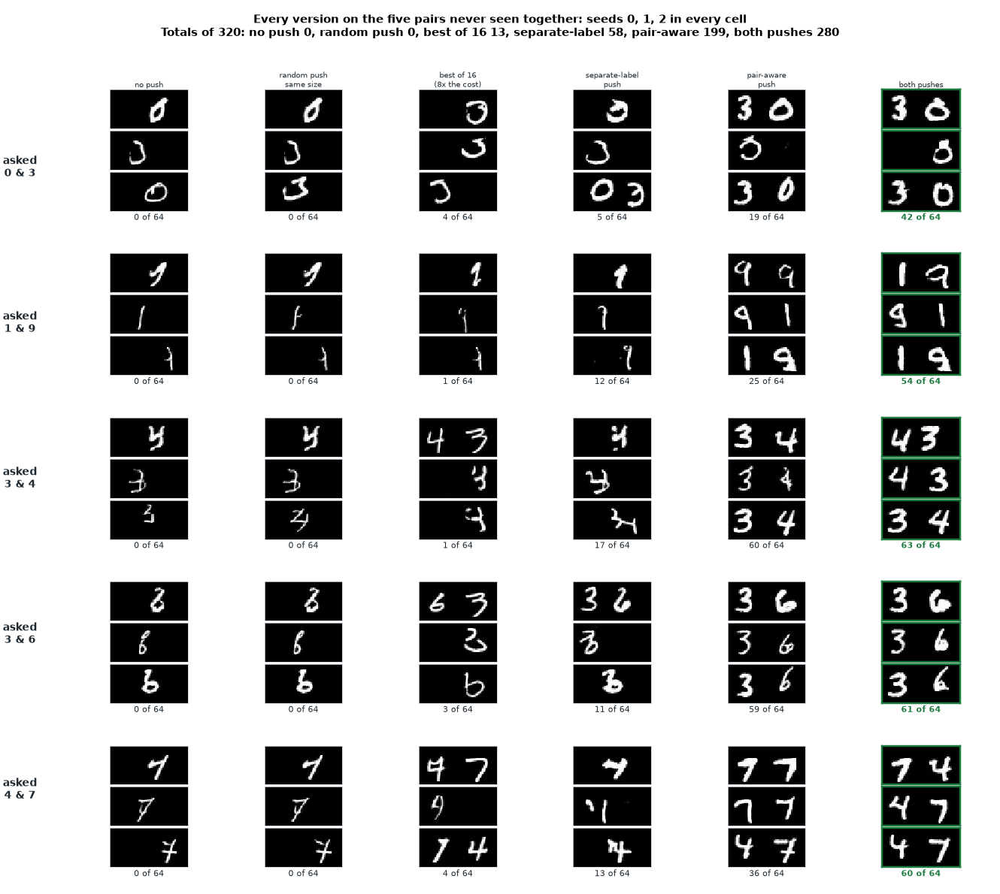
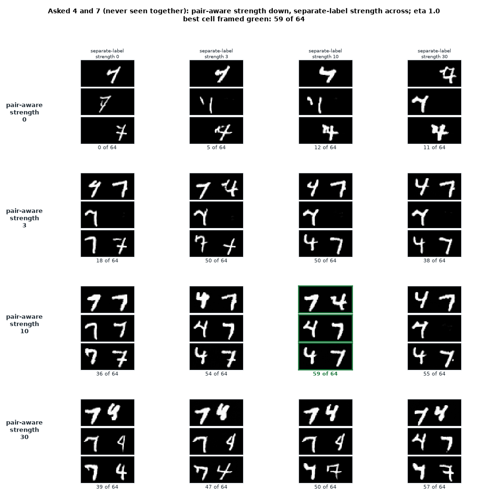
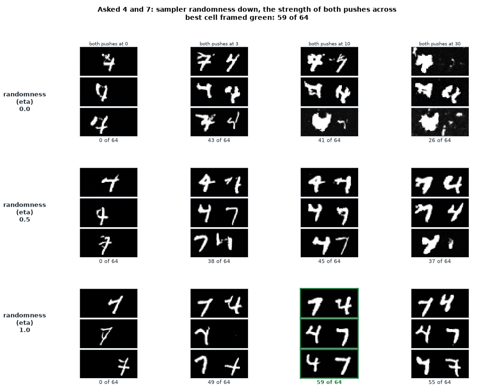

# 5. Qualitative grids: what the pushes do to real canvases

**The question.** What does each version of the sampler draw, on each pair, and how do the strengths and the randomness change it?

Real canvases in every cell, the same seeds 0, 1 and 2 top to bottom so one starting noise can be followed across a row, with the third judge's count of two clear, right digits out of 64 under each cell. The judge counts about 5% below a careful eye. Drawn by `grids/make_grids.py` in [the step 7b results](../../results/how-good-must-the-checker-be-on-mnist/README.md) from jobs 90111, 90154, 90155 and 90156.

## Every version against every held-out pair

Totals of 320: no push 0, random push 0, best of 16 (eight times the cost) 13, separate-label 58, pair-aware 199, both pushes 280. No push, random push and best of 16 draw one digit or a fused glyph; the pair-aware push draws two digits, often with the wrong second one; both pushes draw the right pair.

## The two strengths against each other, on 4 and 7

The pair-aware push alone makes two digits but names them badly: two 7s at strength 10 (36 of 64 two clear digits). Adding the separate-label push turns one of the 7s into a 4. The best cell is both at strength 10: 59 of 64.

## Randomness against strength, on 4 and 7

Without randomness (eta 0) strong pushes wreck the strokes into white blobs: 41 and 26 of 64 at strengths 10 and 30. With eta 1.0 they stay clean: 59 and 55. The sampler uses eta 1.0 for this reason. What the strengths and the randomness mean in the equation is in [the derivation](4-the-derivation.md).
